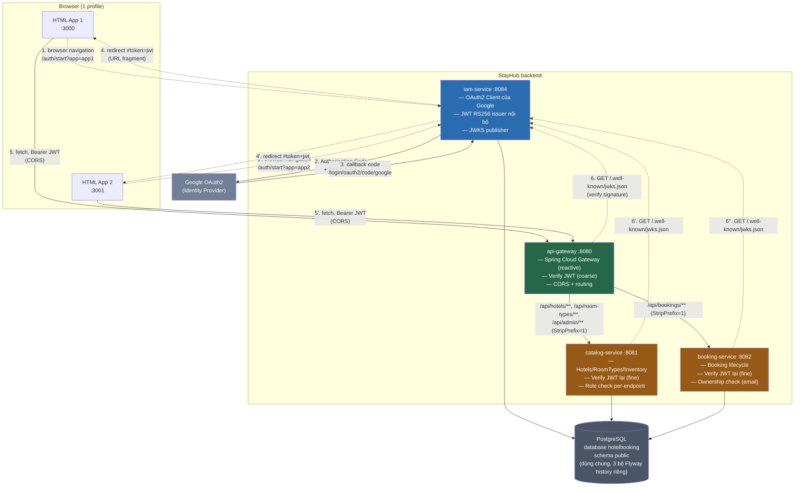
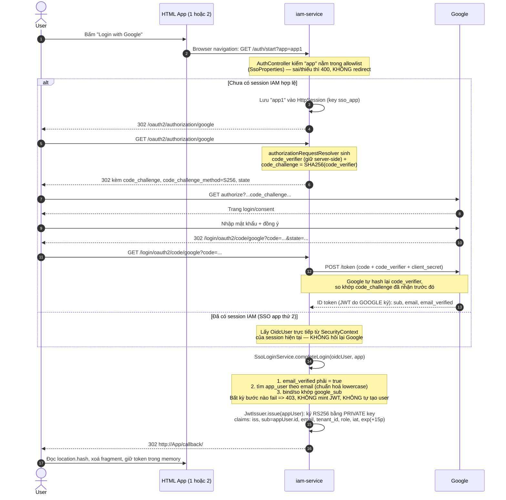
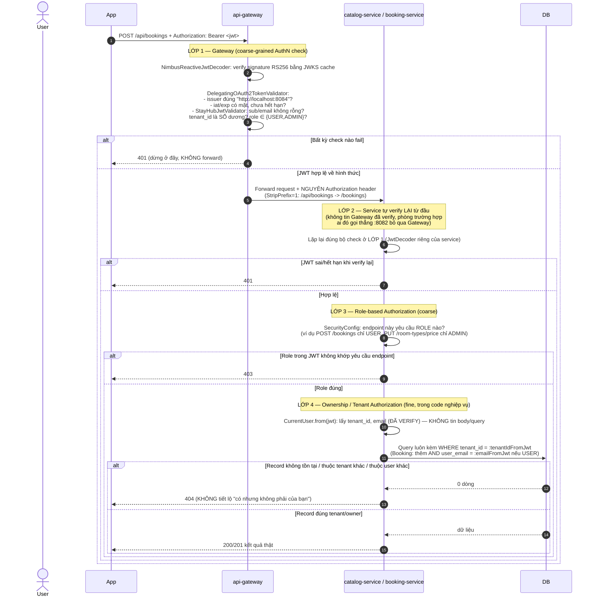
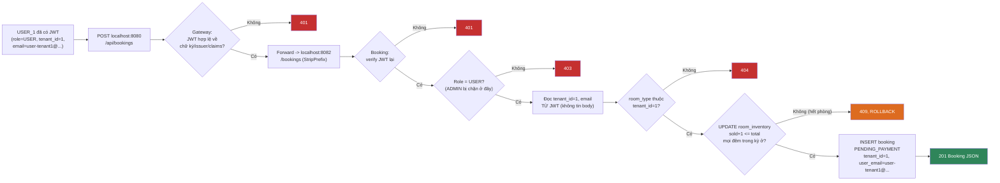

# Kiến trúc tổng thể StayHub — Service kết nối & Authentication/Authorization chi tiết

> Tài liệu bổ sung cho `docs/sequence-iam.md` (vốn tập trung vào riêng OAuth2/PKCE/JWT). File này
> vẽ **toàn cảnh hệ thống**: service nào gọi service nào, qua cổng nào, và tách rõ hai khái niệm
> hay bị nhầm — **Authentication (AuthN — xác thực "bạn là ai")** và **Authorization (AuthZ — xác
> thực "bạn được làm gì")** — áp dụng cụ thể vào phần IAM đã code.

## 1. Bản đồ hệ thống (component diagram)

**Những điều dễ nhầm, nói rõ ở đây:**

- **IAM không nằm sau Gateway.** App 1/App 2 gọi `iam-service` **trực tiếp** ở `:8084` (navigation
  cả trang, không phải `fetch`), vì login phải đi qua redirect của trình duyệt (cookie session,
  redirect sang Google...) — Gateway không route `/auth/**`.
  Catalog/Booking cũng **không gọi `iam-service`** để xin xác thực theo kiểu "hỏi hộ" — mỗi service
  tự tải JWKS về và **tự verify JWT cục bộ** (xem §3). IAM chỉ đóng vai trò *publisher* của public
  key, không tham gia vào từng request nghiệp vụ.
- **Gateway KHÔNG gọi IAM để xác thực từng request.** Việc tải `jwks.json` chỉ xảy ra khi cache
  public key hết hạn/lần đầu (mỗi service tự cache key theo `kid`), không phải mỗi request.
- **Booking không bao giờ gọi HTTP sang Catalog.** Hai service đọc/ghi chung 1 database — Catalog
  sở hữu `room_type`/`room_inventory.total`, Booking sở hữu `booking`/`room_inventory.sold`.
- **3 service (IAM/Catalog/Booking) dùng chung 1 database nhưng 3 bảng Flyway history riêng**
  (`flyway_schema_history_iam/_catalog/_booking`) để tránh đụng số version khi cùng ghi vào 1 DB.

---

## 2. AuthN vs AuthZ — hai câu hỏi khác nhau, hai cơ chế khác nhau

| | **Authentication (AuthN)** | **Authorization (AuthZ)** |
|---|---|---|
| Câu hỏi | "Bạn là ai?" | "Bạn — đã biết là ai — được phép làm gì?" |
| Ai chịu trách nhiệm | **Chỉ IAM** (và Google, đứng sau IAM) | **Gateway + từng service** (Catalog/Booking), mỗi nơi tự quyết |
| Xảy ra khi nào | Một lần ở `/auth/start` → `/login/oauth2/code/google`, kết quả là 1 JWT sống 15 phút | **Mỗi request** nghiệp vụ, tại Gateway (coarse) rồi lại tại service (fine) |
| Input | Mật khẩu/consent Google — IAM **không bao giờ thấy** mật khẩu | JWT đã có sẵn trong header `Authorization: Bearer ...` |
| Output | JWT RS256 chứa `sub`, `email`, `tenant_id`, `role` | Quyết định: cho qua (200...) hay chặn (401/403) |
| Code tương ứng | `AuthController`, `SsoLoginService`, `JwtIssuer`, Google OAuth2 Client của Spring Security | `SecurityConfig` + `StayHubJwtValidator` ở **cả 3 nơi** (Gateway, Catalog, Booking) + check role/ownership trong controller |

Nói ngắn: **AuthN xảy ra 1 lần lúc login, sinh ra "chứng minh nhân dân" (JWT). AuthZ xảy ra lại từ
đầu ở mỗi request, dựa vào thông tin đã ký sẵn trong chứng minh nhân dân đó** — không có "nhớ" gì
giữa các request (stateless), mọi request tự mang đủ bằng chứng.

---

## 3. AuthN chi tiết — IAM xác thực "bạn là ai" như thế nào

**Chốt lại AuthN:** kết quả cuối cùng của toàn bộ chặng này chỉ là **một chuỗi JWT**. Từ giây phút
JWT được phát ra, IAM không còn tham gia gì nữa — Gateway/Catalog/Booking tự verify chữ ký bằng
public key (JWKS) của IAM mà **không cần hỏi lại IAM "token này còn hợp lệ không?"** (không có
session server-side cho JWT, đúng kiểu stateless của JWT).

---

## 4. AuthZ chi tiết — mỗi request được "chặn" mấy lớp

**4 lớp AuthZ, từ thô tới chi tiết:**

| Lớp | Tên | Trả lời câu hỏi | Nơi code |
|---|---|---|---|
| 1 | Gateway JWT check | "Token này có hợp lệ về hình thức không?" | `api-gateway/security/SecurityConfig` + `StayHubJwtValidator` |
| 2 | Service JWT check (lại) | Giống lớp 1, nhưng **độc lập**, phòng bypass Gateway | `catalog-service` / `booking-service` `security/SecurityConfig` |
| 3 | Role-based (RBAC) | "Role này được gọi endpoint này không?" (USER/ADMIN) | `.hasRole(...)` trong từng `SecurityConfig`, khai báo tĩnh theo route |
| 4 | Ownership/Tenant (ABAC) | "Record này có thuộc đúng tenant/đúng chủ sở hữu không?" | Trong service/repository, lọc bằng `tenant_id`/`email` **lấy từ JWT đã verify**, không lấy từ client |

**Vì sao cần cả lớp 1 và lớp 2 (trùng nhau)?** Vì Gateway không phải là "tường lửa duy nhất" theo
chủ đích thiết kế của contract — nếu ai đó gọi thẳng `http://localhost:8081/hotels` (bỏ qua
`:8080`), Catalog vẫn phải tự chặn được, không được dựa vào giả định "request này chắc đã qua
Gateway rồi".

**Vì sao lớp 3 và lớp 4 phải tách riêng?** Role (`USER`/`ADMIN`) là thuộc tính **tĩnh** của người
dùng, kiểm được ngay từ JWT, không cần hỏi DB — nên có thể chặn ở `SecurityConfig` (declarative,
trước khi vào tới logic nghiệp vụ). Nhưng "booking này có phải của tôi không" là thuộc tính
**động** phụ thuộc dữ liệu cụ thể trong DB — phải kiểm trong code nghiệp vụ, sau khi đã load được
record. Hai lớp không thể gộp vì thời điểm kiểm tra khác nhau.

---

## 5. Vì sao JWT là "đủ dùng" cho AuthZ mà không cần hỏi lại IAM

JWT đã tự mang theo **mọi thông tin cần để quyết định quyền truy cập**: `tenant_id`, `role`,
`email`, đã được **ký** nên Gateway/Catalog/Booking tin được nội dung này là thật (không bị client
sửa) miễn là verify đúng chữ ký bằng public key của IAM. Đây là lý do toàn bộ hệ thống **stateless
về phiên đăng nhập business** — không có bảng "session" nào ở Catalog/Booking, không service nào
phải gọi `GET /introspect` sang IAM để hỏi "token này còn sống không" (so với mô hình opaque token
truyền thống). Cái giá phải đánh đổi: **JWT không revoke được giữa đường** — nếu cần vô hiệu hoá
một token đã phát, chỉ có cách đợi hết `exp` (15 phút) hoặc restart IAM để đổi keypair (làm hỏng
toàn bộ JWT cũ, kể cả JWT hợp lệ khác) — đây là giới hạn đã khai báo ở `docs/sequence-iam.md` §8.

---

## 6. Tổng hợp 1 request đi từ đầu đến cuối (ví dụ thật: USER đặt phòng)

Request này đi qua **AuthN đúng 0 lần** (vì JWT đã được mint từ trước, request này không login
lại) và **AuthZ đúng 4 lần** (Gateway JWT, Booking JWT, Role, Tenant-ownership) trước khi chạm vào
logic nghiệp vụ thật (trừ tồn, tạo booking).

---

## 7. Liên kết tài liệu

- Chi tiết OAuth2/PKCE/JWKS/SSO 2 app, giải thích "vì sao" từng quyết định kỹ thuật: `docs/sequence-iam.md`.
- Hợp đồng API đầy đủ (route, status code, JSON schema): `docs/api-contract.md`.
- Mô hình dữ liệu: `docs/erd-v2.md`.
