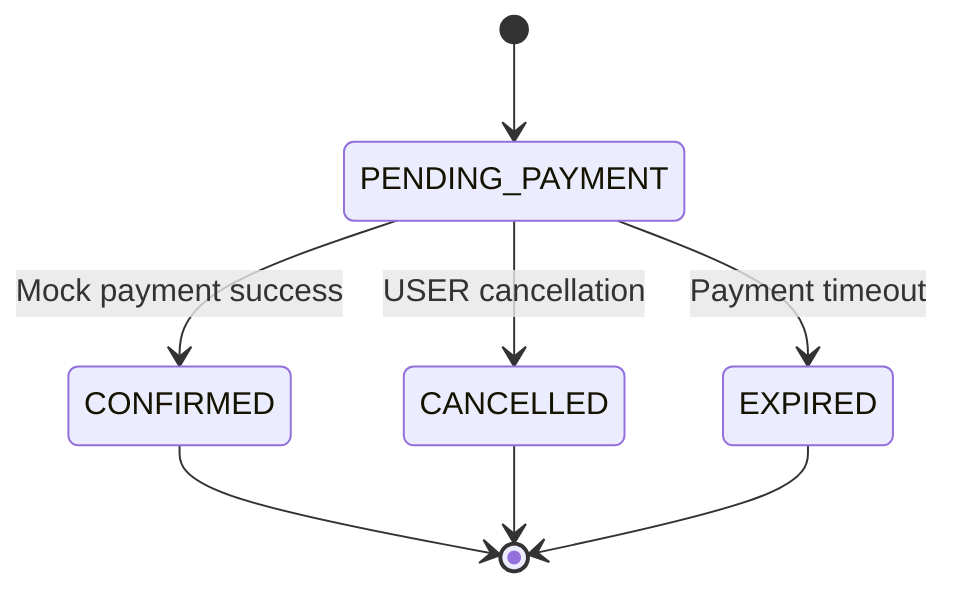
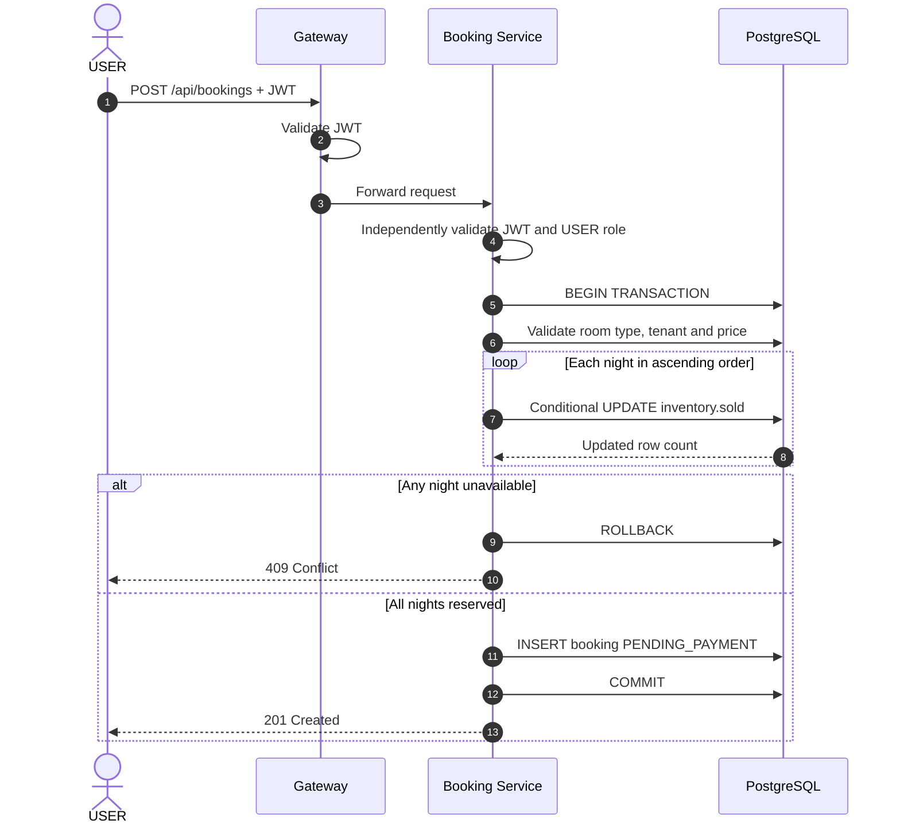
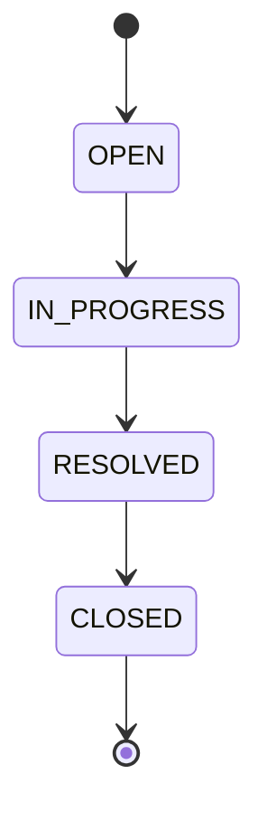

# StayHub — API Contract v5 (3-App Integration)

> **Version:** v5 — Proposed API Contract  
> **Updated:** 2026-11-04  
> **Status:** TARGET INTEGRATION — Pending G2 Sign-off  
> **Architecture:** API Gateway + Spring Boot Microservices + PostgreSQL  
> **Authentication:** Custom IAM + Google OIDC + JWT RS256  
> **Authorization:** RBAC + Tenant Isolation + Resource Ownership  
> **Scope:** Catalog, Booking, Inventory, Mock Payment, Support, IAM  
> **Important:** Endpoint paths, DTOs and behaviors are target contracts unless explicitly verified against source code.

---

## 1. API Design Principles

StayHub sử dụng RESTful APIs thông qua API Gateway.

### 1.1. Core Principles

1. Resource-oriented endpoints.
2. JSON request/response.
3. HTTPS trong môi trường triển khai thực tế.
4. Bearer JWT authentication.
5. Independent JWT validation tại Gateway và business services.
6. Server-side RBAC, tenant isolation và ownership.
7. Server-authoritative pricing và inventory.
8. Atomic booking transactions.
9. Consistent error responses.
10. Explicit API versioning khi có breaking changes.

### 1.2. Service Registry

| Component | Development URL | Responsibility |
|---|---|---|
| API Gateway | `http://localhost:8080` | API entry point |
| Catalog Service | `http://localhost:8081` | Hotels, room types, inventory capacity |
| Booking Service | `http://localhost:8082` | Booking lifecycle, inventory reservation |
| IAM Service | `http://localhost:8084` | Google OIDC, SSO, JWT issuer |
| Support Service | `TBD` | Tickets, messages, support workflow |
| Booking Web | `http://localhost:3000` | USER frontend |
| Admin Dashboard | `http://localhost:3001` | ADMIN frontend |
| Support Center | `http://localhost:3002` | USER/ADMIN frontend |

### 1.3. Gateway Convention

Base URL:

```text
http://localhost:8080/api
```

Resource groups:

```text
/api/hotels/**
/api/room-types/**
/api/admin/hotels/**
/api/bookings/**
/api/support/**
```

IAM endpoints không bắt buộc đi qua API Gateway.

Browser điều hướng trực tiếp đến IAM Service để thực hiện Google login và SSO.

---

## 2. HTTP Standards

### 2.1. HTTP Methods

| Method | Purpose | Example |
|---|---|---|
| GET | Retrieve resource | `GET /api/hotels` |
| POST | Create resource or execute action | `POST /api/bookings` |
| PUT | Replace/update defined resource representation | `PUT /api/room-types/{id}/price` |
| PATCH | Partial update | `PATCH /api/support/tickets/{id}/status` |
| DELETE | Delete resource | Not required in MVP |

### 2.2. HTTP Status Codes

| Status | Meaning | Usage |
|---|---|---|
| `200 OK` | Successful request | GET, update, action |
| `201 Created` | Resource created | Booking, ticket, message |
| `204 No Content` | Successful request without response body | Optional update operations |
| `400 Bad Request` | Invalid request | Malformed JSON, invalid dates |
| `401 Unauthorized` | Missing/invalid authentication | JWT missing, expired, invalid |
| `403 Forbidden` | Authenticated but insufficient role | USER accessing ADMIN endpoint |
| `404 Not Found` | Missing or inaccessible resource | Foreign owner, cross-tenant |
| `409 Conflict` | Business state conflict | Inventory unavailable, invalid transition |
| `422 Unprocessable Content` | Optional semantic validation policy | Only if adopted consistently |
| `429 Too Many Requests` | Rate limit exceeded | Future rate limiting |
| `500 Internal Server Error` | Unexpected server failure | Unhandled internal error |
| `503 Service Unavailable` | Temporary dependency/service failure | Database or service outage |

**Contract rule:** MVP mặc định dùng `400` cho request validation và `409` cho business state conflicts. Không tự ý chuyển sang `422` nếu chưa thống nhất toàn bộ services.

### 2.3. Response Content Types

Success:

```http
Content-Type: application/json
```

Error:

```http
Content-Type: application/problem+json
```

Error format tuân theo RFC 9457 Problem Details.

---

## 3. Standard Error Contract

### 3.1. Problem Details

Example:

```json
{
  "type": "about:blank",
  "title": "Conflict",
  "status": 409,
  "detail": "Not enough rooms available for the selected dates.",
  "instance": "/api/bookings"
}
```

### 3.2. Validation Error

```json
{
  "type": "about:blank",
  "title": "Bad Request",
  "status": 400,
  "detail": "checkOut must be after checkIn.",
  "instance": "/api/bookings",
  "errors": [
    {
      "field": "checkOut",
      "message": "Must be after checkIn"
    }
  ]
}
```

`errors` là proposed extension field, cần thống nhất với implementation.

### 3.3. Security Error

Missing JWT:

```json
{
  "type": "about:blank",
  "title": "Unauthorized",
  "status": 401,
  "detail": "Authentication is required.",
  "instance": "/api/bookings"
}
```

Wrong role:

```json
{
  "type": "about:blank",
  "title": "Forbidden",
  "status": 403,
  "detail": "Insufficient permissions.",
  "instance": "/api/admin/hotels/1/inventory"
}
```

Foreign resource:

```json
{
  "type": "about:blank",
  "title": "Not Found",
  "status": 404,
  "detail": "Resource not found.",
  "instance": "/api/bookings/123"
}
```

Không trả về thông tin cho biết resource tồn tại ở tenant khác.

---

## 4. Authentication & JWT Contract

### 4.1. Authentication Header

Tất cả protected business APIs yêu cầu:

```http
Authorization: Bearer <STAYHUB_JWT>
```

### 4.2. JWT Issuer

```text
http://localhost:8084
```

### 4.3. JWKS Endpoint

```http
GET http://localhost:8084/.well-known/jwks.json
```

### 4.4. JWT Claims

Illustrative payload:

```json
{
  "iss": "http://localhost:8084",
  "sub": "101",
  "email": "user@example.test",
  "tenant_id": 1,
  "role": "USER",
  "iat": 1793779200,
  "exp": 1793780100
}
```

| Claim | Type | Description |
|---|---|---|
| `iss` | String | IAM issuer |
| `sub` | String | `app_user.id` |
| `email` | String | Verified user email |
| `tenant_id` | Number | Tenant identifier |
| `role` | String | USER or ADMIN |
| `iat` | Number | Issued-at |
| `exp` | Number | Expiration |

Current documented JWT TTL:

```text
15 minutes
```

### 4.5. JWT Validation

Gateway và business services phải xác minh:

- RS256 signature.
- IAM issuer.
- Expiration.
- Required claims.
- Role.
- Tenant.
- Ownership where applicable.

Nếu thêm `aud`, cần thống nhất audience contract trước khi enforce.

### 4.6. Untrusted Request Fields

Không chấp nhận các giá trị client gửi làm authorization authority:

```text
tenantId
tenant_id
role
userId
userEmail
ownerEmail
price
totalAmount
status
messageAuthorId
```

Một số field có thể xuất hiện trong DTO của endpoint khác, nhưng không được dùng thay JWT hoặc dữ liệu authoritative của server.

---

## 5. Role & Authorization Matrix

| Endpoint | USER | ADMIN | Semantics |
|---|---|---|---|
| `GET /api/hotels` | Yes | Yes | Tenant-scoped hotels |
| `GET /api/hotels/{hotelId}` | Yes | Yes | Tenant-scoped hotel details |
| `GET /api/hotels/{hotelId}/availability` | Yes | Yes | Read-only nightly availability |
| `POST /api/hotels/{hotelId}/room-types` | No | Yes | Create room type |
| `PUT /api/room-types/{id}/price` | No | Yes | Update price for future bookings |
| `GET /api/admin/hotels/{hotelId}/inventory` | No | Yes | Nightly inventory |
| `PUT /api/admin/room-types/{id}/inventory/{date}` | No | Yes | Update total capacity only |
| `POST /api/bookings` | Yes | No | Reserve inventory |
| `GET /api/bookings` | Own | Tenant | Server-enforced filtering |
| `GET /api/bookings/{id}` | Own | Tenant | Foreign resource returns 404 |
| `POST /api/bookings/{id}/payment` | Own | No | Mock payment |
| `POST /api/bookings/{id}/cancel` | Own | No | Cancel pending booking |
| `POST /api/support/tickets` | Yes | No | Create support ticket |
| `GET /api/support/tickets` | Own | Tenant | Ticket listing |
| `GET /api/support/tickets/{id}` | Own | Tenant | Ticket details and messages |
| `POST /api/support/tickets/{id}/messages` | Own | Tenant | Reply |
| `PATCH /api/support/tickets/{id}/status` | No | Yes | Status transition |
| `PATCH /api/support/tickets/{id}/assignment` | No | Yes | Optional ADMIN assignment |

All paths are proposed contract targets, not source-verified endpoints.

---

# 6. Catalog APIs

## 6.1. List Hotels

```http
GET /api/hotels
Authorization: Bearer <JWT>
```

### Query Parameters

| Parameter | Type | Required | Description |
|---|---|---|---|
| `page` | Integer | No | Zero-based page index |
| `size` | Integer | No | Page size |
| `keyword` | String | No | Hotel search keyword |

### Response — 200

```json
{
  "content": [
    {
      "id": 1,
      "name": "StayHub Central Hotel",
      "address": "Ho Chi Minh City",
      "description": "Central hotel with modern facilities"
    }
  ],
  "page": 0,
  "size": 20,
  "totalElements": 1,
  "totalPages": 1
}
```

Pagination shape là target contract; MVP có thể tạm hoãn nếu được ghi rõ trong implementation.

### Authorization

```text
hotel.tenant_id = JWT.tenant_id
```

---

## 6.2. Get Hotel Details

```http
GET /api/hotels/{hotelId}
Authorization: Bearer <JWT>
```

### Response — 200

```json
{
  "id": 1,
  "name": "StayHub Central Hotel",
  "address": "Ho Chi Minh City",
  "description": "Central hotel with modern facilities",
  "roomTypes": [
    {
      "id": 10,
      "name": "Deluxe Room",
      "capacity": 2,
      "basePrice": 750000
    }
  ]
}
```

### Error Cases

| Condition | Status |
|---|---|
| Invalid hotel ID | `400` |
| Hotel not found | `404` |
| Cross-tenant hotel | `404` |
| Missing JWT | `401` |

---

## 6.3. Hotel Availability

```http
GET /api/hotels/{hotelId}/availability?checkIn=2026-11-24&checkOut=2026-11-26
Authorization: Bearer <JWT>
```

### Query Parameters

| Parameter | Type | Required |
|---|---|---|
| `checkIn` | ISO Date | Yes |
| `checkOut` | ISO Date | Yes |

### Date Validation

```text
checkIn >= current business date
checkOut > checkIn
nights <= 30
```

Business timezone:

```text
Asia/Ho_Chi_Minh
```

Stay dates:

```text
[checkIn, checkOut)
```

### Response — 200

```json
{
  "hotelId": 1,
  "checkIn": "2026-11-24",
  "checkOut": "2026-11-26",
  "nights": 2,
  "roomTypes": [
    {
      "roomTypeId": 10,
      "name": "Deluxe Room",
      "basePrice": 750000,
      "availableRooms": 3,
      "available": true
    },
    {
      "roomTypeId": 11,
      "name": "Suite Room",
      "basePrice": 1500000,
      "availableRooms": 0,
      "available": false
    }
  ]
}
```

### Availability Formula

For every night:

```text
available = total - sold
```

Across the stay:

```text
availableRooms = MIN(total - sold)
```

A room type is available only if:

1. Inventory row exists for every night.
2. Every night has sufficient available quantity.
3. Room type belongs to the requested hotel and tenant.

### Important

Availability API is read-only.

```text
Availability Search != Inventory Reservation
```

Booking creation must perform atomic inventory reservation again.

---

## 6.4. Create Room Type

**ADMIN only**

```http
POST /api/hotels/{hotelId}/room-types
Authorization: Bearer <ADMIN_JWT>
Content-Type: application/json
```

### Request

```json
{
  "name": "Deluxe Room",
  "description": "Room with city view",
  "capacity": 2,
  "basePrice": 750000,
  "totalRooms": 10,
  "inventoryStartDate": "2026-11-24",
  "inventoryEndDate": "2027-02-24"
}
```

### Response — 201

```json
{
  "id": 10,
  "hotelId": 1,
  "name": "Deluxe Room",
  "capacity": 2,
  "basePrice": 750000
}
```

### Business Rules

- ADMIN must belong to the hotel's tenant.
- `basePrice` must be non-negative.
- `totalRooms` must be non-negative.
- Inventory generation is limited to the configured date range.
- Inventory date range uses `[startDate, endDate)` unless otherwise frozen.
- Server derives tenant from JWT.

Inventory generation behavior must be finalized before implementation.

---

## 6.5. Update Room Type Price

**ADMIN only**

```http
PUT /api/room-types/{id}/price
Authorization: Bearer <ADMIN_JWT>
Content-Type: application/json
```

### Request

```json
{
  "basePrice": 850000
}
```

### Response — 200

```json
{
  "roomTypeId": 10,
  "basePrice": 850000
}
```

### Rules

- Price update affects future bookings.
- Existing booking `totalAmount` remains unchanged.
- Price is read from the server when creating a booking.
- Client cannot override calculated total.

---

# 7. Inventory Administration APIs

## 7.1. Get Nightly Inventory

**ADMIN only**

```http
GET /api/admin/hotels/{hotelId}/inventory?checkIn=2026-11-24&checkOut=2026-11-26
Authorization: Bearer <ADMIN_JWT>
```

### Response — 200

```json
{
  "hotelId": 1,
  "checkIn": "2026-11-24",
  "checkOut": "2026-11-26",
  "inventory": [
    {
      "roomTypeId": 10,
      "stayDate": "2026-11-24",
      "total": 10,
      "sold": 7,
      "available": 3
    },
    {
      "roomTypeId": 10,
      "stayDate": "2026-11-25",
      "total": 10,
      "sold": 8,
      "available": 2
    }
  ]
}
```

### Invariant

```text
0 <= sold <= total
```

---

## 7.2. Update Nightly Capacity

**ADMIN only — Proposed endpoint**

```http
PUT /api/admin/room-types/{id}/inventory/{date}
Authorization: Bearer <ADMIN_JWT>
Content-Type: application/json
```

### Request

```json
{
  "total": 12
}
```

### Response — 200

```json
{
  "roomTypeId": 10,
  "stayDate": "2026-11-24",
  "total": 12,
  "sold": 7,
  "available": 5
}
```

### Rules

ADMIN may update:

```text
room_inventory.total
```

ADMIN must not directly update:

```text
room_inventory.sold
```

Validation:

```text
newTotal >= sold
```

If:

```text
newTotal < sold
```

Return:

```http
409 Conflict
```

Capacity updates must use a database operation that prevents races with concurrent booking transactions.

---

# 8. Booking APIs

## 8.1. Booking Lifecycle



### Inventory Semantics

| Booking Status | Inventory Held |
|---|---|
| `PENDING_PAYMENT` | Yes |
| `CONFIRMED` | Yes |
| `CANCELLED` | No |
| `EXPIRED` | No |

---

## 8.2. Create Booking

**USER only**

```http
POST /api/bookings
Authorization: Bearer <USER_JWT>
Content-Type: application/json
```

### Request

```json
{
  "roomTypeId": 10,
  "checkIn": "2026-11-24",
  "checkOut": "2026-11-26",
  "roomCount": 1
}
```

### Request Fields

| Field | Type | Required | Validation |
|---|---|---|---|
| `roomTypeId` | Long | Yes | Positive, tenant-scoped |
| `checkIn` | ISO Date | Yes | Not before business date |
| `checkOut` | ISO Date | Yes | After checkIn |
| `roomCount` | Integer | Yes | Greater than 0 |

### Server-Derived Fields

```text
tenant_id = JWT.tenant_id
user_email = JWT.email
role = JWT.role
basePrice = Catalog database
totalAmount = Server calculation
status = PENDING_PAYMENT
paymentExpiresAt = Server timestamp
```

### Pricing Formula

For fixed room-type base price:

```text
nights = DAYS_BETWEEN(checkIn, checkOut)

totalAmount =
    basePrice * nights * roomCount
```

Use an appropriate decimal representation for money, not binary floating-point arithmetic.

### Response — 201

```json
{
  "id": 123,
  "roomTypeId": 10,
  "checkIn": "2026-11-24",
  "checkOut": "2026-11-26",
  "roomCount": 1,
  "totalAmount": 1500000,
  "status": "PENDING_PAYMENT",
  "paymentExpiresAt": "2026-11-04T16:15:00Z",
  "createdAt": "2026-11-04T16:00:00Z"
}
```

Timestamps above are illustrative and independent of the example stay dates.

### Booking Transaction



### Atomic Inventory Update

Illustrative SQL:

```sql
UPDATE room_inventory
SET sold = sold + :roomCount
WHERE tenant_id = :tenantId
  AND room_type_id = :roomTypeId
  AND stay_date = :stayDate
  AND sold + :roomCount <= total;
```

Required:

- Transaction isolation: `READ COMMITTED` as target.
- Nightly updates in ascending date order.
- Exactly one matching row updated for each night.
- Rollback if any night fails.
- Insert booking in the same transaction.
- No partial inventory holds.

### Error Cases

| Condition | Status |
|---|---|
| Invalid dates | `400` |
| Invalid room count | `400` |
| ADMIN creates booking | `403` |
| Room type outside tenant | `404` |
| Missing inventory date | `409` |
| Insufficient inventory | `409` |
| Invalid JWT | `401` |

---

## 8.3. List Bookings

```http
GET /api/bookings?page=0&size=20
Authorization: Bearer <JWT>
```

### Authorization

USER:

```text
booking.tenant_id = JWT.tenant_id
AND
booking.user_email = JWT.email
```

ADMIN:

```text
booking.tenant_id = JWT.tenant_id
```

### Response — 200

```json
{
  "content": [
    {
      "id": 123,
      "roomTypeId": 10,
      "checkIn": "2026-11-24",
      "checkOut": "2026-11-26",
      "roomCount": 1,
      "totalAmount": 1500000,
      "status": "PENDING_PAYMENT",
      "createdAt": "2026-11-04T16:00:00Z"
    }
  ],
  "page": 0,
  "size": 20,
  "totalElements": 1,
  "totalPages": 1
}
```

USER cannot override owner filtering through query parameters.

---

## 8.4. Get Booking Details

```http
GET /api/bookings/{id}
Authorization: Bearer <JWT>
```

### Response — 200

```json
{
  "id": 123,
  "roomTypeId": 10,
  "checkIn": "2026-11-24",
  "checkOut": "2026-11-26",
  "roomCount": 1,
  "totalAmount": 1500000,
  "status": "PENDING_PAYMENT",
  "paymentExpiresAt": "2026-11-04T16:15:00Z",
  "createdAt": "2026-11-04T16:00:00Z"
}
```

### Authorization

- USER: own booking only.
- ADMIN: tenant booking only.
- Foreign booking: `404`.
- Cross-tenant booking: `404`.

---

# 9. Mock Payment API

## 9.1. Confirm Mock Payment

**USER only**

```http
POST /api/bookings/{id}/payment
Authorization: Bearer <USER_JWT>
```

### Preconditions

```text
booking.status == PENDING_PAYMENT
```

and:

```text
currentTime < paymentExpiresAt
```

### State Transition

```text
PENDING_PAYMENT -> CONFIRMED
```

### Response — 200

```json
{
  "id": 123,
  "status": "CONFIRMED",
  "totalAmount": 1500000
}
```

### Inventory Behavior

Payment confirmation does not modify:

```text
room_inventory.sold
```

Inventory was already reserved during booking creation.

### Error Cases

| Condition | Status |
|---|---|
| Foreign booking | `404` |
| ADMIN payment request | `403` |
| Booking expired | `409` |
| Booking cancelled | `409` |
| Booking already confirmed | `200` or `409`, pending idempotency decision |

**Open decision:** Exact repeated-payment response must be frozen before implementation.

Regardless of response policy, repeated payment must not alter inventory twice.

---

# 10. Booking Cancellation API

## 10.1. Cancel Booking

**USER only**

```http
POST /api/bookings/{id}/cancel
Authorization: Bearer <USER_JWT>
```

### Allowed Transition

```text
PENDING_PAYMENT -> CANCELLED
```

### Response — 200

```json
{
  "id": 123,
  "status": "CANCELLED"
}
```

### Transaction Requirements

Within one transaction:

1. Lock or conditionally transition the booking state.
2. Verify booking is `PENDING_PAYMENT`.
3. Change status to `CANCELLED`.
4. Decrement inventory `sold` for each reserved night.
5. Commit.

### Inventory Invariant

```text
Release stock exactly once
```

### Error Cases

| Condition | Status |
|---|---|
| Foreign booking | `404` |
| ADMIN cancellation | `403` |
| Already confirmed | `409` |
| Already expired | `409` or idempotent response |
| Already cancelled | `200` or `409`, pending idempotency decision |

No refund is implemented in MVP.

---

# 11. Booking Expiry — Internal Operation

## 11.1. Expiry Policy

Default payment window:

```text
15 minutes
```

Eligible booking:

```text
status = PENDING_PAYMENT
AND
payment_expires_at <= currentTime
```

### Transition

```text
PENDING_PAYMENT -> EXPIRED
```

### Required Behavior

- Expiry worker selects eligible bookings.
- State transition is atomic.
- Inventory is released exactly once.
- Concurrent payment/cancel/expiry must not double-release stock.
- Expiry execution is idempotent.

### Public API

No public expiry endpoint is required.

Expiry is a backend scheduled/internal operation.

### Acceptance

```text
Oversold nights = 0
Double stock release = 0
Inventory reconciliation mismatches = 0
```

---

# 12. Support APIs

## 12.1. Support Ticket Lifecycle

Proposed:



Optional reopening:

```text
RESOLVED -> IN_PROGRESS
```

Reopening requires G2 approval.

---

## 12.2. Create Support Ticket

**USER only**

```http
POST /api/support/tickets
Authorization: Bearer <USER_JWT>
Content-Type: application/json
```

### Request

```json
{
  "bookingId": 123,
  "subject": "Cần hỗ trợ nhận phòng",
  "description": "Tôi cần thay đổi giờ đến."
}
```

### Request Fields

| Field | Type | Required | Rules |
|---|---|---|---|
| `bookingId` | Long | No | Must belong to requester and tenant |
| `subject` | String | Yes | Non-blank, length-limited |
| `description` | String | Yes | Non-blank, length-limited |

Proposed validation limits:

```text
subject: 1–200 characters
description: 1–5000 characters
```

These limits require contract approval.

### Server-Derived Fields

```text
tenant_id = JWT.tenant_id
requester_user_id = JWT.sub
status = OPEN
created_at = Server timestamp
```

### Response — 201

```json
{
  "id": 501,
  "bookingId": 123,
  "subject": "Cần hỗ trợ nhận phòng",
  "status": "OPEN",
  "createdAt": "2026-11-04T16:00:00Z"
}
```

### Ownership Validation

If `bookingId` is provided:

```text
booking.tenant_id = JWT.tenant_id
AND
booking.user_email = JWT.email
```

### Error Cases

| Condition | Status |
|---|---|
| Missing JWT | `401` |
| ADMIN creates USER ticket | `403` |
| Invalid subject/description | `400` |
| Foreign booking | `404` |
| Cross-tenant booking | `404` |

---

## 12.3. List Support Tickets

```http
GET /api/support/tickets?page=0&size=20
Authorization: Bearer <JWT>
```

### Query Parameters

| Parameter | Type | Required |
|---|---|---|
| `page` | Integer | No |
| `size` | Integer | No |
| `status` | String | No |

### Authorization

USER:

```text
ticket.tenant_id = JWT.tenant_id
AND
ticket.requester_user_id = JWT.sub
```

ADMIN:

```text
ticket.tenant_id = JWT.tenant_id
```

### Response — 200

```json
{
  "content": [
    {
      "id": 501,
      "bookingId": 123,
      "subject": "Cần hỗ trợ nhận phòng",
      "status": "OPEN",
      "createdAt": "2026-11-04T16:00:00Z"
    }
  ],
  "page": 0,
  "size": 20,
  "totalElements": 1,
  "totalPages": 1
}
```

### Rules

- USER cannot list another user's tickets.
- ADMIN cannot list another tenant's tickets.
- Server enforces filters.
- Client cannot override tenant or owner.

---

## 12.4. Get Support Ticket Details

```http
GET /api/support/tickets/{id}
Authorization: Bearer <JWT>
```

### Response — 200

```json
{
  "id": 501,
  "bookingId": 123,
  "subject": "Cần hỗ trợ nhận phòng",
  "description": "Tôi cần thay đổi giờ đến.",
  "status": "IN_PROGRESS",
  "createdAt": "2026-11-04T16:00:00Z",
  "messages": [
    {
      "id": 1001,
      "authorUserId": 101,
      "body": "Tôi cần hỗ trợ nhận phòng sớm.",
      "createdAt": "2026-11-04T16:01:00Z"
    },
    {
      "id": 1002,
      "authorUserId": 202,
      "body": "Chúng tôi đang kiểm tra yêu cầu.",
      "createdAt": "2026-11-04T16:05:00Z"
    }
  ]
}
```

### Authorization

- USER: own ticket.
- ADMIN: ticket within tenant.
- Foreign ticket: `404`.
- Cross-tenant ticket: `404`.

---

## 12.5. Reply to Support Ticket

```http
POST /api/support/tickets/{id}/messages
Authorization: Bearer <JWT>
Content-Type: application/json
```

### Request

```json
{
  "body": "Tôi muốn xác nhận lại giờ nhận phòng."
}
```

### Response — 201

```json
{
  "id": 1003,
  "ticketId": 501,
  "authorUserId": 101,
  "body": "Tôi muốn xác nhận lại giờ nhận phòng.",
  "createdAt": "2026-11-04T16:10:00Z"
}
```

### Rules

- USER replies only to own tickets.
- ADMIN replies only within tenant.
- `authorUserId` is derived from JWT.
- `tenant_id` is derived from JWT.
- Empty messages rejected.
- Message length is limited.
- HTML/script content must be safely handled.
- Attachments are out of MVP.
- Message records are immutable under the proposed model.

Proposed body limit:

```text
1–5000 characters
```

### Error Cases

| Condition | Status |
|---|---|
| Empty body | `400` |
| Missing JWT | `401` |
| Foreign ticket | `404` |
| Cross-tenant ticket | `404` |
| Closed ticket reply | `409`, if closed tickets are non-replyable |

Closed-ticket reply policy requires G2 approval.

---

## 12.6. Update Ticket Status

**ADMIN only**

```http
PATCH /api/support/tickets/{id}/status
Authorization: Bearer <ADMIN_JWT>
Content-Type: application/json
```

### Request

```json
{
  "status": "IN_PROGRESS"
}
```

### Response — 200

```json
{
  "id": 501,
  "status": "IN_PROGRESS",
  "updatedAt": "2026-11-04T16:15:00Z"
}
```

### Proposed Transitions

| From | To | Allowed |
|---|---|---|
| OPEN | IN_PROGRESS | Yes |
| IN_PROGRESS | RESOLVED | Yes |
| RESOLVED | CLOSED | Yes |
| RESOLVED | IN_PROGRESS | Pending G2 |
| CLOSED | IN_PROGRESS | No by default |
| OPEN | CLOSED | No by default |

### Error Cases

| Condition | Status |
|---|---|
| USER attempts status change | `403` |
| Foreign tenant ticket | `404` |
| Invalid transition | `409` |
| Invalid status value | `400` |

---

## 12.7. Assign Support Ticket

**ADMIN only — Optional MVP Feature**

```http
PATCH /api/support/tickets/{id}/assignment
Authorization: Bearer <ADMIN_JWT>
Content-Type: application/json
```

### Request

```json
{
  "assignedAdminUserId": 202
}
```

### Response — 200

```json
{
  "id": 501,
  "assignedAdminUserId": 202,
  "updatedAt": "2026-11-04T16:20:00Z"
}
```

### Rules

- Assigned user must exist.
- Assigned user must have ADMIN role.
- Assigned user must belong to the same tenant.
- Client cannot assign to another tenant.
- Assignment policy requires G2 approval.

---

# 13. IAM Identity Endpoints

IAM Service is not a full OIDC Authorization Server.

The following endpoints are based on the existing developer documentation.

## 13.1. Start Login

Booking:

```http
GET http://localhost:8084/auth/start?app=app1
```

Admin:

```http
GET http://localhost:8084/auth/start?app=app2
```

Support:

```http
GET http://localhost:8084/auth/start?app=support
```

**Status:** `support` callback and role-to-app policy require implementation/verification.

### Role-to-App Policy

| App ID | Allowed Role |
|---|---|
| `app1` | USER |
| `app2` | ADMIN |
| `support` | USER, ADMIN |

Invalid app:

```http
400 Bad Request
```

Wrong role after authentication:

```http
403 Forbidden
```

---

## 13.2. Google Authorization Endpoint

```http
GET http://localhost:8084/oauth2/authorization/google
```

Uses:

- Authorization Code.
- PKCE S256.
- OAuth2 state.
- Google OIDC.

---

## 13.3. Google Callback

```http
GET http://localhost:8084/login/oauth2/code/google
```

IAM handles:

1. OAuth2 state validation.
2. Authorization code exchange.
3. PKCE verification through the token exchange.
4. Google identity verification.
5. `app_user` provisioning check.
6. `google_sub` binding.
7. Role-to-app authorization.
8. StayHub JWT issuance.

---

## 13.4. JWKS

```http
GET http://localhost:8084/.well-known/jwks.json
```

Expected public RSA fields:

```text
kty
kid
n
e
```

Private fields must never be exposed:

```text
d
p
q
dp
dq
qi
```

---

## 13.5. Application Callback

Booking:

```text
http://localhost:3000/callback/#token=<JWT>
```

Admin:

```text
http://localhost:3001/callback/#token=<JWT>
```

Support:

```text
http://localhost:3002/callback/#token=<JWT>
```

### Security Notes

- Demo-only.
- JWT fragment must be cleared immediately.
- Token is stored in memory.
- Do not store token in localStorage.
- Do not log token.
- Do not share JWT between applications.
- IAM HttpSession and JWT lifecycle are independent.

---

# 14. Pagination Contract

Proposed query parameters:

```text
page=0
size=20
```

### Defaults

| Parameter | Proposed Default |
|---|---|
| `page` | 0 |
| `size` | 20 |
| Maximum `size` | 100 |

### Response Shape

```json
{
  "content": [],
  "page": 0,
  "size": 20,
  "totalElements": 0,
  "totalPages": 0
}
```

### Rules

- Negative page returns `400`.
- Non-positive size returns `400`.
- Size exceeding maximum returns `400` or is capped according to approved policy.
- Stable sorting must be defined for paginated resources.
- Tenant/ownership filtering happens before pagination.

**Status:** Proposed; pagination may be deferred in MVP if explicitly documented.

---

# 15. Idempotency & Concurrency

## 15.1. Booking Creation

Current target:

```text
POST /api/bookings
```

No finalized idempotency-key contract.

Risk:

```text
Client timeout
    |
    v
Retry POST
    |
    v
Potential duplicate booking
```

### Proposed Future Header

```http
Idempotency-Key: <unique-request-key>
```

**Status:** OPEN — not part of verified MVP implementation.

---

## 15.2. Mock Payment

Repeated payment must not:

- Reserve additional inventory.
- Create duplicate bookings.
- Produce inconsistent status.

Exact response for repeated success requires approval.

---

## 15.3. Cancellation

Repeated cancellation must not release stock more than once.

---

## 15.4. Expiry

Repeated scheduler execution must not release stock more than once.

---

## 15.5. Inventory Concurrency

For two simultaneous bookings competing for the last room:

```text
Request A -> 201 Created
Request B -> 409 Conflict
```

or the reverse.

Required invariant:

```text
sold <= total
```

At all times.

---

# 16. Security Acceptance Matrix

| ID | Scenario | Expected |
|---|---|---|
| SEC-001 | Missing JWT | `401` |
| SEC-002 | Invalid signature | `401` |
| SEC-003 | Expired JWT | `401` |
| SEC-004 | Wrong issuer | `401` |
| SEC-005 | Missing required claims | `401` |
| SEC-006 | USER calls ADMIN API | `403` |
| SEC-007 | ADMIN calls USER checkout | `403` |
| SEC-008 | USER reads another user's booking | `404` |
| SEC-009 | USER reads another user's ticket | `404` |
| SEC-010 | Cross-tenant hotel | `404` |
| SEC-011 | Cross-tenant booking | `404` |
| SEC-012 | Cross-tenant ticket | `404` |
| SEC-013 | Direct service call without JWT | `401` |
| SEC-014 | Client attempts tenant spoofing | Rejected / ignored safely |
| SEC-015 | Client attempts price manipulation | Server price enforced |
| SEC-016 | Client attempts message author spoofing | Server author enforced |
| SEC-017 | Invalid app identifier | IAM `400` |
| SEC-018 | Wrong role for IAM app | IAM `403` |

---

# 17. Business Acceptance Matrix

| ID | Scenario | Expected |
|---|---|---|
| BOOK-001 | Valid booking | `201` |
| BOOK-002 | Insufficient inventory | `409` |
| BOOK-003 | Missing nightly inventory | `409` |
| BOOK-004 | Concurrent last-room booking | Exactly one succeeds |
| BOOK-005 | Valid mock payment | CONFIRMED |
| BOOK-006 | Payment after expiry | Rejected |
| BOOK-007 | Pending cancellation | CANCELLED |
| BOOK-008 | Duplicate cancellation | No double release |
| BOOK-009 | Duplicate expiry | No double release |
| BOOK-010 | Price changed after booking | Existing total unchanged |
| INV-001 | ADMIN increases total | Success |
| INV-002 | ADMIN sets total below sold | `409` |
| INV-003 | USER changes inventory | `403` |
| SUP-001 | USER creates ticket | `201` |
| SUP-002 | USER links own booking | Success |
| SUP-003 | USER links foreign booking | `404` |
| SUP-004 | ADMIN replies within tenant | Success |
| SUP-005 | USER changes ticket status | `403` |
| SUP-006 | Invalid ticket transition | `409` |

---

# 18. Performance & Reliability Targets

These are proposed acceptance targets, not measured production results.

| Metric | Target |
|---|---|
| JWT validation correctness | 100% security tests PASS |
| Cross-tenant access violations | 0 |
| Unauthorized resource disclosure | 0 |
| Oversold inventory nights | 0 |
| Inventory reconciliation mismatches | 0 |
| Duplicate stock release | 0 |
| Booking concurrency tests | 100% PASS |
| Support ownership tests | 100% PASS |
| Three-app SSO flows | 2/2 PASS |
| Secrets in logs | 0 |

### Latency Metrics to Instrument

- Gateway request latency.
- Catalog availability query latency.
- Booking transaction latency.
- Inventory row lock wait time.
- Support ticket query latency.
- JWT/JWKS verification latency.
- IAM login/SSO completion latency.

Do not set arbitrary production SLOs without baseline measurements.

---

# 19. Open API Contract Decisions

| ID | Question | Priority | Owner |
|---|---|---|---|
| API-OPEN-001 | Exact Support Service port | P0 | Backend |
| API-OPEN-002 | Exact Gateway route mapping | P0 | Gateway |
| API-OPEN-003 | Final Support DTOs | P0 | Support |
| API-OPEN-004 | Ticket reopen transitions | P1 | Product + Support |
| API-OPEN-005 | Ticket assignment in MVP | P1 | Product |
| API-OPEN-006 | Pagination implementation | P1 | Backend |
| API-OPEN-007 | Booking idempotency key | P1 | Booking |
| API-OPEN-008 | Repeated payment response policy | P1 | Booking |
| API-OPEN-009 | Repeated cancellation response policy | P1 | Booking |
| API-OPEN-010 | Production JWT delivery | P0 before production | IAM + Security |
| API-OPEN-011 | IAM logout and token invalidation | P0 before production | IAM |
| API-OPEN-012 | Support-to-Booking ownership validation | P0 | Support + Booking |
| API-OPEN-013 | JWT audience contract | P1 | IAM + Security |
| API-OPEN-014 | Exact API error schema | P1 | Backend |
| API-OPEN-015 | Support message length and sanitization | P1 | Support |
| API-OPEN-016 | Inventory generation range | P1 | Catalog |
| API-OPEN-017 | API versioning strategy | P1 | Architecture |

---

# 20. Contract Freeze Checklist

Before G2 sign-off:

### IAM

- [ ] Confirm existing IAM endpoints.
- [ ] Confirm Support callback.
- [ ] Confirm role-to-app policy.
- [ ] Confirm JWT claims.
- [ ] Confirm issuer and JWKS.
- [ ] Confirm IAM session behavior.

### Catalog

- [ ] Confirm hotel endpoints.
- [ ] Confirm room-type DTOs.
- [ ] Confirm availability response.
- [ ] Confirm inventory management policy.
- [ ] Confirm price snapshot behavior.

### Booking

- [ ] Confirm booking request/response.
- [ ] Confirm transaction boundaries.
- [ ] Confirm payment transition.
- [ ] Confirm cancellation semantics.
- [ ] Confirm expiry behavior.
- [ ] Confirm idempotency policy.
- [ ] Confirm Booking migration compatibility.

### Support

- [ ] Confirm Support Service port.
- [ ] Confirm ticket endpoints.
- [ ] Confirm ticket DTOs.
- [ ] Confirm status transitions.
- [ ] Confirm ownership validation.
- [ ] Confirm message policy.

### Security

- [ ] Confirm 401/403/404 conventions.
- [ ] Confirm JWT validation at every service.
- [ ] Confirm tenant isolation.
- [ ] Confirm resource ownership.
- [ ] Confirm error response format.

---

# 21. Documentation References

| Document | Responsibility |
|---|---|
| `../README.md` | Documentation overview |
| `architecture.md` | System architecture |
| `iam-sso.md` | Custom IAM, JWT and SSO |
| `iam-integration-tasks.md` | IAM integration tasks |
| `iam-testing.md` | IAM test plan |
| `data-model.md` | Database schema and ownership |
| `workflows.md` | Business and authentication workflows |
| `operations-and-tests.md` | Operations and release acceptance |
| `decisions.md` | Architecture decisions |

---

# 22. Final Contract Status

```text
API CONTRACT:
    VERSION: v5
    STATUS: PROPOSED
    G2 SIGN-OFF: PENDING

GATEWAY:
    PORT: 8080
    PREFIX: /api

IAM:
    PORT: 8084
    GOOGLE OIDC: PRESERVED
    PKCE S256: PRESERVED
    HTTPSESSION SSO: PRESERVED
    JWT RS256: PRESERVED
    JWKS: PRESERVED
    SUPPORT CALLBACK: TODO
    ROLE-TO-APP POLICY: TODO

CATALOG:
    PORT: 8081
    HOTEL APIS: TARGET
    AVAILABILITY: TARGET
    INVENTORY CAPACITY: TARGET

BOOKING:
    PORT: 8082
    BOOKING APIS: TARGET
    ATOMIC INVENTORY HOLD: REQUIRED
    MOCK PAYMENT: TARGET
    CANCELLATION: TARGET
    EXPIRY: TARGET
    LEGACY MIGRATION: REQUIRES VERIFICATION

SUPPORT:
    PORT: TBD
    SERVICE: PROPOSED
    TICKET APIS: PROPOSED
    MESSAGE APIS: PROPOSED
    STATUS POLICY: PENDING G2

AUTHORIZATION:
    RBAC: REQUIRED
    TENANT ISOLATION: REQUIRED
    RESOURCE OWNERSHIP: REQUIRED
    INDEPENDENT JWT VERIFICATION: REQUIRED

PAGINATION:
    PROPOSED

IDEMPOTENCY:
    NOT FINALIZED

PRODUCTION READINESS:
    NOT ESTABLISHED
```

---

## 23. Final API Design Principles

StayHub API Contract ưu tiên:

1. **Security:** JWT verification, RBAC, tenant isolation và ownership ở backend.
2. **Consistency:** Booking và inventory được cập nhật nguyên tử.
3. **Compatibility:** Giữ Custom IAM, Google OIDC, PKCE và existing JWT claims.
4. **Maintainability:** REST resource conventions, explicit DTOs và consistent errors.
5. **Scalability:** Service ownership rõ ràng, có thể mở rộng sau MVP.
6. **Observability:** Có thể đo latency, errors, concurrency và reconciliation.
7. **Scope Control:** Không đưa production-grade payment, logout hoặc realtime chat vào MVP khi chưa có quyết định.

**Architecture rule:** API contract chỉ được coi là implemented khi source code, migrations, automated tests và E2E evidence xác nhận hành vi tương ứng.
