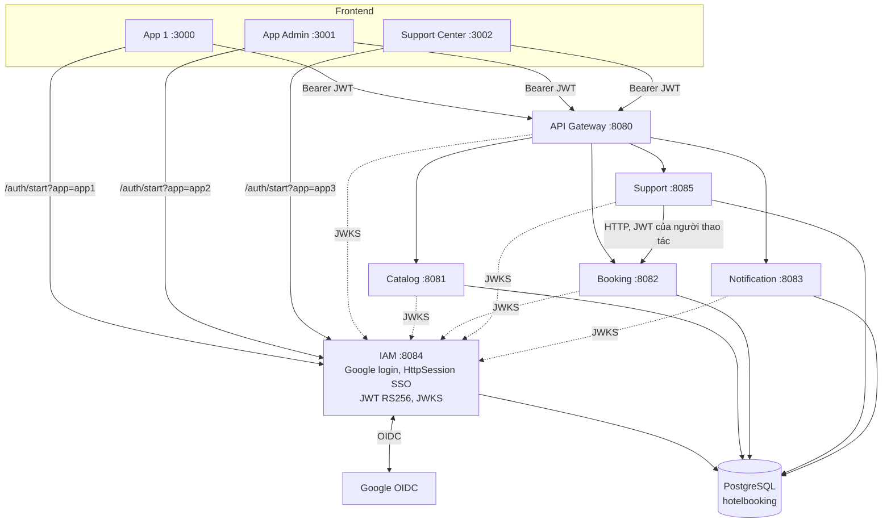
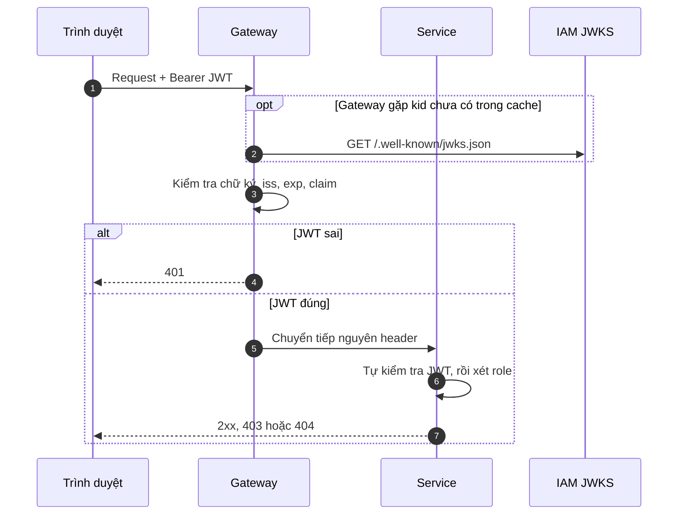
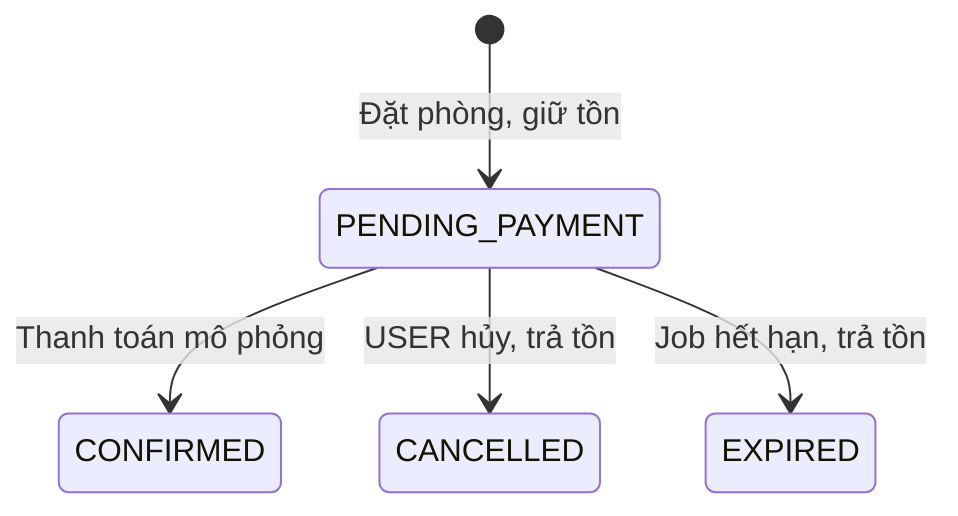
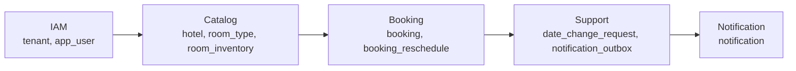

# StayHub — System Architecture

> **Cập nhật:** 05/11/2026, đối chiếu với `main` tại commit `1737b60`
> **Trạng thái:** Mô tả hệ thống đang có trong code. Mức kiểm chứng xem [README.md](README.md#6-mức-độ-kiểm-chứng).

## 1. Tổng quan

StayHub gồm ba frontend độc lập, một IAM tự xây dựng và bốn service nghiệp vụ dùng chung một PostgreSQL. Hệ thống không dùng Keycloak. IAM vừa là OAuth2 Client của Google, vừa quản lý phiên SSO, vừa phát hành JWT nội bộ. IAM không phải OIDC Authorization Server đầy đủ.

### 1.1. Công nghệ

| Lớp | Công nghệ |
|---|---|
| Frontend | HTML và JavaScript thuần, phục vụ bằng `frontend/server.js` (Node.js) |
| Backend | Java 21, Spring Boot 3.3.5 |
| Gateway | Spring Cloud Gateway (Spring Cloud 2023.0.3, reactive) |
| Xác thực | Spring Security OAuth2 Client với Google OIDC, Authorization Code + PKCE S256 |
| JWT | RS256, ký bằng Nimbus JOSE, xác minh bằng Spring Security Resource Server qua JWKS |
| Database | PostgreSQL 16, Flyway |
| Build | Gradle 9.8.2 |
| Chạy local | Docker Compose, profile `workflow` |
| Test | JUnit, Mockito, Testcontainers, `node --test` |

Module `common-security` đã khai báo trong Gradle nhưng chưa có code. Mỗi service hiện tự có `SecurityConfig` và `StayHubJwtValidator`.

## 2. Frontend

Mỗi app là một origin riêng và chỉ giữ JWT trong bộ nhớ trang. Giao diện ẩn hoặc hiện theo role trong JWT chỉ để phục vụ trải nghiệm. Frontend không xác minh chữ ký và không phải lớp bảo mật.

| App | Chức năng đang có | API chính |
|---|---|---|
| App 1 `:3000` | Chọn khách sạn, tìm phòng, đặt phòng, xem đơn, thanh toán mô phỏng, hủy đơn, đăng xuất | `/api/hotels`, `/api/bookings` |
| App Admin `:3001` | Xem tồn kho từng đêm, thêm loại phòng, sửa giá, xem đơn trong tenant | `/api/hotels`, `/api/admin/hotels`, `/api/room-types`, `/api/bookings` |
| Support Center `:3002` | USER chọn đơn, xem báo giá đổi ngày, gửi phiếu, xem phiếu và thông báo. ADMIN xem hàng chờ, duyệt, từ chối | `/api/bookings/reschedulable`, `/api/bookings/{id}/reschedule-quote`, `/api/support`, `/api/notifications` |

Hệ thống chưa có màn hình hoặc API để tạo, sửa khách sạn, cũng như sửa số phòng theo từng đêm. Chỉ App 1 có nút Đăng xuất.

## 3. Thành phần



Nguyên tắc:

1. Chỉ IAM phát hành JWT. Service không dùng Google ID Token.
2. Service xác minh JWT bằng public key trong cache, không gọi IAM ở mỗi request.
3. Gateway không thay thế việc kiểm tra ở service. Gọi thẳng vào cổng service vẫn phải có JWT hợp lệ.
4. Booking là nơi duy nhất đổi `booking` và `room_inventory.sold`, nên Support phải gọi Booking qua HTTP.

## 4. Trách nhiệm của từng service

### 4.1. IAM

Xử lý Google login, áp dụng chính sách theo app, tạo tài khoản khi chính sách cho phép, gắn `google_sub`, ký JWT, cung cấp JWKS và đăng xuất. Chi tiết ở [iam-sso.md](iam-sso.md).

### 4.2. API Gateway

Áp dụng CORS, cho `OPTIONS` đi qua không cần JWT, và yêu cầu JWT hợp lệ với mọi request khác. Gateway kiểm tra chữ ký RS256, `iss`, hạn dùng và các claim bắt buộc, nhưng không xét role. Sau đó Gateway bỏ tiền tố `/api` và chuyển tiếp nguyên header `Authorization`.

| Đường dẫn | Service |
|---|---|
| `/api/hotels/**`, `/api/room-types/**`, `/api/admin/**` | Catalog |
| `/api/bookings/**` | Booking |
| `/api/support/**` | Support |
| `/api/notifications/**` | Notification |

Gateway không có route `/auth/**`. CORS chỉ cho phép ba origin của frontend, các method `GET`, `POST`, `PUT`, `OPTIONS` và các header `Authorization`, `Content-Type`.

### 4.3. Catalog

Trả danh sách khách sạn theo tenant, tìm loại phòng còn trống, và cho ADMIN xem tồn kho, thêm loại phòng, sửa giá. Khi thêm loại phòng, Catalog tạo tồn kho từ hôm nay đến `2027-01-31`. Ngày cuối đang viết cứng trong SQL.

### 4.4. Booking

Giữ tồn kho và tạo đơn trong một transaction, xác nhận thanh toán mô phỏng, hủy đơn, chạy job hết hạn và đổi ngày. Booking đọc thẳng `room_type`, `hotel` và ghi thẳng `room_inventory.sold`, không gọi Catalog.

### 4.5. Support

Chỉ xử lý phiếu xin đổi ngày. Phần ticket và tin nhắn chung đã bị gỡ ở migration `V2`. Support gọi Booking bằng chính JWT của người đang thao tác, không có tài khoản dịch vụ. Timeout là 3 giây khi kết nối và 10 giây khi đọc.

### 4.6. Notification

Một job đọc `notification_outbox` và tạo `notification`, sau đó USER đọc qua API. Hệ thống chưa có email hay push, và không có API tạo thông báo.

## 5. JWT

| Claim | Giá trị |
|---|---|
| `iss` | `http://localhost:8084` |
| `sub` | `app_user.id`, dạng chuỗi |
| `email` | Email trong `app_user` |
| `tenant_id` | Số nguyên dương |
| `role` | `USER` hoặc `ADMIN` |
| `iat`, `exp` | Hạn 15 phút |

JWT không có `aud`. Thiếu hoặc sai một claim bắt buộc đều trả `401`. JWT có thể đọc được nội dung vì chỉ được ký, không được mã hóa.



## 6. Phân quyền

Các lớp kiểm tra:

| Lớp | Kiểm tra |
|---|---|
| IAM | Tài khoản có được nhận JWT cho app này không |
| Gateway | JWT hợp lệ |
| Service | JWT hợp lệ, role theo endpoint, tenant, chủ sở hữu |
| PostgreSQL | Khóa ngoại theo tenant, CHECK, UNIQUE |

Support và Notification còn đối chiếu email, tenant và role trong JWT với `app_user`. Không khớp thì trả `403`, nên JWT cũ của người vừa đổi role sẽ bị chặn ở hai service này.

| Nghiệp vụ | USER | ADMIN |
|---|---|---|
| Xem khách sạn, tìm phòng | Có | Có |
| Đặt phòng, thanh toán, hủy đơn | Đơn của mình | Không |
| Xem đơn | Đơn của mình | Trong tenant |
| Xem tồn kho, thêm loại phòng, sửa giá | Không | Trong tenant |
| Danh sách đơn đổi được ngày | Đơn của mình | Không |
| Báo giá đổi ngày | Đơn của mình | Trong tenant |
| Gửi phiếu đổi ngày | Đơn của mình | Không |
| Xem phiếu | Phiếu của mình | Trong tenant |
| Duyệt, từ chối phiếu | Không | Trong tenant |
| Đổi ngày trực tiếp ở Booking | Không | Trong tenant |
| Xem, đánh dấu đã đọc thông báo | Của mình | Của mình |

Ma trận theo từng endpoint nằm ở [api-contract.md](api-contract.md).

## 7. Database

Mọi service dùng chung database `hotelbooking`, schema `public`. Mỗi service có lịch sử Flyway riêng. Dùng chung database giúp giữ tồn kho và tạo đơn trong một transaction mà không cần transaction phân tán. Đổi lại, các service phụ thuộc vào schema của nhau.

| Bảng | Service ghi | Service chỉ đọc |
|---|---|---|
| `tenant` | Seed của IAM | Khóa ngoại |
| `app_user` | IAM | Support, Notification |
| `hotel`, `room_type` | Catalog | Booking |
| `room_inventory.total` | Catalog | Booking |
| `room_inventory.sold` | Booking | Catalog |
| `booking` | Booking | Khóa ngoại của Support |
| `booking_reschedule` | Booking | Support |
| `date_change_request` | Support | Không có |
| `notification_outbox` | Support, Notification chỉ ghi `processed_at` | Notification |
| `notification` | Notification | Không có |

Schema chi tiết ở [erd.md](erd.md), quy tắc nghiệp vụ ở [data-model.md](data-model.md).

## 8. Đặt phòng và tồn kho

Tồn kho tính theo từng đêm của từng loại phòng, trong đó `available = total - sold`. Kỳ ở là khoảng `[checkIn, checkOut)`. Kết quả tìm phòng không giữ chỗ. Booking kiểm tra lại bằng `UPDATE` có điều kiện, xử lý các đêm theo ngày tăng dần, trong transaction `READ COMMITTED`:

```sql
UPDATE room_inventory
SET sold = sold + :roomCount
WHERE tenant_id = :tenantId
  AND room_type_id = :roomTypeId
  AND stay_date = :stayDate
  AND sold + :roomCount <= total;
```

Một đêm không đổi được đúng một dòng thì toàn bộ transaction rollback và trả `409`.



Thời gian giữ phòng mặc định là 15 phút (`booking.payment.hold`), job hết hạn chạy mỗi 60 giây (`booking.expiry.interval`). Đơn `CONFIRMED` có thể đổi ngày nhưng hiện không hủy được.

## 9. Đổi ngày

1. USER xem báo giá. Việc này chỉ đọc, chưa giữ phòng.
2. USER gửi phiếu. Support gọi Booking để lấy báo giá, sau đó lưu phiếu `PENDING`. Mỗi đơn chỉ có một phiếu đang chờ.
3. ADMIN duyệt. Support khóa dòng phiếu, gọi Booking kèm `requestId`, rồi ghi `APPROVED` và `notification_outbox` trong cùng transaction.
4. Booking đổi tồn kho và đơn trong một transaction, đồng thời ghi `booking_reschedule`. Nếu hết phòng, Booking trả `409` và phiếu vẫn `PENDING`.

Booking commit trước, Support ghi nhận sau. Nếu Support lỗi giữa hai bước, phiếu vẫn `PENDING` và ADMIN có thể duyệt lại an toàn, vì Booking bỏ qua `requestId` đã áp dụng. Từ chối phiếu trong trường hợp đó sẽ bị chặn bằng `409`.

Tổng tiền mới tính theo giá mỗi đêm của đơn gốc, nên việc đổi giá phòng không ảnh hưởng đơn đã tạo. Chênh lệch chỉ được ghi nhận, không có thu thêm hay hoàn tiền thật.

## 10. Thông báo qua outbox

Support ghi `notification_outbox` cùng transaction với kết quả duyệt hoặc từ chối. Job của Notification chạy mỗi 2 giây, đọc tối đa 100 dòng chưa xử lý bằng `FOR UPDATE SKIP LOCKED`, tạo `notification` và đánh dấu `processed_at` trong một transaction. `UNIQUE (source_event_id)` chặn tạo trùng.

Phiếu đã có kết quả thì sự kiện đã nằm trong database, nên Notification tắt cũng không mất thông báo. Support Center của USER gọi lại mỗi 15 giây.

## 11. Thứ tự migration



Docker Compose bảo đảm thứ tự này bằng `depends_on`. Chạy bằng Gradle thì phải khởi động theo đúng thứ tự.

## 12. Giới hạn đã biết

| Giới hạn | Hệ quả | Hướng xử lý |
|---|---|---|
| IAM tạo RSA key mới khi khởi động nhưng giữ nguyên `kid = stayhub-key-1` | Service đang cache key cũ từ chối JWT mới. Đo bằng bản sao `dev-token` cố định `kid`: Catalog, Booking, Support hồi phục sau khoảng 5 phút, Gateway vẫn trả `401` sau 13 phút và chỉ hết khi restart Gateway. JWT ký bằng key cũ vẫn được chấp nhận trong lúc đó | Tạo `kid` theo từng key. Về lâu dài lưu key bền vững và có xoay vòng |
| `IAM_ADMIN_EMAIL` chỉ có một email | ADMIN khác chỉ dùng được Support, và chỉ một tenant có người vào App Admin. Không đặt biến này thì không ai vào được App Admin | Quản lý quyền App Admin theo role và tenant |
| Compose đặt sẵn một email cá nhân làm `IAM_ADMIN_EMAIL` mặc định | Ai dùng cấu hình mặc định cũng phụ thuộc email đó | Bắt buộc khai báo trong `.env.local` |
| Compose mặc định dùng `dev-token` | Không đặt lại issuer và JWKS thì JWT thật của IAM bị `401` | Xem [operations-and-tests.md](operations-and-tests.md#2-cấu-hình) |
| JWT nằm trong URL fragment và bộ nhớ trang | XSS đọc được JWT. Tải lại trang là mất JWT | Dùng BFF và cookie HttpOnly nếu lên production |
| Chưa có refresh token và thu hồi JWT | JWT còn hiệu lực đến khi hết hạn, kể cả sau đăng xuất hay đổi role | Quyết định riêng trước production |
| Đăng xuất chỉ ở App 1, không báo các tab khác | Tab khác vẫn dùng được JWT đến khi hết hạn | Xem `OPEN-002` trong [decisions.md](decisions.md) |
| `sso_app` nằm chung trong session | Hai tab đăng nhập song song có thể bị trả về nhầm app | Gắn app đích với từng authorization request |
| Mọi lỗi chính sách đều là `#error=not_provisioned` | Frontend có thể báo sai nguyên nhân | Trả mã lỗi riêng |
| Chính sách theo app chưa có test | Logic đăng nhập mới không được test bảo vệ | Bổ sung test cho `SsoLoginService` |
| Booking chưa có idempotency key | Gửi lại request có thể tạo đơn thứ hai. Frontend khóa nút để giảm rủi ro | Thêm `Idempotency-Key` |
| Giá lấy tại thời điểm đặt | Đơn theo giá mới nếu ADMIN đổi giá ngay sau khi người dùng xem | Gửi giá đã xem để đối chiếu |
| Tồn kho có ngày cuối cố định `2027-01-31` | Sau ngày đó đặt phòng nhận `409` | Có job mở bán cuốn chiếu |
| Support giữ transaction và khóa phiếu trong lúc gọi Booking | Booking chậm giữ khóa và một kết nối DB tối đa khoảng 13 giây | Tách bước gọi HTTP khỏi transaction |
| ADMIN gọi thẳng `POST /api/bookings/{id}/reschedule` được | Đổi được ngày mà không qua phiếu | Chấp nhận vì ADMIN đã có quyền duyệt |
| Phiếu chờ không tự hết hạn | Duyệt sau ngày nhận phòng sẽ nhận `409` | ADMIN từ chối phiếu |
| Dùng chung database, đơn giữ theo `user_email` | Các service phụ thuộc schema của nhau. Đổi email ảnh hưởng quyền sở hữu đơn | Đánh giá khi tách service |

Các mục không ghi số đo ở trên được suy ra từ code.
