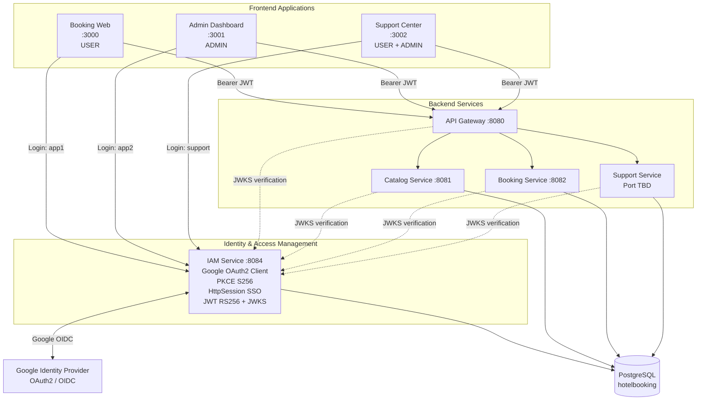
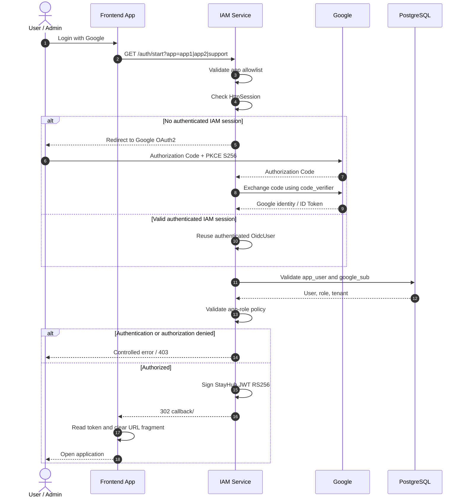
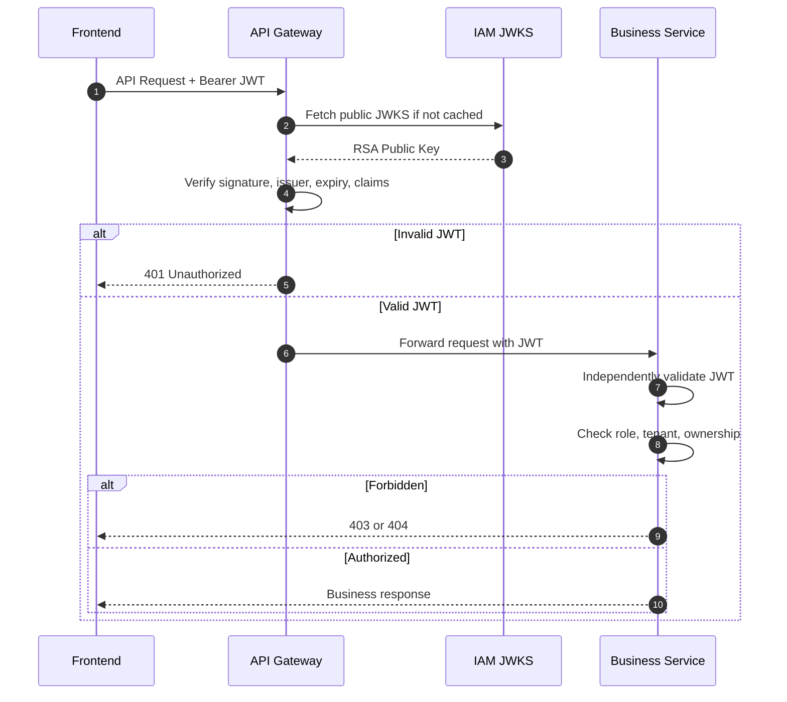
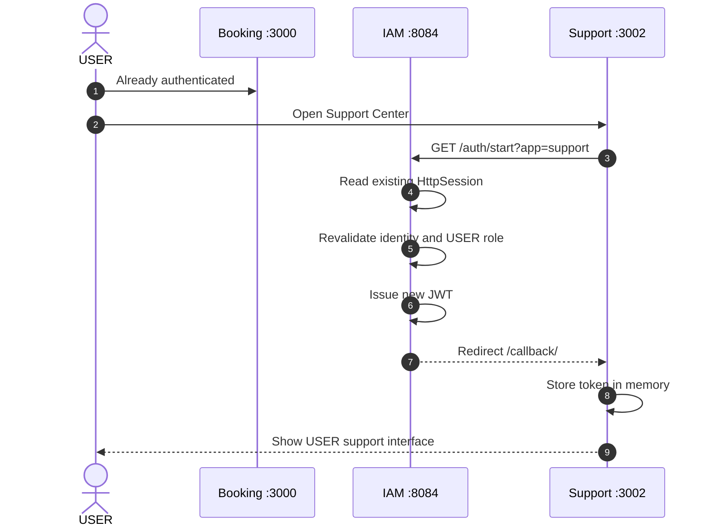
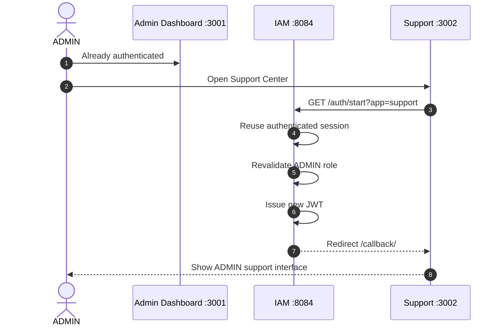
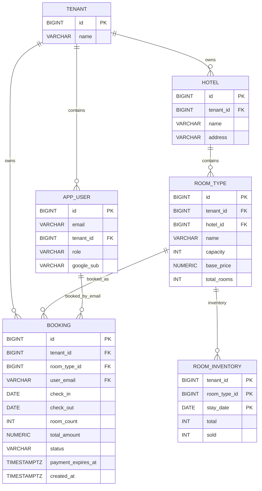
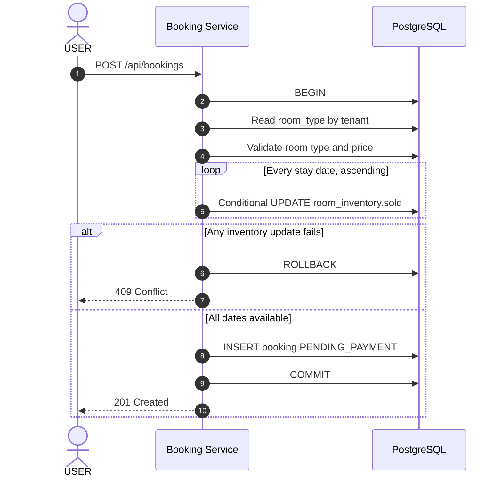
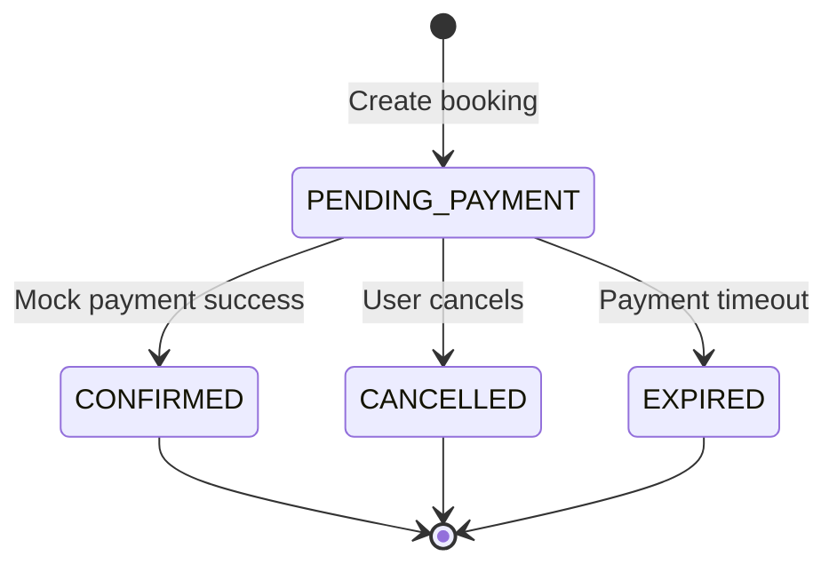
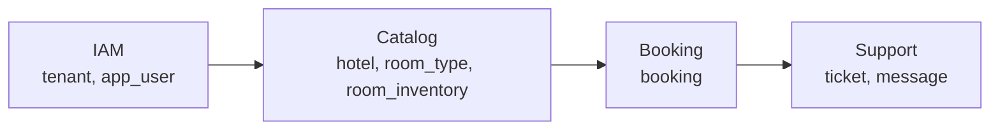

# StayHub — System Architecture (3 Apps + Custom IAM)

> **Phiên bản:** 3-App Architecture  
> **Cập nhật:** 04/11/2026  
> **Trạng thái:** TARGET INTEGRATION — Chưa xác minh toàn bộ source code và E2E  
> **Quyết định:** Giữ `iam-service` của developer làm Google OAuth2 Client, SSO Session Manager và JWT RS256 Issuer. **Không sử dụng Keycloak.**

---

## 1. Architecture Overview

StayHub là hệ thống đặt phòng khách sạn theo kiến trúc microservices, gồm ba ứng dụng frontend độc lập sử dụng chung IAM Service và các backend services.

Mục tiêu kiến trúc:

- Xây dựng ba ứng dụng độc lập: Booking, Admin và Support.
- Tái sử dụng IAM Service hiện tại, không viết lại authentication.
- Triển khai Single Sign-On thông qua phiên đăng nhập chung tại IAM.
- Phân quyền dựa trên hai role `USER` và `ADMIN`.
- Cách ly dữ liệu theo `tenant_id`.
- Đảm bảo booking và room inventory nhất quán trong transaction.
- Duy trì khả năng kiểm thử riêng từng service và tích hợp end-to-end.

### 1.1. Technology Stack

| Layer | Technology | Responsibility |
|---|---|---|
| Frontend | Web SPA, framework theo repository | Booking, Admin, Support |
| Authentication | Spring Security OAuth2 Client | Google OAuth2/OIDC Login |
| SSO | Spring Security + HttpSession | Duy trì phiên đăng nhập tại IAM |
| Token Issuer | Custom IAM + RSA RS256 | Phát hành StayHub JWT |
| Token Verification | Spring Security Resource Server + JWKS | Xác thực JWT tại Gateway và services |
| API Gateway | Spring Cloud Gateway | API routing, gateway authentication |
| Backend | Spring Boot | IAM, Catalog, Booking, Support |
| Database | PostgreSQL | Lưu trữ dữ liệu nghiệp vụ |
| Migration | Flyway | Quản lý database schema |
| Build | Gradle | Build và quản lý dependencies |

Các phiên bản công nghệ cụ thể cần đối chiếu với repository hiện tại.

---

## 2. Frontend Applications

Hệ thống có ba ứng dụng frontend chạy độc lập, sử dụng chung IAM nhưng có quyền truy cập và nghiệp vụ khác nhau.

| Application | Development URL | Allowed Role | Responsibilities |
|---|---|---|---|
| Booking Web | `http://localhost:3000` | `USER` | Tìm phòng, đặt phòng, thanh toán mô phỏng, hủy đơn |
| Admin Dashboard | `http://localhost:3001` | `ADMIN` | Quản lý khách sạn, loại phòng, giá, inventory và booking |
| Support Center | `http://localhost:3002` | `USER`, `ADMIN` | Tạo, theo dõi và xử lý ticket hỗ trợ |

Support Center là ứng dụng thứ ba cần triển khai, chưa được xác nhận đã tồn tại trong source code.

### 2.1. Booking Web

**Role:** `USER`

Chức năng:

- Đăng nhập Google thông qua IAM Service.
- Xem khách sạn thuộc tenant.
- Tìm kiếm loại phòng còn trống theo khoảng ngày.
- Tạo booking.
- Thanh toán mô phỏng.
- Hủy booking đang chờ thanh toán.
- Xem danh sách và chi tiết booking của mình.
- Chuyển sang Support Center thông qua SSO.

`ADMIN` không được tạo booking hoặc sử dụng các API đặt phòng dành cho `USER`.

### 2.2. Admin Dashboard

**Role:** `ADMIN`

Chức năng:

- Đăng nhập Google thông qua IAM Service.
- Quản lý khách sạn.
- Quản lý loại phòng và giá bán.
- Quản lý số lượng phòng mở bán theo từng đêm.
- Xem booking trong tenant.
- Chuyển sang Support Center thông qua SSO.

`USER` không được truy cập các API quản trị.

### 2.3. Support Center

**Role:** `USER`, `ADMIN`

Support Center sử dụng chung IAM Session nhưng nhận JWT riêng khi thực hiện luồng đăng nhập vào ứng dụng.

**USER:**

- Tạo ticket hỗ trợ.
- Liên kết ticket với booking thuộc quyền sở hữu.
- Xem ticket của mình.
- Gửi và nhận phản hồi.

**ADMIN:**

- Xem ticket thuộc tenant.
- Phản hồi ticket.
- Cập nhật trạng thái xử lý.
- Theo dõi danh sách yêu cầu hỗ trợ.

Không tạo thêm role `SUPPORT` trong phạm vi hiện tại.

---

## 3. High-Level Component Architecture



### 3.1. Architecture Principles

1. Frontend không trực tiếp xác thực Google ID Token để cấp quyền nghiệp vụ.
2. IAM Service là thành phần duy nhất phát hành StayHub JWT.
3. Gateway và từng backend service xác minh JWT độc lập.
4. Backend không gọi IAM đồng bộ cho mỗi business request.
5. Role và tenant phải được xác thực ở backend.
6. Frontend không được tự quyết định quyền truy cập API.
7. Các services có trách nhiệm ghi dữ liệu rõ ràng dù dùng chung database.

---

## 4. Backend Services & Responsibilities

| Service | Port | Data Ownership | Responsibilities |
|---|---|---|---|
| `iam-service` | `8084` | `tenant`, `app_user` | Authentication, SSO, JWT, JWKS |
| `api-gateway` | `8080` | Không sở hữu dữ liệu nghiệp vụ | Routing, JWT validation |
| `catalog-service` | `8081` | `hotel`, `room_type`, `room_inventory.total` | Catalog, availability, inventory |
| `booking-service` | `8082` | `booking`, `room_inventory.sold` | Booking, payment, cancel, expiry |
| `support-service` | TBD | `support_ticket`, `ticket_message` | Ticket management, support workflows |

### 4.1. IAM Service

IAM Service thực hiện:

- Google OAuth2/OIDC login.
- Authorization Code Flow và PKCE S256.
- Quản lý phiên xác thực qua `HttpSession`.
- Kiểm tra tài khoản đã được provision.
- Kiểm tra `email_verified`.
- Binding Google identity bằng `google_sub`.
- Phát hành JWT RS256.
- Cung cấp public key thông qua JWKS.
- Điều hướng về callback của ứng dụng được allowlist.

IAM hiện tại **không phải OIDC Authorization Server đầy đủ**.

### 4.2. API Gateway

API Gateway chịu trách nhiệm:

- Nhận API requests từ ba frontend.
- Kiểm tra JWT hợp lệ.
- Xác minh issuer, expiration và các claims bắt buộc.
- Routing tới backend service tương ứng.
- Áp dụng authorization ở gateway theo endpoint khi cần.

Gateway không thay thế authorization tại business services.

### 4.3. Catalog Service

Catalog Service chịu trách nhiệm:

- Quản lý `hotel`.
- Quản lý `room_type`.
- Quản lý giá phòng.
- Tạo các dòng `room_inventory`.
- Quản lý `room_inventory.total`.
- Tìm kiếm loại phòng còn trống theo khoảng ngày.

Catalog không trực tiếp tạo booking và không cập nhật `room_inventory.sold` trong nghiệp vụ đặt phòng.

### 4.4. Booking Service

Booking Service chịu trách nhiệm:

- Tạo booking.
- Kiểm tra lại availability khi đặt.
- Cập nhật `room_inventory.sold`.
- Quản lý booking lifecycle.
- Xử lý thanh toán mô phỏng.
- Xử lý cancellation và expiry.
- Hoàn tồn kho khi booking bị hủy hoặc hết hạn.

Booking phải cập nhật tồn kho và booking trong cùng database transaction.

### 4.5. Support Service

Support Service là thành phần mở rộng cho ứng dụng thứ ba.

Trách nhiệm dự kiến:

- Tạo và quản lý ticket.
- Quản lý message trong ticket.
- Kiểm tra quyền truy cập theo role.
- Kiểm tra ticket ownership.
- Cách ly ticket theo tenant.
- Liên kết ticket với booking khi cần.

Support Service phải xác minh JWT độc lập bằng IAM JWKS.

---

## 5. IAM Architecture

### 5.1. Authentication Contract

Giữ nguyên các thành phần IAM developer đang triển khai:

| Component | Responsibility |
|---|---|
| `AuthController` | Khởi tạo login theo app |
| `SsoProperties` | Quản lý callback allowlist |
| `SsoLoginService` | Kiểm tra identity và tài khoản nội bộ |
| `SsoAuthenticationSuccessHandler` | Hoàn tất login và redirect |
| `JwtIssuer` | Phát hành JWT RS256 |
| `JwtKeyProvider` | Quản lý RSA keypair |
| `JwksController` | Cung cấp public JWKS |
| `SecurityConfig` | Cấu hình Spring Security và OAuth2 |

### 5.2. Authentication Endpoints

| Endpoint | Purpose |
|---|---|
| `GET /auth/start?app=app1` | Khởi tạo login Booking |
| `GET /auth/start?app=app2` | Khởi tạo login Admin |
| `GET /auth/start?app=support` | Khởi tạo login Support — cần bổ sung |
| `/oauth2/authorization/google` | Bắt đầu Google authorization |
| `/login/oauth2/code/google` | Google OAuth2 callback |
| `GET /.well-known/jwks.json` | Public keys để xác minh JWT |

Giữ tên `app1` và `app2` nếu đây là contract frontend/IAM hiện tại.

Không đổi sang `booking` và `admin` nếu chưa cập nhật đồng bộ IAM configuration, frontend và tests.

### 5.3. Authentication Sequence



**Implementation note:** App-role enforcement và callback Support là các phần cần bổ sung, chưa được xác nhận đã triển khai.

---

## 6. JWT Architecture

### 6.1. JWT Claims

IAM Service phát hành JWT RS256 với các claims:

| Claim | Value |
|---|---|
| `iss` | `http://localhost:8084` |
| `sub` | `app_user.id` |
| `email` | Email đã xác thực |
| `tenant_id` | Numeric tenant ID |
| `role` | `USER` hoặc `ADMIN` |
| `iat` | Issued-at timestamp |
| `exp` | Expiration timestamp |

Theo tài liệu IAM developer, JWT có TTL khoảng **15 phút**.

### 6.2. JWT Validation Flow



### 6.3. Security Rules

- Không sử dụng Google ID Token làm StayHub API access token.
- Không chia sẻ RSA private key với Gateway hoặc business services.
- Public JWKS không được chứa private RSA parameters.
- Không tin tưởng claims trước khi xác minh chữ ký.
- Không tin tưởng tenant/role do client gửi.
- Không dựa hoàn toàn vào Gateway để bảo vệ service.
- JWKS có thể được cache để giảm latency và tránh gọi IAM trên mỗi request.

---

## 7. Single Sign-On Across 3 Apps

### 7.1. SSO Principle

SSO sử dụng `HttpSession` tại IAM Service.

Khi một người dùng đã đăng nhập thành công vào Booking hoặc Admin, trình duyệt có thể sử dụng phiên IAM hiện tại để đăng nhập Support Center mà không cần nhập lại mật khẩu Google.

Mỗi frontend vẫn nhận JWT riêng.

### 7.2. Booking → Support



### 7.3. Admin → Support



### 7.4. SSO vs Authorization

**SSO** trả lời câu hỏi:

> Người dùng đã được xác thực hay chưa?

**Authorization** trả lời câu hỏi:

> Người dùng được phép thực hiện nghiệp vụ nào?

| Scenario | Expected Result |
|---|---|
| USER → Booking | Allowed |
| USER → Admin | Denied |
| USER → Support | Allowed |
| ADMIN → Booking | Denied |
| ADMIN → Admin | Allowed |
| ADMIN → Support | Allowed |

SSO không cho phép người dùng vượt qua role restrictions.

---

## 8. Authorization Architecture

Authorization được triển khai theo nhiều lớp.

```text id="ewmdv2"
Frontend
    |
    | UI Role Guard (UX only)
    v
IAM
    |
    | App Access Policy
    v
API Gateway
    |
    | JWT Validation
    | Route Authorization
    v
Business Service
    |
    | JWT Validation
    | RBAC
    | Tenant Isolation
    | Ownership
    v
PostgreSQL
    |
    | Foreign Keys
    | Constraints
    v
Business Data
```

### 8.1. RBAC Matrix

| Resource / Action | USER | ADMIN |
|---|---|---|
| Booking Web | Allow | Deny |
| Admin Dashboard | Deny | Allow |
| Support Center | Allow | Allow |
| Hotel Search | Allow | Allow |
| Room Availability | Allow | Allow |
| Create Booking | Allow | Deny |
| Mock Payment | Own Booking | Deny |
| Cancel Booking | Own Booking | Deny |
| Manage Hotel | Deny | Allow |
| Manage Room Type | Deny | Allow |
| Manage Inventory | Deny | Allow |
| Read Booking | Own Booking | Tenant Scope |
| Create Support Ticket | Allow | Not in current scope |
| Read Support Ticket | Own Ticket | Tenant Scope |
| Resolve Support Ticket | Deny | Allow |

### 8.2. Tenant Isolation

`tenant_id` phải được lấy từ JWT đã xác minh.

Ví dụ:

```sql
SELECT *
FROM booking
WHERE id = :bookingId
  AND tenant_id = :tenantId;
```

Đối với USER, cần kiểm tra thêm quyền sở hữu:

```sql
SELECT *
FROM booking
WHERE id = :bookingId
  AND tenant_id = :tenantId
  AND user_email = :authenticatedEmail;
```

Không sử dụng `tenant_id` hoặc `user_email` do frontend gửi để quyết định quyền truy cập.

### 8.3. HTTP Status Policy

| Condition | HTTP Status |
|---|---|
| Missing/invalid/expired JWT | `401 Unauthorized` |
| Valid JWT but insufficient role | `403 Forbidden` |
| Resource not found | `404 Not Found` |
| Resource belongs to another tenant or owner | `404 Not Found` |
| Invalid request | `400 Bad Request` |
| Booking inventory conflict | `409 Conflict` |

---

## 9. Database Architecture

### 9.1. Database Strategy

Trong phạm vi demo, hệ thống sử dụng:

- PostgreSQL database: `hotelbooking`.
- Schema: `public`.
- Flyway migrations.
- Service-level data ownership.
- Transaction nội bộ cho booking và inventory.

Việc dùng chung database giúp Booking cập nhật `room_inventory.sold` và tạo booking trong cùng transaction, tránh distributed transaction trong MVP.

### 9.2. Database ERD



Support tables được bổ sung khi Support Service được triển khai. Chi tiết schema và constraints nằm trong `data-model.md`.

### 9.3. Data Ownership

| Table | Schema/Migration Owner | Write Responsibility |
|---|---|---|
| `tenant` | IAM | IAM |
| `app_user` | IAM | IAM |
| `hotel` | Catalog | Catalog |
| `room_type` | Catalog | Catalog |
| `room_inventory.total` | Catalog | Catalog |
| `room_inventory.sold` | Catalog schema / Booking business | Booking |
| `booking` | Booking | Booking |
| `support_ticket` | Support | Support |
| `ticket_message` | Support | Support |

---

## 10. Booking & Inventory Architecture

### 10.1. Inventory Model

StayHub sử dụng inventory theo từng đêm.

```text id="udssfv"
room_inventory
    |
    +-- tenant_id
    +-- room_type_id
    +-- stay_date
    +-- total
    +-- sold
```

Số phòng còn trống:

```text id="6v8ddm"
available_rooms = total - sold
```

### 10.2. Availability Search

Khi USER tìm phòng:

1. Chọn khách sạn.
2. Chọn `checkIn` và `checkOut`.
3. Catalog đọc `room_type` và `room_inventory`.
4. Kiểm tra inventory của tất cả các đêm.
5. Trả về các loại phòng còn đủ số lượng.

`checkOut` không được tính là đêm lưu trú.

Điều kiện availability cốt lõi:

```sql
HAVING COUNT(*) = :nights
   AND MIN(i.total - i.sold) > 0
```

### 10.3. Booking Transaction



Câu lệnh cập nhật tồn kho:

```sql
UPDATE room_inventory
SET sold = sold + :roomCount
WHERE tenant_id = :tenantId
  AND room_type_id = :roomTypeId
  AND stay_date = :stayDate
  AND sold + :roomCount <= total;
```

Nếu một đêm không cập nhật được đúng một dòng, transaction phải rollback.

### 10.4. Concurrency Control

- Sử dụng PostgreSQL transaction.
- Thiết kế dựa trên isolation level `READ COMMITTED`.
- Cập nhật tồn kho bằng conditional `UPDATE`.
- Cập nhật các đêm theo thứ tự tăng dần.
- Không cho phép overselling.
- Kiểm tra inventory lại tại thời điểm đặt, không tin kết quả search trước đó.

### 10.5. Booking Lifecycle



| Status | Inventory Reserved | Meaning |
|---|---|---|
| `PENDING_PAYMENT` | Yes | Waiting for payment |
| `CONFIRMED` | Yes | Payment completed |
| `CANCELLED` | No | Inventory released |
| `EXPIRED` | No | Inventory released |

Thanh toán mô phỏng chỉ cập nhật trạng thái booking vì inventory đã được giữ khi tạo đơn.

Cancellation và expiry phải cập nhật trạng thái có điều kiện trước khi hoàn inventory, trong cùng transaction, nhằm tránh hoàn phòng hai lần.

---

## 11. API Routing Architecture

Frontend gọi backend thông qua API Gateway.

| API | Service | Role |
|---|---|---|
| `GET /api/hotels` | Catalog | USER, ADMIN |
| `GET /api/hotels/{hotelId}/availability` | Catalog | USER, ADMIN |
| `POST /api/hotels/{hotelId}/room-types` | Catalog | ADMIN |
| `PUT /api/room-types/{id}/price` | Catalog | ADMIN |
| `GET /api/admin/hotels/{hotelId}/inventory` | Catalog | ADMIN |
| `POST /api/bookings` | Booking | USER |
| `POST /api/bookings/{id}/payment` | Booking | USER, owner |
| `POST /api/bookings/{id}/cancel` | Booking | USER, owner |
| `GET /api/bookings` | Booking | USER, ADMIN — scoped |
| `GET /api/bookings/{id}` | Booking | USER, ADMIN — scoped |
| Support ticket endpoints | Support | USER, ADMIN — scoped |

Chi tiết request, response và status codes được định nghĩa tại `api-contract.md`.

---

## 12. Migration Architecture

### 12.1. Flyway Dependency Order



Thứ tự này thể hiện các phụ thuộc dữ liệu của thiết kế mục tiêu, không mặc định là startup order đã được cấu hình.

Support cần được triển khai sau khi IAM và các bảng booking liên quan đã sẵn sàng nếu schema Support có foreign key tới booking.

### 12.2. Known Migration Blocker

Theo tài liệu developer, Booking migration hiện tại còn tham chiếu bảng `room` cũ.

Trong khi đó, ERD v2 sử dụng:

- `hotel`
- `room_type`
- `room_inventory`
- `booking`

Cần đồng bộ Catalog và Booking migrations trước khi chạy E2E.

Với database demo chưa phát hành, có thể điều chỉnh migrations và tạo lại database sạch theo kế hoạch của team.

Không chỉnh sửa migration đã áp dụng trên môi trường có dữ liệu thật nếu chưa có chiến lược migration tương thích.

---

## 13. Minimal IAM Changes for 3 Apps

Mục tiêu là mở rộng IAM hiện tại, không thay thế implementation của developer.

### 13.1. Required Changes

**IAM Developer:**

1. Bổ sung `support` vào callback allowlist.
2. Giữ `app1` và `app2` nếu đang được sử dụng.
3. Bổ sung role-to-app authorization.
4. Tái sử dụng HttpSession SSO cho Support.
5. Phát JWT mới khi chuyển sang Support.
6. Bổ sung unit/integration tests cho app thứ ba.

**Frontend Developer:**

1. Booking sử dụng `app1`.
2. Admin sử dụng `app2`.
3. Support sử dụng `support`.
4. Xử lý callback JWT theo cơ chế hiện tại.
5. Không chia sẻ token trực tiếp giữa các ứng dụng.

**Support Developer:**

1. Triển khai Support Service.
2. Cấu hình JWT Resource Server với IAM JWKS.
3. Triển khai ticket schema và Flyway.
4. Triển khai RBAC, tenant isolation và ownership.
5. Tích hợp Support API qua Gateway.

### 13.2. IAM App Access Policy

| App Identifier | Frontend | Allowed Role |
|---|---|---|
| `app1` | Booking | USER |
| `app2` | Admin | ADMIN |
| `support` | Support Center | USER, ADMIN |

Không nhận callback URL tùy ý từ client để tránh open redirect.

---

## 14. Security Limitations & Technical Debt

| Risk | Current Design | Required Follow-up |
|---|---|---|
| JWT in URL fragment | Demo-only | Secure token delivery / BFF |
| Token in frontend memory | Demo-only | Define production session strategy |
| RSA keypair reset on restart | Theo tài liệu dev | Persistent keys and rotation |
| Missing refresh/revocation | Chưa triển khai đầy đủ | Token lifecycle design |
| IAM logout | Chưa hoàn thiện | Single Logout design |
| Shared `sso_app` session attribute | Multi-tab race risk | Bind destination to authorization request/state |
| JWT role changes | Token may remain valid until expiry | Revocation / short TTL strategy |
| Booking duplicate requests | No idempotency key in ERD v2 | Add idempotency mechanism |
| Shared database | MVP trade-off | Enforce service write ownership |
| Support authorization | Proposed | Implement and test tenant/owner checks |

Các giới hạn này phải được ghi nhận khi demo, không được mô tả là production-ready.

---

## 15. Integration & Acceptance Criteria

### 15.1. Authentication & SSO

- [ ] USER đăng nhập Booking thành công.
- [ ] ADMIN đăng nhập Admin thành công.
- [ ] USER chuyển Booking → Support không cần đăng nhập Google lại khi IAM session còn hiệu lực.
- [ ] ADMIN chuyển Admin → Support tương tự.
- [ ] USER truy cập Admin bị từ chối.
- [ ] ADMIN truy cập Booking bị từ chối.
- [ ] JWT không hợp lệ bị từ chối tại Gateway và business services.
- [ ] Tài khoản chưa provision không được cấp JWT.
- [ ] Google identity không khớp `google_sub` bị từ chối.

### 15.2. Booking & Inventory

- [ ] Tìm phòng đúng theo tất cả các đêm lưu trú.
- [ ] Không trả về phòng đã hết tồn.
- [ ] Tạo booking cập nhật inventory atomically.
- [ ] Concurrent booking không overselling.
- [ ] Thanh toán mô phỏng chuyển sang `CONFIRMED`.
- [ ] Hủy đơn hoàn inventory đúng một lần.
- [ ] Job expiry hoàn inventory đúng một lần.
- [ ] Inventory reconciliation không có sai lệch.

### 15.3. Support Center

- [ ] USER tạo ticket thành công.
- [ ] USER chỉ xem ticket của mình.
- [ ] ADMIN xem ticket trong tenant.
- [ ] ADMIN phản hồi và xử lý ticket.
- [ ] Ticket khác tenant không bị lộ.
- [ ] Support Service tự xác thực JWT.

---

## 16. Architecture Decisions

| Decision | Selected Approach | Reason |
|---|---|---|
| IAM | Custom IAM Service | Tương thích với implementation developer |
| Identity Provider | Google OAuth2/OIDC | Tái sử dụng flow hiện tại |
| SSO | IAM HttpSession | Hỗ trợ phiên đăng nhập chung |
| JWT | RS256 + JWKS | Xác thực phân tán giữa services |
| Roles | USER, ADMIN | Đủ scope demo |
| Frontend | 3 independent applications | Tách nghiệp vụ và kiểm thử SSO |
| Database | Shared PostgreSQL | Đơn giản hóa transaction trong MVP |
| Inventory | Per-night `room_inventory` | Quản lý số lượng phòng theo từng đêm |
| Booking Consistency | Conditional UPDATE + transaction | Chống overselling |
| Support | Separate frontend and service | Tách nghiệp vụ hỗ trợ |
| Migration | Flyway per service | Quản lý schema và dependencies |

Các quyết định chi tiết và thay đổi trong tương lai được ghi nhận tại `decisions.md`.

---

## 17. Documentation References

| Document | Purpose |
|---|---|
| `../README.md` | Tổng quan và hướng dẫn đọc tài liệu |
| `iam-sso.md` | IAM authentication, JWT, JWKS, SSO |
| `iam-integration-tasks.md` | Checklist mở rộng IAM lên 3 App |
| `iam-testing.md` | IAM và SSO testing |
| `api-contract.md` | REST API contracts và authorization |
| `data-model.md` | ERD, DDL, inventory, database constraints |
| `workflows.md` | Booking, payment, cancellation, expiry, Support |
| `operations-and-tests.md` | Flyway, seed, concurrency và integration tests |
| `decisions.md` | Architecture Decision Records |

---

## 18. Architecture Status

**Đã được developer mô tả trong tài liệu IAM:**

- Google OAuth2/OIDC login.
- PKCE S256.
- IAM HttpSession SSO cho 2 App.
- Custom JWT RS256.
- JWKS.
- Gateway/Catalog JWT verification.

**Cần triển khai hoặc xác minh:**

- SSO mở rộng lên 3 App.
- IAM role-to-app enforcement.
- Support Center và Support Service.
- Booking Inventory ERD v2.
- Booking lifecycle hoàn chỉnh.
- Flyway migration đồng bộ.
- Full integration và E2E tests.

**Kết luận:** Đây là kiến trúc mục tiêu thống nhất cho StayHub 3-App, giữ nguyên hướng IAM của developer và mở rộng hệ thống theo phạm vi đã chốt. Chỉ đánh dấu các thành phần hoàn thành khi đã đối chiếu source code và có kết quả kiểm thử tương ứng.
