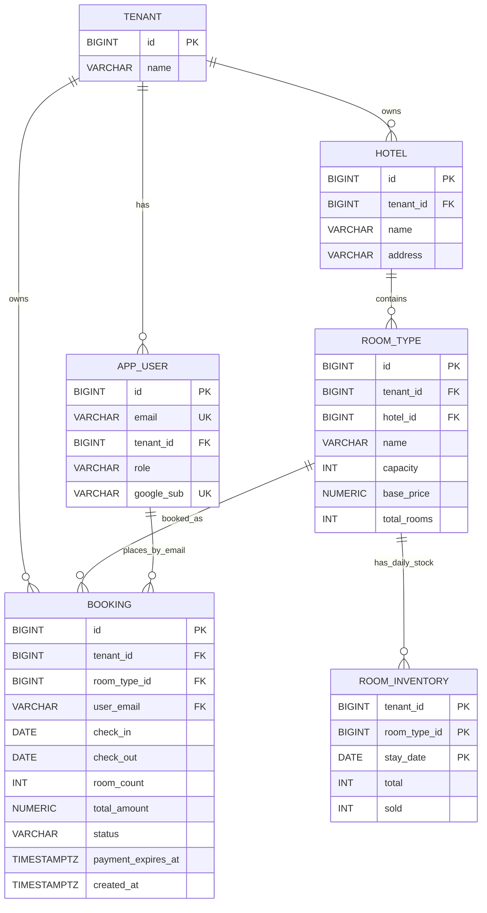
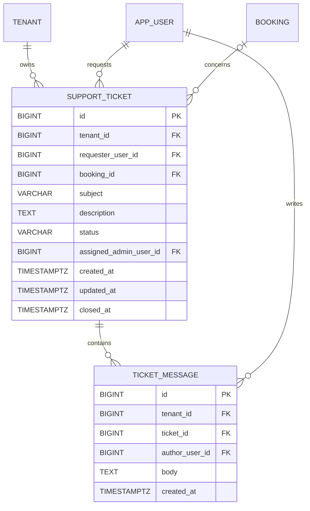
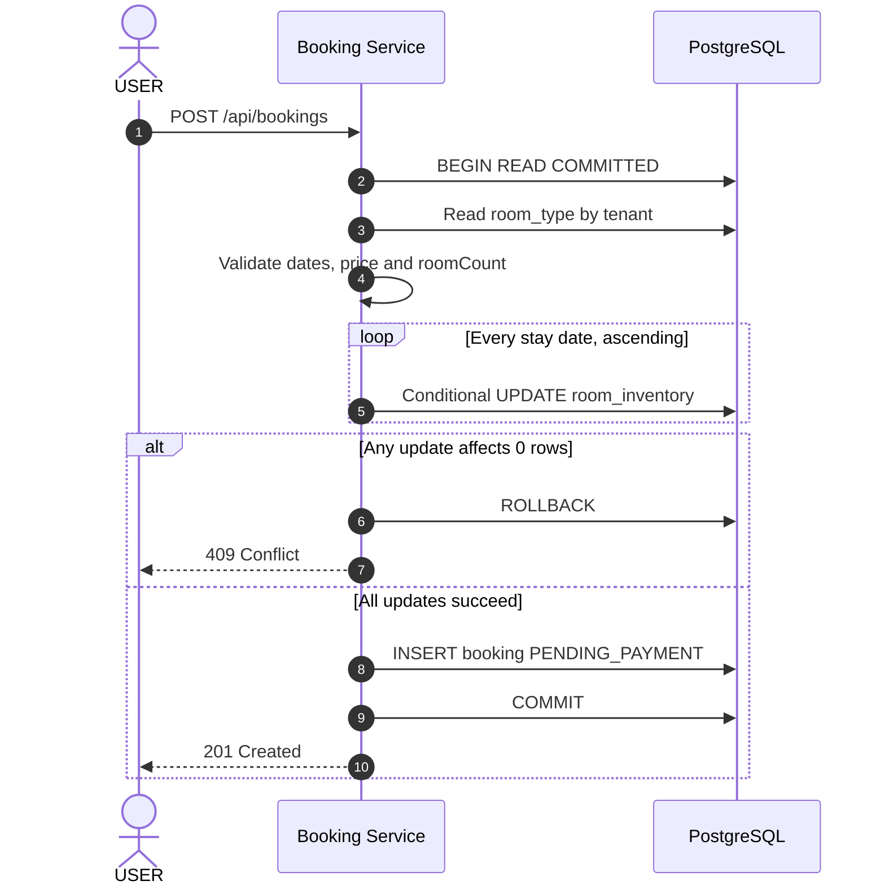
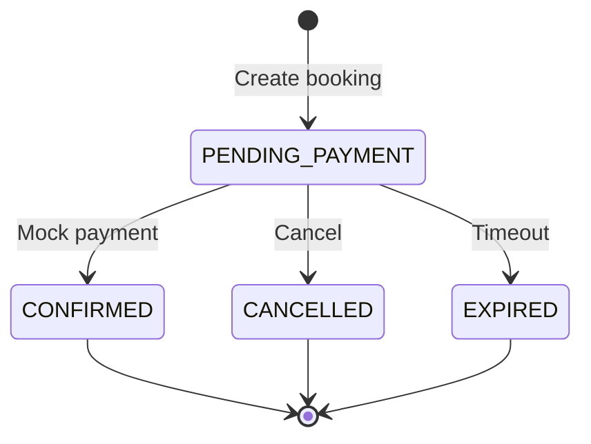
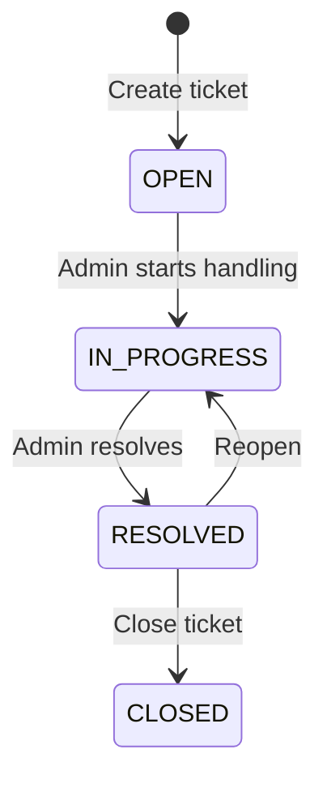
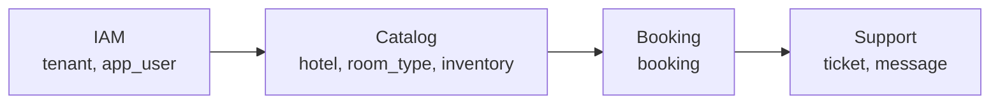

# StayHub — Data Model & Database Architecture

> **Phiên bản:** ERD v2 + 3-App Architecture  
> **Cập nhật:** 04/11/2026  
> **Database:** PostgreSQL `hotelbooking`  
> **Schema:** `public`  
> **Migration:** Flyway  
> **Trạng thái:** PROPOSED — Chưa xác minh toàn bộ migrations và source code  
> **Nguồn chuẩn:** Tài liệu này thay thế `erd-v2.md` trong bộ documentation đang sử dụng.

---

## 1. Overview

StayHub sử dụng PostgreSQL để lưu trữ dữ liệu định danh, khách sạn, loại phòng, tồn kho theo đêm, booking và yêu cầu hỗ trợ.

Thiết kế phục vụ ba ứng dụng:

| Application | Role | Data Domain |
|---|---|---|
| Booking Web | `USER` | Hotel, Room Type, Availability, Booking |
| Admin Dashboard | `ADMIN` | Hotel, Room Type, Inventory, Booking |
| Support Center | `USER`, `ADMIN` | Support Ticket, Ticket Message, Booking Reference |

### 1.1. Design Principles

1. **IAM compatibility:** Giữ nguyên `tenant`, `app_user`, `google_sub` và identity model của IAM developer.
2. **Tenant isolation:** Dữ liệu nghiệp vụ phải được phân tách theo `tenant_id`.
3. **Per-night inventory:** Tồn kho được quản lý theo từng đêm, không theo từng phòng vật lý.
4. **Transactional consistency:** Booking và inventory được cập nhật trong cùng PostgreSQL transaction.
5. **Data ownership:** Mỗi service có trách nhiệm quản lý dữ liệu rõ ràng.
6. **Referential integrity:** Sử dụng composite foreign keys để ngăn liên kết dữ liệu khác tenant.
7. **Migration safety:** Không thay đổi migrations đã áp dụng trên shared database nếu chưa có kế hoạch migration.

### 1.2. Database Scope

```text
PostgreSQL
└── hotelbooking
    └── public
        ├── tenant
        ├── app_user
        ├── hotel
        ├── room_type
        ├── room_inventory
        ├── booking
        ├── support_ticket       [PROPOSED]
        └── ticket_message       [PROPOSED]
```

Trong phạm vi MVP, các services sử dụng chung database để hỗ trợ transaction nhất quán giữa Booking và Inventory.

---

## 2. Entity Relationship Diagram

### 2.1. Core Booking ERD



### 2.2. Support Domain ERD — Proposed



**Lưu ý:** Support schema là thiết kế đề xuất. Chưa có bằng chứng đã tồn tại trong migrations.

---

## 3. Data Ownership & Service Boundaries

| Table | Migration Owner | Write Responsibility |
|---|---|---|
| `tenant` | IAM Service | IAM |
| `app_user` | IAM Service | IAM |
| `hotel` | Catalog Service | Catalog |
| `room_type` | Catalog Service | Catalog |
| `room_inventory` | Catalog Service | Catalog tạo dòng, sửa `total`; Booking sửa `sold` |
| `booking` | Booking Service | Booking |
| `support_ticket` | Support Service | Support |
| `ticket_message` | Support Service | Support |

### 3.1. Shared Database Trade-off

Trong MVP, Catalog và Booking cùng truy cập bảng `room_inventory`.

- Catalog quản lý cấu hình inventory.
- Booking quản lý lượng tồn đã giữ hoặc đã bán.
- Booking cập nhật inventory và booking trong một transaction.
- Không cần HTTP call từ Booking sang Catalog khi giữ phòng.

Đây là **logical service ownership**, chưa phải database-level isolation hoàn toàn.

Nếu cần đảm bảo quyền ghi bằng database credentials, phải thiết kế PostgreSQL roles và column-level privileges tương ứng.

---

## 4. IAM Identity Model

IAM Service của developer tiếp tục sở hữu:

```text
tenant
app_user
```

### 4.1. Tenant

| Column | Type | Description |
|---|---|---|
| `id` | BIGINT | Tenant identifier |
| `name` | VARCHAR | Tenant name |

### 4.2. App User

| Column | Type | Description |
|---|---|---|
| `id` | BIGINT | Internal user identifier |
| `tenant_id` | BIGINT | Tenant reference |
| `email` | VARCHAR | Verified email, lowercase |
| `role` | VARCHAR | `USER` hoặc `ADMIN` |
| `google_sub` | VARCHAR | Stable Google identity binding, nullable before binding |

### 4.3. Identity Rules

- `app_user` phải được provision trước khi đăng nhập.
- IAM kiểm tra `email_verified`.
- IAM bind và xác minh `google_sub`.
- Không tự động tạo tài khoản khi Google login.
- JWT `sub` tương ứng với `app_user.id`.
- JWT `tenant_id` là numeric claim.
- `role` chỉ nhận `USER` hoặc `ADMIN`.

Không thêm Keycloak identity columns.

### 4.4. Existing Booking Ownership

Theo hướng triển khai của developer:

```text
booking.user_email
    |
    v
app_user.email
```

Trong MVP, giữ nguyên `booking.user_email`.

Không tự ý chuyển sang `booking.user_id` khi chưa có migration plan.

Với các bảng Support mới, sử dụng `requester_user_id` và `author_user_id` tham chiếu tới `app_user.id`.

Nếu tương lai một user có thể thuộc nhiều tenant, cần thiết kế membership table riêng. Đây không phải phạm vi hiện tại.

---

## 5. Core Table Definitions

### 5.1. Hotel

```sql
CREATE TABLE hotel (
    id BIGINT GENERATED ALWAYS AS IDENTITY PRIMARY KEY,
    tenant_id BIGINT NOT NULL REFERENCES tenant(id),
    name VARCHAR(100) NOT NULL,
    address VARCHAR(255) NOT NULL,

    CONSTRAINT uq_hotel_tenant_id
        UNIQUE (tenant_id, id)
);
```

Một tenant có thể sở hữu nhiều khách sạn.

### 5.2. Room Type

```sql
CREATE TABLE room_type (
    id BIGINT GENERATED ALWAYS AS IDENTITY PRIMARY KEY,
    tenant_id BIGINT NOT NULL,
    hotel_id BIGINT NOT NULL,
    name VARCHAR(100) NOT NULL,
    capacity INT NOT NULL,
    base_price NUMERIC(10, 2) NOT NULL,
    total_rooms INT NOT NULL,

    CONSTRAINT uq_room_type_tenant_id
        UNIQUE (tenant_id, id),

    CONSTRAINT fk_room_type_hotel_same_tenant
        FOREIGN KEY (tenant_id, hotel_id)
        REFERENCES hotel(tenant_id, id),

    CONSTRAINT chk_room_type_capacity
        CHECK (capacity > 0),

    CONSTRAINT chk_room_type_price
        CHECK (base_price > 0),

    CONSTRAINT chk_room_type_total_rooms
        CHECK (total_rooms >= 0)
);
```

**Ý nghĩa:**

- `capacity`: Số khách tối đa mỗi phòng.
- `base_price`: Giá một phòng mỗi đêm.
- `total_rooms`: Số phòng mặc định khi tạo inventory.

Không sử dụng bảng `room` vật lý trong thiết kế MVP.

### 5.3. Room Inventory

```sql
CREATE TABLE room_inventory (
    tenant_id BIGINT NOT NULL,
    room_type_id BIGINT NOT NULL,
    stay_date DATE NOT NULL,
    total INT NOT NULL,
    sold INT NOT NULL DEFAULT 0,

    PRIMARY KEY (
        tenant_id,
        room_type_id,
        stay_date
    ),

    CONSTRAINT fk_inventory_room_type_same_tenant
        FOREIGN KEY (tenant_id, room_type_id)
        REFERENCES room_type(tenant_id, id),

    CONSTRAINT chk_inventory_not_oversold
        CHECK (sold >= 0 AND sold <= total)
);
```

Mỗi dòng đại diện cho tồn kho của một loại phòng trong một đêm.

```text
available_rooms = total - sold
```

Không lưu `available_rooms` thành một cột riêng.

### 5.4. Booking

```sql
CREATE TABLE booking (
    id BIGINT GENERATED ALWAYS AS IDENTITY PRIMARY KEY,
    tenant_id BIGINT NOT NULL REFERENCES tenant(id),
    room_type_id BIGINT NOT NULL,
    user_email VARCHAR(255) NOT NULL,
    check_in DATE NOT NULL,
    check_out DATE NOT NULL,
    room_count INT NOT NULL,
    total_amount NUMERIC(14, 2) NOT NULL,
    status VARCHAR(20) NOT NULL DEFAULT 'PENDING_PAYMENT',
    payment_expires_at TIMESTAMPTZ NOT NULL,
    created_at TIMESTAMPTZ NOT NULL DEFAULT now(),

    CONSTRAINT uq_booking_tenant_id
        UNIQUE (tenant_id, id),

    CONSTRAINT chk_booking_status
        CHECK (
            status IN (
                'PENDING_PAYMENT',
                'CONFIRMED',
                'CANCELLED',
                'EXPIRED'
            )
        ),

    CONSTRAINT chk_booking_email_lowercase
        CHECK (user_email = lower(user_email)),

    CONSTRAINT chk_booking_checkout_after_checkin
        CHECK (check_out > check_in),

    CONSTRAINT chk_booking_room_count
        CHECK (room_count > 0),

    CONSTRAINT chk_booking_total_amount
        CHECK (total_amount > 0),

    CONSTRAINT fk_booking_room_type_same_tenant
        FOREIGN KEY (tenant_id, room_type_id)
        REFERENCES room_type(tenant_id, id),

    CONSTRAINT fk_booking_user_same_tenant
        FOREIGN KEY (tenant_id, user_email)
        REFERENCES app_user(tenant_id, email)
);
```

**Prerequisite:** IAM migration phải có unique constraint hoặc unique index trên `(tenant_id, email)` để composite FK hoạt động.

```sql
-- Chỉ bổ sung nếu IAM schema chưa có constraint tương đương.
-- Cần kiểm tra dữ liệu trùng trước khi áp dụng.

ALTER TABLE app_user
ADD CONSTRAINT uq_app_user_tenant_email
UNIQUE (tenant_id, email);
```

Không tự động chạy lệnh này nếu IAM đã có constraint tương ứng.

### 5.5. Booking Indexes

```sql
CREATE INDEX idx_booking_tenant_user
ON booking(tenant_id, user_email);

CREATE INDEX idx_booking_room_type
ON booking(tenant_id, room_type_id);

CREATE INDEX idx_booking_pending_expiry
ON booking(payment_expires_at)
WHERE status = 'PENDING_PAYMENT';
```

**Giải thích:**

- `idx_booking_tenant_user`: Tối ưu truy vấn booking của USER.
- `idx_booking_room_type`: Tối ưu truy vấn theo loại phòng.
- `idx_booking_pending_expiry`: Tối ưu job xử lý booking hết hạn.

---

## 6. Booking Inventory Model

### 6.1. Stay Interval

Khoảng lưu trú sử dụng quy tắc:

```text
[checkIn, checkOut)
```

Ví dụ:

```text
checkIn  = 2026-11-24
checkOut = 2026-11-26
```

Số đêm:

```text
2026-11-24
2026-11-25
```

Ngày `2026-11-26` không được tính vào inventory.

### 6.2. Price Calculation

```text
total_amount =
    base_price
    × number_of_nights
    × room_count
```

Ví dụ:

```text
500,000 × 2 × 1 = 1,000,000 VND
```

`total_amount` được chốt khi tạo booking.

Thay đổi `room_type.base_price` sau đó không ảnh hưởng booking đã tạo.

### 6.3. Inventory Invariants

Các quy tắc bắt buộc:

1. `total >= 0`.
2. `sold >= 0`.
3. `sold <= total`.
4. Mỗi loại phòng có tối đa một inventory row cho mỗi ngày.
5. Không có inventory row nghĩa là ngày đó chưa mở bán.
6. Booking chỉ giữ phòng nếu đủ tồn kho ở tất cả các đêm.
7. Booking và inventory phải được cập nhật atomically.
8. Cancellation và expiry phải hoàn inventory đúng một lần.

---

## 7. Availability Search

### 7.1. API

```http
GET /api/hotels/1/availability?checkIn=2026-11-24&checkOut=2026-11-26
Authorization: Bearer <JWT>
```

### 7.2. SQL Query

```sql
SELECT
    rt.id,
    rt.name,
    rt.capacity,
    rt.base_price,
    MIN(i.total - i.sold) AS available_rooms
FROM room_type rt
JOIN room_inventory i
    ON i.tenant_id = rt.tenant_id
   AND i.room_type_id = rt.id
WHERE rt.tenant_id = :tenantId
  AND rt.hotel_id = :hotelId
  AND i.stay_date >= :checkIn
  AND i.stay_date < :checkOut
GROUP BY
    rt.id
HAVING COUNT(*) = :nights
   AND MIN(i.total - i.sold) > 0
ORDER BY rt.id;
```

### 7.3. Query Rules

- `tenantId` lấy từ JWT.
- `hotelId` phải thuộc tenant hiện tại.
- `checkOut > checkIn`.
- `checkIn` không được ở quá khứ.
- Thời gian lưu trú tối đa 30 đêm.
- Kiểm tra đủ inventory row cho toàn bộ khoảng ngày.
- Trả về số phòng còn trống nhỏ nhất trong kỳ lưu trú.

Ngày hiện tại được xác định theo timezone:

```text
Asia/Ho_Chi_Minh
```

### 7.4. Example Response

```json
[
  {
    "roomTypeId": 1,
    "name": "Standard",
    "capacity": 2,
    "pricePerNight": 500000.00,
    "nights": 2,
    "totalPricePerRoom": 1000000.00,
    "availableRooms": 1
  }
]
```

### 7.5. Error Handling

| Condition | HTTP |
|---|---|
| Available room types found | `200` |
| No availability | `200 []` |
| Invalid date range | `400` |
| Hotel not found | `404` |
| Hotel belongs to another tenant | `404` |

---

## 8. Booking Transaction

### 8.1. Booking Request

```json
{
  "roomTypeId": 1,
  "checkIn": "2026-11-24",
  "checkOut": "2026-11-26",
  "roomCount": 1
}
```

### 8.2. Transaction Flow



### 8.3. Conditional Inventory Update

```sql
UPDATE room_inventory
SET sold = sold + :roomCount
WHERE tenant_id = :tenantId
  AND room_type_id = :roomTypeId
  AND stay_date = :stayDate
  AND sold + :roomCount <= total;
```

Nếu một đêm cập nhật được 0 dòng:

```text
ROLLBACK entire transaction
HTTP 409 Conflict
```

### 8.4. Isolation Level

Thiết kế sử dụng:

```text
READ COMMITTED
```

PostgreSQL sẽ khóa các dòng được cập nhật.

Khi transaction khác hoàn tất, điều kiện `sold + :roomCount <= total` được đánh giá lại theo giá trị mới nhất.

Các ngày phải được cập nhật theo thứ tự tăng dần để giảm nguy cơ deadlock.

### 8.5. Transaction Requirements

- Sử dụng `@Transactional`.
- Không commit từng đêm riêng lẻ.
- Không tạo booking nếu một đêm hết phòng.
- Không lấy giá phòng từ frontend.
- Không lấy tenant từ request body.
- Rollback cả booking và inventory khi có lỗi.
- Chỉ trả `201` sau khi transaction thành công.

---

## 9. Booking Lifecycle

### 9.1. State Machine



### 9.2. Status Definition

| Status | Inventory Reserved | Description |
|---|---|---|
| `PENDING_PAYMENT` | Yes | Waiting for mock payment |
| `CONFIRMED` | Yes | Payment successful |
| `CANCELLED` | No | Cancelled and released |
| `EXPIRED` | No | Expired and released |

### 9.3. Mock Payment

```sql
UPDATE booking
SET status = 'CONFIRMED'
WHERE id = :bookingId
  AND tenant_id = :tenantId
  AND user_email = :email
  AND status = 'PENDING_PAYMENT'
  AND payment_expires_at > now();
```

Chỉ cập nhật booking status.

Không tăng `sold` thêm lần nữa.

Nếu không cập nhật được dòng nào, trả `409` sau khi đã kiểm tra ownership.

### 9.4. Cancellation

```sql
UPDATE booking
SET status = 'CANCELLED'
WHERE id = :bookingId
  AND tenant_id = :tenantId
  AND user_email = :email
  AND status = 'PENDING_PAYMENT';
```

Chỉ khi trạng thái chuyển thành công mới hoàn inventory.

```sql
UPDATE room_inventory
SET sold = sold - :roomCount
WHERE tenant_id = :tenantId
  AND room_type_id = :roomTypeId
  AND stay_date = :stayDate
  AND sold >= :roomCount;
```

Cả hai thao tác phải nằm trong cùng transaction.

### 9.5. Expiry Job

Job tìm các booking:

```sql
SELECT id
FROM booking
WHERE status = 'PENDING_PAYMENT'
  AND payment_expires_at <= now()
ORDER BY payment_expires_at;
```

Với mỗi booking:

1. Chuyển trạng thái sang `EXPIRED` có điều kiện.
2. Chỉ khi transition thành công mới hoàn inventory.
3. Commit toàn bộ thay đổi trong một transaction.
4. Nếu transition không thành công, không hoàn inventory.

Job có thể chạy lặp lại nhưng không được hoàn phòng hai lần.

---

## 10. Concurrency & Overselling Prevention

### 10.1. Race Condition Scenario

Giả sử:

```text
room_type_id = 5
total = 1
sold = 0
available = 1
```

Hai người cùng đặt một phòng trong cùng khoảng ngày.

| Step | Transaction A | Transaction B |
|---|---|---|
| 1 | UPDATE inventory | Chờ row lock |
| 2 | `sold: 0 → 1` | Chờ |
| 3 | COMMIT | Tiếp tục |
| 4 | Booking created | Điều kiện `1 + 1 <= 1` sai |
| 5 | Success | ROLLBACK, HTTP 409 |

### 10.2. Database Guarantees

Database đảm bảo:

- Không có inventory row trùng khóa chính.
- Không cho phép `sold > total`.
- Không cho phép `sold < 0`.
- Không cho phép liên kết `room_type` khác tenant.
- Atomicity của transaction.

Business Service đảm bảo:

- Cập nhật inventory khi tạo booking.
- Hoàn inventory khi hủy/hết hạn.
- Không hoàn inventory hai lần.
- Đồng bộ booking status và inventory.

### 10.3. Reconciliation SQL

Truy vấn kiểm tra inventory có khớp với các booking đang giữ phòng hay không:

```sql
SELECT
    i.tenant_id,
    i.room_type_id,
    i.stay_date,
    i.sold,
    COALESCE(SUM(b.room_count), 0) AS expected_sold
FROM room_inventory i
LEFT JOIN booking b
    ON b.tenant_id = i.tenant_id
   AND b.room_type_id = i.room_type_id
   AND b.status IN ('PENDING_PAYMENT', 'CONFIRMED')
   AND i.stay_date >= b.check_in
   AND i.stay_date < b.check_out
GROUP BY
    i.tenant_id,
    i.room_type_id,
    i.stay_date,
    i.sold
HAVING i.sold <> COALESCE(SUM(b.room_count), 0);
```

**Acceptance criteria:**

```text
Expected rows = 0
```

Chạy sau booking tests, cancellation tests, expiry tests và concurrent booking tests.

---

## 11. Demo Seed Data

### 11.1. Hotel

| id | tenant_id | name | address |
|---|---|---|---|
| 1 | 1 | Demo Hotel A - Hà Nội | 12 Hàng Trống, Hoàn Kiếm, Hà Nội |
| 2 | 2 | Demo Hotel B - TP.HCM | 25 Nguyễn Huệ, Quận 1, TP.HCM |
| 3 | 1 | Demo Hotel A - Đà Nẵng | 08 Bạch Đằng, Hải Châu, Đà Nẵng |

### 11.2. Room Type

| id | tenant_id | hotel_id | name | capacity | base_price | total_rooms |
|---|---|---|---|---|---|---|
| 1 | 1 | 1 | Standard | 2 | 500000 | 3 |
| 2 | 1 | 1 | Deluxe | 2 | 900000 | 4 |
| 3 | 2 | 2 | Standard | 2 | 450000 | 5 |
| 4 | 2 | 2 | Deluxe | 2 | 850000 | 6 |
| 5 | 1 | 3 | Race Test | 2 | 500000 | 1 |
| 6 | 1 | 3 | Standard | 2 | 600000 | 5 |

### 11.3. Inventory Seed

Khoảng ngày cố định phục vụ demo:

```text
2026-11-01 → 2027-01-31
```

```sql
INSERT INTO room_inventory (
    tenant_id,
    room_type_id,
    stay_date,
    total
)
SELECT
    rt.tenant_id,
    rt.id,
    d::date,
    rt.total_rooms
FROM room_type rt
CROSS JOIN generate_series(
    DATE '2026-11-01',
    DATE '2027-01-31',
    INTERVAL '1 day'
) AS d;
```

**Lưu ý:**

- Khoảng ngày seed là cố định, chỉ phù hợp với demo.
- Ngày ngoài khoảng seed sẽ không có inventory.
- Chưa có job tự mở bán các ngày mới.
- Khi ADMIN tạo loại phòng mới, Catalog phải tạo inventory rows trong cùng transaction.

### 11.4. Inventory Example

Giả sử Standard có `total = 3`:

| stay_date | total | sold | available |
|---|---|---|---|
| 2026-11-23 | 3 | 0 | 3 |
| 2026-11-24 | 3 | 1 | 2 |
| 2026-11-25 | 3 | 2 | 1 |
| 2026-11-26 | 3 | 1 | 2 |
| 2026-11-27 | 3 | 0 | 3 |

Nếu khách đặt thêm một phòng từ 24/11 đến 26/11:

| stay_date | sold_before | sold_after |
|---|---|---|
| 2026-11-24 | 1 | 2 |
| 2026-11-25 | 2 | 3 |

Ngày 26/11 không thay đổi.

---

## 12. Support Domain — Proposed Schema

Support Center là ứng dụng thứ ba, dùng chung IAM với Booking và Admin.

### 12.1. Support Ticket

```sql
CREATE TABLE support_ticket (
    id BIGINT GENERATED ALWAYS AS IDENTITY PRIMARY KEY,
    tenant_id BIGINT NOT NULL,
    requester_user_id BIGINT NOT NULL,
    booking_id BIGINT NULL,
    subject VARCHAR(200) NOT NULL,
    description TEXT NOT NULL,
    status VARCHAR(20) NOT NULL DEFAULT 'OPEN',
    assigned_admin_user_id BIGINT NULL,
    created_at TIMESTAMPTZ NOT NULL DEFAULT now(),
    updated_at TIMESTAMPTZ NOT NULL DEFAULT now(),
    closed_at TIMESTAMPTZ NULL,

    CONSTRAINT uq_support_ticket_tenant_id
        UNIQUE (tenant_id, id),

    CONSTRAINT fk_support_requester
        FOREIGN KEY (tenant_id, requester_user_id)
        REFERENCES app_user(tenant_id, id),

    CONSTRAINT fk_support_booking
        FOREIGN KEY (tenant_id, booking_id)
        REFERENCES booking(tenant_id, id),

    CONSTRAINT fk_support_assignee
        FOREIGN KEY (tenant_id, assigned_admin_user_id)
        REFERENCES app_user(tenant_id, id),

    CONSTRAINT chk_support_status
        CHECK (
            status IN (
                'OPEN',
                'IN_PROGRESS',
                'RESOLVED',
                'CLOSED'
            )
        ),

    CONSTRAINT chk_support_subject
        CHECK (length(trim(subject)) > 0),

    CONSTRAINT chk_support_description
        CHECK (length(trim(description)) > 0)
);
```

**Prerequisite:** `app_user` cần unique constraint trên `(tenant_id, id)` nếu IAM migration chưa có.

```sql
-- Chỉ bổ sung nếu chưa tồn tại constraint tương đương.
ALTER TABLE app_user
ADD CONSTRAINT uq_app_user_tenant_id
UNIQUE (tenant_id, id);
```

### 12.2. Ticket Message

```sql
CREATE TABLE ticket_message (
    id BIGINT GENERATED ALWAYS AS IDENTITY PRIMARY KEY,
    tenant_id BIGINT NOT NULL,
    ticket_id BIGINT NOT NULL,
    author_user_id BIGINT NOT NULL,
    body TEXT NOT NULL,
    created_at TIMESTAMPTZ NOT NULL DEFAULT now(),

    CONSTRAINT fk_ticket_message_ticket
        FOREIGN KEY (tenant_id, ticket_id)
        REFERENCES support_ticket(tenant_id, id),

    CONSTRAINT fk_ticket_message_author
        FOREIGN KEY (tenant_id, author_user_id)
        REFERENCES app_user(tenant_id, id),

    CONSTRAINT chk_ticket_message_body
        CHECK (length(trim(body)) > 0)
);
```

### 12.3. Support Indexes

```sql
CREATE INDEX idx_support_ticket_requester
ON support_ticket(tenant_id, requester_user_id);

CREATE INDEX idx_support_ticket_status
ON support_ticket(tenant_id, status, created_at DESC);

CREATE INDEX idx_support_ticket_assignee
ON support_ticket(tenant_id, assigned_admin_user_id);

CREATE INDEX idx_ticket_message_ticket
ON ticket_message(tenant_id, ticket_id, created_at);
```

### 12.4. Support Ownership Rules

**USER:**

- Chỉ được tạo ticket dưới identity của mình.
- Chỉ được xem ticket do mình tạo.
- Nếu ticket liên kết booking, booking phải thuộc chính USER đó.
- Không được tự gán ticket cho ADMIN.
- Không được thay đổi ticket của người dùng khác.

**ADMIN:**

- Chỉ xem và xử lý ticket trong tenant.
- Có thể phản hồi và cập nhật trạng thái.
- Chỉ được assign ticket cho tài khoản `ADMIN` thuộc cùng tenant.

**Database guarantees:**

- Ticket thuộc tenant hợp lệ.
- Booking reference cùng tenant.
- Requester và assignee cùng tenant.
- Message cùng tenant với ticket.

**Service guarantees:**

- Requester là USER đang xác thực.
- Booking thuộc requester.
- Assignee có role ADMIN.
- Author được phép viết vào ticket.
- Ticket status transition hợp lệ.

Composite foreign keys không tự đảm bảo booking thuộc đúng requester; cần kiểm tra tại service.

---

## 13. Support Ticket Lifecycle

### 13.1. State Machine



Đây là state machine đề xuất, cần thống nhất với API contract trước khi triển khai.

### 13.2. Ticket Message Rules

- Message có author được xác thực.
- Message gắn với một ticket trong cùng tenant.
- USER chỉ gửi message vào ticket của mình.
- ADMIN chỉ gửi message vào ticket thuộc tenant.
- Không cho phép frontend tự đặt `author_user_id`.
- Không sửa hoặc xóa message đã tạo trong MVP.
- Thời gian tạo message do server quản lý.

### 13.3. Data Privacy

Support messages có thể chứa thông tin cá nhân.

Yêu cầu:

- Không log nội dung nhạy cảm không cần thiết.
- Không lưu JWT hoặc session cookie trong ticket.
- Không dùng thông tin cá nhân thật làm seed data.
- Cần xác định retention/deletion policy trước production.

---

## 14. Tenant Isolation & Referential Integrity

### 14.1. Tenant-Scoped Queries

Mọi truy vấn nghiệp vụ phải được giới hạn theo tenant.

```sql
SELECT *
FROM hotel
WHERE tenant_id = :tenantId;
```

```sql
SELECT *
FROM booking
WHERE tenant_id = :tenantId
  AND user_email = :authenticatedEmail;
```

```sql
SELECT *
FROM support_ticket
WHERE tenant_id = :tenantId
  AND requester_user_id = :authenticatedUserId;
```

### 14.2. Composite Foreign Keys

Các quan hệ tenant-scoped cần sử dụng composite foreign keys.

Ví dụ:

```sql
FOREIGN KEY (tenant_id, room_type_id)
REFERENCES room_type(tenant_id, id)
```

Điều này ngăn booking tham chiếu tới room type thuộc tenant khác.

### 14.3. Authorization Responsibilities

| Layer | Responsibility |
|---|---|
| IAM | Xác thực identity, phát hành JWT |
| Gateway | JWT validation, route authorization |
| Business Service | Role, tenant, ownership |
| Database | FK, unique constraints, checks |

Không sử dụng database constraints để thay thế business authorization.

---

## 15. Flyway Migration Strategy

### 15.1. Dependency Order



### 15.2. Migration Ownership

| Service | Migration Scope |
|---|---|
| IAM | `tenant`, `app_user` |
| Catalog | `hotel`, `room_type`, `room_inventory` |
| Booking | `booking`, booking indexes |
| Support | `support_ticket`, `ticket_message` |

Mỗi service sử dụng Flyway migration history riêng nếu đây là cấu hình đang được team triển khai.

### 15.3. Existing Migration Conflict

Theo báo cáo developer:

- Catalog trước đây có bảng `room`.
- Booking migration tham chiếu `room`.
- ERD v2 chuyển sang `room_type` và `room_inventory`.
- Booking migration phải được đồng bộ với schema mới.

**Đối với database demo sạch:**

Có thể cập nhật các migrations chưa phát hành rồi tạo lại database.

**Đối với shared database hoặc database có dữ liệu:**

- Không sửa migration đã chạy.
- Tạo migration version mới.
- Kiểm tra dữ liệu hiện tại.
- Xây dựng rollback plan.
- Kiểm tra foreign keys và migration dependencies.

### 15.4. Recommended Migration Sequence

1. IAM tạo `tenant`, `app_user`.
2. Xác nhận các unique constraints cần thiết.
3. Catalog tạo `hotel`, `room_type`, `room_inventory`.
4. Booking tạo `booking` và indexes.
5. Support tạo `support_ticket`, `ticket_message`.
6. Seed dữ liệu demo.
7. Chạy integration tests.
8. Chạy inventory reconciliation.

---

## 16. Data Reset & Reconciliation

### 16.1. Reset Booking Demo

Chỉ sử dụng trên môi trường demo được phép xóa dữ liệu.

```sql
BEGIN;

TRUNCATE TABLE booking RESTART IDENTITY;

UPDATE room_inventory
SET sold = 0;

COMMIT;
```

**Cảnh báo:** Nếu đã triển khai Support với foreign key tới booking, `TRUNCATE booking` có thể bị chặn.

Khi đó cần reset dữ liệu theo đúng dependency order hoặc sử dụng database demo sạch.

Không chạy lệnh reset trên production.

### 16.2. Inventory Reconciliation

Chạy SQL tại mục 10.3.

```text
Expected mismatched rows = 0
```

Nếu có sai lệch:

1. Xác định `tenant_id`, `room_type_id`, `stay_date`.
2. Kiểm tra booking status.
3. Kiểm tra các transaction đã rollback.
4. Kiểm tra cancellation/expiry.
5. Không tự động sửa `sold` nếu chưa xác định nguyên nhân.

---

## 17. Data Model Acceptance Criteria

| Area | Acceptance Criteria |
|---|---|
| IAM compatibility | Giữ nguyên `app_user`, `google_sub`, `booking.user_email` |
| Tenant isolation | Không có cross-tenant reference |
| Room inventory | Không có `sold < 0` hoặc `sold > total` |
| Availability | Chỉ trả về loại phòng còn đủ tất cả các đêm |
| Booking creation | Inventory và booking commit atomically |
| Concurrent booking | Không overselling |
| Mock payment | Không tăng inventory lần thứ hai |
| Cancellation | Hoàn inventory đúng một lần |
| Expiry | Hoàn inventory đúng một lần |
| Reconciliation | 0 dòng sai lệch |
| Support ownership | USER chỉ truy cập ticket của mình |
| Support tenant scope | ADMIN chỉ truy cập ticket trong tenant |
| Migration | Flyway chạy thành công trên database mục tiêu |

Các tiêu chí trên chưa được coi là đã đạt cho đến khi có test evidence.

---

## 18. Known Limitations & Open Decisions

| Issue | Status | Required Action |
|---|---|---|
| Booking migration còn tham chiếu `room` | Reported blocker | Kiểm tra và đồng bộ migration |
| `booking.user_email` thay vì immutable user ID | Existing compatibility | Giữ nguyên MVP; đánh giá migration sau |
| Inventory seed window cố định | Demo-only | Thiết kế rolling inventory generation nếu cần |
| Booking idempotency key | Chưa có | Bổ sung khi nâng cấp |
| Support tables | Proposed | Chốt schema trước implementation |
| Support ticket lifecycle | Proposed | Chốt state transitions |
| Shared PostgreSQL | MVP decision | Đánh giá service/database isolation về sau |
| IAM user multi-tenancy membership | Out of scope | Thiết kế riêng nếu phát sinh |
| Support data retention | Open decision | Thống nhất trước production |

---

## 19. Documentation References

| Document | Responsibility |
|---|---|
| `../README.md` | Tổng quan documentation |
| `architecture.md` | Kiến trúc hệ thống và service boundaries |
| `iam-sso.md` | Authentication, JWT, SSO |
| `iam-integration-tasks.md` | Tích hợp IAM cho 3 App |
| `api-contract.md` | API request/response và authorization |
| `workflows.md` | Booking, payment, cancel, expiry, Support workflows |
| `operations-and-tests.md` | Flyway, seed, race tests, acceptance |
| `decisions.md` | Architecture decisions |

---

## 20. Final Design Decisions

1. **Identity:** Giữ `app_user` và `google_sub` theo IAM developer.
2. **Booking owner:** Giữ `booking.user_email` trong MVP.
3. **Tenant:** Mọi business data được giới hạn theo `tenant_id`.
4. **Inventory:** Sử dụng `room_inventory` theo từng đêm.
5. **Booking:** Dùng conditional update trong PostgreSQL transaction.
6. **Concurrency:** Không overselling, rollback khi bất kỳ đêm nào hết phòng.
7. **Payment:** Mock payment chỉ thay đổi booking status.
8. **Cancellation/Expiry:** Hoàn inventory đúng một lần.
9. **Support:** Sử dụng `app_user.id` cho các bản ghi Support mới.
10. **Migration:** Đồng bộ schema với code trước E2E.

**Trạng thái cuối:** Đây là logical data model mục tiêu cho StayHub 3-App, không phải bằng chứng migrations hiện tại đã triển khai đầy đủ.
