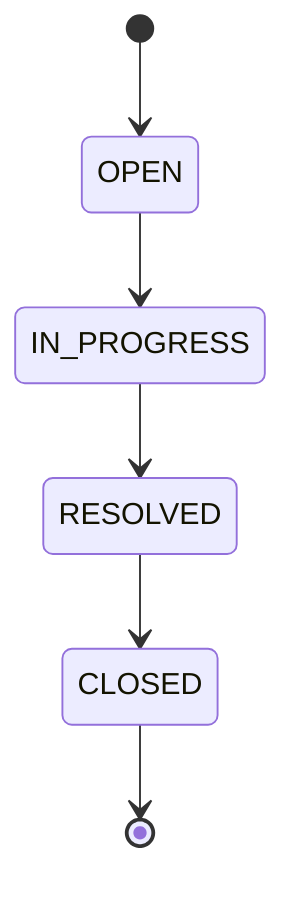
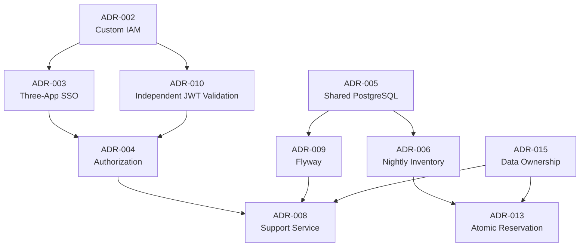

# StayHub — Architecture Decision Records (ADR)

> **Version:** 3-App Architecture + Custom IAM  
> **Updated:** 2026-11-04  
> **Status:** PROPOSED — Pending G2 Architecture Sign-off  
> **Scope:** Architecture, Authentication, Authorization, Multi-Tenancy, Booking, Inventory, Support, Database & Operations  
> **Architecture Principle:** Preserve existing Custom IAM — **No Keycloak**

---

## 1. Purpose

Tài liệu này quản lý các quyết định kiến trúc (Architecture Decision Records — ADR) của hệ thống StayHub.

Mục tiêu:

- Ghi nhận các quyết định kỹ thuật và lý do lựa chọn.
- Xác định trade-offs giữa tính đơn giản, hiệu năng, bảo mật và khả năng mở rộng.
- Phân biệt quyết định đã thống nhất về mặt thiết kế với implementation đã được xác minh.
- Hạn chế thay đổi kiến trúc không cần thiết trong MVP.
- Cung cấp cơ sở cho code review, integration testing và production hardening.

**Lưu ý:** Các quyết định trong tài liệu này là kiến trúc mục tiêu. Chúng không chứng minh rằng source code, migrations hoặc deployment đã hoàn thành.

---

## 2. Decision Status Convention

| Status | Meaning |
|---|---|
| PROPOSED | Đã đề xuất, chưa được phê duyệt |
| ACCEPTED | Đã được phê duyệt về kiến trúc |
| IMPLEMENTED | Đã triển khai và có evidence |
| DEPRECATED | Không còn khuyến nghị sử dụng |
| SUPERSEDED | Được thay thế bởi ADR khác |
| REJECTED | Không được lựa chọn |

### 2.1. Approval Gates

| Gate | Purpose |
|---|---|
| G1 — Architecture Review | Kiểm tra tính nhất quán của thiết kế |
| G2 — Architecture Sign-off | Phê duyệt ADR và integration contracts |
| G3 — Implementation Verification | Xác minh source code, migrations và tests |
| G4 — Release Acceptance | Nghiệm thu E2E, security và operational readiness |

**Current status:** Pending G2.

Không chuyển ADR sang `IMPLEMENTED` chỉ dựa trên tài liệu thiết kế hoặc kết quả test lịch sử của hệ thống hai ứng dụng.

---

## 3. ADR Register

| ID | Decision | Status | Priority |
|---|---|---|---|
| ADR-001 | Three independent frontend applications | PROPOSED | P0 |
| ADR-002 | Preserve Custom IAM + Google OIDC + RS256 JWT | PROPOSED | P0 |
| ADR-003 | HttpSession SSO across three applications | PROPOSED | P0 |
| ADR-004 | RBAC + Tenant Isolation + Resource Ownership | PROPOSED | P0 |
| ADR-005 | Shared PostgreSQL for atomic Booking and Inventory | PROPOSED | P0 |
| ADR-006 | Room-Type Booking with Nightly Inventory | PROPOSED | P0 |
| ADR-007 | Mock Payment for MVP | PROPOSED | P1 |
| ADR-008 | Support Ticket Service with USER/ADMIN roles | PROPOSED | P0 |
| ADR-009 | Immutable Flyway Migrations | PROPOSED | P0 |
| ADR-010 | Independent JWT Verification at Each Service | PROPOSED | P0 |
| ADR-011 | Preserve Existing Booking Email Ownership Contract | PROPOSED | P0 |
| ADR-012 | JWT Fragment Callback for Demo Only | PROPOSED | P1 |
| ADR-013 | Transactional Inventory Reservation | PROPOSED | P0 |
| ADR-014 | Minimal IAM Integration Delta | PROPOSED | P0 |
| ADR-015 | Explicit Service and Data Ownership | PROPOSED | P1 |

---

# 4. Architecture Decisions

## ADR-001 — Three Independent Frontend Applications

**Status:** PROPOSED  
**Priority:** P0  
**Decision Owner:** Architecture Team

### Context

StayHub phục vụ ba nhóm chức năng:

1. Khách hàng đặt phòng.
2. Quản trị khách sạn.
3. Hỗ trợ khách hàng sau đặt phòng.

Các nhóm có UI, navigation và authorization requirements khác nhau.

### Decision

Triển khai ba frontend applications:

| Application | URL | Purpose |
|---|---|---|
| Booking Web | `http://localhost:3000` | Hotel discovery and booking |
| Admin Dashboard | `http://localhost:3001` | Catalog, inventory and booking administration |
| Support Center | `http://localhost:3002` | Customer support and ticket management |

Chỉ sử dụng hai business roles:

```text
USER
ADMIN
```

### Rationale

- Phân tách rõ user experience.
- Frontend có thể phát triển và deploy độc lập.
- Authorization policy dễ xác định.
- Support phục vụ cả USER và ADMIN mà không cần role mới.
- Giữ tương thích với kiến trúc hai frontend hiện tại.

### Trade-offs

**Advantages:**

- Separation of concerns.
- Independent frontend lifecycle.
- Clear route ownership.
- Reduced UI coupling.

**Disadvantages:**

- Phải quản lý ba frontend deployments.
- Phải cấu hình callback riêng cho từng ứng dụng.
- Cần kiểm thử cross-app SSO.
- Có thêm integration complexity.

### Consequences

- IAM phải hỗ trợ ba app identifiers.
- Support Center phải có callback riêng.
- Không chia sẻ frontend JWT trực tiếp giữa các ứng dụng.

---

## ADR-002 — Preserve Custom IAM with Google OIDC

**Status:** PROPOSED  
**Priority:** P0  
**Decision Owner:** IAM Developer + Architecture Team

### Context

IAM developer đã xây dựng hệ thống xác thực riêng bằng Spring Security, Google OIDC, HttpSession và JWT RS256.

Việc thay thế IAM trong giai đoạn tích hợp ba ứng dụng làm tăng chi phí migration và regression risk.

### Decision

Tiếp tục sử dụng:

```text
iam-service :8084
```

Với các thành phần:

- Spring Security OAuth2 Client.
- Google OAuth2/OIDC.
- Authorization Code flow.
- PKCE S256.
- HttpSession SSO.
- Pre-provisioned `app_user`.
- Google `sub` binding.
- Custom JWT RS256 issuer.
- JWKS public key endpoint.

**Không triển khai Keycloak.**

### Rationale

- Tương thích với source code IAM hiện tại.
- Tránh viết lại authentication infrastructure.
- Giảm integration latency và migration risk.
- Giữ nguyên JWT contract cho Gateway và services.
- Tập trung nguồn lực vào Support Service và business workflows.

### Trade-offs

**Advantages:**

- Minimum code changes.
- Preserve existing developer work.
- No new identity infrastructure.
- Full control over IAM business policy.

**Disadvantages:**

- Team tự chịu trách nhiệm security hardening.
- Chưa có full OIDC Authorization Server.
- Chưa có token revocation.
- Chưa có Single Logout.
- Cần quản lý signing keys và session lifecycle.

### Consequences

IAM hiện tại được giữ nguyên trừ khi phát hiện bug hoặc security issue.

Production readiness phải được đánh giá độc lập.

---

## ADR-003 — HttpSession SSO Across Three Applications

**Status:** PROPOSED  
**Priority:** P0  
**Decision Owner:** IAM Developer

### Context

Booking và Admin đã có luồng SSO dựa trên IAM HttpSession theo tài liệu developer.

Support Center cần tham gia cùng cơ chế.

### Decision

Giữ các app identifiers:

```text
app1    -> Booking Web
app2    -> Admin Dashboard
support -> Support Center
```

Role-to-app policy:

| Application | Allowed Roles |
|---|---|
| Booking | USER |
| Admin | ADMIN |
| Support | USER, ADMIN |

Mỗi lần chuyển ứng dụng:

1. Browser truy cập IAM `/auth/start?app=...`.
2. IAM tái sử dụng authenticated HttpSession nếu còn hợp lệ.
3. IAM kiểm tra lại identity, provisioning và role.
4. IAM phát JWT mới.
5. Browser redirect tới callback tương ứng.

### Rationale

- SSO không cần chia sẻ JWT giữa frontend applications.
- Tận dụng IAM session hiện tại.
- Cho phép kiểm tra lại authorization khi vào ứng dụng mới.
- Không cần triển khai identity provider mới.

### Trade-offs

**Advantages:**

- Reduced repeated authentication.
- Clear app authorization.
- Independent frontend tokens.
- Minimal changes to IAM architecture.

**Disadvantages:**

- Phụ thuộc browser cookie và IAM session.
- Multi-tab login có thể gặp race với session-wide app selector.
- JWT expiry và IAM session expiry độc lập.
- Chưa có cross-app logout.

### Consequences

- Phải bổ sung Support callback.
- Phải enforce role-to-app policy trước JWT issuance.
- Phải test USER Booking → Support.
- Phải test ADMIN Admin → Support.
- Phải kiểm tra multi-tab `sso_app` race.

---

## ADR-004 — RBAC + Tenant Isolation + Resource Ownership

**Status:** PROPOSED  
**Priority:** P0  
**Decision Owner:** Backend Architecture Team

### Context

StayHub là hệ thống multi-tenant.

Chỉ kiểm tra role không đủ để bảo vệ dữ liệu của các tenant hoặc người dùng khác nhau.

### Decision

Authorization sử dụng ba lớp:

```text
Role-Based Access Control
        +
Tenant Isolation
        +
Resource Ownership
```

Trusted identity lấy từ JWT đã được verify:

```text
sub
email
tenant_id
role
```

### Authorization Model

| Layer | Example |
|---|---|
| RBAC | USER không được gọi ADMIN API |
| Tenant Isolation | Tenant A không đọc dữ liệu Tenant B |
| Ownership | USER chỉ đọc booking/ticket của mình |

### Response Policy

| Condition | Response |
|---|---|
| Missing/invalid JWT | `401` |
| Wrong role | `403` |
| Cross-tenant resource | `404` |
| Another user's resource | `404` |

### Rationale

- Tránh horizontal privilege escalation.
- Tránh cross-tenant data leakage.
- Frontend route guards không phải security boundary.
- Có thể kiểm thử authorization ở service level.

### Trade-offs

- Mọi repository query cần tenant scoping.
- Business services cần ownership checks.
- Authorization tests phức tạp hơn.
- Cần thống nhất identity contract.

### Consequences

Không tin các giá trị sau từ request payload:

```text
tenantId
userId
role
ownerEmail
```

để quyết định quyền truy cập.

---

## ADR-005 — Shared PostgreSQL for Booking & Inventory

**Status:** PROPOSED  
**Priority:** P0  
**Decision Owner:** Backend Architecture Team

### Context

Booking cần giữ tồn kho phòng theo từng đêm.

Nếu Booking và Inventory sử dụng database độc lập, việc giữ tồn kho nguyên tử sẽ cần distributed coordination.

### Decision

Trong MVP, sử dụng PostgreSQL chung:

```text
Database: hotelbooking
Schema: public
```

Các service sử dụng cùng database nhưng phải xác định rõ data ownership.

### Data Ownership

| Data | Owner |
|---|---|
| `tenant` | IAM |
| `app_user` | IAM |
| `hotel` | Catalog |
| `room_type` | Catalog |
| `room_inventory.total` | Catalog |
| `room_inventory.sold` | Booking |
| `booking` | Booking |
| `support_ticket` | Support |
| `ticket_message` | Support |

### Rationale

Cho phép Booking cập nhật:

```text
room_inventory.sold
+
booking record
```

trong cùng PostgreSQL transaction.

### Trade-offs

**Advantages:**

- ACID transaction.
- Lower implementation complexity.
- No distributed transaction coordinator.
- Easier inventory consistency.

**Disadvantages:**

- Database-level coupling.
- Cross-service schema dependencies.
- Harder independent database scaling.
- Requires coordinated migrations.
- Ownership boundaries are logical rather than physical.

### Consequences

Shared database không có nghĩa mọi service được tự do sửa mọi bảng.

Cross-service writes phải được giới hạn theo ownership contract.

---

## ADR-006 — Room-Type Booking with Nightly Inventory

**Status:** PROPOSED  
**Priority:** P0  
**Decision Owner:** Booking + Catalog Developers

### Context

MVP cần hỗ trợ đặt phòng theo loại phòng và khoảng ngày.

Không yêu cầu gán phòng vật lý cụ thể.

### Decision

Booking bán theo:

```text
Hotel
    |
    +-- Room Type
            |
            +-- Nightly Inventory
```

Inventory key:

```text
(tenant_id, room_type_id, stay_date)
```

### Inventory Model

```text
total = Total available rooms
sold  = Reserved/occupied inventory
```

Invariant:

```text
0 <= sold <= total
```

Khoảng ngày:

```text
[checkIn, checkOut)
```

Ví dụ:

```text
Check-in: 2026-12-01
Check-out: 2026-12-04

Inventory nights:
2026-12-01
2026-12-02
2026-12-03
```

### Rationale

- Đơn giản hơn physical-room assignment.
- Phù hợp hotel booking MVP.
- Hỗ trợ kiểm tra availability theo từng đêm.
- Có thể mở rộng sang pricing và inventory management sau này.

### Trade-offs

- Chưa quản lý số phòng vật lý.
- Chưa có room assignment.
- Chưa có daily pricing.
- Inventory phải được tạo cho các ngày cần bán.

### Consequences

Availability search chỉ là read-only snapshot.

Booking transaction mới là nguồn quyết định cuối cùng về tồn kho.

---

## ADR-007 — Mock Payment Only in MVP

**Status:** PROPOSED  
**Priority:** P1  
**Decision Owner:** Product + Booking Team

### Context

MVP tập trung kiểm chứng authentication, booking workflow, inventory consistency và support operations.

Tích hợp payment gateway thật sẽ tăng scope và operational complexity.

### Decision

Sử dụng mock payment.

Booking lifecycle:

```text
PENDING_PAYMENT
        |
        +-- Mock Payment Success --> CONFIRMED
        |
        +-- Cancel --> CANCELLED
        |
        +-- Timeout --> EXPIRED
```

### Rationale

- Giảm integration dependencies.
- Không cần xử lý real money.
- Tập trung test booking state machine.
- Dễ mô phỏng payment success/failure.

### Trade-offs

- Không có payment gateway thật.
- Không có refund.
- Không có payment reconciliation.
- Không xử lý webhook hoặc settlement.

### Consequences

Không gọi MVP là production-ready payment system.

Mock payment endpoints phải được bảo vệ và không được bật ngoài môi trường cho phép.

---

## ADR-008 — Support Ticket Service with Existing Roles

**Status:** PROPOSED  
**Priority:** P0  
**Decision Owner:** Support Developer + Architecture Team

### Context

Khách hàng cần được hỗ trợ sau khi đặt phòng.

ADMIN cần quản lý ticket theo tenant.

### Decision

Triển khai Support Service mới với:

```text
support_ticket
ticket_message
```

Chỉ sử dụng:

```text
USER
ADMIN
```

### USER Capabilities

- Create ticket.
- Link ticket to own booking.
- List own tickets.
- Read own ticket.
- Reply to own ticket.
- View ticket status.

### ADMIN Capabilities

- View tenant ticket queue.
- Read tenant tickets.
- Reply to tickets.
- Assign tickets.
- Update ticket status.
- Resolve and close tickets.

### Ticket Lifecycle



### Rationale

- Hỗ trợ post-booking operations.
- Không làm phức tạp IAM role model.
- Có thể phát triển Support độc lập.
- Có audit author và timestamp cho messages.

### Trade-offs

- Thêm service và frontend mới.
- Cần authorization integration.
- Cần xác định booking ownership validation.
- Cần quản lý ticket lifecycle và retention.

### Consequences

Support Service phải verify JWT độc lập.

USER chỉ được thao tác trên ticket của mình.

ADMIN chỉ được thao tác trên ticket thuộc tenant.

---

## ADR-009 — Immutable Flyway Migrations

**Status:** PROPOSED  
**Priority:** P0  
**Decision Owner:** Backend + Database Team

### Context

IAM, Catalog, Booking và Support cùng sử dụng PostgreSQL.

Thay đổi migration đã chạy có thể gây checksum mismatch và deployment failure.

### Decision

Flyway migrations đã áp dụng trên shared/deployed database phải được giữ nguyên.

Naming convention:

```text
V<number>__snake_case.sql
```

### Migration Principles

1. Không chỉnh sửa applied migrations.
2. Tạo migration mới cho schema changes.
3. Kiểm tra migration dependencies.
4. Không xóa production/shared data để sửa migration.
5. Dùng additive migration khi có thể.
6. Backfill dữ liệu trước khi áp dụng constraint mới.
7. Validate trước khi cleanup legacy columns.
8. Review cross-service schema changes.

### Migration Dependency

```text
IAM Tables
    |
    v
Catalog Tables
    |
    v
Booking Tables
    |
    v
Support Tables
```

Đây là dependency logic; thứ tự và tên migration thực tế phải được xác minh trong repository.

### Trade-offs

- Cần quản lý versioning chặt chẽ.
- Cross-service changes cần coordination.
- Shared schema tạo coupling.
- Migration rollback không luôn đơn giản.

### Consequences

Không sử dụng:

```bash
docker compose down -v
```

để xử lý lỗi migration trên shared hoặc production database.

Disposable local database chỉ được reset khi có sự đồng ý và không chứa dữ liệu cần giữ.

---

## ADR-010 — Independent JWT Verification at Each Service

**Status:** PROPOSED  
**Priority:** P0  
**Decision Owner:** Security + Backend Team

### Context

Gateway là entry point chính, nhưng business services có thể bị gọi trực tiếp trong development hoặc internal network.

### Decision

Mỗi service tự verify JWT bằng IAM JWKS.

JWKS endpoint:

```text
http://localhost:8084/.well-known/jwks.json
```

Issuer:

```text
http://localhost:8084
```

### Required Checks

- RS256 signature.
- Issuer.
- Expiration.
- Required claims.
- Role.
- Tenant.
- Ownership where applicable.

### Rationale

- Defense in depth.
- Không phụ thuộc hoàn toàn vào Gateway.
- Ngăn bypass authorization qua direct service access.
- Giữ service security boundaries rõ ràng.

### Trade-offs

- Security configuration lặp lại giữa services.
- Cần shared JWT contract.
- Cần quản lý JWKS cache và key rotation.
- Cần integration tests cho từng service.

### Consequences

Gateway validation không thay thế service-level validation.

---

## ADR-011 — Preserve Booking Email Ownership Contract

**Status:** PROPOSED  
**Priority:** P0  
**Decision Owner:** Booking Developer

### Context

Booking implementation hiện tại sử dụng:

```text
booking.user_email
```

Thay đổi sang `user_id` sẽ ảnh hưởng schema, queries, APIs và migration.

### Decision

Giữ Booking ownership contract hiện tại trong MVP.

Ownership:

```text
booking.tenant_id = JWT.tenant_id

AND

booking.user_email = JWT.email
```

Support Service mới có thể sử dụng:

```text
support_ticket.requester_user_id = JWT.sub
```

### Rationale

- Tránh breaking changes.
- Giữ tương thích Booking code.
- Giảm migration risk.
- Cho phép Support dùng stable user identifier ngay từ đầu.

### Trade-offs

- Email có thể thay đổi.
- Ownership phụ thuộc email consistency.
- Booking và Support sử dụng hai identity references khác nhau.

### Consequences

Không tự ý đổi `booking.user_email` thành `booking.user_id`.

Nếu cần migration trong tương lai, phải tạo ADR và migration plan riêng.

---

## ADR-012 — JWT Fragment Callback for Demo Only

**Status:** PROPOSED  
**Priority:** P1  
**Decision Owner:** IAM + Frontend Team

### Context

IAM hiện tại redirect JWT qua URL fragment:

```text
/callback/#token=<JWT>
```

Frontend giữ JWT trong memory.

### Decision

Giữ flow hiện tại trong demo để hạn chế thay đổi IAM.

Frontend phải:

1. Đọc JWT từ fragment.
2. Xóa fragment khỏi URL.
3. Giữ JWT trong memory.
4. Không lưu JWT vào localStorage.
5. Không ghi JWT vào logs.

### Rationale

- Tương thích implementation hiện tại.
- Đơn giản cho demo.
- Không yêu cầu xây dựng BFF ngay.

### Trade-offs

- XSS có thể đọc JWT.
- Browser extensions có thể truy cập token tùy quyền.
- Reload làm mất in-memory token.
- Chưa có refresh token.
- Chưa có Single Logout.

### Consequences

**Không sử dụng flow này làm mặc định production architecture.**

Production replacement cần được quyết định riêng.

Các phương án có thể xem xét:

- BFF.
- HttpOnly Secure cookies.
- SameSite policy.
- CSRF protection.
- Server-side token handling.

---

## ADR-013 — Transactional Inventory Reservation

**Status:** PROPOSED  
**Priority:** P0  
**Decision Owner:** Booking Developer

### Context

Hai người dùng có thể đặt cùng phòng cuối cùng tại cùng thời điểm.

Read-only availability check không bảo đảm inventory consistency.

### Decision

Booking phải giữ tồn kho bằng atomic conditional update trong PostgreSQL transaction.

### Reservation Invariant

```text
sold <= total
```

### Booking Transaction

```text
BEGIN TRANSACTION
    |
    v
Validate tenant and room type
    |
    v
Validate nightly inventory
    |
    v
Atomic conditional UPDATE sold = sold + quantity
    |
    +-- Any night failed --> ROLLBACK
    |
    v
INSERT booking (PENDING_PAYMENT)
    |
    v
COMMIT
```

### Cancellation / Expiry

- `CANCELLED` release inventory.
- `EXPIRED` release inventory.
- Duplicate cancellation không release lần hai.
- Duplicate expiry không release lần hai.
- `CONFIRMED` không tăng inventory lần nữa.

### Rationale

- Prevent overselling.
- ACID consistency.
- Avoid distributed transaction complexity.
- Deterministic concurrency behavior.

### Trade-offs

- Row-level contention khi nhiều booking cùng room type/date.
- Booking phụ thuộc shared PostgreSQL.
- Cần race tests và reconciliation.

### Consequences

Acceptance:

```text
Concurrent booking for last room:
    1 success
    1 conflict

Oversold nights:
    0

Inventory reconciliation mismatches:
    0
```

---

## ADR-014 — Minimum IAM Integration Delta

**Status:** PROPOSED  
**Priority:** P0  
**Decision Owner:** Architecture + IAM Team

### Context

IAM hiện tại đã hỗ trợ hai ứng dụng.

Mục tiêu là tích hợp Support mà không viết lại authentication stack.

### Decision

Chỉ triển khai những thay đổi IAM cần thiết:

1. Add Support callback.
2. Add role-to-app policy.
3. Preserve HttpSession SSO.
4. Issue new JWT for Support.
5. Test three-app flows.
6. Fix security/regression bugs nếu phát hiện.

### Rationale

- Lower implementation cost.
- Reduced regression risk.
- Faster integration.
- Preserve developer ownership.
- Avoid unnecessary architecture changes.

### Trade-offs

- Giữ lại một số technical debt.
- Chưa có full production-grade IAM.
- Cần phân biệt MVP limitations với security blockers.

### Consequences

Không triển khai:

- Keycloak migration.
- Full OAuth2 Authorization Server.
- Refresh token infrastructure.
- Token revocation service.
- Single Logout.

trong minimum integration scope nếu chưa có quyết định mới.

---

## ADR-015 — Explicit Service and Data Ownership

**Status:** PROPOSED  
**Priority:** P1  
**Decision Owner:** Backend Architecture Team

### Context

Shared PostgreSQL tạo nguy cơ business services truy cập và thay đổi dữ liệu không thuộc trách nhiệm của mình.

### Decision

Mỗi service phải có ownership rõ ràng.

| Service | Owned Data | Responsibility |
|---|---|---|
| IAM | `tenant`, `app_user` | Identity, roles, Google binding |
| Catalog | `hotel`, `room_type`, inventory capacity | Hotel and room catalog |
| Booking | `booking`, inventory sold quantity | Booking lifecycle and reservations |
| Support | `support_ticket`, `ticket_message` | Customer support workflow |

### Rationale

- Giảm accidental coupling.
- Dễ review migrations.
- Dễ phân quyền database.
- Chuẩn bị cho khả năng tách database trong tương lai.

### Trade-offs

- Cross-service operations cần contract.
- Shared inventory có ownership chia theo column.
- Database permissions có thể phức tạp hơn.
- Schema evolution cần coordination.

### Consequences

Không thay đổi data ownership tùy tiện.

Cross-service data access cần được review và document.

---

# 5. Decisions Still Open

Các vấn đề sau chưa được chốt tại G2.

| ID | Open Decision | Priority | Owner |
|---|---|---|---|
| OPEN-001 | Production JWT delivery strategy | High | IAM + Security |
| OPEN-002 | IAM logout and cross-app session invalidation | High | IAM |
| OPEN-003 | Multi-tab `sso_app` race solution | Medium | IAM |
| OPEN-004 | Persistent RSA signing keys and rotation | High | IAM + DevOps |
| OPEN-005 | Multi-tenant user membership policy | Medium | Architecture |
| OPEN-006 | Support-to-Booking ownership validation method | High | Support + Booking |
| OPEN-007 | Ticket status transitions and reopen policy | Medium | Support |
| OPEN-008 | Ticket retention, SLA and assignment rules | Medium | Product + Support |
| OPEN-009 | Support Service port and exact API routes | High | Backend + Gateway |
| OPEN-010 | DTO and endpoint contract freeze | High | Backend + Frontend |
| OPEN-011 | Flyway history strategy for shared PostgreSQL | High | Database Team |
| OPEN-012 | Actual Spring Boot/Gradle versions | Medium | Backend |
| OPEN-013 | Booking legacy `room` migration compatibility | Critical | Booking + Catalog |
| OPEN-014 | JWT audience and app-specific claims | Medium | IAM + Security |
| OPEN-015 | Token revocation and stale-role mitigation | High for production | IAM + Security |

---

## 6. Open Decision Analysis

### OPEN-001 — Production JWT Delivery

**Current demo:**

```text
IAM -> Frontend callback/#token=JWT
```

**Candidates:**

| Option | Advantages | Disadvantages |
|---|---|---|
| JWT in memory | Simple | Exposed to XSS |
| BFF + HttpOnly cookie | Better token isolation | Additional backend layer |
| Dedicated OAuth2/OIDC client architecture | Standardized flow | Requires architecture changes |

**Current recommendation:** Preserve demo flow for MVP; evaluate BFF before production.

**Status:** OPEN.

---

### OPEN-002 — IAM Single Logout

Current behavior:

```text
Frontend clears JWT
    |
    v
IAM HttpSession may remain valid
```

Required decision:

- Logout current app only?
- Logout all StayHub apps?
- Invalidate IAM HttpSession?
- Revoke outstanding JWTs?
- Redirect to Google logout or not?

**Status:** OPEN.

---

### OPEN-003 — Multi-Tab Session Race

Current risk:

```text
HttpSession.sso_app
```

Possible solution:

Bind app destination to OAuth2 authorization request/state instead of a single mutable session attribute.

**Status:** OPEN — requires source verification and tests.

---

### OPEN-004 — RSA Signing Key Persistence

Current reported behavior:

```text
IAM restart -> new RSA keypair
```

Production options:

- Persistent private key.
- Secret management.
- Key rotation with `kid`.
- JWKS overlapping keys.

**Status:** OPEN.

---

### OPEN-005 — Multi-Tenant Membership

Current logical model:

```text
app_user
    |
    +-- tenant_id
    +-- role
```

Future option:

```text
app_user
    |
    +-- user_tenant_membership
            |
            +-- tenant_id
            +-- role
```

Không triển khai membership model mới trong MVP nếu chưa có requirement.

**Status:** OPEN.

---

### OPEN-006 — Support Booking Ownership Validation

Hai phương án:

**Option A — Shared Database Query**

Support đọc booking data trong PostgreSQL chung.

Advantages:

- Low latency.
- Simple implementation.
- No network dependency.

Disadvantages:

- Strong schema coupling.
- Support phụ thuộc Booking tables.
- Data ownership boundary yếu hơn.

**Option B — Booking Internal API**

Support gọi Booking Service để xác minh ownership.

Advantages:

- Clear service ownership.
- Encapsulated booking rules.
- Easier future database separation.

Disadvantages:

- Additional network latency.
- Service availability dependency.
- Requires internal authentication and API contract.

**Decision required:** Chọn một phương án trước khi hoàn thiện Support API.

**Status:** OPEN.

---

### OPEN-007 — Ticket State Machine

Proposed:

```text
OPEN -> IN_PROGRESS -> RESOLVED -> CLOSED
```

Cần xác định:

- Có cho phép `RESOLVED -> IN_PROGRESS` không?
- Có cho phép reopen `CLOSED` không?
- USER có được đóng ticket không?
- ADMIN có được chuyển trực tiếp `OPEN -> RESOLVED` không?
- Có cần cancellation state không?

**Status:** OPEN.

---

### OPEN-008 — Ticket Retention & SLA

Cần thống nhất:

- Ticket retention period.
- Message retention period.
- SLA response targets.
- Assignment policy.
- Audit requirements.
- Data deletion policy.

**Status:** OPEN.

---

### OPEN-009 — Support Port & API Routing

Current:

```text
Support Service Port: TBD
```

Proposed Gateway prefix:

```text
/api/support/**
```

Không tự ý freeze port hoặc route khi chưa thống nhất API contract.

**Status:** OPEN.

---

### OPEN-010 — API Contract Freeze

Cần thống nhất:

- Endpoint paths.
- Request DTOs.
- Response DTOs.
- Error format.
- Pagination.
- Ticket status transitions.
- Authorization policy.
- API versioning.

**Status:** OPEN.

---

### OPEN-011 — Flyway History Strategy

Shared PostgreSQL có thể sử dụng:

- Separate Flyway history per service.
- Coordinated shared migration ownership.

Cần đánh giá theo repository và deployment hiện tại.

Không thay đổi Flyway history tùy tiện.

**Status:** OPEN.

---

### OPEN-012 — Actual Build Versions

Cần audit:

- Java version.
- Spring Boot version.
- Spring Security version.
- Gradle version.
- PostgreSQL version.
- Flyway version.
- Testcontainers version.

Không mặc định toàn bộ service đã sử dụng cùng phiên bản.

**Status:** OPEN.

---

### OPEN-013 — Legacy Booking Migration

Developer đã báo khả năng Booking migration tham chiếu:

```text
room
```

Trong khi target data model sử dụng:

```text
room_type
room_inventory
```

Required:

1. Inspect actual migration.
2. Verify Catalog schema.
3. Verify Booking foreign keys.
4. Create additive migration if required.
5. Run integration tests.

**Status:** OPEN — Critical blocker until verified.

---

### OPEN-014 — JWT Audience Contract

Current documented claims:

```text
iss
sub
email
tenant_id
role
iat
exp
```

Cần quyết định:

- Có thêm `aud` không?
- Audience chung cho Gateway và services?
- Có cần app-specific token claims không?
- Service có cần kiểm tra token audience riêng không?

Không tự ý enforce `aud` nếu IAM chưa phát claim này.

**Status:** OPEN.

---

### OPEN-015 — Stale Role & Token Revocation

Current limitation:

```text
JWT role is a signed snapshot
```

Khi role thay đổi trong database, JWT đã phát có thể tiếp tục hợp lệ đến khi hết hạn.

Candidates:

- Short-lived JWT.
- Token version.
- Revocation list.
- Critical-action authorization recheck.
- Session invalidation.

**Status:** OPEN — production hardening.

---

# 7. Rejected or Deferred Alternatives

| Alternative | Decision | Reason |
|---|---|---|
| Replace IAM with Keycloak | Rejected for current scope | Unnecessary migration and regression risk |
| Add SUPPORT role | Deferred | USER/ADMIN sufficient for MVP |
| Separate databases for Booking and Inventory | Deferred | Requires distributed consistency strategy |
| Physical-room assignment | Deferred | Beyond MVP |
| Real payment gateway | Deferred | Scope control |
| Realtime support chat | Deferred | Ticket workflow sufficient |
| Full OIDC Authorization Server | Deferred | Existing IAM integration is priority |
| Immediate migration to `booking.user_id` | Deferred | Preserve current Booking contract |
| JWT sharing between frontend apps | Rejected | Apps should obtain tokens through IAM |
| Frontend-only authorization | Rejected | Backend must enforce RBAC, tenant and ownership |

---

# 8. Architecture Invariants

Các invariants sau phải được bảo toàn trong implementation.

## 8.1. Authentication

```text
Google OIDC
    |
    v
Custom IAM
    |
    v
StayHub JWT RS256
```

- Không dùng Google ID Token trực tiếp cho business APIs.
- Không auto-provision users.
- Không bỏ qua `google_sub` binding.
- Không phát JWT cho app trái role.

## 8.2. Authorization

```text
Valid JWT
    +
Correct Role
    +
Correct Tenant
    +
Correct Ownership
```

- Gateway và service đều phải bảo vệ APIs.
- Không tin tenant hoặc owner từ request body.
- Không để lộ cross-tenant resources.

## 8.3. Booking Inventory

```text
0 <= sold <= total
```

- Booking và stock hold phải atomic.
- Không oversell.
- Cancel/expiry release đúng một lần.
- Payment confirmation không tăng stock lần hai.

## 8.4. Data Integrity

- Applied Flyway migrations immutable.
- Tenant-scoped data access.
- Foreign keys và indexes được xác minh.
- Shared database không đồng nghĩa shared ownership.

## 8.5. Support

- USER chỉ truy cập own tickets.
- ADMIN chỉ truy cập tenant tickets.
- Message author và timestamp được lưu.
- Booking reference phải được authorization-checked.

---

# 9. Architecture Decision Dependencies



---

# 10. G2 Architecture Sign-off Checklist

## Authentication & IAM

- [ ] Custom IAM được giữ nguyên.
- [ ] Không sử dụng Keycloak.
- [ ] Google OIDC + PKCE S256 được giữ nguyên.
- [ ] JWT RS256 contract được thống nhất.
- [ ] `app1`, `app2`, `support` được thống nhất.
- [ ] Role-to-app policy được phê duyệt.
- [ ] Support callback được phê duyệt.

## Backend Architecture

- [ ] Gateway routing được thống nhất.
- [ ] Independent JWT verification được thống nhất.
- [ ] Tenant isolation được thống nhất.
- [ ] Booking ownership contract được giữ nguyên.
- [ ] Support ownership validation approach được quyết định.

## Database & Inventory

- [ ] Shared PostgreSQL được chấp thuận cho MVP.
- [ ] Nightly inventory model được chấp thuận.
- [ ] Atomic booking transaction được chấp thuận.
- [ ] Flyway ownership được thống nhất.
- [ ] Legacy Booking migration được kiểm tra.

## Support

- [ ] Ticket lifecycle được thống nhất.
- [ ] Ticket API contract được thống nhất.
- [ ] Support Service port được xác định.
- [ ] USER/ADMIN permissions được thống nhất.
- [ ] Ticket retention/SLA scope được xác định.

## Operations & Security

- [ ] Demo-only JWT fragment limitation được ghi nhận.
- [ ] IAM Single Logout limitation được ghi nhận.
- [ ] RSA key persistence requirement được ghi nhận.
- [ ] Multi-tab session race được đánh giá.
- [ ] Production hardening backlog được xác định.

---

# 11. Decision Change Control

Mỗi thay đổi kiến trúc quan trọng phải được ghi nhận theo mẫu:

```markdown
## ADR-XXX — Decision Title

**Status:** PROPOSED
**Date:** YYYY-MM-DD
**Owner:** Team / Developer

### Context

Vấn đề cần giải quyết.

### Decision

Quyết định được lựa chọn.

### Alternatives Considered

Các phương án đã đánh giá.

### Rationale

Lý do lựa chọn.

### Trade-offs

Ưu điểm và hạn chế.

### Consequences

Tác động đến hệ thống.

### Acceptance Criteria

Điều kiện nghiệm thu.

### References

Tài liệu liên quan.
```

### Change Rules

- Không thay đổi ADR đã ACCEPTED mà không review tác động.
- Nếu thay thế quyết định, tạo ADR mới và đánh dấu ADR cũ là SUPERSEDED.
- Không đánh dấu IMPLEMENTED nếu chưa có evidence.
- Breaking changes cần migration và rollback strategy.
- Security-sensitive changes cần security review.

---

# 12. Documentation References

| Document | Responsibility |
|---|---|
| `../README.md` | Project documentation overview |
| `architecture.md` | System architecture |
| `iam-sso.md` | Custom IAM and SSO |
| `iam-integration-tasks.md` | IAM integration implementation plan |
| `iam-testing.md` | IAM acceptance tests |
| `api-contract.md` | API contracts and authorization |
| `data-model.md` | Database and inventory model |
| `workflows.md` | End-to-end workflows |
| `operations-and-tests.md` | Operations, migrations and testing |

---

# 13. Final Architecture Status

```text
PROJECT:
    STAYHUB

ARCHITECTURE:
    THREE FRONTEND APPLICATIONS
    CUSTOM IAM
    SPRING BOOT MICROSERVICES
    SHARED POSTGRESQL MVP

AUTHENTICATION:
    GOOGLE OIDC
    AUTHORIZATION CODE + PKCE S256
    HTTPSESSION SSO

AUTHORIZATION:
    CUSTOM JWT RS256
    JWKS
    RBAC
    TENANT ISOLATION
    RESOURCE OWNERSHIP

BOOKING:
    ROOM-TYPE RESERVATION
    NIGHTLY INVENTORY
    ATOMIC STOCK HOLD
    MOCK PAYMENT

SUPPORT:
    TICKET-BASED WORKFLOW
    USER / ADMIN ROLES
    PROPOSED SERVICE

MIGRATIONS:
    FLYWAY
    IMMUTABLE APPLIED MIGRATIONS

KEYCLOAK:
    NOT USED

ADR APPROVAL:
    PENDING G2 SIGN-OFF

IMPLEMENTATION VERIFICATION:
    PENDING G3

RELEASE ACCEPTANCE:
    PENDING G4

PRODUCTION READINESS:
    NOT ESTABLISHED
```

---

## 14. Final Decision Summary

StayHub ưu tiên **tái sử dụng kiến trúc hiện tại, giảm integration complexity và bảo đảm data consistency**.

Các quyết định trọng tâm:

1. Giữ Custom IAM với Google OIDC, PKCE S256, HttpSession SSO và JWT RS256.
2. Mở rộng từ hai frontend lên ba frontend mà không thay đổi authentication stack.
3. Enforce RBAC, tenant isolation và resource ownership tại backend.
4. Sử dụng shared PostgreSQL cho Booking và Inventory trong MVP để bảo đảm atomic transactions.
5. Bán phòng theo room type và nightly inventory thay vì physical-room assignment.
6. Giữ mock payment và Support ticket workflow để kiểm soát phạm vi MVP.
7. Bảo toàn existing IAM/Booking contracts và Flyway migration history.
8. Chỉ mở rộng kiến trúc khi có requirement, evidence và quyết định được phê duyệt.

**Architecture principle:** Minimum necessary complexity, explicit security boundaries, transactional correctness, measurable acceptance criteria.
