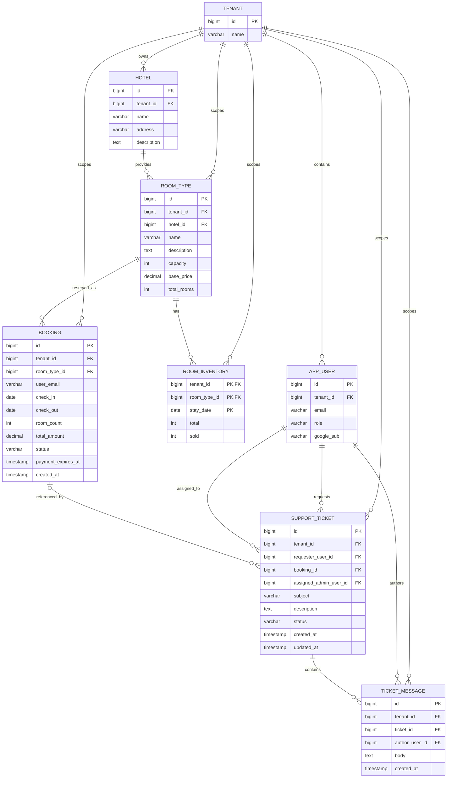
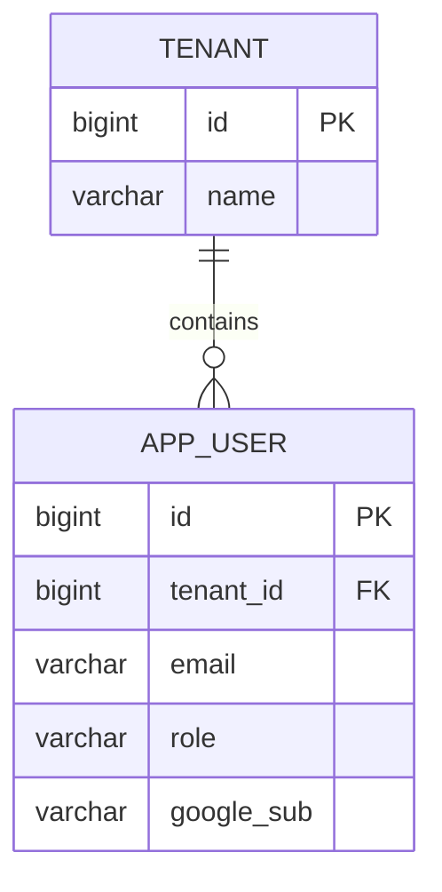
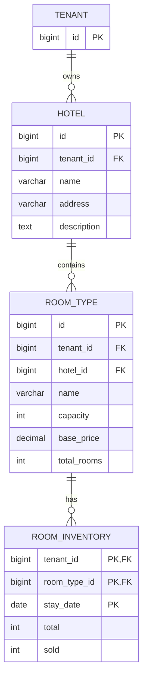
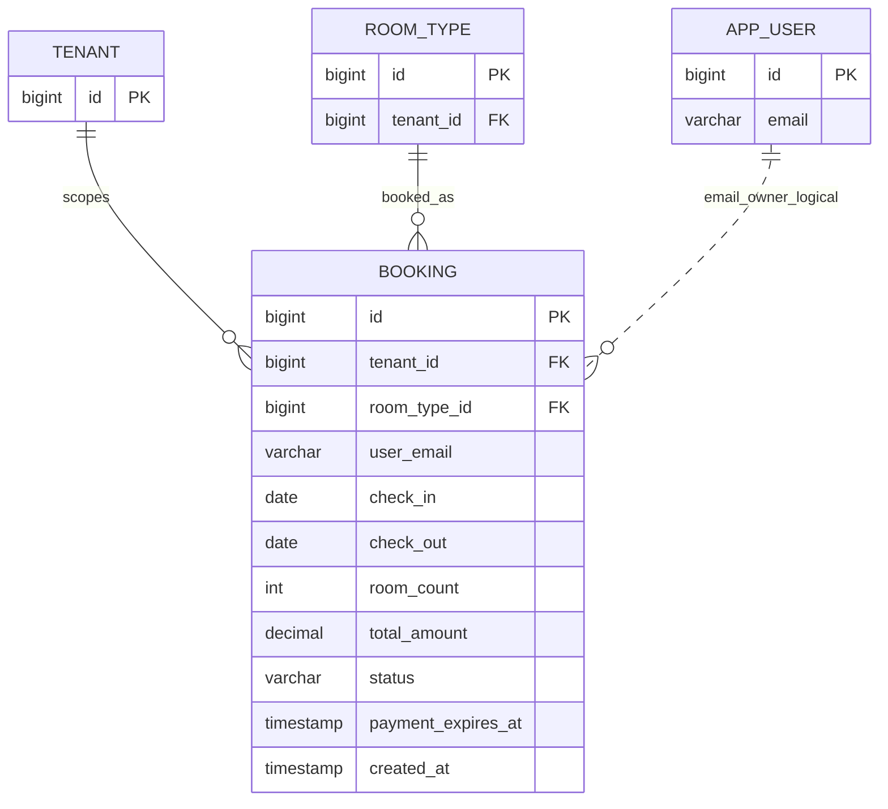
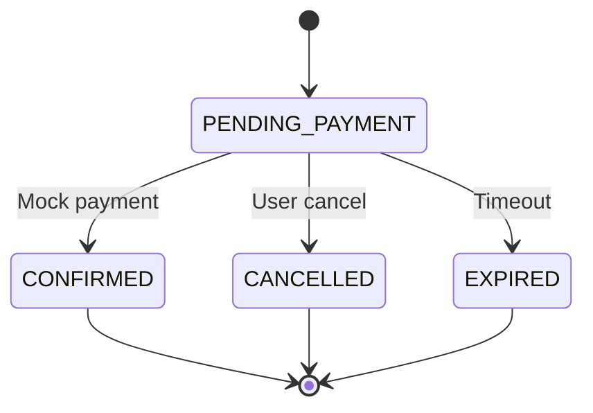
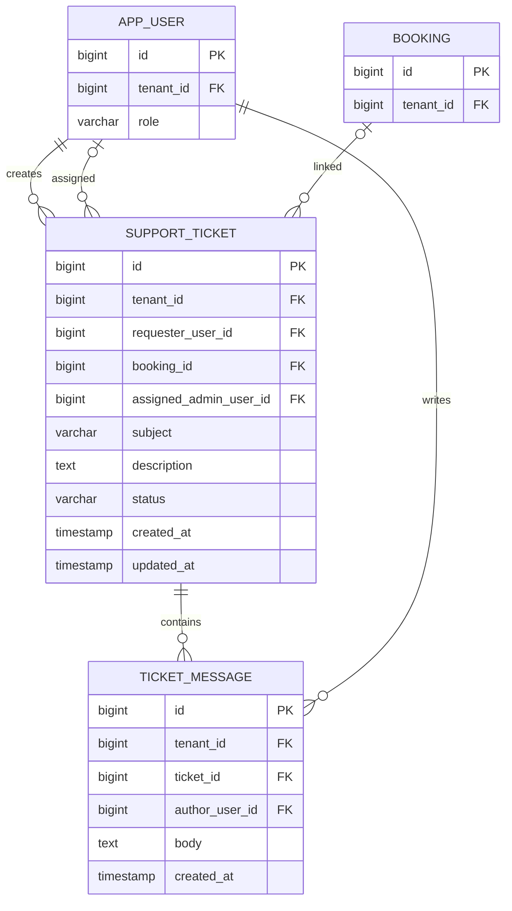
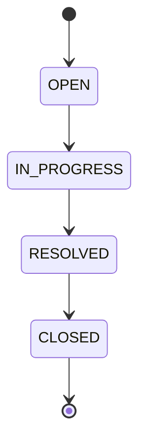
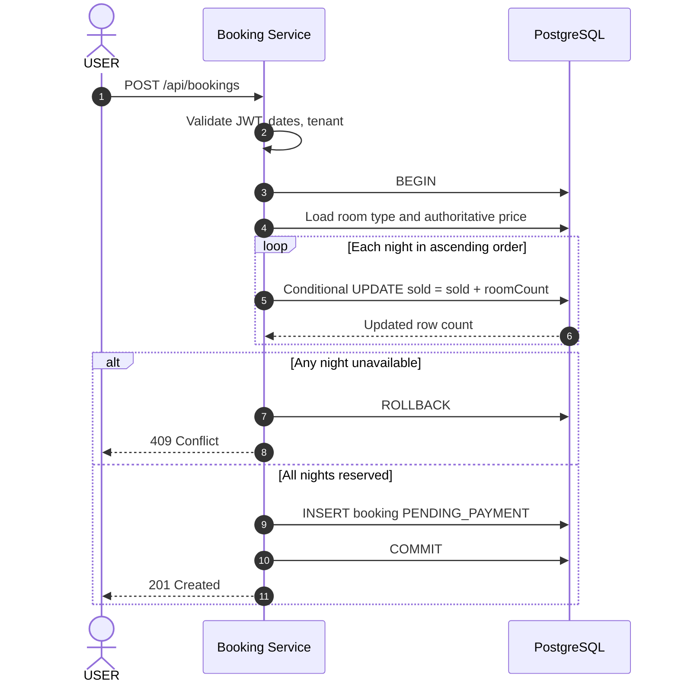

# StayHub — Entity Relationship Diagram (ERD)

> **Document:** `docs/erd.md`  

> **Version:** v1.1 — Proposed Database Architecture  

> **Updated:** 2026-11-04  

> **Status:** TARGET DESIGN — Pending G2 Sign-off  

> **Database:** PostgreSQL — `hotelbooking`  

> **Schema:** `public`  

> **Migration:** Flyway  

> **Architecture:** Custom IAM + Catalog + Booking + Support  

> **Scope:** Multi-Tenancy, Identity, Hotel Catalog, Nightly Inventory, Booking, Support Tickets

---

# 1. Overview

## 1.1. Purpose

Tài liệu này mô tả **Entity Relationship Diagram (ERD)** và cấu trúc dữ liệu mục tiêu của hệ thống StayHub.

ERD được thiết kế để hỗ trợ:

1\. Xác thực người dùng thông qua Custom IAM.

2\. Phân quyền USER và ADMIN.

3\. Quản lý dữ liệu theo tenant.

4\. Quản lý khách sạn và loại phòng.

5\. Quản lý tồn kho phòng theo từng ngày.

6\. Đặt phòng và thanh toán giả lập.

7\. Quản lý yêu cầu hỗ trợ khách hàng.

8\. Bảo đảm tính nhất quán dữ liệu và chống overselling.

## 1.2. Design Principles

- PostgreSQL là database chính của MVP.

- Các service dùng chung database nhưng có ownership rõ ràng.

- Sử dụng khóa chính và khóa ngoại để bảo đảm referential integrity.

- Dữ liệu nghiệp vụ phải được tenant-scoped.

- Inventory sử dụng mô hình nightly inventory.

- Booking và inventory reservation phải được cập nhật trong cùng transaction.

- Applied Flyway migrations không được sửa trực tiếp.

- Không tự động thay đổi cấu trúc database hiện tại khi chưa kiểm tra repository.

**Quan trọng:** Đây là ERD mục tiêu. Một số bảng và cột đã được mô tả trong tài liệu developer, trong khi Support schema và một số constraints vẫn là thiết kế đề xuất.

---

# 2. Database Architecture

## 2.1. Database Overview

```text
PostgreSQL
└── Database: hotelbooking
    └── Schema: public
        │
        ├── IAM Domain
        │   ├── tenant
        │   └── app_user
        │
        ├── Catalog Domain
        │   ├── hotel
        │   ├── room_type
        │   └── room_inventory
        │
        ├── Booking Domain
        │   └── booking
        │
        └── Support Domain
            ├── support_ticket
            └── ticket_message
```

## 2.2. Service Ownership

| Service | Tables | Responsibility |
|---|---|---|
| IAM Service | `tenant`, `app_user` | Identity, roles, tenant membership |
| Catalog Service | `hotel`, `room_type` | Hotel and room catalog |
| Catalog Service | `room_inventory.total` | Inventory capacity |
| Booking Service | `booking` | Booking lifecycle |
| Booking Service | `room_inventory.sold` | Reserved inventory |
| Support Service | `support_ticket`, `ticket_message` | Support workflow |

**Shared database does not imply unrestricted table ownership.**

---

# 3. Complete Entity Relationship Diagram

## 3.1. Full ERD



### Important Modeling Notes

- `BOOKING.user_email` được giữ theo implementation contract hiện tại, không tự ý đổi thành `user_id`.

- Quan hệ Booking → User là **logical relationship qua email và tenant**, không phải foreign key trực tiếp.

- `SUPPORT_TICKET.booking_id` có thể `NULL`.

- `SUPPORT_TICKET.assigned_admin_user_id` có thể `NULL` nếu triển khai assignment.

- `ROOM_INVENTORY` sử dụng composite primary key.

- Các cột chưa xác minh trong source code là target fields, không phải khẳng định schema đã tồn tại.

- Các FK theo tenant trong sơ đồ thể hiện quan hệ logic; composite FK vật lý được đề xuất tại phần constraints.

---

# 4. IAM Domain ERD

## 4.1. Diagram



## 4.2. Table: `tenant`

**Owner:** IAM Service

### Purpose

Lưu thông tin tenant phục vụ multi-tenancy.

### Proposed Structure

| Column | PostgreSQL Type | Constraint | Description |
|---|---|---|---|
| `id` | BIGINT | PK | Tenant identifier |
| `name` | VARCHAR(255) | NOT NULL | Tenant name |

### Relationships

```text
tenant (1) -> (N) app_user
tenant (1) -> (N) hotel
tenant (1) -> (N) booking
tenant (1) -> (N) support_ticket
```

---

## 4.3. Table: `app_user`

**Owner:** IAM Service

### Purpose

Lưu người dùng đã được provision và liên kết với Google identity.

### Proposed Structure

| Column | PostgreSQL Type | Constraint | Description |
|---|---|---|---|
| `id` | BIGINT | PK | Internal user identifier |
| `tenant_id` | BIGINT | FK, NOT NULL | Tenant |
| `email` | VARCHAR(255) | NOT NULL | User email |
| `role` | VARCHAR(20) | NOT NULL | USER / ADMIN |
| `google_sub` | VARCHAR(255) | NULL, UNIQUE when bound | Google identity subject |

### Role Values

```text
USER
ADMIN
```

Không bổ sung role `SUPPORT` trong MVP.

### Authentication Mapping

```text
Google OIDC
    |
    v
email_verified
    |
    v
app_user.email
    |
    v
google_sub binding
    |
    v
StayHub JWT
```

### JWT Mapping

| Database Column | JWT Claim |
|---|---|
| `app_user.id` | `sub` |
| `app_user.email` | `email` |
| `app_user.tenant_id` | `tenant_id` |
| `app_user.role` | `role` |

### Constraints

- User phải được provision trước khi đăng nhập.

- Không tự động tạo user từ Google login.

- Google `sub` mismatch phải bị từ chối.

- `google_sub` không được liên kết với nhiều account.

- Email uniqueness scope phải được xác minh theo IAM implementation.

**Open decision:** IAM hiện tại có cho phép một email thuộc nhiều tenant hay không. Không thay đổi unique constraint nếu chưa kiểm tra authentication lookup logic.

---

# 5. Catalog Domain ERD

## 5.1. Diagram



---

## 5.2. Table: `hotel`

**Owner:** Catalog Service

### Purpose

Lưu thông tin khách sạn.

### Proposed Structure

| Column | PostgreSQL Type | Constraint | Description |
|---|---|---|---|
| `id` | BIGINT | PK | Hotel identifier |
| `tenant_id` | BIGINT | FK, NOT NULL | Tenant owner |
| `name` | VARCHAR(255) | NOT NULL | Hotel name |
| `address` | VARCHAR(500) | NULL | Hotel address |
| `description` | TEXT | NULL | Hotel description |

### Relationships

```text
tenant (1) -> (N) hotel
hotel (1) -> (N) room_type
```

### Authorization

```text
hotel.tenant_id = JWT.tenant_id
```

Cross-tenant hotel access must return `404`.

---

## 5.3. Table: `room_type`

**Owner:** Catalog Service

### Purpose

Lưu loại phòng được bán trên hệ thống, bao gồm sức chứa, giá cơ bản và số lượng phòng mặc định mở bán (`total_rooms`).

Ví dụ:

- Standard Room.
- Deluxe Room.
- Suite Room.
- Family Room.

### Proposed Structure

| Column | PostgreSQL Type | Constraint | Description |
|---|---|---|---|
| `id` | BIGINT | PK | Room type identifier |
| `tenant_id` | BIGINT | FK, NOT NULL | Tenant |
| `hotel_id` | BIGINT | FK, NOT NULL | Parent hotel |
| `name` | VARCHAR(255) | NOT NULL | Room type name |
| `description` | TEXT | NULL | Description |
| `capacity` | INTEGER | NOT NULL | Maximum occupancy per room |
| `base_price` | NUMERIC(15,2) | NOT NULL | Base price per room per night |
| `total_rooms` | INTEGER | NOT NULL, DEFAULT 0, CHECK >= 0 | Default number of rooms available for sale |

### Constraints

```text
capacity > 0
base_price >= 0
total_rooms >= 0
```

- `room_type.tenant_id` phải trùng với `hotel.tenant_id` (đề xuất enforce bằng tenant-safe composite FK).
- `total_rooms = 0` nghĩa là chưa có phòng mặc định được mở bán.

### Relationships

```text
tenant (1) -> (N) room_type
hotel (1) -> (N) room_type
room_type (1) -> (N) room_inventory
room_type (1) -> (N) booking
```

### Total Rooms Rule

`room_type.total_rooms` là số lượng phòng mặc định mở bán cho một loại phòng; không phải số phòng đã được đặt.

Ví dụ: `Deluxe Room` có `capacity = 2`, `base_price = 750000`, `total_rooms = 10` nghĩa là mỗi phòng chứa tối đa 2 khách, giá cơ bản 750.000 VND/phòng/đêm và mặc định mở bán 10 phòng.

### Inventory Rule

Khi khởi tạo inventory cho một ngày mới:

```text
room_inventory.tenant_id = room_type.tenant_id
room_inventory.room_type_id = room_type.id
room_inventory.stay_date = targetDate
room_inventory.total = room_type.total_rooms
room_inventory.sold = 0
```

- `room_inventory.total` là sức chứa mở bán thực tế theo ngày; `sold` là số phòng đang được giữ bởi các booking hợp lệ.
- Thay đổi `total_rooms` chỉ áp dụng làm giá trị mặc định cho inventory **tạo mới**, không tự động ghi đè các ngày đã có inventory.
- ADMIN có thể điều chỉnh `room_inventory.total` theo ngày nhưng phải bảo đảm `total >= sold`.
- ADMIN không trực tiếp chỉnh sửa `room_inventory.sold`; Booking Service quản lý cột này trong transaction đặt/hủy/hết hạn.
- Mỗi `(tenant_id, room_type_id, stay_date)` chỉ có một inventory row.

```text
room_type.total_rooms >= 0
0 <= room_inventory.sold <= room_inventory.total
available = room_inventory.total - room_inventory.sold
```

### Pricing Rule

```text
totalAmount =
    basePrice
    × nights
    × roomCount
```

- Giá phải được server tính toán và snapshot vào `booking.total_amount` tại thời điểm đặt.
- `total_rooms` không tham gia công thức tính giá; khả dụng được kiểm tra trên `room_inventory` cho **tất cả** các đêm trong `[check_in, check_out)`.
- Thay đổi `base_price` không làm thay đổi giá của booking đã tạo.

---

## 5.4. Table: `room_inventory`

**Owners:**

- Catalog Service: `total`.

- Booking Service: `sold`.

### Purpose

Quản lý số lượng phòng có thể bán theo từng đêm.

### Structure

| Column | PostgreSQL Type | Constraint | Description |
|---|---|---|---|
| `tenant_id` | BIGINT | Composite PK, FK | Tenant |
| `room_type_id` | BIGINT | Composite PK, FK | Room type |
| `stay_date` | DATE | Composite PK | Inventory date |
| `total` | INTEGER | NOT NULL | Total capacity |
| `sold` | INTEGER | NOT NULL | Reserved capacity |

### Primary Key

```sql
PRIMARY KEY (
    tenant_id,
    room_type_id,
    stay_date
)
```

### Inventory Invariant

```text
0 <= sold <= total
```

### Proposed Database Constraint

```sql
CHECK (
    total >= 0
    AND sold >= 0
    AND sold <= total
)
```

### Example Data

| tenant_id | room_type_id | stay_date | total | sold | available |
|---|---|---|---|---|---|
| 1 | 10 | 2026-12-01 | 10 | 7 | 3 |
| 1 | 10 | 2026-12-02 | 10 | 8 | 2 |
| 1 | 10 | 2026-12-03 | 10 | 10 | 0 |

`available` là giá trị tính toán:

```text
available = total - sold
```

Không cần lưu `available` thành một cột riêng trong MVP.

### Availability Calculation

Đối với một khoảng lưu trú:

```text
availableRooms =
    MIN(total - sold)
```

Chỉ hợp lệ khi tồn tại inventory row cho tất cả các đêm.

---

# 6. Booking Domain ERD

## 6.1. Diagram



The dotted relationship to `APP_USER` represents application-level ownership, not a physical foreign key.

---

## 6.2. Table: `booking`

**Owner:** Booking Service

### Purpose

Lưu thông tin đặt phòng và trạng thái thanh toán giả lập.

### Proposed Structure

| Column | PostgreSQL Type | Constraint | Description |
|---|---|---|---|
| `id` | BIGINT | PK | Booking identifier |
| `tenant_id` | BIGINT | FK, NOT NULL | Tenant |
| `room_type_id` | BIGINT | FK, NOT NULL | Room type |
| `user_email` | VARCHAR(255) | NOT NULL | Booking owner |
| `check_in` | DATE | NOT NULL | Check-in date |
| `check_out` | DATE | NOT NULL | Check-out date |
| `room_count` | INTEGER | NOT NULL | Number of rooms |
| `total_amount` | NUMERIC(15,2) | NOT NULL | Price snapshot |
| `status` | VARCHAR(30) | NOT NULL | Booking status |
| `payment_expires_at` | TIMESTAMPTZ | NOT NULL | Payment deadline |
| `created_at` | TIMESTAMPTZ | NOT NULL | Creation timestamp |

### Important Compatibility Rule

Giữ nguyên:

```text
booking.user_email
```

Không tự động thay bằng:

```text
booking.user_id
```

Nếu thay đổi identity reference trong tương lai, phải có migration plan riêng.

---

## 6.3. Booking Status

| Status | Meaning | Inventory Held |
|---|---|---|
| `PENDING_PAYMENT` | Awaiting payment | Yes |
| `CONFIRMED` | Payment confirmed | Yes |
| `CANCELLED` | Cancelled | No |
| `EXPIRED` | Payment timeout | No |

### State Machine



### Business Constraints

```text
check_out > check_in
room_count > 0
total_amount >= 0
```

Maximum stay duration:

```text
30 nights
```

### Business Timezone

```text
Asia/Ho_Chi_Minh
```

Stay date convention:

```text
[check_in, check_out)
```

---

## 6.4. Booking Ownership

Current implementation contract:

```text
booking.tenant_id = JWT.tenant_id
AND
booking.user_email = JWT.email
```

ADMIN may view bookings within the same tenant.

USER may view only their own bookings.

---

# 7. Support Domain ERD

## 7.1. Diagram



**Status:** Support schema is proposed, not verified against implementation.

---

## 7.2. Table: `support_ticket`

**Owner:** Support Service

### Purpose

Lưu yêu cầu hỗ trợ từ USER.

### Proposed Structure

| Column | PostgreSQL Type | Constraint | Description |
|---|---|---|---|
| `id` | BIGINT | PK | Ticket identifier |
| `tenant_id` | BIGINT | FK, NOT NULL | Tenant |
| `requester_user_id` | BIGINT | FK, NOT NULL | Ticket owner |
| `booking_id` | BIGINT | FK, NULL | Related booking |
| `assigned_admin_user_id` | BIGINT | FK, NULL | Assigned ADMIN |
| `subject` | VARCHAR(200) | NOT NULL | Ticket subject |
| `description` | TEXT | NOT NULL | Initial request |
| `status` | VARCHAR(30) | NOT NULL | Ticket status |
| `created_at` | TIMESTAMPTZ | NOT NULL | Created timestamp |
| `updated_at` | TIMESTAMPTZ | NOT NULL | Updated timestamp |

### Relationships

```text
app_user (1) -> (N) support_ticket
booking (0..1) -> (N) support_ticket
support_ticket (1) -> (N) ticket_message
```

A ticket may exist without a booking.

A booking may have multiple tickets.

### Ticket Status

```text
OPEN
IN_PROGRESS
RESOLVED
CLOSED
```

### State Machine



Optional reopen:

```text
RESOLVED -> IN_PROGRESS
```

Requires G2 approval.

### Ownership

USER:

```text
support_ticket.tenant_id = JWT.tenant_id
AND
support_ticket.requester_user_id = JWT.sub
```

ADMIN:

```text
support_ticket.tenant_id = JWT.tenant_id
```

---

## 7.3. Table: `ticket_message`

**Owner:** Support Service

### Purpose

Lưu lịch sử trao đổi giữa USER và ADMIN.

### Proposed Structure

| Column | PostgreSQL Type | Constraint | Description |
|---|---|---|---|
| `id` | BIGINT | PK | Message identifier |
| `tenant_id` | BIGINT | FK, NOT NULL | Tenant |
| `ticket_id` | BIGINT | FK, NOT NULL | Parent ticket |
| `author_user_id` | BIGINT | FK, NOT NULL | Message author |
| `body` | TEXT | NOT NULL | Message content |
| `created_at` | TIMESTAMPTZ | NOT NULL | Created timestamp |

### Relationships

```text
support_ticket (1) -> (N) ticket_message
app_user (1) -> (N) ticket_message
```

### Message Rules

- Author is derived from verified JWT.

- Client cannot impersonate another user.

- Message body cannot be empty.

- Message history is immutable under the proposed model.

- Cross-tenant messages must not be accessible.

- HTML/script content must be safely handled at input/output boundaries.

- Attachments are deferred from MVP.

---

# 8. Entity Relationships Summary

| Parent Entity | Child Entity | Cardinality | Relationship |
|---|---|---|---|
| `tenant` | `app_user` | 1:N | Tenant users |
| `tenant` | `hotel` | 1:N | Tenant hotels |
| `tenant` | `room_type` | 1:N | Tenant room types |
| `tenant` | `room_inventory` | 1:N | Tenant inventory |
| `tenant` | `booking` | 1:N | Tenant bookings |
| `tenant` | `support_ticket` | 1:N | Tenant tickets |
| `tenant` | `ticket_message` | 1:N | Tenant messages |
| `hotel` | `room_type` | 1:N | Hotel room types |
| `room_type` | `room_inventory` | 1:N | Nightly inventory |
| `room_type` | `booking` | 1:N | Room-type bookings |
| `app_user` | `booking` | Logical 1:N | Email-based ownership |
| `app_user` | `support_ticket` | 1:N | Ticket requester |
| `app_user` | `support_ticket` | 1:N optional assignment | Assigned ADMIN |
| `booking` | `support_ticket` | 1:N optional association | Related booking |
| `support_ticket` | `ticket_message` | 1:N | Message history |
| `app_user` | `ticket_message` | 1:N | Message author |

---

# 9. Database Constraints

## 9.1. Primary Keys

| Table | Primary Key |
|---|---|
| `tenant` | `id` |
| `app_user` | `id` |
| `hotel` | `id` |
| `room_type` | `id` |
| `room_inventory` | `(tenant_id, room_type_id, stay_date)` |
| `booking` | `id` |
| `support_ticket` | `id` |
| `ticket_message` | `id` |

---

## 9.2. Foreign Keys

### IAM

```text
app_user.tenant_id
    -> tenant.id
```

### Catalog

```text
hotel.tenant_id
    -> tenant.id
room_type.hotel_id
    -> hotel.id
room_type.tenant_id
    -> tenant.id
room_inventory.room_type_id
    -> room_type.id
room_inventory.tenant_id
    -> tenant.id
```

### Booking

```text
booking.room_type_id
    -> room_type.id
booking.tenant_id
    -> tenant.id
```

### Support

```text
support_ticket.tenant_id
    -> tenant.id
support_ticket.requester_user_id
    -> app_user.id
support_ticket.booking_id
    -> booking.id
support_ticket.assigned_admin_user_id
    -> app_user.id
ticket_message.ticket_id
    -> support_ticket.id
ticket_message.author_user_id
    -> app_user.id
ticket_message.tenant_id
    -> tenant.id
```

---

## 9.3. Tenant-Safe Foreign Keys

Single-column foreign keys do not guarantee that related records belong to the same tenant.

Example risk:

```text
support_ticket.tenant_id = 1
support_ticket.booking_id = 999
booking.id = 999
booking.tenant_id = 2
```

To prevent this at the database level, use composite foreign keys where appropriate.

### Proposed Pattern

Parent table:

```sql
ALTER TABLE booking
ADD CONSTRAINT uq_booking_tenant_id_id
UNIQUE (tenant_id, id);
```

Child table:

```sql
ALTER TABLE support_ticket
ADD CONSTRAINT fk_ticket_booking_tenant
FOREIGN KEY (tenant_id, booking_id)
REFERENCES booking (tenant_id, id);
```

This enforces:

```text
support_ticket.tenant_id = booking.tenant_id
```

### Recommended Composite FK Candidates

```text
room_type(tenant_id, hotel_id)
    -> hotel(tenant_id, id)
room_inventory(tenant_id, room_type_id)
    -> room_type(tenant_id, id)
booking(tenant_id, room_type_id)
    -> room_type(tenant_id, id)
support_ticket(tenant_id, requester_user_id)
    -> app_user(tenant_id, id)
support_ticket(tenant_id, booking_id)
    -> booking(tenant_id, id)
ticket_message(tenant_id, ticket_id)
    -> support_ticket(tenant_id, id)
ticket_message(tenant_id, author_user_id)
    -> app_user(tenant_id, id)
```

Parent tables must expose matching `UNIQUE` or `PRIMARY KEY` constraints.

**Important:** Do not apply these changes blindly. Verify existing schema, data quality and Flyway history first.

---

# 10. Proposed Index Strategy

## 10.1. IAM Indexes

```sql
CREATE INDEX idx_app_user_tenant
ON app_user (tenant_id);
```

For email lookup:

```sql
CREATE INDEX idx_app_user_email
ON app_user (email);
```

Google subject uniqueness should be enforced according to the existing IAM contract.

---

## 10.2. Catalog Indexes

```sql
CREATE INDEX idx_hotel_tenant
ON hotel (tenant_id);
CREATE INDEX idx_room_type_hotel
ON room_type (tenant_id, hotel_id);
```

Inventory lookup is already supported by the composite primary key:

```text
(tenant_id, room_type_id, stay_date)
```

---

## 10.3. Booking Indexes

```sql
CREATE INDEX idx_booking_tenant_email
ON booking (tenant_id, user_email);
CREATE INDEX idx_booking_tenant_status
ON booking (tenant_id, status);
CREATE INDEX idx_booking_payment_expiry
ON booking (payment_expires_at)
WHERE status = 'PENDING_PAYMENT';
```

### Purpose

- Fast USER booking lookup.

- Tenant-scoped ADMIN queries.

- Efficient expiry scheduler.

---

## 10.4. Support Indexes

```sql
CREATE INDEX idx_ticket_tenant_requester
ON support_ticket (tenant_id, requester_user_id);
CREATE INDEX idx_ticket_tenant_status_created
ON support_ticket (tenant_id, status, created_at DESC);
CREATE INDEX idx_ticket_booking
ON support_ticket (tenant_id, booking_id);
CREATE INDEX idx_message_ticket_created
ON ticket_message (tenant_id, ticket_id, created_at, id);
```

### Purpose

- Fast own-ticket listing.

- ADMIN tenant queue.

- Booking-related ticket lookup.

- Ordered message history.

**Index policy:** Add indexes based on actual query patterns and `EXPLAIN ANALYZE`; avoid indexing every column unnecessarily.

---

# 11. Inventory Transaction Model

## 11.1. Booking Reservation



## 11.2. Atomic Inventory Update

```sql
UPDATE room_inventory
SET sold = sold + :roomCount
WHERE tenant_id = :tenantId
  AND room_type_id = :roomTypeId
  AND stay_date = :stayDate
  AND sold + :roomCount <= total;
```

### Required Behavior

- Update exactly one row per night.

- If any night fails, rollback all updates.

- Insert booking in the same transaction.

- Process dates in ascending order to reduce deadlock risk.

- Use `READ COMMITTED` as the target transaction isolation level.

---

## 11.3. Cancellation and Expiry

Inventory release:

```sql
UPDATE room_inventory
SET sold = sold - :roomCount
WHERE tenant_id = :tenantId
  AND room_type_id = :roomTypeId
  AND stay_date = :stayDate
  AND sold >= :roomCount;
```

This SQL is illustrative and must only run after an atomic, successful booking state transition.

### Required Invariant

```text
One booking cancellation
    \=
One inventory release
```

Duplicate cancellation or expiry must not release inventory twice.

---

# 12. Inventory Reconciliation

## 12.1. Purpose

Đối chiếu số lượng inventory đã giữ với các booking còn hiệu lực.

Expected sold:

```text
SUM(room_count)
```

for bookings with status:

```text
PENDING_PAYMENT
CONFIRMED
```

covering each inventory night.

## 12.2. Proposed Reconciliation SQL

```sql
WITH expected_inventory AS (
    SELECT
        b.tenant_id,
        b.room_type_id,
        gs.stay_date::date AS stay_date,
        SUM(b.room_count) AS expected_sold
    FROM booking b
    CROSS JOIN LATERAL generate_series(
        b.check_in::timestamp,
        (b.check_out - 1)::timestamp,
        INTERVAL '1 day'
    ) AS gs(stay_date)
    WHERE b.status IN (
        'PENDING_PAYMENT',
        'CONFIRMED'
    )
    GROUP BY
        b.tenant_id,
        b.room_type_id,
        gs.stay_date::date
)
SELECT
    ri.tenant_id,
    ri.room_type_id,
    ri.stay_date,
    ri.total,
    ri.sold,
    COALESCE(e.expected_sold, 0) AS expected_sold,
    ri.sold - COALESCE(e.expected_sold, 0) AS difference
FROM room_inventory ri
LEFT JOIN expected_inventory e
    ON e.tenant_id = ri.tenant_id
   AND e.room_type_id = ri.room_type_id
   AND e.stay_date = ri.stay_date
WHERE ri.sold <> COALESCE(e.expected_sold, 0);
```

This query detects mismatches for existing inventory rows. A separate check must detect bookings covering nights with missing inventory rows.

### Acceptance Target

```text
Inventory reconciliation mismatches = 0
```

---

# 13. Multi-Tenancy Model

## 13.1. Logical Isolation

```text
Tenant A
    |
    +-- Users
    +-- Hotels
    +-- Room Types
    +-- Inventory
    +-- Bookings
    +-- Tickets
    +-- Messages
Tenant B
    |
    +-- Users
    +-- Hotels
    +-- Room Types
    +-- Inventory
    +-- Bookings
    +-- Tickets
    +-- Messages
```

All tenant-owned queries must use:

```sql
WHERE tenant_id = :verifiedJwtTenantId
```

The tenant identifier must come from the verified JWT.

## 13.2. Ownership Rules

| Entity | USER | ADMIN |
|---|---|---|
| Hotel | Read own tenant | Manage own tenant |
| Room Type | Read own tenant | Manage own tenant |
| Inventory | Read availability | Manage capacity |
| Booking | Own bookings | Tenant bookings |
| Support Ticket | Own tickets | Tenant tickets |
| Ticket Message | Own ticket messages | Tenant ticket messages |

## 13.3. Security Responses

| Scenario | Response |
|---|---|
| Missing JWT | `401` |
| Wrong role | `403` |
| Cross-tenant resource | `404` |
| Foreign-owned resource | `404` |

---

# 14. Flyway Migration Structure

## 14.1. Recommended Directory Layout

Illustrative structure:

```text
backend/
├── iam-service/
│   └── src/main/resources/
│       └── db/migration/
│
├── catalog-service/
│   └── src/main/resources/
│       └── db/migration/
│
├── booking-service/
│   └── src/main/resources/
│       └── db/migration/
│
└── support-service/
    └── src/main/resources/
        └── db/migration/
```

Actual repository layout must be verified.

## 14.2. Logical Migration Order

```text
1\. IAM
   ├── tenant
   └── app_user
2\. Catalog
   ├── hotel
   ├── room_type
   └── room_inventory
3\. Booking
   └── booking
4\. Support
   ├── support_ticket
   └── ticket_message
5\. Constraints and indexes
```

## 14.3. Migration Rules

- Never edit applied Flyway migrations.

- Use additive migrations for existing databases.

- Verify cross-service dependencies.

- Validate foreign keys before applying constraints.

- Backfill data before adding `NOT NULL` when necessary.

- Do not reset shared databases to fix migration issues.

- Separate Flyway history strategy must be agreed before Support deployment.

---

# 15. Sample Data Model

## 15.1. Tenant

| id | name |
|---|---|
| 1 | StayHub Demo Tenant |

## 15.2. App Users

| id | tenant_id | email | role |
|---|---|---|---|
| 101 | 1 | user\@example.test | USER |
| 202 | 1 | admin\@example.test | ADMIN |

## 15.3. Hotel

| id | tenant_id | name |
|---|---|---|
| 1 | 1 | StayHub Central Hotel |

## 15.4. Room Type

| id | tenant_id | hotel_id | name | base_price | total_rooms |
|---|---|---|---|---|---|
| 10 | 1 | 1 | Deluxe Room | 750000 | 10 |

## 15.5. Inventory

| tenant_id | room_type_id | stay_date | total | sold |
|---|---|---|---|---|
| 1 | 10 | 2026-12-01 | 10 | 1 |
| 1 | 10 | 2026-12-02 | 10 | 1 |

## 15.6. Booking

| id | tenant_id | room_type_id | user_email | status |
|---|---|---|---|---|
| 123 | 1 | 10 | user\@example.test | PENDING_PAYMENT |

## 15.7. Support Ticket

| id | tenant_id | requester_user_id | booking_id | status |
|---|---|---|---|---|
| 501 | 1 | 101 | 123 | OPEN |

## 15.8. Ticket Message

| id | tenant_id | ticket_id | author_user_id | body |
|---|---|---|---|---|
| 1001 | 1 | 501 | 101 | Tôi cần hỗ trợ nhận phòng. |
| 1002 | 1 | 501 | 202 | Chúng tôi đang kiểm tra yêu cầu. |

**All sample records are illustrative, not actual database data.**

---

# 16. Data Integrity Acceptance Matrix

| ID | Test | Expected |
|---|---|---|
| ERD-001 | Create user with invalid tenant | FK rejection |
| ERD-002 | Create hotel with invalid tenant | FK rejection |
| ERD-003 | Create room type with invalid hotel | FK rejection |
| ERD-004 | Create inventory with invalid room type | FK rejection |
| ERD-005 | Duplicate inventory composite key | PK rejection |
| ERD-006 | Negative inventory total | CHECK rejection |
| ERD-007 | Negative inventory sold | CHECK rejection |
| ERD-008 | Inventory sold exceeds total | CHECK rejection |
| ERD-009 | Booking checkOut before checkIn | CHECK rejection |
| ERD-010 | Booking roomCount <= 0 | CHECK rejection |
| ERD-011 | Booking with invalid room type | FK rejection |
| ERD-012 | Support ticket references foreign tenant booking | Composite FK rejection, if implemented |
| ERD-013 | Ticket message references invalid ticket | FK rejection |
| ERD-014 | USER accesses foreign booking | `404` |
| ERD-015 | USER accesses foreign ticket | `404` |
| ERD-016 | Concurrent last-room booking | No oversell |
| ERD-017 | Duplicate cancellation | No double release |
| ERD-018 | Duplicate expiry | No double release |
| ERD-019 | Inventory reconciliation | Zero mismatches |
| ERD-020 | Flyway migration validation | PASS |
| ERD-021 | Negative `room_type.total_rooms` | CHECK rejection |
| ERD-022 | New nightly inventory initialization | `total = total_rooms`, `sold = 0` |
| ERD-023 | Update `total_rooms` after inventory creation | Existing daily inventory unchanged |

---

# 17. Performance Considerations

## 17.1. Expected Query Patterns

### Catalog

```text
tenant_id
hotel_id
room_type_id
```

### Availability

```text
tenant_id
room_type_id
stay_date range
```

### Booking

```text
tenant_id
user_email
status
payment_expires_at
```

### Support

```text
tenant_id
requester_user_id
status
ticket_id
created_at
```

## 17.2. Optimization Strategy

- Index tenant-scoped query paths.

- Use composite indexes for common filters.

- Avoid unnecessary indexes on low-selectivity columns alone.

- Keep booking transactions short.

- Avoid external HTTP calls while holding inventory row locks.

- Process inventory dates in consistent order.

- Measure database lock contention.

- Use `EXPLAIN ANALYZE` for slow queries.

- Implement pagination for large lists.

- Avoid N+1 queries in ticket message retrieval.

## 17.3. Metrics

| Metric | Target |
|---|---|
| Oversold inventory | 0 |
| Duplicate inventory release | 0 |
| Cross-tenant data leakage | 0 |
| Broken foreign key references | 0 |
| Inventory reconciliation mismatches | 0 |
| Flyway migration failures | 0 after release acceptance |

Latency and throughput SLOs require baseline measurements before being finalized.

---

# 18. Known Limitations

## 18.1. Shared Database Coupling

Catalog, Booking and Support share PostgreSQL.

This simplifies MVP consistency but introduces schema coupling.

Future database separation would require a new consistency and migration strategy.

## 18.2. Booking Email Ownership

Booking currently uses:

```text
user_email
```

instead of immutable:

```text
user_id
```

This preserves compatibility but creates identity consistency risks if user email changes.

## 18.3. No Physical Room Assignment

The model reserves room types, not physical room numbers.

Physical room allocation is outside MVP scope.

## 18.4. No Real Payment Data Model

MVP uses mock payment.

No payment transaction, refund, settlement or webhook tables are required.

## 18.5. No Attachment Storage

Support tickets use text messages only.

Attachments are deferred.

## 18.6. No Audit Event Table

The proposed schema stores message authors and timestamps but does not include a dedicated audit event table.

Production audit requirements remain open.

## 18.7. No Multi-Tenant Membership Table

Current IAM uses:

```text
app_user.tenant_id
```

A user-to-multiple-tenants membership model is not part of MVP.

---

# 19. Open ERD Decisions

| ID | Decision | Priority | Owner |
|---|---|---|---|
| ERD-OPEN-001 | Verify actual IAM table definitions | P0 | IAM |
| ERD-OPEN-002 | Verify existing Catalog migrations | P0 | Catalog |
| ERD-OPEN-003 | Resolve legacy Booking `room` reference | P0 | Booking |
| ERD-OPEN-004 | Confirm Booking column types and constraints | P0 | Booking |
| ERD-OPEN-005 | Confirm Support Service schema | P0 | Support |
| ERD-OPEN-006 | Decide Support booking ownership validation method | P0 | Support + Booking |
| ERD-OPEN-007 | Approve composite tenant-safe foreign keys | P1 | Database Team |
| ERD-OPEN-008 | Confirm IAM email uniqueness policy | P0 | IAM |
| ERD-OPEN-009 | Approve ticket assignment fields | P1 | Support |
| ERD-OPEN-010 | Approve ticket status transition policy | P1 | Product + Support |
| ERD-OPEN-011 | Confirm Flyway history strategy | P0 | Database Team |
| ERD-OPEN-012 | Confirm timestamp and timezone conventions | P1 | Backend |
| ERD-OPEN-013 | Confirm money precision and currency convention | P1 | Booking |
| ERD-OPEN-014 | Decide future migration from email to user ID | P2 | Architecture |
| ERD-OPEN-015 | Confirm data retention and deletion policy | P1 | Architecture |

---

# 20. G2 Database Sign-off Checklist

## IAM

- [ ] `tenant` schema verified.

- [ ] `app_user` schema verified.

- [ ] Email uniqueness policy verified.

- [ ] Google subject binding verified.

- [ ] Role values confirmed.

## Catalog

- [ ] `hotel` schema verified.

- [ ] `room_type` schema verified.
- [ ] `room_type.total_rooms` default and nonnegative constraint verified.
- [ ] New nightly inventory inherits `total_rooms` without overwriting existing daily inventory.

- [ ] `room_inventory` schema verified.

- [ ] Composite inventory PK confirmed.

- [ ] Price precision confirmed.

## Booking

- [ ] `booking` schema verified.

- [ ] Existing `user_email` contract preserved.

- [ ] Legacy migration compatibility resolved.

- [ ] Inventory transaction behavior confirmed.

- [ ] Booking state machine confirmed.

- [ ] Expiry and cancellation consistency confirmed.

## Support

- [ ] `support_ticket` schema approved.

- [ ] `ticket_message` schema approved.

- [ ] Booking reference validation approved.

- [ ] Ticket ownership model approved.

- [ ] Status transition policy approved.

## Database Operations

- [ ] Flyway migration strategy approved.

- [ ] Foreign keys reviewed.

- [ ] Indexes reviewed.

- [ ] Tenant-safe constraints reviewed.

- [ ] Reconciliation tests implemented.

- [ ] Database integration tests passing.

---

# 21. Documentation References

| Document | Responsibility |
|---|---|
| `../README.md` | Project overview |
| `architecture.md` | System architecture |
| `data-model.md` | Database requirements and data model |
| `api-contract.md` | API contracts |
| `workflows.md` | Business workflows |
| `iam-sso.md` | Authentication and identity |
| `iam-integration-tasks.md` | IAM integration |
| `iam-testing.md` | IAM tests |
| `operations-and-tests.md` | Operations and integration testing |
| `decisions.md` | Architecture decisions |

---

# 22. Final ERD Summary

```text
DATABASE:
    PostgreSQL
DATABASE_NAME:
    hotelbooking
SCHEMA:
    public
TOTAL_TARGET_TABLES:
    8
IAM:
    tenant
    app_user
CATALOG:
    hotel
    room_type
    room_inventory
BOOKING:
    booking
SUPPORT:
    support_ticket
    ticket_message
AUTHENTICATION:
    Custom IAM
    Google OIDC
    JWT RS256
AUTHORIZATION:
    RBAC
    Tenant Isolation
    Resource Ownership
INVENTORY:
    Nightly Inventory
    Composite Primary Key
    Atomic Stock Reservation
BOOKING:
    Room-Type Booking
    Email-Based Ownership
    Mock Payment
    Expiry
    Cancellation
SUPPORT:
    Ticket-Based Workflow
    USER / ADMIN
    Immutable Messages
MIGRATION:
    Flyway
DATABASE_STRATEGY:
    Shared PostgreSQL MVP
ERD_STATUS:
    PROPOSED
G2_SIGN_OFF:
    PENDING
IMPLEMENTATION_VERIFICATION:
    PENDING
```

---

## 23. Architecture Conclusion

StayHub sử dụng **8 bảng dữ liệu mục tiêu**, được phân chia thành bốn business domains:

1\. **IAM:** Identity, roles và tenant.

2\. **Catalog:** Hotels, room types và nightly inventory.

3\. **Booking:** Reservations, payment states và inventory consistency.

4\. **Support:** Customer tickets và message history.

Thiết kế tập trung vào:

- Data integrity.

- Multi-tenant isolation.

- Atomic inventory reservation.

- Clear service ownership.

- Minimal MVP complexity.

- Migration compatibility.

- Scalable query patterns.

- Testable business invariants.

**Final principle:** Database constraints bảo vệ tính toàn vẹn dữ liệu; service authorization bảo vệ quyền truy cập; transaction boundaries bảo vệ consistency; Flyway bảo vệ schema evolution.

**Implementation rule:** Chỉ coi ERD là implemented sau khi đối chiếu với PostgreSQL schema thực tế, Flyway migrations và integration tests.
