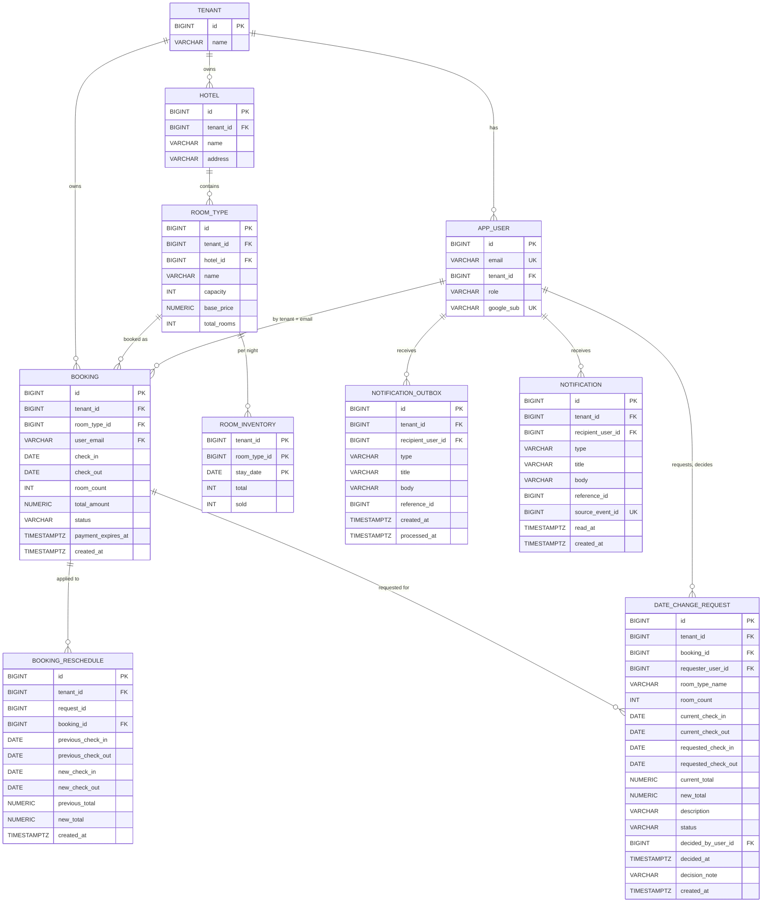

# StayHub — Entity Relationship Diagram

> **Cập nhật:** 05/11/2026, đối chiếu với Flyway migrations tại commit `1737b60`
> **Nguồn sự thật:** `*/src/main/resources/db/migration/`. Nếu tài liệu này khác migration thì migration đúng.

## 1. Sơ đồ

`date_change_request.id` được dùng làm `booking_reschedule.request_id` và `notification_outbox.reference_id`, nhưng không có khóa ngoại cho hai quan hệ này. `notification.source_event_id` trỏ tới `notification_outbox.id`, cũng không có khóa ngoại.

## 2. Bảng và ràng buộc

### 2.1. `tenant` (IAM `V1`)

`id` tự sinh, `name VARCHAR(100)`. Dữ liệu seed ở IAM `V2`.

### 2.2. `app_user` (IAM `V1`, Support `V1`)

| Cột | Kiểu | Ghi chú |
|---|---|---|
| `id` | `BIGINT` | Tự sinh, khóa chính |
| `email` | `VARCHAR(255)` | Bắt buộc, duy nhất, viết thường |
| `tenant_id` | `BIGINT` | Bắt buộc, FK `tenant` |
| `role` | `VARCHAR(20)` | `USER` hoặc `ADMIN` |
| `google_sub` | `VARCHAR(255)` | Có thể rỗng trước lần đăng nhập đầu, duy nhất |

Ràng buộc: `uq_app_user_email`, `uq_app_user_tenant_email (tenant_id, email)`, `uq_app_user_google_sub`, `chk_app_user_role`, `chk_app_user_email_lowercase`. Support `V1` thêm `uq_app_user_tenant_id (tenant_id, id)`.

### 2.3. `hotel` (Catalog `V1`)

`id`, `tenant_id` (FK `tenant`), `name VARCHAR(100)`, `address VARCHAR(255)`. Ràng buộc `uq_hotel_tenant_id (tenant_id, id)`.

### 2.4. `room_type` (Catalog `V1`)

| Cột | Kiểu | Ghi chú |
|---|---|---|
| `id`, `tenant_id`, `hotel_id` | `BIGINT` | Bắt buộc |
| `name` | `VARCHAR(100)` | Bắt buộc |
| `capacity` | `INT` | Lớn hơn 0 |
| `base_price` | `NUMERIC(10,2)` | Lớn hơn 0 |
| `total_rooms` | `INT` | Không âm |

Ràng buộc: `uq_room_type_tenant_id (tenant_id, id)`, `fk_room_type_hotel_same_tenant`, và các CHECK theo bảng trên.

### 2.5. `room_inventory` (Catalog `V1`)

Khóa chính `(tenant_id, room_type_id, stay_date)`. Cột `total INT`, `sold INT DEFAULT 0`. Ràng buộc `fk_inventory_room_type_same_tenant`, `chk_inventory_not_oversold (sold >= 0 AND sold <= total)`.

### 2.6. `booking` (Booking `V1`, Support `V1`)

| Cột | Kiểu | Ghi chú |
|---|---|---|
| `id`, `tenant_id`, `room_type_id` | `BIGINT` | Bắt buộc |
| `user_email` | `VARCHAR(255)` | Viết thường |
| `check_in`, `check_out` | `DATE` | `check_out > check_in` |
| `room_count` | `INT` | Lớn hơn 0 |
| `total_amount` | `NUMERIC(14,2)` | Lớn hơn 0 |
| `status` | `VARCHAR(20)` | `PENDING_PAYMENT`, `CONFIRMED`, `CANCELLED`, `EXPIRED` |
| `payment_expires_at` | `TIMESTAMPTZ` | Bắt buộc |
| `created_at` | `TIMESTAMPTZ` | Mặc định `now()` |

Support `V1` thêm `uq_booking_tenant_id (tenant_id, id)`.

### 2.7. `booking_reschedule` (Booking `V2`)

Mỗi lần đổi ngày đã áp dụng là một dòng, lưu ngày và tổng tiền trước, sau. `uq_booking_reschedule_request (tenant_id, request_id)` chặn áp dụng hai lần.

### 2.8. `date_change_request` (Support `V2`)

Cột như sơ đồ. `description VARCHAR(4000)`, `decision_note VARCHAR(1000)`, `room_type_name VARCHAR(100)`.

| Ràng buộc | Tác dụng |
|---|---|
| `chk_date_change_status` | `PENDING`, `APPROVED`, `REJECTED` |
| `chk_date_change_requested_order` | `requested_check_out > requested_check_in` |
| `chk_date_change_decided` | Chỉ phiếu đã có kết quả mới có `decided_at`, `decided_by_user_id` |
| `uq_date_change_request_pending` | Unique index một phần: mỗi đơn tối đa một phiếu `PENDING` |

### 2.9. `notification_outbox` (Support `V2`)

`type VARCHAR(40)`, `title VARCHAR(200)`, `body VARCHAR(2000)`, `reference_id BIGINT`, `processed_at` rỗng khi chưa xử lý.

### 2.10. `notification` (Notification `V1`)

Cùng nội dung với outbox, thêm `source_event_id` (`uq_notification_source_event`) và `read_at`.

## 3. Khóa ngoại theo tenant

| Khóa ngoại | Từ | Tới | Chặn |
|---|---|---|---|
| `fk_room_type_hotel_same_tenant` | `room_type (tenant_id, hotel_id)` | `hotel (tenant_id, id)` | Loại phòng trỏ sang khách sạn tenant khác |
| `fk_inventory_room_type_same_tenant` | `room_inventory (tenant_id, room_type_id)` | `room_type (tenant_id, id)` | Tồn kho sai tenant |
| `fk_booking_room_type_same_tenant` | `booking (tenant_id, room_type_id)` | `room_type (tenant_id, id)` | Đặt loại phòng tenant khác |
| `fk_booking_user_same_tenant` | `booking (tenant_id, user_email)` | `app_user (tenant_id, email)` | Đơn của user tenant khác hoặc không tồn tại |
| `fk_date_change_booking_same_tenant` | `date_change_request (tenant_id, booking_id)` | `booking (tenant_id, id)` | Phiếu cho đơn tenant khác |
| `fk_date_change_requester_same_tenant` | `date_change_request (tenant_id, requester_user_id)` | `app_user (tenant_id, id)` | Người gửi tenant khác |
| `fk_date_change_decider_same_tenant` | `date_change_request (tenant_id, decided_by_user_id)` | `app_user (tenant_id, id)` | Người duyệt tenant khác |
| `fk_notification_outbox_recipient_same_tenant` | `notification_outbox (tenant_id, recipient_user_id)` | `app_user (tenant_id, id)` | Người nhận tenant khác |
| `fk_notification_recipient_same_tenant` | `notification (tenant_id, recipient_user_id)` | `app_user (tenant_id, id)` | Người nhận tenant khác |

## 4. Index

| Index | Bảng | Cột | Dùng cho |
|---|---|---|---|
| `idx_app_user_tenant_id` | `app_user` | `tenant_id` | Lọc theo tenant |
| `idx_hotel_tenant_id` | `hotel` | `tenant_id` | Danh sách khách sạn |
| `idx_room_type_tenant_hotel` | `room_type` | `tenant_id, hotel_id, id` | Tìm phòng |
| `idx_inventory_tenant_date` | `room_inventory` | `tenant_id, stay_date` | Tồn kho theo ngày |
| `idx_booking_tenant_user` | `booking` | `tenant_id, user_email` | Đơn của USER |
| `idx_booking_room_type` | `booking` | `tenant_id, room_type_id` | Đối soát |
| `idx_booking_pending_expiry` | `booking` | `payment_expires_at` với `status = 'PENDING_PAYMENT'` | Job hết hạn |
| `idx_booking_reschedule_booking` | `booking_reschedule` | `booking_id` | Tra theo đơn |
| `idx_date_change_tenant` | `date_change_request` | `tenant_id, id` | Hàng chờ ADMIN |
| `idx_date_change_requester` | `date_change_request` | `tenant_id, requester_user_id, id` | Phiếu của USER |
| `idx_notification_outbox_unprocessed` | `notification_outbox` | `id` với `processed_at IS NULL` | Job thông báo |
| `idx_notification_recipient` | `notification` | `tenant_id, recipient_user_id, id` | Hộp thư |
| `idx_notification_unread` | `notification` | `tenant_id, recipient_user_id` với `read_at IS NULL` | Đếm chưa đọc |

## 5. Migration

| Service | Bảng lịch sử | Migration |
|---|---|---|
| IAM | `flyway_schema_history_iam` | `V1__create_tenant_and_app_user`, `V2__seed_tenants` |
| Catalog | `flyway_schema_history_catalog` | `V1__create_room`, `V2__seed_rooms` |
| Booking | `flyway_schema_history_booking` | `V1__create_booking`, `V2__create_booking_reschedule` |
| Support | `flyway_schema_history_support` | `V1__create_support_ticket`, `V2__replace_tickets_with_date_change_requests` |
| Notification | `flyway_schema_history_notification` | `V1__create_notification` |

Thứ tự bắt buộc là IAM, Catalog, Booking, Support, Notification. Các service dùng `baseline-on-migrate: true` với `baseline-version: 0`, vì schema đã có bảng của service chạy trước. Cả hai `V1__create_room` và `V1__create_support_ticket` đều giữ tên cũ: tên file đầu được test tham chiếu trực tiếp, còn file sau đã áp dụng nên không đổi.

## 6. Seed trong migration

| Dữ liệu | Giá trị |
|---|---|
| Tenant | 1 `Tenant 1 - Demo Hotel A`, 2 `Tenant 2 - Demo Hotel B` |
| Khách sạn | 1 Hà Nội (tenant 1), 2 TP.HCM (tenant 2), 3 Đà Nẵng (tenant 1) |
| Loại phòng | 6 loại, ID từ 1 đến 6. Loại 5 `Race Test` chỉ có 1 phòng |
| Tồn kho | Mỗi loại từ `2026-11-01` đến `2027-01-31`, tổng 552 dòng |

| ID | Tenant | Khách sạn | Tên | Giá | Số phòng |
|---|---|---|---|---|---|
| 1 | 1 | 1 | Standard | 500.000 | 3 |
| 2 | 1 | 1 | Deluxe | 900.000 | 4 |
| 3 | 2 | 2 | Standard | 450.000 | 5 |
| 4 | 2 | 2 | Deluxe | 850.000 | 6 |
| 5 | 1 | 3 | Race Test | 500.000 | 1 |
| 6 | 1 | 3 | Standard | 600.000 | 5 |

`app_user` không được seed trong migration. Xem [operations-and-tests.md](operations-and-tests.md#6-seed-và-dữ-liệu-mẫu).

Quy tắc nghiệp vụ của dữ liệu nằm ở [data-model.md](data-model.md).
