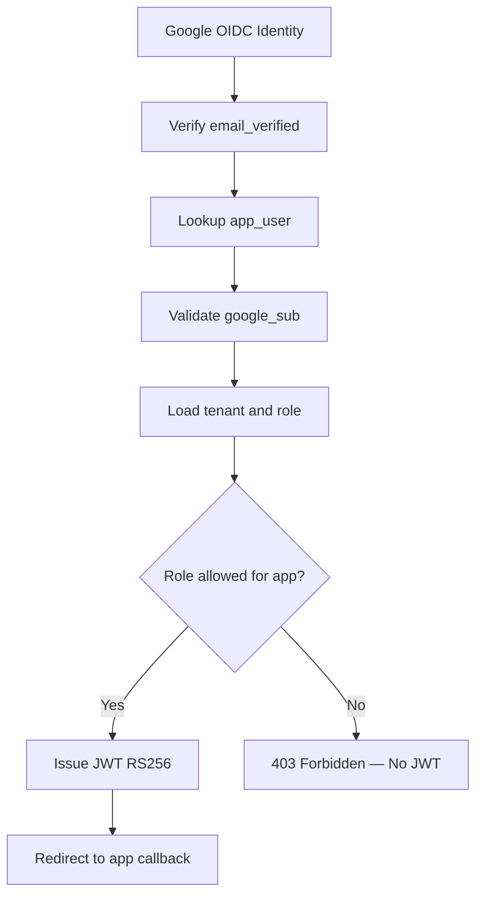
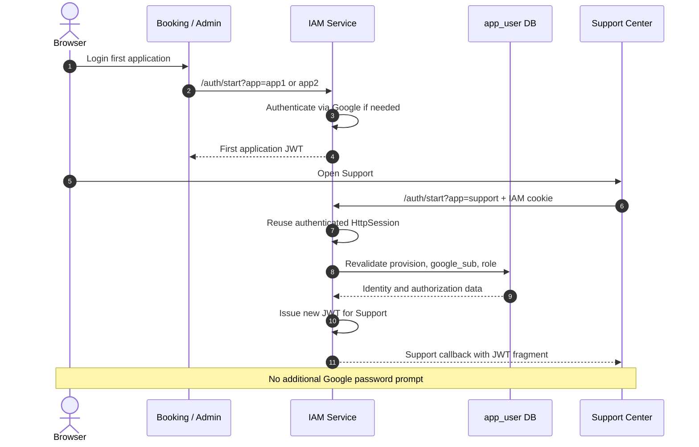
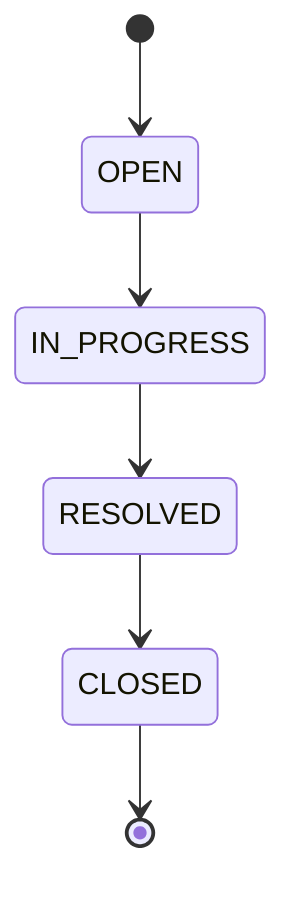
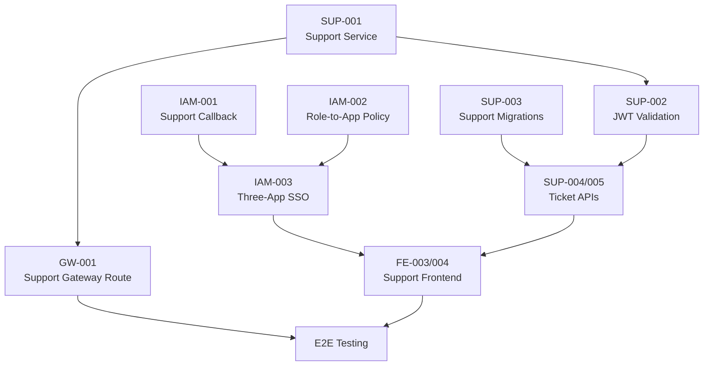

# StayHub — IAM Integration Tasks (3-App Custom IAM)

> **Version:** 3-App Architecture + Custom IAM  
> **Updated:** 2026-11-04  
> **Status:** IMPLEMENTATION PLAN — NOT VERIFIED  
> **Priority:** Minimum changes from existing 2-App IAM  
> **Authentication:** Google OAuth2/OIDC + PKCE S256  
> **SSO:** Spring Security + HttpSession  
> **Token:** Custom JWT RS256 + JWKS  
> **Architecture Decision:** Preserve existing IAM Service — **No Keycloak**

---

## 1. Integration Objectives

Mục tiêu là mở rộng IAM hiện tại từ hai ứng dụng lên ba ứng dụng mà không thay đổi kiến trúc xác thực cốt lõi.

### 1.1. Existing Applications

| Application | URL | IAM App ID | Role |
|---|---|---|---|
| Booking Web | `http://localhost:3000` | `app1` | USER |
| Admin Dashboard | `http://localhost:3001` | `app2` | ADMIN |

### 1.2. New Application

| Application | URL | IAM App ID | Role |
|---|---|---|---|
| Support Center | `http://localhost:3002` | `support` | USER, ADMIN |

### 1.3. Expected Outcomes

- Booking và Admin tiếp tục sử dụng IAM hiện tại.
- Support Center được tích hợp vào IAM SSO.
- USER có thể chuyển Booking → Support mà không cần đăng nhập Google lại khi IAM session còn hợp lệ.
- ADMIN có thể chuyển Admin → Support tương tự.
- IAM phát JWT mới khi chuyển sang ứng dụng khác.
- USER không được truy cập Admin Dashboard.
- ADMIN không được truy cập Booking Web theo policy MVP.
- Gateway và business services tiếp tục xác minh JWT độc lập.
- Không phát sinh yêu cầu triển khai Keycloak hoặc Authorization Server mới.

---

## 2. Scope & Ownership

| Component | Owner | Scope |
|---|---|---|
| IAM Service | IAM Developer | Support callback, role-to-app policy, SSO verification |
| API Gateway | Gateway Developer | Support routing, JWT security |
| Catalog Service | Catalog Developer | Preserve existing authorization |
| Booking Service | Booking Developer | Preserve JWT contract, ownership, migration verification |
| Support Service | Support Developer | New service, ticket APIs, JWT validation |
| Booking Web | Frontend Developer | Preserve `app1` login |
| Admin Dashboard | Frontend Developer | Preserve `app2` login |
| Support Center | Frontend Developer | New `support` login and callback |
| PostgreSQL/Flyway | Backend Team | Support migrations and schema integrity |
| QA/Integration | Backend + Frontend | Three-app E2E and security tests |

### 2.1. Scope Classification

| Scope | Classification |
|---|---|
| Existing Google login | Preserve |
| Existing PKCE S256 | Preserve |
| Existing IAM HttpSession | Preserve |
| Existing JWT RS256 | Preserve |
| Existing JWKS | Preserve |
| Existing `app1` / `app2` | Preserve |
| Support callback | Required change |
| Role-to-app enforcement | Required change |
| Support Service | New implementation |
| Support frontend | New implementation |
| Multi-tab session race | Verify / fix or document |
| IAM Single Logout | Future improvement |
| Refresh token | Out of MVP |
| Keycloak migration | Explicitly excluded |

---

## 3. Existing IAM Components — Preserve

Theo tài liệu IAM developer, các thành phần hiện tại gồm:

```text
iam-service
├── AuthController
├── SsoProperties
├── SsoLoginService
├── SsoAuthenticationSuccessHandler
├── JwtIssuer
├── JwtKeyProvider
├── JwksController
└── SecurityConfig
```

### 3.1. Do Not Rewrite

Giữ nguyên các cơ chế sau nếu không phát hiện lỗi hoặc vấn đề bảo mật:

- [ ] Google OAuth2/OIDC Client.
- [ ] Google callback `/login/oauth2/code/google`.
- [ ] Authorization Code flow.
- [ ] PKCE S256.
- [ ] OAuth2 `state` validation.
- [ ] Google identity verification.
- [ ] `email_verified` validation.
- [ ] `app_user` pre-provisioning.
- [ ] `google_sub` binding.
- [ ] Spring Security HttpSession SSO.
- [ ] JWT RS256 signing.
- [ ] JWT TTL theo contract hiện tại.
- [ ] JWKS public key endpoint.
- [ ] Gateway JWT verification.
- [ ] Catalog JWT verification.
- [ ] Booking JWT verification.

### 3.2. Identity Contract

IAM tiếp tục sử dụng:

```text
app_user
├── id
├── tenant_id
├── email
├── role
└── google_sub
```

JWT contract:

```json
{
  "iss": "http://localhost:8084",
  "sub": "101",
  "email": "user@example.test",
  "tenant_id": 1,
  "role": "USER",
  "iat": 1793779200,
  "exp": 1793780100
}
```

Payload trên chỉ là ví dụ.

**Không thay đổi:**

- `sub = app_user.id` dạng string.
- `tenant_id` dạng number.
- Role `USER` / `ADMIN`.
- `google_sub` identity binding.
- Existing IAM issuer.

Không thêm cột hoặc bảng Keycloak.

---

## 4. IAM Developer — Required Changes

### Task IAM-001 — Register Support Application

**Priority:** P0  
**Owner:** IAM Developer  
**Component:** `SsoProperties`, `AuthController`

#### Requirement

Bổ sung app identifier:

```text
support
```

Callback:

```text
http://localhost:3002/callback/
```

Giữ nguyên:

```text
app1 -> http://localhost:3000/callback/
app2 -> http://localhost:3001/callback/
```

#### Target Configuration

Ví dụ logic, cần đối chiếu với property names trong source code:

```yaml
sso:
  callbacks:
    app1: http://localhost:3000/callback/
    app2: http://localhost:3001/callback/
    support: http://localhost:3002/callback/
```

#### Acceptance Criteria

- [ ] `/auth/start?app=app1` vẫn hoạt động.
- [ ] `/auth/start?app=app2` vẫn hoạt động.
- [ ] `/auth/start?app=support` được chấp nhận.
- [ ] `/auth/start?app=invalid` trả `400`.
- [ ] `/auth/start` thiếu app trả `400`.
- [ ] Support callback chỉ redirect tới URL allowlisted.
- [ ] Không cho phép arbitrary callback URL.
- [ ] Không làm hỏng backward compatibility.

---

### Task IAM-002 — Implement Role-to-App Authorization

**Priority:** P0  
**Owner:** IAM Developer  
**Component:** `SsoLoginService`, `SsoAuthenticationSuccessHandler`

#### Requirement

IAM phải kiểm tra role sau khi xác minh Google identity và provisioning, nhưng trước khi phát JWT.

| App ID | Allowed Role |
|---|---|
| `app1` | USER |
| `app2` | ADMIN |
| `support` | USER, ADMIN |

#### Target Logic

```java
boolean canAccessApp(String app, String role) {
    return switch (app) {
        case "app1" -> "USER".equals(role);
        case "app2" -> "ADMIN".equals(role);
        case "support" ->
            "USER".equals(role) || "ADMIN".equals(role);
        default -> false;
    };
}
```

Đây là pseudocode cho policy, không phải source code đã triển khai.

#### Required Execution Order



#### Acceptance Criteria

- [ ] USER → Booking: Allowed.
- [ ] USER → Admin: `403`.
- [ ] USER → Support: Allowed.
- [ ] ADMIN → Booking: `403`.
- [ ] ADMIN → Admin: Allowed.
- [ ] ADMIN → Support: Allowed.
- [ ] Invalid role: Denied.
- [ ] Denied requests không được phát JWT.
- [ ] Denied requests không redirect tới application callback chứa JWT.

**Security note:** IAM app-role gate không thay thế RBAC tại Gateway và business services.

---

### Task IAM-003 — Preserve Three-App HttpSession SSO

**Priority:** P0  
**Owner:** IAM Developer  
**Component:** `SecurityConfig`, `AuthController`, `SsoAuthenticationSuccessHandler`

#### Requirement

Tái sử dụng IAM authenticated HttpSession khi browser chuyển giữa các ứng dụng.

```text
Booking Login
    |
    v
IAM HttpSession established
    |
    v
Open Support
    |
    v
Reuse IAM session
    |
    v
Revalidate identity and role
    |
    v
Issue new JWT
    |
    v
Support callback
```

#### SSO Sequence



#### Acceptance Criteria

- [ ] USER Booking → Support SSO thành công.
- [ ] ADMIN Admin → Support SSO thành công.
- [ ] Không yêu cầu nhập lại mật khẩu Google khi IAM session hợp lệ.
- [ ] Support nhận JWT mới qua IAM.
- [ ] Support không sử dụng JWT copy từ Booking/Admin.
- [ ] Role và tenant được kiểm tra lại khi phát JWT.
- [ ] IAM session hết hạn dẫn đến reauthentication phù hợp.

---

### Task IAM-004 — Verify Session App Selector Race

**Priority:** P1  
**Owner:** IAM Developer  
**Component:** `AuthController`, OAuth2 authorization request handling

#### Known Risk

Theo tài liệu developer, IAM có thể lưu app destination trong:

```text
HttpSession.sso_app
```

Khi nhiều tab login đồng thời:

```text
Tab A: /auth/start?app=app1
Tab B: /auth/start?app=support

Shared HttpSession:
    sso_app overwritten

OAuth callback:
    Potential wrong destination
```

#### Required Actions

- [ ] Kiểm tra source code sử dụng `sso_app`.
- [ ] Viết test concurrent/multi-tab login.
- [ ] Xác minh app destination không bị ghi đè.
- [ ] Nếu có bug, cân nhắc bind destination theo OAuth2 authorization request/state.
- [ ] Nếu chưa sửa trong MVP, ghi nhận limitation rõ ràng.

#### Acceptance Criteria

Một trong hai kết quả:

**Option A — Fixed**

- Multi-tab redirect chính xác.
- Automated regression test PASS.

**Option B — Accepted Demo Limitation**

- Known issue được ghi nhận.
- Có reproduction steps.
- Không tuyên bố multi-tab SSO hoàn toàn an toàn.

---

### Task IAM-005 — Invalid App & Error Handling Regression

**Priority:** P1  
**Owner:** IAM Developer  
**Component:** `AuthController`, `SecurityConfig`

#### Known Issue

Developer từng ghi nhận `sendError(400)` có thể kích hoạt `/error` dispatch và bị Spring Security redirect sang Google.

#### Required Tests

```http
GET /auth/start
GET /auth/start?app=invalid
GET /auth/start?app=
```

Expected:

```text
400 Bad Request
```

Không redirect sang Google.

#### Acceptance Criteria

- [ ] Invalid app trả `400`.
- [ ] Missing app trả `400`.
- [ ] Không redirect tới Google.
- [ ] Không phát JWT.
- [ ] Không có redirect loop.
- [ ] Error handling không làm lộ thông tin nhạy cảm.

Không mặc định `sendError()` luôn sai; kiểm tra theo cấu hình SecurityFilterChain thực tế.

---

### Task IAM-006 — IAM Unit & Integration Tests

**Priority:** P0  
**Owner:** IAM Developer

#### Unit Test Matrix

| Test ID | Scenario | Expected |
|---|---|---|
| IAM-U001 | Valid `app1` | Accepted |
| IAM-U002 | Valid `app2` | Accepted |
| IAM-U003 | Valid `support` | Accepted |
| IAM-U004 | Invalid app | `400` |
| IAM-U005 | Missing app | `400` |
| IAM-U006 | USER → Booking | Allowed |
| IAM-U007 | USER → Admin | `403` |
| IAM-U008 | USER → Support | Allowed |
| IAM-U009 | ADMIN → Booking | `403` |
| IAM-U010 | ADMIN → Admin | Allowed |
| IAM-U011 | ADMIN → Support | Allowed |
| IAM-U012 | Unprovisioned user | Denied |
| IAM-U013 | `google_sub` mismatch | Denied |
| IAM-U014 | Unverified email | Denied |
| IAM-U015 | Support callback | Correct destination |
| IAM-U016 | JWT required claims | Valid |
| IAM-U017 | Invalid app error dispatch | No Google redirect |
| IAM-U018 | Multi-tab app selection | Correct or documented limitation |

#### Acceptance Criteria

- [ ] Unit tests PASS.
- [ ] IAM integration tests PASS.
- [ ] No secrets in test reports.
- [ ] Existing two-app login regression tests PASS.
- [ ] New Support login tests PASS.

---

## 5. API Gateway Developer — Required Changes

### Task GW-001 — Register Support Routes

**Priority:** P0  
**Owner:** Gateway Developer

#### Requirement

Bổ sung routing từ Gateway đến Support Service.

Logical route:

```text
/api/support/**
    |
    v
support-service
```

Support Service port hiện tại:

```text
TBD
```

Không tự ý chọn port nếu chưa thống nhất service registry hoặc Gateway configuration.

#### Acceptance Criteria

- [ ] Support API routes được định nghĩa.
- [ ] Gateway forward request đúng Support Service.
- [ ] Missing JWT bị từ chối.
- [ ] Invalid JWT bị từ chối.
- [ ] Wrong role bị từ chối theo policy.
- [ ] Tenant/ownership được enforce tại Support Service.
- [ ] Existing Catalog/Booking routes không bị ảnh hưởng.

### Task GW-002 — Preserve JWT Validation

**Priority:** P0  
**Owner:** Gateway Developer

Giữ nguyên:

```text
Issuer:
http://localhost:8084

JWKS:
http://localhost:8084/.well-known/jwks.json
```

Required validation:

- RS256 signature.
- `iss`.
- `exp`.
- Required claims.
- Role mapping.
- Tenant claim mapping.

Nếu JWT có `aud` và policy yêu cầu audience, phải thống nhất contract trước khi enforce.

---

## 6. Support Developer — New Service

### Task SUP-001 — Initialize Support Service

**Priority:** P0  
**Owner:** Support Developer  
**Status:** PROPOSED

#### Required Components

```text
support-service
├── SecurityConfig
├── JwtAuthenticationConverter
├── TicketController
├── TicketService
├── TicketRepository
├── TicketMessageRepository
├── DTOs
├── Flyway Migrations
└── Tests
```

Tên class là đề xuất, không phải cấu trúc source code đã xác minh.

#### Acceptance Criteria

- [ ] Spring Boot service khởi động.
- [ ] PostgreSQL connection hoạt động.
- [ ] Flyway migrations chạy thành công.
- [ ] JWT validation hoạt động.
- [ ] API Gateway routing hoạt động.
- [ ] Health/readiness checks được xác định.

---

### Task SUP-002 — Independent JWT Verification

**Priority:** P0  
**Owner:** Support Developer

Support Service phải xác minh JWT độc lập bằng IAM JWKS.

#### Required Checks

- [ ] RS256 signature.
- [ ] Issuer.
- [ ] Expiration.
- [ ] Required claims.
- [ ] Role.
- [ ] Tenant.
- [ ] Resource ownership.

#### Trusted Claims

```text
JWT.sub       -> app_user.id
JWT.tenant_id -> tenant scope
JWT.role      -> USER / ADMIN
JWT.email     -> verified email
```

Không tin:

```text
request.body.userId
request.body.tenantId
request.body.role
```

làm nguồn quyết định authorization.

---

### Task SUP-003 — Support Database Migrations

**Priority:** P0  
**Owner:** Support Developer + Database Owner

#### Proposed Tables

```text
support_ticket
ticket_message
```

Logical model:

```text
support_ticket
├── id
├── tenant_id
├── requester_user_id
├── booking_id
├── subject
├── description
├── status
├── assigned_admin_user_id
├── created_at
├── updated_at
└── closed_at

ticket_message
├── id
├── tenant_id
├── ticket_id
├── author_user_id
├── body
└── created_at
```

#### Required Constraints

- Tenant-scoped foreign keys.
- Ticket requester references `app_user`.
- Optional booking reference.
- Optional assigned ADMIN reference.
- Message references ticket.
- Message author references `app_user`.
- Ticket and message tenant consistency.
- Valid ticket statuses.

Booking ownership phải được kiểm tra trong service transaction; foreign key đơn thuần không bảo đảm requester là chủ booking.

#### Migration Rules

- [ ] Không sửa Flyway migrations đã áp dụng.
- [ ] Không xóa dữ liệu IAM/Booking/Catalog.
- [ ] Dùng versioned additive migrations.
- [ ] Kiểm tra FK dependencies.
- [ ] Kiểm tra migration history.
- [ ] Có integration tests với PostgreSQL.

---

### Task SUP-004 — USER Ticket APIs

**Priority:** P0  
**Owner:** Support Developer

#### Required Features

- [ ] Create ticket.
- [ ] List own tickets.
- [ ] Get own ticket details.
- [ ] Reply to own ticket.
- [ ] Link ticket to own booking.
- [ ] View ticket status.

#### Authorization Rules

```text
role == USER

AND

ticket.tenant_id == JWT.tenant_id

AND

ticket.requester_user_id == JWT.sub
```

Nếu ticket liên kết booking:

```text
booking.tenant_id == JWT.tenant_id

AND

booking.user_email == JWT.email
```

Giữ Booking ownership contract hiện tại cho đến khi có migration riêng.

#### Acceptance Criteria

| Scenario | Expected |
|---|---|
| Create valid ticket | `201` |
| Read own ticket | `200` |
| Read another user's ticket | `404` |
| Link another user's booking | `404` |
| Cross-tenant ticket | `404` |
| Invalid JWT | `401` |
| USER updates ADMIN-only status | `403` |

---

### Task SUP-005 — ADMIN Ticket APIs

**Priority:** P0  
**Owner:** Support Developer

#### Required Features

- [ ] List tenant ticket queue.
- [ ] Filter tickets by status.
- [ ] View ticket details.
- [ ] Reply to tickets.
- [ ] Assign ticket to ADMIN.
- [ ] Update ticket status.
- [ ] Resolve ticket.
- [ ] Close ticket.

#### Target Lifecycle



Reopen behavior cần được quyết định trong API contract trước khi triển khai.

#### Authorization Rules

```text
role == ADMIN

AND

ticket.tenant_id == JWT.tenant_id
```

#### Acceptance Criteria

- [ ] ADMIN chỉ xem ticket trong tenant.
- [ ] ADMIN chỉ assign user thuộc tenant.
- [ ] Invalid state transition bị từ chối.
- [ ] Message có author và timestamp.
- [ ] Cross-tenant ticket trả `404`.
- [ ] USER không sử dụng được ADMIN-only APIs.

---

### Task SUP-006 — Support Integration Tests

**Priority:** P0  
**Owner:** Support Developer

Required tests:

- [ ] JWT missing → `401`.
- [ ] JWT invalid → `401`.
- [ ] USER creates ticket → `201`.
- [ ] USER reads own ticket → `200`.
- [ ] USER reads foreign ticket → `404`.
- [ ] ADMIN reads tenant ticket → `200`.
- [ ] ADMIN reads foreign tenant ticket → `404`.
- [ ] USER cannot resolve ticket → `403`.
- [ ] Ticket message author is audited.
- [ ] Cross-tenant foreign keys are rejected.
- [ ] Invalid status transition is rejected.
- [ ] Direct Support Service calls remain protected.

---

## 7. Frontend Developers — Required Changes

### Task FE-001 — Preserve Booking Login

**Priority:** P0  
**Owner:** Booking Frontend Developer

Login:

```text
http://localhost:8084/auth/start?app=app1
```

Callback:

```text
http://localhost:3000/callback/
```

Required:

- [ ] Existing login vẫn hoạt động.
- [ ] JWT fragment được đọc.
- [ ] Fragment được xóa khỏi URL.
- [ ] JWT được giữ trong memory.
- [ ] JWT được gửi qua Bearer Authorization header.
- [ ] USER-only routes được bảo vệ ở UI.
- [ ] Backend vẫn enforce authorization độc lập.

---

### Task FE-002 — Preserve Admin Login

**Priority:** P0  
**Owner:** Admin Frontend Developer

Login:

```text
http://localhost:8084/auth/start?app=app2
```

Callback:

```text
http://localhost:3001/callback/
```

Required:

- [ ] Existing login vẫn hoạt động.
- [ ] JWT fragment được xử lý.
- [ ] ADMIN-only UI được bảo vệ.
- [ ] USER không truy cập Admin.
- [ ] Không lưu JWT vào localStorage trong demo.
- [ ] Không ghi JWT vào console.

---

### Task FE-003 — Implement Support Login

**Priority:** P0  
**Owner:** Support Frontend Developer

Login:

```text
http://localhost:8084/auth/start?app=support
```

Callback:

```text
http://localhost:3002/callback/
```

Required:

- [ ] Support khởi tạo login qua IAM.
- [ ] IAM session được tái sử dụng nếu còn hợp lệ.
- [ ] Support nhận JWT mới.
- [ ] Callback đọc JWT fragment.
- [ ] Fragment được xóa ngay sau khi đọc.
- [ ] JWT được giữ trong memory.
- [ ] Không copy JWT từ Booking/Admin.
- [ ] Không lưu JWT vào localStorage.
- [ ] Không ghi JWT vào logs hoặc analytics.

---

### Task FE-004 — Support Role-Based UI

**Priority:** P0  
**Owner:** Support Frontend Developer

#### USER Interface

- My Tickets.
- Create Ticket.
- Ticket Details.
- Reply to Ticket.
- Ticket Status.
- Related Booking.

#### ADMIN Interface

- Tenant Ticket Queue.
- Ticket Details.
- Assign Ticket.
- Reply to Ticket.
- Update Status.
- Resolve / Close Ticket.

#### Security Requirement

Frontend role-based rendering chỉ phục vụ UX.

Backend phải enforce:

```text
JWT role
JWT tenant_id
JWT sub
Resource ownership
```

Không coi việc ẩn button là authorization.

---

### Task FE-005 — JWT Expiry & Local Logout

**Priority:** P1  
**Owner:** Frontend Developers

Required:

- [ ] Xử lý API `401`.
- [ ] Không tiếp tục sử dụng JWT hết hạn.
- [ ] Có thể khởi tạo lại IAM login flow.
- [ ] Xóa JWT khỏi memory khi local logout.
- [ ] Không tuyên bố local logout kết thúc IAM session.
- [ ] Không triển khai giả refresh token flow.

Current IAM:

```text
Refresh Token: NOT IMPLEMENTED
Token Revocation: NOT IMPLEMENTED
Single Logout: NOT IMPLEMENTED
```

---

## 8. Booking Developer — Integration Verification

### Task BOOK-001 — Preserve IAM Contract

**Priority:** P0  
**Owner:** Booking Developer

Không thay đổi:

```text
JWT.sub = app_user.id
JWT.email = verified email
JWT.tenant_id = numeric tenant ID
JWT.role = USER / ADMIN
```

Booking ownership hiện tại:

```text
booking.user_email
```

Required:

- [ ] JWT được verify độc lập.
- [ ] USER-only checkout được enforce.
- [ ] Booking tenant được lấy từ JWT.
- [ ] Booking owner được kiểm tra bằng verified email.
- [ ] Không tin user email từ request body.
- [ ] Không tự ý đổi sang `booking.user_id`.

---

### Task BOOK-002 — Verify Legacy Migration

**Priority:** P0 — BLOCKER  
**Owner:** Booking + Catalog Developers

Theo tài liệu developer, Booking migration có thể còn tham chiếu bảng:

```text
room
```

Trong khi target schema sử dụng:

```text
room_type
room_inventory
```

Required:

- [ ] Kiểm tra migration thực tế.
- [ ] Xác định foreign key lỗi thời.
- [ ] Xác minh Catalog migrations.
- [ ] Xác minh Booking migration dependencies.
- [ ] Không sửa migration đã chạy trên shared database.
- [ ] Tạo migration mới nếu cần.
- [ ] Chạy PostgreSQL integration tests.
- [ ] Kiểm tra dữ liệu booking hiện có.

Không khởi động hoặc nghiệm thu Booking integration khi migration blocker chưa được xác minh.

---

## 9. Cross-Team Integration Dependencies



### 9.1. Dependency Notes

- Support callback và role policy cần hoàn thành trước SSO acceptance.
- Support migrations cần hoàn thành trước ticket API integration.
- Support JWT validation phải hoàn thành trước authorization acceptance.
- Gateway route cần hoàn thành trước full E2E.
- Booking migration blocker cần xử lý trước Booking integration tests.
- Không đánh dấu hệ thống READY nếu chỉ frontend login thành công.

---

## 10. Execution Plan

### Phase 1 — IAM Minimum Delta

**Priority:** P0

- [ ] IAM-001: Support callback.
- [ ] IAM-002: Role-to-app policy.
- [ ] IAM-003: Three-app SSO.
- [ ] IAM-005: Invalid app regression.
- [ ] IAM-006: IAM tests.

**Exit Criteria:**

```text
Booking login: PASS
Admin login: PASS
Support login: PASS
USER -> Admin: DENIED
ADMIN -> Booking: DENIED
```

### Phase 2 — Support Backend

**Priority:** P0

- [ ] SUP-001: Initialize service.
- [ ] SUP-002: JWT validation.
- [ ] SUP-003: Flyway migrations.
- [ ] SUP-004: USER ticket APIs.
- [ ] SUP-005: ADMIN ticket APIs.
- [ ] SUP-006: Integration tests.
- [ ] GW-001: Gateway routing.

**Exit Criteria:**

```text
Support JWT: VERIFIED
Ticket CRUD: PASS
Role Authorization: PASS
Tenant Isolation: PASS
Ownership Validation: PASS
```

### Phase 3 — Frontend Integration

**Priority:** P0

- [ ] FE-001: Booking regression.
- [ ] FE-002: Admin regression.
- [ ] FE-003: Support login.
- [ ] FE-004: Role-based UI.
- [ ] FE-005: JWT expiry handling.

**Exit Criteria:**

```text
USER Booking -> Support: PASS
ADMIN Admin -> Support: PASS
Support USER UI: PASS
Support ADMIN UI: PASS
```

### Phase 4 — Security & E2E

**Priority:** P0

- [ ] Three-app SSO tests.
- [ ] Invalid JWT tests.
- [ ] Expired JWT tests.
- [ ] Cross-tenant tests.
- [ ] Cross-user ownership tests.
- [ ] Direct service security tests.
- [ ] Multi-tab session race verification.
- [ ] No secrets in logs.
- [ ] Test evidence collection.

**Exit Criteria:**

```text
Authentication: PASS
Authorization: PASS
Tenant Isolation: PASS
Ownership: PASS
SSO: PASS
Regression: PASS
```

---

## 11. Integration Acceptance Matrix

| ID | Scenario | Expected | Status |
|---|---|---|---|
| INT-001 | Existing Booking login | PASS | TODO |
| INT-002 | Existing Admin login | PASS | TODO |
| INT-003 | Support login | PASS | TODO |
| INT-004 | USER Booking → Support | SSO without Google re-login | TODO |
| INT-005 | ADMIN Admin → Support | SSO without Google re-login | TODO |
| INT-006 | USER → Admin | `403` | TODO |
| INT-007 | ADMIN → Booking | `403` | TODO |
| INT-008 | Invalid app identifier | `400` | TODO |
| INT-009 | Unprovisioned user | Denied | TODO |
| INT-010 | `google_sub` mismatch | Denied | TODO |
| INT-011 | JWT RS256 verification | PASS | TODO |
| INT-012 | JWKS public-only fields | PASS | TODO |
| INT-013 | Expired JWT | `401` | TODO |
| INT-014 | Direct Support Service call without JWT | `401` | TODO |
| INT-015 | USER creates ticket | `201` | TODO |
| INT-016 | USER reads own ticket | `200` | TODO |
| INT-017 | USER reads foreign ticket | `404` | TODO |
| INT-018 | ADMIN reads tenant tickets | `200` | TODO |
| INT-019 | ADMIN reads foreign tenant tickets | `404` | TODO |
| INT-020 | USER changes ticket status | `403` | TODO |
| INT-021 | Booking migration verification | PASS | BLOCKED |
| INT-022 | Multi-tab app selector | Correct or documented | TODO |
| INT-023 | IAM Single Logout | Not implemented | N/A |

### 11.1. Acceptance Targets

| Metric | Target |
|---|---|
| Existing IAM regressions | 100% PASS |
| Three-app SSO flows | 2/2 PASS |
| Wrong-role rejection | 100% |
| Cross-tenant access rejection | 100% |
| Cross-user ownership rejection | 100% |
| Unauthorized direct service access | 0 |
| Secrets in Git/logs | 0 |
| Support API integration tests | 100% PASS |

Các metrics trên là mục tiêu nghiệm thu, chưa phải kết quả đo thực tế.

---

## 12. Known Blockers & Risks

| Issue | Severity | Action |
|---|---|---|
| Support callback chưa xác minh | High | IAM-001 |
| Role-to-app policy chưa xác minh | Critical | IAM-002 |
| Support Service chưa triển khai | High | SUP-001 |
| Support migrations chưa triển khai | High | SUP-003 |
| Support Gateway route chưa cấu hình | High | GW-001 |
| Booking migration tham chiếu `room` cũ | Critical | BOOK-002 |
| Session `sso_app` multi-tab race | Medium | IAM-004 |
| RSA keypair reset on IAM restart | Production risk | Future hardening |
| No refresh token | MVP limitation | Document |
| No token revocation | MVP limitation | Document |
| No IAM Single Logout | MVP limitation | Future decision |
| JWT in URL fragment | Demo-only security debt | Production redesign |

---

## 13. Out of Scope

Không triển khai trong minimum integration delta:

- Keycloak.
- IAM replacement.
- Full OAuth2 Authorization Server.
- Standard OIDC provider implementation.
- Refresh token infrastructure.
- Token revocation service.
- Full Single Logout.
- Multi-tenant membership redesign.
- Booking ownership migration từ email sang user ID.
- Real payment integration.
- Realtime Support chat.
- Ticket attachments.
- Automated SLA escalation.

Các hạng mục này cần quyết định kiến trúc và kế hoạch riêng nếu được ưu tiên sau MVP.

---

## 14. Required Test Evidence

Mỗi task hoàn thành phải có:

- Commit SHA.
- Changed files.
- Unit test results.
- Integration test results.
- HTTP status evidence.
- Sanitized logs.
- Relevant screenshots.
- Migration version nếu có.
- Known limitations.
- Reviewer approval.

Ví dụ:

```text
Task ID: IAM-002

Owner: IAM Developer

Scope:
Role-to-App Authorization

Expected:
- USER -> Booking: ALLOW
- USER -> Admin: DENY
- ADMIN -> Booking: DENY
- ADMIN -> Admin: ALLOW
- USER/ADMIN -> Support: ALLOW

Actual:
NOT EXECUTED

Evidence:
NONE

Status:
TODO
```

Không lưu JWT, session cookie, Google credentials hoặc private keys trong evidence.

---

## 15. Documentation References

| Document | Responsibility |
|---|---|
| `../README.md` | Documentation overview |
| `architecture.md` | Three-app architecture |
| `iam-sso.md` | Custom IAM and SSO design |
| `iam-testing.md` | IAM acceptance tests |
| `api-contract.md` | API contracts and authorization |
| `data-model.md` | Identity, booking and support schema |
| `workflows.md` | End-to-end workflows |
| `operations-and-tests.md` | Migration and release gates |
| `decisions.md` | Architecture decisions |

---

## 16. Final Implementation Status

```text
ARCHITECTURE:
    CUSTOM IAM PRESERVED

KEYCLOAK:
    NOT USED
    NOT REQUIRED

EXISTING IAM:
    GOOGLE OIDC
    PKCE S256
    HTTPSESSION SSO
    JWT RS256
    JWKS

IAM MINIMUM DELTA:
    SUPPORT CALLBACK: TODO
    ROLE-TO-APP POLICY: TODO
    THREE-APP SSO TESTS: TODO

SUPPORT BACKEND:
    SERVICE: PROPOSED
    MIGRATIONS: TODO
    JWT VALIDATION: TODO
    TICKET APIS: TODO

SUPPORT FRONTEND:
    LOGIN: TODO
    CALLBACK: TODO
    USER UI: TODO
    ADMIN UI: TODO

GATEWAY:
    SUPPORT ROUTE: TODO

BOOKING:
    LEGACY MIGRATION: REQUIRES VERIFICATION

SECURITY:
    TENANT ISOLATION: TODO
    OWNERSHIP TESTS: TODO
    DIRECT SERVICE TESTS: TODO

FINAL INTEGRATION:
    NOT VERIFIED

RELEASE READINESS:
    PENDING
```

**Kết luận:** Phương án tích hợp StayHub ba ứng dụng chỉ yêu cầu mở rộng IAM hiện tại bằng Support callback, role-to-app authorization và kiểm thử SSO. Support Service là phạm vi phát triển mới; Google OIDC, PKCE S256, HttpSession, JWT RS256 và JWKS tiếp tục được giữ nguyên. Không thực hiện migration sang Keycloak hoặc viết lại IAM nếu không có yêu cầu kiến trúc mới.
