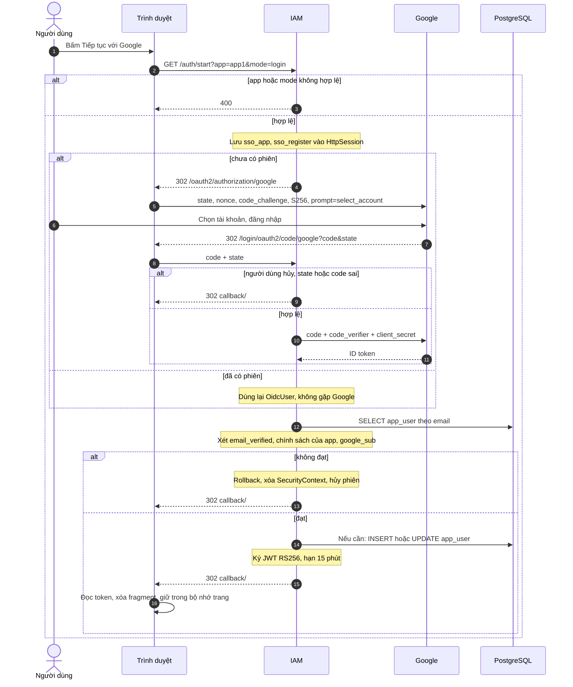
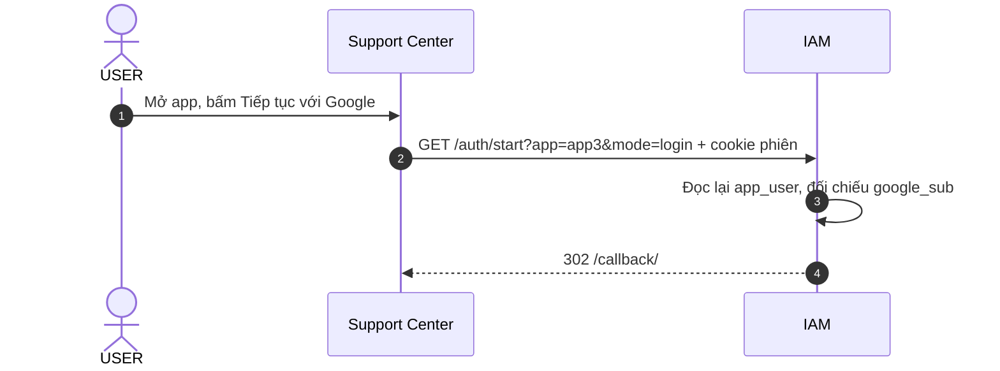
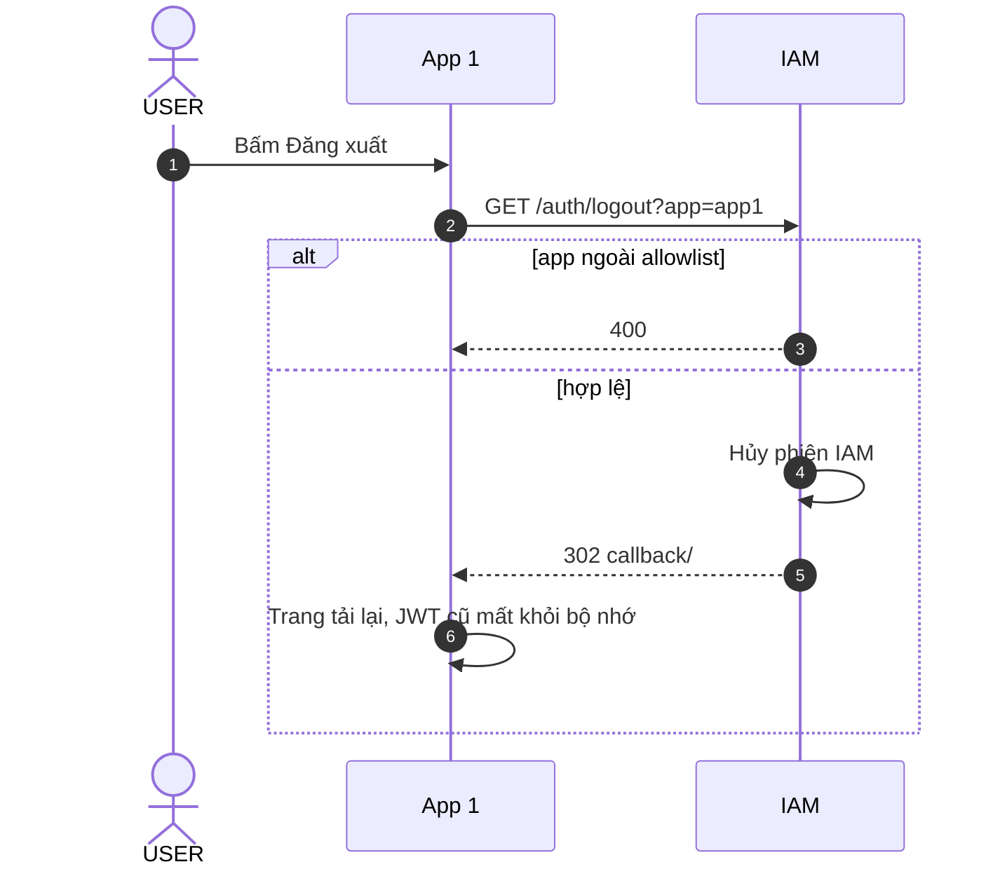

# StayHub — IAM, Google OIDC & SSO

> **Cập nhật:** 05/11/2026, đối chiếu với `main` tại commit `1737b60`
> **Trạng thái:** Các endpoint và chuyển hướng đã được gọi thật. Đăng nhập bằng tài khoản Google thật chưa chạy, nên chính sách theo app, tạo tài khoản, `#token=JWT` và SSO khi đã có phiên mới chỉ đọc từ code.

## 1. Vai trò của IAM

`iam-service` (cổng `8084`) là:

- OAuth2 Client của Google, dùng Authorization Code + PKCE S256.
- Nơi giữ phiên SSO bằng `HttpSession`.
- Nơi quyết định tài khoản nào được nhận JWT cho app nào.
- Bên duy nhất phát hành JWT RS256 và cung cấp JWKS.

IAM không phải OIDC Authorization Server đầy đủ: không có `/.well-known/openid-configuration`, nên các service cấu hình `jwk-set-uri` trực tiếp.

| Thành phần | Trách nhiệm |
|---|---|
| `AuthController` | `/auth/start`, `/auth/logout` |
| `SsoProperties` | Allowlist callback, tenant mặc định, email admin |
| `SsoLoginService` | Chính sách theo app, tạo tài khoản, gắn `google_sub`, cấp JWT |
| `SsoAuthenticationSuccessHandler` | Hoàn tất đăng nhập và chuyển về callback |
| `SsoAuthenticationFailureHandler` | Hủy phiên và trả `#error=login_failed` |
| `JwtIssuer`, `JwtKeyProvider` | Ký JWT, tạo RSA key |
| `JwksController` | Public key |
| `SecurityConfig` | Bật PKCE, thêm `prompt=select_account`, cấu hình đường dẫn công khai |

## 2. Endpoint

| Endpoint | Tác dụng |
|---|---|
| `GET /auth/start?app={app1,app2,app3}&mode={login,register}` | Bắt đầu đăng nhập. `mode` mặc định là `login` |
| `GET /auth/logout?app=...` | Hủy phiên IAM, chuyển về callback kèm `#logged_out` |
| `GET /.well-known/jwks.json` | Public key, chỉ có `kid = stayhub-key-1` |
| `GET /oauth2/authorization/google` | Do Spring Security xử lý, chuyển sang Google |
| `GET /login/oauth2/code/google` | Google trả `code` và `state` về đây |

`/auth/start` trả `400` và không chuyển sang Google khi `app` ngoài allowlist, `mode` không hợp lệ, hoặc `mode=register` ở app khác `app1`.

Callback theo `sso.callbacks`:

| `app` | Callback |
|---|---|
| `app1` | `http://localhost:3000/callback/` |
| `app2` | `http://localhost:3001/callback/` |
| `app3` | `http://localhost:3002/callback/` |

IAM không nhận callback URL từ client, nên không thể bị lợi dụng để chuyển token đến địa chỉ khác. Redirect URI cần đăng ký ở Google là `http://localhost:8084/login/oauth2/code/google`.

## 3. Luồng đăng nhập

Spring Security tự tạo `state`, `nonce` và lưu `code_verifier` trong session, đồng thời kiểm tra chữ ký, `iss`, `aud`, `exp` và `nonce` của ID token.

Nếu session không còn `sso_app` khi Google trả về, IAM trả `400`.

## 4. Chính sách theo từng app

Thứ tự kiểm tra trong `SsoLoginService.issueToken`:

1. Có email và `email_verified = true`.
2. Đổi email sang chữ thường, tìm trong `app_user`.
3. Áp dụng chính sách của app ở bảng dưới.
4. Kiểm tra `google_sub`: chưa có thì gắn, khác thì từ chối.
5. Ký JWT.

Tất cả nằm trong một transaction, nên tài khoản vừa tạo sẽ được rollback nếu một bước sau đó từ chối.

| App | Khi email chưa có tài khoản | Điều kiện nhận JWT | Role trong JWT |
|---|---|---|---|
| App 1 (`app1`) | Tạo `USER` trong tenant mặc định | Email khác `IAM_ADMIN_EMAIL` và role đang là `USER` | `USER` |
| App Admin (`app2`) | Tạo `ADMIN` trong tenant mặc định, chỉ với `IAM_ADMIN_EMAIL` | Email đúng bằng `IAM_ADMIN_EMAIL`. Tài khoản đang `USER` được nâng thành `ADMIN` và giữ nguyên tenant | `ADMIN` |
| Support (`app3`) | Từ chối | Tài khoản đã tồn tại | Role đang lưu |

Hệ quả:

- Tham số `mode` không đổi kết quả. App 1 tạo tài khoản mới kể cả với `mode=login`. Frontend hiện chỉ gửi `mode=login`.
- ADMIN có email khác `IAM_ADMIN_EMAIL` bị từ chối ở App Admin và App 1, chỉ dùng được Support.
- Tài khoản seed vẫn hoạt động theo chính sách trên. Tài khoản đã tồn tại giữ nguyên tenant.
- Tenant mặc định lấy từ `IAM_REGISTRATION_DEFAULT_TENANT_ID` (mặc định `1`).
- Nếu `IAM_ADMIN_EMAIL` rỗng thì không ai vào được App Admin. Biến này mặc định rỗng khi chạy ngoài Compose.

## 5. Kết quả trả về frontend

Kết quả nằm trong URL fragment, nên không được gửi lên server frontend.

| Fragment | Khi nào |
|---|---|
| `#token=<JWT>` | Đăng nhập thành công |
| `#error=not_provisioned` | Email chưa xác minh, sai chính sách của app, hoặc `google_sub` không khớp |
| `#error=login_failed` | Người dùng hủy ở Google, `state` hoặc `code` sai |
| `#logged_out` | Đăng xuất xong |

Mọi lần từ chối đều hủy phiên IAM. Vì vậy, mở một app không được phép khi đang có phiên sẽ làm mất phiên đó, và các app khác phải qua Google lại khi cần JWT mới.

Frontend đoán lý do của `not_provisioned` theo từng app (`frontend/auth.js`), nên có thể báo sai nguyên nhân khi lỗi thật là `google_sub` hoặc email chưa xác minh.

Cách trả lỗi còn lại là mã HTTP `400`: `app` hoặc `mode` sai ở `/auth/start`, sai `app` ở `/auth/logout`, hoặc lỗi Google khi session không còn app đích.

> Trong các handler, IAM dùng `setStatus` thay vì `sendError`. `sendError` chuyển sang `/error`, đường dẫn này cần đăng nhập nên sẽ bị chuyển hướng sang Google thay vì trả `4xx`.

## 6. SSO

Phiên SSO là cookie `JSESSIONID` của IAM. Mỗi app vẫn phải đi qua `/auth/start` để lấy JWT riêng, các app không chia sẻ JWT với nhau.

Theo chính sách hiện tại, các đường SSO hợp lệ là App 1 → Support và App Admin → Support. Không tự đăng nhập khi mở app: người dùng vẫn phải bấm nút.

SSO không phải refresh token. JWT hết hạn sau 15 phút thì API trả `401`, frontend xóa JWT và yêu cầu đăng nhập lại. Nếu phiên IAM còn hiệu lực thì không cần qua Google.

## 7. Đăng xuất

| Câu hỏi | Trạng thái hiện tại |
|---|---|
| Hủy phiên IAM | Có |
| Nút đăng xuất | Chỉ App 1. Endpoint nhận mọi `app` trong allowlist |
| Thu hồi JWT đã cấp | Không. JWT còn dùng được đến khi hết hạn |
| Báo cho tab app khác | Không |
| Hủy phiên Google | Không. `prompt=select_account` làm Google hiện màn hình chọn tài khoản ở lần sau |

## 8. JWT và JWKS

Claim xem [architecture.md](architecture.md#5-jwt). Mỗi service tự kiểm tra:

- Thuật toán RS256 và chữ ký theo JWKS.
- `iss` khớp `security.jwt.issuer`, `exp` còn hạn.
- `exp`, `iat`, `sub`, `email` có mặt.
- `tenant_id` là số nguyên dương, `role` là `USER` hoặc `ADMIN`.

Thiếu hoặc sai đều trả `401`. Không có tenant hay role mặc định.

### 8.1. Quản lý key

`JwtKeyProvider` tạo RSA 2048 bit mỗi lần khởi động, chỉ giữ trong bộ nhớ, và luôn dùng `kid = stayhub-key-1`. Đã xác nhận khi restart IAM: key đổi, `kid` không đổi.

Hệ quả, đo bằng bản sao `dev-token` cố định `kid` vì chưa có JWT thật do IAM ký trong lần kiểm tra:

| Sau khi key đổi | Kết quả |
|---|---|
| JWT mới | `401` ở Gateway, Catalog, Booking, Support |
| JWT ký bằng key cũ | Vẫn được chấp nhận |
| Catalog, Booking, Support | Tự hồi phục sau khoảng 5 phút |
| Gateway | Vẫn `401` sau 13 phút theo dõi, hết khi restart Gateway |

Nguyên nhân là JWKS cache chỉ tải lại khi gặp `kid` lạ. `dev-token` đã tránh bằng cách tạo `kid` mới mỗi lần chạy, IAM thì chưa. Vì vậy, sau khi rebuild hoặc restart riêng IAM, cần restart cả Gateway cho đến khi lỗi này được sửa.

Không commit private key, không đưa private key vào JWKS hay log.

## 9. Bảo mật của luồng hiện tại

| Điểm | Hiện trạng |
|---|---|
| JWT trong URL fragment | Chỉ dùng cho demo. Frontend xóa fragment ngay và giữ JWT trong biến JS |
| JWT trong bộ nhớ trang | XSS đọc được. Tải lại trang là mất. Không dùng `localStorage` |
| Frontend đọc claim | Chỉ để hiển thị, không xác minh chữ ký |
| CSRF ở IAM | Đã tắt. `state` bảo vệ luồng đăng nhập. `/auth/logout` là `GET` nên trang khác có thể kích hoạt đăng xuất |
| Cookie `JSESSIONID` | `HttpOnly`, không có `Secure` vì chạy `http://localhost` |
| Hai tab song song | `sso_app` và `sso_register` nằm chung trong session, nên có thể trả về nhầm app. Chưa có test |
| JWT cũ sau khi đổi role | Support và Notification đối chiếu với `app_user` và trả `403`. Catalog và Booking tin JWT đến khi hết hạn |

Production cần quyết định riêng về BFF, cookie `Secure` và `SameSite`, refresh token, thu hồi JWT và lưu key bền vững. Xem [decisions.md](decisions.md).

## 10. Tham chiếu

- Cấu hình và cách chạy với Google thật: [operations-and-tests.md](operations-and-tests.md#2-cấu-hình)
- Kiểm thử: [iam-testing.md](iam-testing.md)
- Việc còn lại: [iam-integration-tasks.md](iam-integration-tasks.md)
