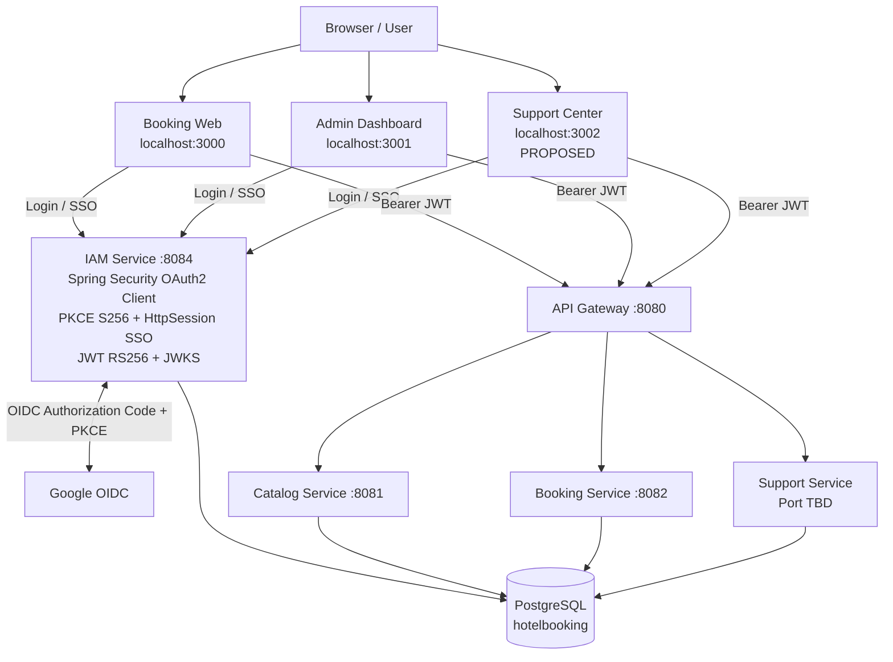
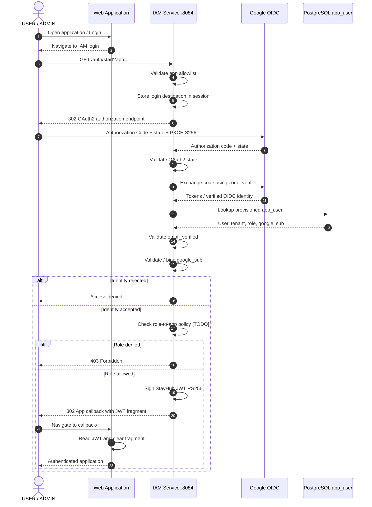
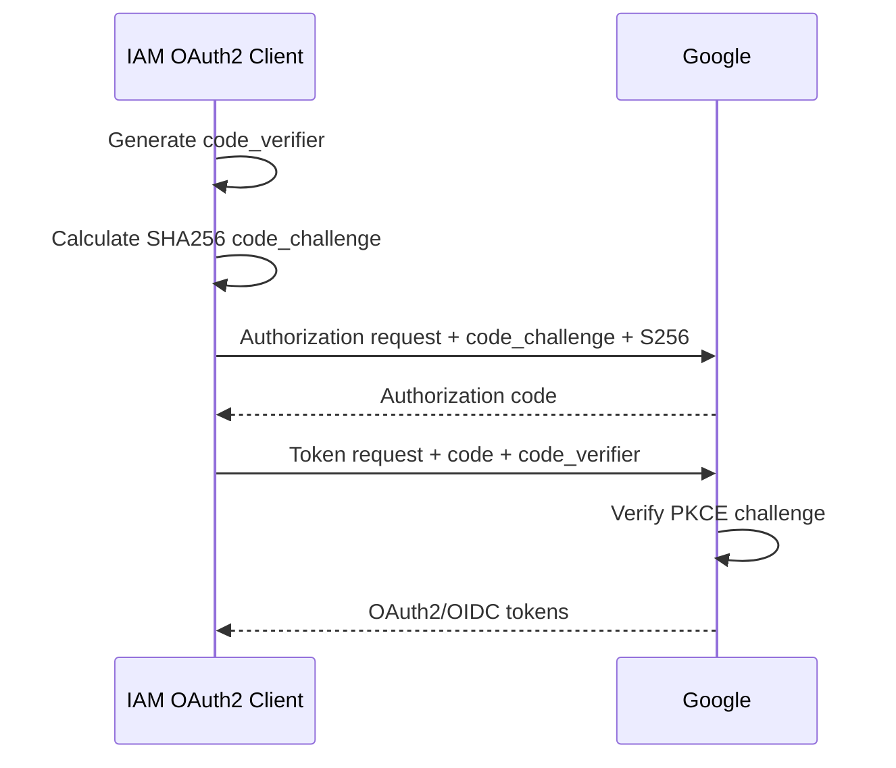
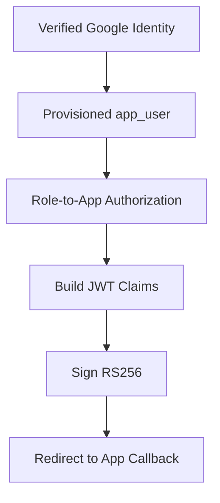
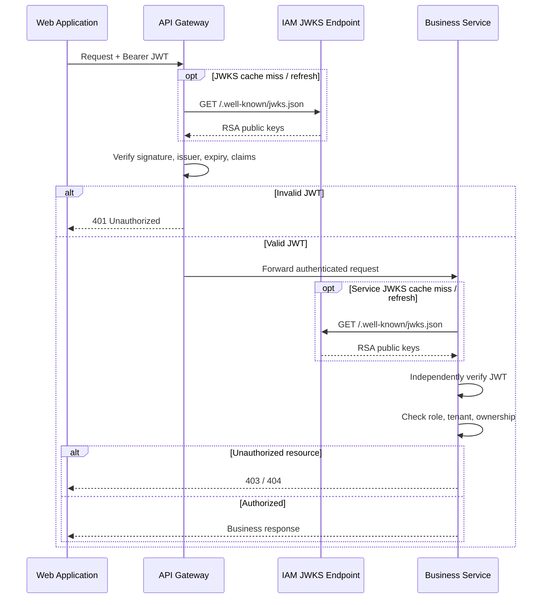
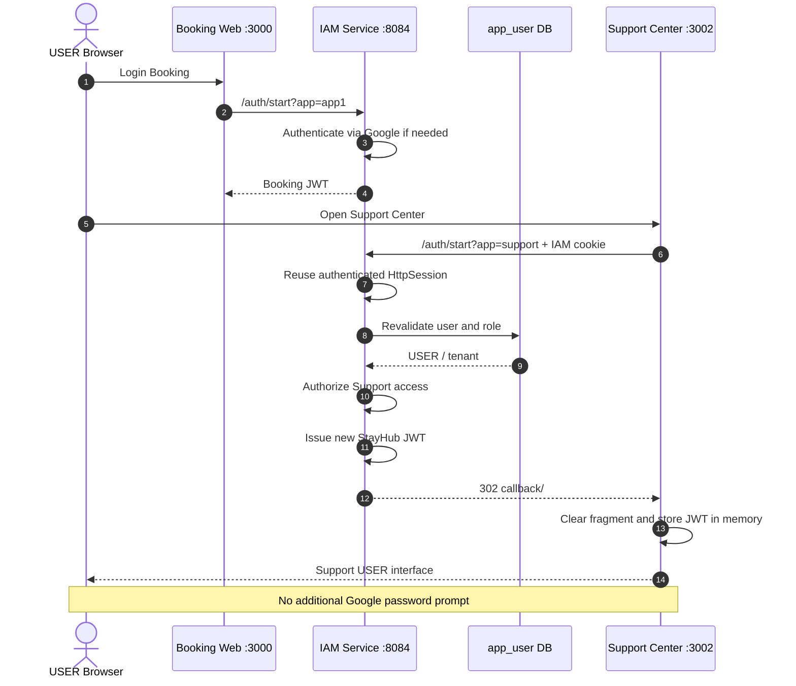
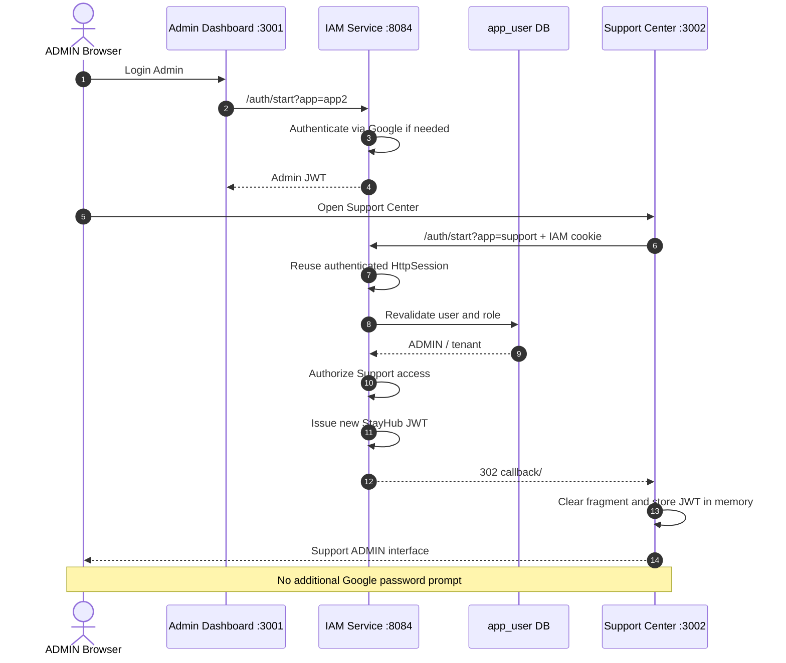

# StayHub — IAM Service, Google OIDC & SSO (3 Applications)

> **Version:** Custom IAM + Google OIDC + 3-App SSO  
> **Updated:** 2026-11-04  
> **Status:** TARGET INTEGRATION — Chưa xác minh toàn bộ source code và E2E  
> **Authentication:** Google OAuth2/OIDC Authorization Code + PKCE S256  
> **SSO:** Spring Security + HttpSession  
> **Authorization:** Custom JWT RS256 + RBAC + Tenant Isolation  
> **Identity Database:** PostgreSQL `hotelbooking`  
> **Architecture Decision:** Giữ nguyên IAM Service hiện tại — **Không sử dụng Keycloak**

---

## 1. Overview

StayHub sử dụng `iam-service` làm hệ thống xác thực tập trung cho ba ứng dụng:

1. **Booking Web:** Khách hàng tìm kiếm và đặt phòng.
2. **Admin Dashboard:** Quản trị khách sạn, phòng và booking.
3. **Support Center:** Hỗ trợ khách hàng và xử lý ticket.

IAM tích hợp Google OIDC để xác thực danh tính, sau đó tự phát hành JWT RS256 cho các ứng dụng StayHub.

### 1.1. Architecture Principles

- Google là upstream Identity Provider.
- IAM Service là OAuth2 Client của Google.
- IAM quản lý phiên đăng nhập tập trung bằng `HttpSession`.
- IAM là JWT issuer nội bộ của StayHub.
- Gateway và business services là JWT Resource Servers.
- Mỗi ứng dụng nhận JWT riêng thông qua IAM login flow.
- Không chia sẻ JWT trực tiếp giữa các frontend applications.
- Không chuyển Google ID Token trực tiếp cho Gateway.
- Không gọi IAM để introspect JWT trên mỗi business request.
- Không tự động tạo user từ Google login.
- Không sử dụng Keycloak.

### 1.2. Architecture Diagram



**Lưu ý:** Support Center và Support Service là thành phần đề xuất, chưa có bằng chứng đã triển khai.

---

## 2. IAM Service Components

Theo tài liệu developer, IAM hiện tại gồm các thành phần chính:

| Component | Responsibility |
|---|---|
| `AuthController` | Xử lý `/auth/start?app=...` |
| `SsoProperties` | Cấu hình allowlist ứng dụng và callback |
| `SsoLoginService` | Kiểm tra provisioning và Google identity binding |
| `SsoAuthenticationSuccessHandler` | Hoàn tất login và redirect |
| `JwtIssuer` | Phát hành JWT RS256 |
| `JwtKeyProvider` | Quản lý RSA signing key |
| `JwksController` | Công bố RSA public keys |
| `SecurityConfig` | Cấu hình OAuth2 Client, session và security filters |

### 2.1. Responsibilities

```text
IAM Service
│
├── Authentication
│   ├── Google OAuth2/OIDC
│   ├── Authorization Code
│   ├── PKCE S256
│   └── Google identity verification
│
├── Identity Management
│   ├── app_user lookup
│   ├── Pre-provisioning enforcement
│   ├── email_verified validation
│   └── google_sub binding
│
├── Session Management
│   ├── HttpSession
│   ├── SecurityContext
│   └── Cross-app SSO
│
├── Authorization
│   ├── App allowlist
│   └── Role-to-app policy [TODO]
│
└── Token Management
    ├── JWT RS256 signing
    ├── JWT claims
    ├── JWT expiration
    └── JWKS publication
```

IAM không phải một OIDC Authorization Server đầy đủ.

Không mặc định IAM hỗ trợ:

- Standard OIDC discovery.
- Dynamic client registration.
- OAuth2 token introspection.
- Refresh token issuance.
- Token revocation.
- Standard OIDC end-session endpoint.

Các khả năng này chỉ được công nhận khi source code và tests xác nhận.

---

## 3. Application Access Model

### 3.1. Application Registry

| Application | Development URL | IAM App ID | Allowed Role |
|---|---|---|---|
| Booking Web | `http://localhost:3000` | `app1` | USER |
| Admin Dashboard | `http://localhost:3001` | `app2` | ADMIN |
| Support Center | `http://localhost:3002` | `support` | USER, ADMIN |

Giữ `app1` và `app2` để tương thích với IAM hiện tại.

Không tự ý đổi sang `booking` và `admin` nếu chưa có migration contract giữa IAM và frontend.

### 3.2. Role Matrix

| Permission | USER | ADMIN |
|---|---|---|
| Login Booking | Allow | Deny |
| Login Admin | Deny | Allow |
| Login Support | Allow | Allow |
| Search Hotels | Allow | Theo API policy |
| Create Booking | Allow | Deny |
| Mock Payment | Own Booking | Deny |
| Cancel Booking | Own Booking | Deny |
| Manage Catalog | Deny | Allow |
| Manage Inventory | Deny | Allow |
| View Own Ticket | Allow | N/A |
| View Tenant Ticket Queue | Deny | Allow |
| Resolve Ticket | Deny | Allow |

Không thêm role `SUPPORT` trong MVP.

### 3.3. Authentication vs Authorization

| Layer | Responsibility | Failure |
|---|---|---|
| Google OIDC | Xác thực Google identity | Login denied |
| IAM Provisioning | Xác minh user thuộc StayHub | Login denied |
| IAM App Authorization | Kiểm tra role được phép vào app | `403` |
| Gateway | Xác minh JWT và policy tại Gateway | `401` / `403` |
| Business Service | Xác minh JWT độc lập và endpoint role | `401` / `403` |
| Tenant Isolation | Kiểm tra tenant ownership | `404` |
| Resource Ownership | Kiểm tra chủ sở hữu booking/ticket | `404` |

**Nguyên tắc:** SSO chỉ giải quyết việc tái sử dụng phiên xác thực. SSO không tự động cấp quyền truy cập mọi ứng dụng hoặc API.

---

## 4. Google OIDC Authentication Flow

### 4.1. Login Entry Points

Booking:

```http
GET http://localhost:8084/auth/start?app=app1
```

Admin:

```http
GET http://localhost:8084/auth/start?app=app2
```

Support:

```http
GET http://localhost:8084/auth/start?app=support
```

Google callback:

```text
http://localhost:8084/login/oauth2/code/google
```

### 4.2. First Login Sequence



### 4.3. Authentication Invariants

- OAuth2 `state` phải được xác minh.
- PKCE sử dụng S256.
- Google identity phải được xác minh bởi Spring Security OAuth2/OIDC Client.
- `email_verified` phải hợp lệ.
- `app_user` phải tồn tại.
- `google_sub` phải khớp với identity đã liên kết.
- Không auto-provision user.
- Role-to-app policy phải được kiểm tra trước khi phát JWT và redirect vào ứng dụng.
- Không nhận arbitrary callback URL từ client.

**Status:** Role-to-app policy cho ba ứng dụng là TODO, chưa có evidence đã triển khai.

---

## 5. PKCE S256

### 5.1. Purpose

PKCE bảo vệ OAuth2 Authorization Code flow khỏi nguy cơ authorization code interception.

IAM sử dụng:

```text
code_verifier = cryptographically random value

code_challenge =
    BASE64URL(SHA256(code_verifier))

code_challenge_method = S256
```

### 5.2. PKCE Execution



### 5.3. Implementation Requirements

- `code_verifier` được tạo ngẫu nhiên và đủ entropy.
- `code_verifier` được giữ trong OAuth2 authorization request context phía IAM.
- Không đưa `code_verifier` vào frontend application.
- Không ghi `code_verifier` vào logs.
- Không sử dụng `plain` challenge method.
- Không thay Authorization Code flow bằng Implicit flow.

### 5.4. Testing

Xem `iam-testing.md` để kiểm tra:

- `response_type=code`.
- `state`.
- `code_challenge`.
- `code_challenge_method=S256`.
- Callback và code exchange.

---

## 6. Identity & Pre-Provisioning

### 6.1. Identity Source

PostgreSQL:

```text
tenant
app_user
```

Logical identity model:

```text
app_user
├── id
├── tenant_id
├── email
├── role
└── google_sub
```

### 6.2. Identity Mapping

| Source | Field | Usage |
|---|---|---|
| Google ID Token | `sub` | Stable Google identity |
| Google ID Token | `email` | Initial user lookup |
| Google ID Token | `email_verified` | Email verification check |
| `app_user` | `id` | StayHub JWT subject |
| `app_user` | `tenant_id` | Tenant isolation |
| `app_user` | `role` | RBAC |
| `app_user` | `google_sub` | Google identity binding |

### 6.3. Login Validation

```text
Google Login
    |
    v
Verify Google Identity
    |
    v
email_verified == true?
    |
    +-- NO --> DENY
    |
    v
Find app_user by email
    |
    +-- NOT FOUND --> DENY
    |
    v
Validate google_sub binding
    |
    +-- MISMATCH --> DENY
    |
    v
Validate tenant and role
    |
    v
Validate role-to-app policy
    |
    +-- DENIED --> 403
    |
    v
Issue StayHub JWT
```

### 6.4. Google Subject Binding

`google_sub` là định danh Google ổn định hơn email.

Expected behavior:

1. User đã được provision trong `app_user`.
2. Google login cung cấp verified identity.
3. IAM kiểm tra email và Google subject.
4. Nếu chưa bind, IAM có thể bind `google_sub` theo policy hiện tại.
5. Nếu đã bind nhưng subject không khớp, IAM từ chối login.

Không tự ý thay đổi binding policy mà chưa kiểm tra implementation của `SsoLoginService`.

### 6.5. Multi-Tenancy

Trong phạm vi MVP:

```text
One app_user
    |
    +-- One tenant_id
    +-- One role
```

Nếu tương lai một user cần thuộc nhiều tenant, cần thiết kế membership model riêng.

Không mở rộng multi-tenant membership trong scope ba ứng dụng hiện tại.

---

## 7. StayHub JWT Architecture

### 7.1. JWT Issuer

IAM phát JWT nội bộ bằng thuật toán:

```text
RS256
```

Issuer:

```text
http://localhost:8084
```

Token TTL theo tài liệu developer:

```text
15 minutes
```

### 7.2. JWT Claims

Ví dụ payload minh họa:

```json
{
  "iss": "http://localhost:8084",
  "sub": "101",
  "email": "user@example.test",
  "tenant_id": 1,
  "role": "USER",
  "iat": 1793779200,
  "exp": 1793780100
}
```

Đây là dữ liệu minh họa, không phải JWT thật.

### 7.3. Claim Contract

| Claim | Type | Description |
|---|---|---|
| `iss` | String | StayHub IAM issuer |
| `sub` | String | `app_user.id` |
| `email` | String | Verified user email |
| `tenant_id` | Number | Tenant identifier |
| `role` | String | `USER` hoặc `ADMIN` |
| `iat` | Number | Issued-at timestamp |
| `exp` | Number | Expiration timestamp |

Không tự ý thay đổi `tenant_id` từ number sang string.

Không thêm claim `aud` như một yêu cầu bắt buộc nếu chưa thống nhất contract giữa IAM và resource services.

### 7.4. JWT Issuance Flow



### 7.5. JWT Security Rules

- Private key chỉ tồn tại ở IAM.
- Gateway và business services không cần private key.
- Không sử dụng Google ID Token làm StayHub API token.
- Không tin JWT chưa được verify.
- Không lấy `tenant_id` từ request body.
- Không lấy `role` từ request body.
- Không dùng frontend authorization làm security boundary duy nhất.
- Không ghi JWT vào logs.

---

## 8. JWKS & Resource Server Validation

### 8.1. JWKS Endpoint

```http
GET http://localhost:8084/.well-known/jwks.json
```

JWKS chỉ công bố RSA public key.

Expected public fields:

```text
kty
kid
n
e
```

Private fields không được xuất hiện:

```text
d
p
q
dp
dq
qi
oth
```

### 8.2. JWT Verification Flow



### 8.3. Spring Security Configuration

IAM hiện tại không được giả định là một OIDC Authorization Server có discovery endpoint chuẩn.

Resource services cần sử dụng:

- `jwk-set-uri`.
- Explicit issuer validation.
- Expiration validation.
- Required claims validation.
- Custom role/tenant mapping.

Ví dụ cấu hình mục tiêu:

```yaml
spring:
  security:
    oauth2:
      resourceserver:
        jwt:
          jwk-set-uri: http://localhost:8084/.well-known/jwks.json
```

Issuer validator phải được cấu hình và xác minh riêng theo implementation.

Không mặc định cấu hình `jwk-set-uri` tự động thực thi toàn bộ issuer, audience hoặc custom claims validation.

### 8.4. Service Security Responsibility

| Service | Required Checks |
|---|---|
| API Gateway | Signature, issuer, expiry, required claims |
| Catalog | JWT independently, ADMIN policy, tenant |
| Booking | JWT independently, USER policy, tenant, ownership |
| Support | JWT independently, USER/ADMIN policy, tenant, ticket ownership |

### 8.5. Direct Service Access

Ngay cả khi gọi trực tiếp:

```text
http://localhost:8081
http://localhost:8082
http://localhost:<support-port>
```

Service vẫn phải từ chối request thiếu hoặc sai JWT.

Gateway không được là security boundary duy nhất.

---

## 9. SSO Across Three Applications

### 9.1. SSO Principle

IAM quản lý authenticated session tập trung.

```text
Browser
    |
    +-- IAM HttpSession Cookie
    |
    +-- Booking JWT (App Memory)
    |
    +-- Admin JWT (App Memory)
    |
    +-- Support JWT (App Memory)
```

JWT của mỗi ứng dụng được nhận thông qua IAM login flow.

Không copy JWT từ Booking sang Support hoặc Admin.

### 9.2. USER: Booking → Support



### 9.3. ADMIN: Dashboard → Support



### 9.4. SSO Acceptance

| Scenario | Expected |
|---|---|
| USER Booking → Support | SSO success |
| ADMIN Admin → Support | SSO success |
| USER → Admin | Denied |
| ADMIN → Booking | Denied |
| IAM session expired | Reauthentication may be required |
| App JWT expired, IAM session valid | New login flow can issue JWT |
| Different browser profile | Independent session |

### 9.5. SSO vs JWT Lifetime

Hai vòng đời độc lập:

**IAM HttpSession**

- Duy trì authenticated Google identity.
- Cho phép tái sử dụng SSO.
- Không đồng nghĩa JWT business còn hiệu lực.

**StayHub JWT**

- Được phát cho application.
- Có thời hạn riêng.
- Được business services xác minh.
- Hết hạn không tự động xóa IAM session.

---

## 10. Callback & App Allowlist

### 10.1. Target Configuration

Ví dụ cấu hình logic:

```yaml
sso:
  callbacks:
    app1: http://localhost:3000/callback/
    app2: http://localhost:3001/callback/
    support: http://localhost:3002/callback/
```

Tên property phải được xác minh trong `SsoProperties`.

### 10.2. Callback Rules

- Chỉ cho phép app identifier đã đăng ký.
- Không nhận callback URL tự do từ request.
- Không redirect đến arbitrary external domain.
- Không dùng wildcard callback.
- Phải xác minh role trước khi phát JWT.
- Không redirect vào application trái role.

### 10.3. Invalid App Handling

Request:

```http
GET /auth/start?app=invalid
```

Expected:

```http
HTTP/1.1 400 Bad Request
```

Không redirect sang Google.

### 10.4. Known Spring Security Error Handling Issue

Theo báo cáo developer, từng có tình huống:

```java
response.sendError(400);
```

kích hoạt error dispatch tới `/error`, sau đó bị Spring Security chuyển sang Google login.

Developer đã xử lý cục bộ bằng:

```java
response.setStatus(400);
```

Đây là lesson learned theo cấu hình `SecurityFilterChain` hiện tại, không phải quy tắc chung rằng `sendError()` luôn sai.

Cần test trực tiếp invalid app behavior.

---

## 11. Role-to-App Enforcement

### 11.1. Target Policy

```text
app1
    |
    +-- USER only

app2
    |
    +-- ADMIN only

support
    |
    +-- USER
    +-- ADMIN
```

### 11.2. Authorization Pseudocode

```java
boolean canAccessApp(String app, String role) {
    return switch (app) {
        case "app1" -> "USER".equals(role);
        case "app2" -> "ADMIN".equals(role);
        case "support" ->
            "USER".equals(role) || "ADMIN".equals(role);
        default -> false;
    };
}
```

Đây là pseudocode cho policy mục tiêu, không phải source code đã xác minh.

### 11.3. Enforcement Point

Sau khi IAM hoàn tất identity validation:

```text
Google Identity
    |
    v
Pre-Provisioning Check
    |
    v
Google Subject Binding
    |
    v
Load Role and Tenant
    |
    v
Check App Authorization
    |
    +-- DENIED --> 403
    |
    v
Issue JWT
    |
    v
Redirect to Callback
```

Không chỉ kiểm tra role ở frontend.

Không chỉ kiểm tra role ở Gateway.

Business services vẫn phải kiểm tra role theo từng endpoint.

---

## 12. Tenant Isolation & Resource Ownership

### 12.1. Trusted Identity

Nguồn thông tin đáng tin cậy:

```text
JWT.sub
JWT.tenant_id
JWT.role
JWT.email
```

Chỉ sử dụng sau khi JWT được verify thành công.

### 12.2. Booking Ownership

Theo Booking implementation hiện tại:

```text
booking.user_email
```

Ownership dựa trên:

```text
booking.tenant_id == JWT.tenant_id

AND

booking.user_email == JWT.email
```

Không tự ý đổi Booking sang `user_id` khi chưa có migration riêng.

### 12.3. Support Ownership

Đối với Support Service mới:

```text
support_ticket.requester_user_id = JWT.sub

support_ticket.tenant_id = JWT.tenant_id
```

USER:

- Chỉ xem ticket của mình.
- Chỉ tạo ticket liên kết booking của mình.
- Không sửa role hoặc tenant qua request body.

ADMIN:

- Xem và xử lý ticket thuộc tenant.
- Không truy cập ticket của tenant khác.

### 12.4. Authorization Responses

| Condition | Response |
|---|---|
| Missing JWT | `401` |
| Invalid JWT | `401` |
| Expired JWT | `401` |
| Wrong role | `403` |
| Cross-tenant resource | `404` |
| Another user's resource | `404` |

---

## 13. Session Management & Multi-Tab Race

### 13.1. Current Session Approach

Theo tài liệu developer, IAM có thể lưu app destination trong:

```text
HttpSession attribute: sso_app
```

### 13.2. Race Scenario

```text
Tab A:
    /auth/start?app=app1

Tab B:
    /auth/start?app=support

Shared HttpSession:
    sso_app overwritten

Google callback:
    May redirect to wrong app
```

### 13.3. Target Improvement

Bind destination với từng OAuth2 authorization request:

```text
OAuth2 state
    |
    +-- Authorization request
    |
    +-- App destination
    |
    +-- Callback metadata
```

### 13.4. Implementation Status

- Current session-based app selector: Reported.
- Multi-tab race: Known risk.
- Authorization request/state binding: Proposed.
- Automated regression test: TODO.

Không coi improvement này là đã triển khai.

---

## 14. JWT Delivery & Frontend Session

### 14.1. Current Demo Flow

IAM redirect:

```text
http://localhost:3000/callback/#token=<JWT>
```

Frontend:

1. Đọc JWT từ fragment.
2. Xóa fragment khỏi browser URL.
3. Giữ JWT trong memory.
4. Gửi JWT qua Authorization header.

```http
Authorization: Bearer <JWT>
```

### 14.2. Security Limitations

URL fragment không được gửi trong HTTP request đến server đích, nhưng vẫn có thể bị đọc bởi:

- JavaScript chạy trong trang.
- XSS payload.
- Browser extensions có quyền phù hợp.
- Các script bên thứ ba chạy cùng origin.

Do đó, flow này chỉ dành cho demo.

### 14.3. Production Direction

Hướng nâng cấp có thể cân nhắc:

- Backend for Frontend (BFF).
- HttpOnly session cookies.
- Secure cookies.
- SameSite policy.
- CSRF protection.
- Server-side token handling.

Không thay đổi demo flow hiện tại khi chưa có quyết định kiến trúc riêng.

---

## 15. JWT Expiration, Refresh & Logout

### 15.1. Token Expiration

Theo developer:

```text
JWT TTL = 15 minutes
```

Sau khi hết hạn:

- Gateway trả `401`.
- Business services trả `401`.
- Frontend không tiếp tục sử dụng JWT cũ.

Nếu IAM session còn hợp lệ, frontend có thể khởi tạo lại IAM login flow để nhận JWT mới.

### 15.2. Refresh Token

Current status:

```text
NOT IMPLEMENTED
```

Không gọi việc login lại qua IAM session là refresh token flow.

### 15.3. Token Revocation

Current status:

```text
NOT IMPLEMENTED
```

JWT đã phát có thể tiếp tục hợp lệ cho đến khi hết hạn, trừ khi signing key hoặc validation policy thay đổi.

### 15.4. Local Logout

```text
Frontend clears JWT
    |
    v
Application becomes locally logged out
    |
    v
IAM HttpSession may remain valid
```

Local logout không đồng nghĩa SSO logout.

### 15.5. IAM Single Logout

Current status:

```text
NOT IMPLEMENTED
```

Trước production cần quyết định:

- IAM session invalidation.
- Cross-app logout semantics.
- Cookie invalidation.
- Token expiration/revocation strategy.
- Google session behavior.

---

## 16. RSA Key Management

### 16.1. Current Behavior

Theo báo cáo developer, `JwtKeyProvider` có thể sinh RSA keypair mới mỗi lần IAM restart.

Hệ quả:

```text
IAM Restart
    |
    v
New RSA Keypair
    |
    v
New JWKS
    |
    v
Previously issued JWT may fail verification
```

### 16.2. Production Requirements

- Persistent RSA private key.
- Secure key storage.
- Key rotation.
- Stable `kid`.
- JWKS caching strategy.
- Overlapping public keys during rotation.
- Defined key retirement policy.

### 16.3. Security Rules

Không:

- Commit private key vào Git.
- Đưa private key vào JWKS.
- Ghi private key vào logs.
- Chia sẻ private key cho Gateway.
- Dùng cùng private key cho các mục đích không liên quan nếu chưa được đánh giá bảo mật.

---

## 17. Stale Authorization & Role Changes

### 17.1. Problem

JWT là signed snapshot của identity và authorization claims tại thời điểm phát hành.

Ví dụ:

```text
T0:
    User role = ADMIN
    JWT issued with ADMIN

T1:
    Database role changed to USER

T2:
    Old JWT still contains ADMIN
```

Nếu service chỉ dựa trên JWT, role cũ có thể còn hiệu lực đến khi token hết hạn.

### 17.2. Current MVP Behavior

- JWT TTL ngắn giúp giới hạn thời gian stale claims.
- IAM có thể đọc lại role khi user login/SSO.
- Chưa có server-side JWT revocation.

### 17.3. Production Options

- Short-lived access tokens.
- Token version.
- Revocation list.
- Session invalidation.
- Critical-action authorization recheck.

Các lựa chọn này cần quyết định riêng, không tự động bổ sung vào MVP.

---

## 18. IAM Integration Tasks

### 18.1. Required for Three Apps

- [ ] Thêm `support` vào `SsoProperties` allowlist.
- [ ] Cấu hình Support callback `http://localhost:3002/callback/`.
- [ ] Giữ tương thích `app1` và `app2`.
- [ ] Enforce role-to-app policy tại IAM.
- [ ] USER chỉ được vào Booking và Support.
- [ ] ADMIN chỉ được vào Admin và Support.
- [ ] Không phát JWT cho app trái role.
- [ ] Support Service xác minh JWT độc lập.
- [ ] Support Service enforce tenant isolation.
- [ ] Support Service enforce ticket ownership.
- [ ] Kiểm thử hai cross-app SSO flows.
- [ ] Kiểm thử invalid app handling.
- [ ] Kiểm thử multi-tab session race.

### 18.2. Preserve Existing Implementation

Không thay đổi nếu chưa có lý do kỹ thuật và quyết định riêng:

- Google OIDC integration.
- Authorization Code + PKCE.
- HttpSession SSO.
- `app_user` provisioning.
- `google_sub` binding.
- RS256 JWT signing.
- JWKS endpoint.
- JWT TTL.
- Gateway resource server validation.
- Existing Catalog/Booking JWT validation contract.

---

## 19. IAM Acceptance Criteria

| Test | Expected | Status |
|---|---|---|
| Google OIDC login | Success | TODO |
| PKCE S256 | Verified | TODO |
| Unprovisioned account | Denied | TODO |
| `google_sub` mismatch | Denied | TODO |
| JWT RS256 signature | Valid | TODO |
| JWKS public-only fields | Valid | TODO |
| Invalid JWT | `401` | TODO |
| Expired JWT | `401` | TODO |
| USER Booking login | Allowed | TODO |
| ADMIN Admin login | Allowed | TODO |
| USER Booking → Support SSO | No Google re-login | TODO |
| ADMIN Admin → Support SSO | No Google re-login | TODO |
| USER → Admin | `403` | TODO |
| ADMIN → Booking | `403` | TODO |
| Cross-tenant API access | `404` | TODO |
| Cross-user resource access | `404` | TODO |
| Direct service JWT verification | PASS | TODO |
| Multi-tab login behavior | Verified | TODO |
| IAM Single Logout | Not implemented | N/A |

Chi tiết test cases nằm trong `iam-testing.md`.

---

## 20. Operational Metrics

### 20.1. Authentication

| Metric | Target |
|---|---|
| Valid provisioned login | 100% test cases PASS |
| Unprovisioned account rejection | 100% |
| Invalid Google subject rejection | 100% |
| Invalid app rejection | 100% |

### 20.2. Authorization

| Metric | Target |
|---|---|
| Wrong-role access rejected | 100% |
| Cross-tenant access rejected | 100% |
| Ownership violations rejected | 100% |
| Direct service security tests | 100% PASS |

### 20.3. SSO

| Metric | Target |
|---|---|
| USER Booking → Support | PASS |
| ADMIN Admin → Support | PASS |
| Additional Google password prompt with valid IAM session | 0 |
| Newly issued JWT for second app | Verified |

### 20.4. Security

| Metric | Target |
|---|---|
| Private RSA fields exposed through JWKS | 0 |
| Secrets committed to repository | 0 |
| JWT/cookies in logs or test evidence | 0 |
| Unauthorized JWT acceptance | 0 |

Đây là acceptance targets, không phải metrics đã đo từ hệ thống đang chạy.

---

## 21. Documentation References

| Document | Responsibility |
|---|---|
| `../README.md` | Project documentation overview |
| `architecture.md` | Three-App architecture |
| `iam-integration-tasks.md` | IAM implementation tasks |
| `iam-testing.md` | IAM test plan and acceptance matrix |
| `api-contract.md` | API authorization contracts |
| `data-model.md` | Identity, tenant and ownership model |
| `workflows.md` | Login, SSO and business sequences |
| `operations-and-tests.md` | Operations, migrations and release gates |
| `decisions.md` | Architecture decisions |

---

## 22. Final Integration Status

```text
ARCHITECTURE:
    CUSTOM IAM — PRESERVED

IDENTITY PROVIDER:
    GOOGLE OIDC

AUTHENTICATION:
    AUTHORIZATION CODE + PKCE S256

SSO:
    SPRING SECURITY + HTTPSESSION

TOKEN:
    CUSTOM JWT RS256

PUBLIC KEY:
    IAM JWKS ENDPOINT

APPLICATIONS:
    BOOKING WEB — EXISTING TARGET
    ADMIN DASHBOARD — EXISTING TARGET
    SUPPORT CENTER — PROPOSED

THREE-APP CALLBACK:
    TODO

ROLE-TO-APP POLICY:
    TODO / NOT VERIFIED

SUPPORT JWT VALIDATION:
    TODO

TENANT ISOLATION:
    REQUIRES INTEGRATION TESTING

CROSS-APP SSO:
    NOT RE-VERIFIED

JWT REFRESH:
    NOT IMPLEMENTED

TOKEN REVOCATION:
    NOT IMPLEMENTED

IAM SINGLE LOGOUT:
    NOT IMPLEMENTED

MULTI-TAB SESSION RACE:
    KNOWN RISK

PRODUCTION READINESS:
    NOT ESTABLISHED
```

**Kết luận:** StayHub tiếp tục sử dụng IAM Service tự phát triển của team, tích hợp Google OIDC, PKCE S256, HttpSession SSO và JWT RS256/JWKS. Phạm vi mở rộng ba ứng dụng tập trung vào Support callback, role-to-app authorization, Support Service và E2E testing; không thay thế IAM hiện tại bằng Keycloak hoặc một Authorization Server khác.
