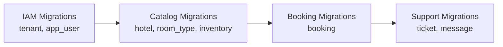
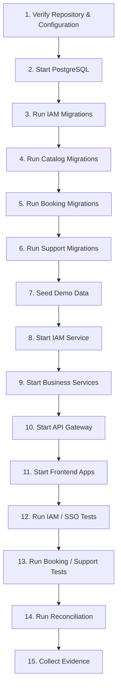

# StayHub — Operations, Migrations, Testing & Known Limitations

> **Phiên bản:** 3-App Architecture + Custom IAM + Booking Inventory ERD v2  
> **Cập nhật:** 04/11/2026  
> **Database:** PostgreSQL `hotelbooking`  
> **Migration:** Flyway  
> **Build:** Gradle  
> **Trạng thái:** PROPOSED — Chưa thực thi hoặc xác minh toàn bộ migrations, integration tests và E2E tests  
> **Phạm vi:** IAM, API Gateway, Catalog, Booking, Support và ba ứng dụng frontend.

---

## 1. Operations Overview

Tài liệu này quy định:

- Quy trình khởi tạo và vận hành môi trường development.
- Quy ước Flyway migrations.
- Thứ tự khởi tạo database và services.
- Quy trình seed dữ liệu demo.
- Kiểm thử IAM, SSO, RBAC và tenant isolation.
- Kiểm thử Booking Inventory, transaction và concurrency.
- Kiểm thử Support Center.
- Reconciliation và kiểm tra dữ liệu.
- Các giới hạn MVP và tiêu chí nghiệm thu.

### 1.1. Operational Principles

1. **Preserve IAM:** Giữ nguyên Custom IAM của developer; không chuyển sang Keycloak.
2. **Migration safety:** Không chỉnh sửa migrations đã chạy trên shared database.
3. **Database integrity:** Không xóa dữ liệu nếu chưa được phép.
4. **Service independence:** Mỗi backend service phải xác minh JWT độc lập.
5. **Tenant isolation:** Mọi dữ liệu nghiệp vụ phải được giới hạn theo tenant.
6. **Transactional consistency:** Booking và inventory phải được cập nhật atomically.
7. **Evidence-based acceptance:** Chỉ đánh dấu PASS khi có kết quả kiểm thử thực tế.
8. **No secrets:** Không commit credentials, private keys, JWT hoặc session cookies.

---

## 2. Environment & Service Configuration

### 2.1. Service Map

| Component | Development Address | Status |
|---|---|---|
| Booking Web | `http://localhost:3000` | Existing target |
| Admin Dashboard | `http://localhost:3001` | Existing target |
| Support Center | `http://localhost:3002` | Proposed |
| API Gateway | `http://localhost:8080` | Existing target |
| Catalog Service | `http://localhost:8081` | Existing target |
| Booking Service | `http://localhost:8082` | Existing target |
| IAM Service | `http://localhost:8084` | Existing target |
| Support Service | TBD | Proposed |
| PostgreSQL | `localhost:5432` | Example development configuration |

Các địa chỉ và port phải được đối chiếu với configuration thực tế của repository.

### 2.2. Required Environment Variables

Ví dụ cấu hình, không phải danh sách biến đã xác nhận trong source code:

```properties
# PostgreSQL
SPRING_DATASOURCE_URL=jdbc:postgresql://localhost:5432/hotelbooking
SPRING_DATASOURCE_USERNAME=${DB_USERNAME}
SPRING_DATASOURCE_PASSWORD=${DB_PASSWORD}

# IAM
IAM_ISSUER_URI=http://localhost:8084
IAM_JWKS_URI=http://localhost:8084/.well-known/jwks.json

# Google OAuth2
GOOGLE_CLIENT_ID=${GOOGLE_CLIENT_ID}
GOOGLE_CLIENT_SECRET=${GOOGLE_CLIENT_SECRET}
```

Không đưa giá trị thật vào tài liệu hoặc Git.

### 2.3. Configuration Validation

Trước khi chạy E2E:

- [ ] PostgreSQL hoạt động.
- [ ] Database `hotelbooking` tồn tại.
- [ ] IAM kết nối database thành công.
- [ ] Google OAuth2 configuration hợp lệ.
- [ ] IAM callback URLs được allowlist.
- [ ] JWKS endpoint truy cập được.
- [ ] Gateway và business services cấu hình đúng issuer/JWKS.
- [ ] Flyway migrations chạy thành công.
- [ ] Frontend sử dụng đúng IAM login entry points.
- [ ] Support routes được cấu hình nếu Support đã triển khai.

---

## 3. Flyway Migration Convention

### 3.1. Naming Convention

Sử dụng:

```text
V<number>__snake_case_description.sql
```

Ví dụ:

```text
V1__create_tenant.sql
V2__create_app_user.sql
V3__create_hotel.sql
V4__create_room_type.sql
V5__create_room_inventory.sql
V6__create_booking.sql
V7__create_support_ticket.sql
V8__create_ticket_message.sql
```

Đây là ví dụ về tên migration, không phải danh sách version thực tế của repository.

Nếu các services sử dụng Flyway history riêng, version có thể bắt đầu từ `V1` trong từng service.

### 3.2. Migration Rules

- Không chỉnh sửa migration đã áp dụng trên shared/production database.
- Không đổi tên migration đã được Flyway ghi nhận.
- Không xóa migration history để bỏ qua lỗi.
- Không dùng `flyway repair` để che giấu schema mismatch.
- Không tự động reset database có dữ liệu.
- Migration phải có thể review và kiểm thử.
- Mọi thay đổi cross-service schema phải được thống nhất giữa các developer.

### 3.3. Shared Database Strategy

StayHub MVP sử dụng PostgreSQL database chung:

```text
hotelbooking
    |
    +-- IAM Tables
    |     +-- tenant
    |     +-- app_user
    |
    +-- Catalog Tables
    |     +-- hotel
    |     +-- room_type
    |     +-- room_inventory
    |
    +-- Booking Tables
    |     +-- booking
    |
    +-- Support Tables [PROPOSED]
          +-- support_ticket
          +-- ticket_message
```

Mỗi service quản lý migrations thuộc domain của mình.

Nếu sử dụng Flyway history riêng trong cùng schema, phải cấu hình history table riêng cho từng service.

Ví dụ:

```properties
# IAM Service
spring.flyway.table=flyway_schema_history_iam

# Catalog Service
spring.flyway.table=flyway_schema_history_catalog

# Booking Service
spring.flyway.table=flyway_schema_history_booking

# Support Service
spring.flyway.table=flyway_schema_history_support
```

Đây là cấu hình đề xuất; phải kiểm tra thực tế trước khi áp dụng.

### 3.4. Migration Dependency Order



Thứ tự này phản ánh foreign key dependencies.

Không chạy các migrations phụ thuộc song song nếu referenced tables chưa sẵn sàng.

---

## 4. Migration Safety Strategy

### 4.1. Disposable Local Database

Chỉ được reset database khi:

- Database chỉ phục vụ local development.
- Không chứa dữ liệu cần giữ lại.
- Team đã thống nhất reset.
- Đã kiểm tra đúng database target.

Ví dụ:

```bash
# Chỉ dùng với disposable local environment
docker compose down -v
docker compose up -d
```

**Cảnh báo:** `down -v` có thể xóa dữ liệu trong Docker volumes của project.

Không chạy trên shared hoặc production environment.

### 4.2. Shared Database

Đối với shared database:

1. Kiểm tra `flyway_schema_history`.
2. Xác định schema hiện tại.
3. Backup dữ liệu.
4. Tạo additive migration mới.
5. Backfill dữ liệu nếu cần.
6. Kiểm tra constraints và indexes.
7. Deploy application tương thích.
8. Chỉ cleanup legacy schema ở migration sau.

### 4.3. Expand–Migrate–Contract

```text
EXPAND
  |
  +-- Add new tables / columns / indexes
  |
  v
MIGRATE
  |
  +-- Backfill data
  +-- Validate consistency
  +-- Update application
  |
  v
CONTRACT
  |
  +-- Remove legacy dependencies
  +-- Drop obsolete columns / tables
```

Không thực hiện breaking migration trong một bước trên môi trường có dữ liệu.

---

## 5. Known Migration Blocker

Theo tài liệu developer, Booking migration cũ còn tham chiếu bảng:

```text
room
```

Trong khi ERD v2 sử dụng:

```text
hotel
room_type
room_inventory
booking
```

### 5.1. Required Verification

- [ ] Kiểm tra Booking Flyway scripts.
- [ ] Xác định foreign key còn tham chiếu `room`.
- [ ] Kiểm tra Catalog migrations thực tế.
- [ ] Kiểm tra `room_type` và `room_inventory` đã tồn tại.
- [ ] Đồng bộ Booking FK sang `room_type`.
- [ ] Kiểm tra dữ liệu booking hiện có.
- [ ] Chạy migration trên PostgreSQL sạch.
- [ ] Chạy migration trên bản sao database có dữ liệu nếu cần nâng cấp.
- [ ] Kiểm tra rollback/recovery plan.

### 5.2. Migration Acceptance

```text
Expected:
- All migrations successful
- No unresolved foreign keys
- No missing referenced tables
- No duplicate migration versions
- No checksum mismatch
- No unintended data loss
```

Không đánh dấu blocker đã xử lý khi chưa có kết quả migration thực tế.

---

## 6. Database Constraints Verification

### 6.1. Required Constraints

| Table | Constraint |
|---|---|
| `app_user` | Unique tenant/email, tenant/id nếu dùng composite FK |
| `hotel` | Unique `(tenant_id, id)` |
| `room_type` | Unique `(tenant_id, id)` |
| `room_inventory` | PK `(tenant_id, room_type_id, stay_date)` |
| `room_inventory` | `0 <= sold <= total` |
| `booking` | `check_out > check_in` |
| `booking` | `room_count > 0` |
| `booking` | Valid booking status |
| `support_ticket` | Valid ticket status |
| `ticket_message` | Valid tenant-scoped references |

### 6.2. Verify PostgreSQL Constraints

```sql
SELECT
    conrelid::regclass AS table_name,
    conname AS constraint_name,
    contype AS constraint_type,
    pg_get_constraintdef(oid) AS definition
FROM pg_constraint
WHERE connamespace = 'public'::regnamespace
ORDER BY table_name, constraint_name;
```

### 6.3. Verify Indexes

```sql
SELECT
    tablename,
    indexname,
    indexdef
FROM pg_indexes
WHERE schemaname = 'public'
ORDER BY tablename, indexname;
```

### 6.4. Verify Flyway History

```sql
SELECT *
FROM flyway_schema_history
ORDER BY installed_rank;
```

Nếu dùng history tables riêng:

```sql
SELECT *
FROM flyway_schema_history_iam
ORDER BY installed_rank;

SELECT *
FROM flyway_schema_history_catalog
ORDER BY installed_rank;

SELECT *
FROM flyway_schema_history_booking
ORDER BY installed_rank;
```

Chỉ truy vấn các bảng history thực sự tồn tại.

---

## 7. Demo Seed Data

### 7.1. Seed Strategy

Seed data phục vụ:

- Hotel search.
- Room availability.
- Booking creation.
- Mock payment.
- Cancellation.
- Expiry.
- Concurrent booking.
- Tenant isolation.
- Support ticket workflows.

### 7.2. Seed Requirements

| Entity | Target |
|---|---|
| Tenant | 2 |
| Hotel | 3 |
| Room Type | 6 |
| Inventory | Theo khoảng ngày demo |
| Confirmed Booking | 4 |
| Race Test Room Type | 1 room available |
| USER Accounts | Ít nhất 1 mỗi tenant |
| ADMIN Accounts | Ít nhất 1 mỗi tenant |
| Support Tickets | Tạo trong test fixtures |

Các tài khoản IAM phải được provision đúng với Google identity dùng để test.

Không dùng Google account hoặc dữ liệu cá nhân thật trong fixtures được commit.

### 7.3. Inventory Seed Window

Theo thiết kế ERD v2:

```text
2026-11-01 → 2027-01-31
```

Khoảng ngày này là hữu hạn.

Nếu test sử dụng ngày nằm ngoài seed window, availability sẽ không có dữ liệu.

### 7.4. Seed Inventory

```sql
INSERT INTO room_inventory (
    tenant_id,
    room_type_id,
    stay_date,
    total
)
SELECT
    rt.tenant_id,
    rt.id,
    d::date,
    rt.total_rooms
FROM room_type rt
CROSS JOIN generate_series(
    DATE '2026-11-01',
    DATE '2027-01-31',
    INTERVAL '1 day'
) AS d;
```

Không chạy seed lặp lại nếu có nguy cơ vi phạm primary key hoặc ghi đè inventory đã được sử dụng.

### 7.5. Seed Validation

```sql
SELECT
    tenant_id,
    room_type_id,
    COUNT(*) AS inventory_days,
    MIN(stay_date) AS first_day,
    MAX(stay_date) AS last_day
FROM room_inventory
GROUP BY tenant_id, room_type_id
ORDER BY tenant_id, room_type_id;
```

---

## 8. Build & Unit Testing

### 8.1. Gradle Commands

Tại từng backend service:

```bash
./gradlew clean test
```

Build:

```bash
./gradlew clean build
```

Nếu repository dùng Gradle multi-project, có thể chạy test theo module:

```bash
./gradlew :iam-service:test
./gradlew :catalog-service:test
./gradlew :booking-service:test
```

Tên module phải được đối chiếu với `settings.gradle` hoặc `settings.gradle.kts`.

### 8.2. Unit Test Coverage

**IAM Service:**

- App allowlist validation.
- Role-to-app authorization.
- Provisioned user lookup.
- Google identity binding.
- JWT claims generation.
- JWT expiration.

**Catalog Service:**

- Hotel ownership validation.
- Room type validation.
- Date validation.
- Price validation.
- Inventory availability calculation.

**Booking Service:**

- Booking request validation.
- Total price calculation.
- Booking state transitions.
- Payment expiry validation.
- Cancellation rules.
- Inventory release rules.

**Support Service:**

- Ticket ownership.
- Tenant isolation.
- Ticket state transitions.
- Message author validation.
- ADMIN assignment rules.

### 8.3. Unit Test Acceptance

```text
Expected:
- All tests PASS
- No unexpected skipped tests
- No failing assertions
- No test dependency on production data
```

Unit tests không đủ để chứng minh tính đúng đắn của concurrency hoặc database transactions.

---

## 9. PostgreSQL Integration Testing

### 9.1. Recommended Stack

Sử dụng:

- JUnit 5.
- Spring Boot Test.
- Testcontainers.
- PostgreSQL container.
- Flyway.
- AssertJ hoặc framework assertion tương đương.

### 9.2. Testcontainers Example

Ví dụ minh họa, cần điều chỉnh theo phiên bản Spring Boot/Testcontainers trong repository:

```java
@Testcontainers
@SpringBootTest
class BookingIntegrationTest {

    @Container
    static PostgreSQLContainer<?> postgres =
        new PostgreSQLContainer<>("postgres:16")
            .withDatabaseName("hotelbooking")
            .withUsername("test")
            .withPassword("test");

    @DynamicPropertySource
    static void configure(DynamicPropertyRegistry registry) {
        registry.add(
            "spring.datasource.url",
            postgres::getJdbcUrl
        );
        registry.add(
            "spring.datasource.username",
            postgres::getUsername
        );
        registry.add(
            "spring.datasource.password",
            postgres::getPassword
        );
    }
}
```

Testcontainers phải sử dụng schema/migrations tương thích với môi trường mục tiêu.

### 9.3. Integration Test Matrix

| Test | Expected |
|---|---|
| Flyway migration | PASS |
| FK same tenant | PASS |
| Cross-tenant FK | Rejected |
| Invalid booking dates | Rejected |
| Negative inventory | Rejected |
| `sold > total` | Rejected |
| Booking transaction rollback | No partial stock hold |
| Payment transition | Correct |
| Cancel transition | Correct |
| Expiry transition | Correct |
| Concurrent booking | No overselling |

---

## 10. Booking Concurrency Testing

### 10.1. Race Test Scenario

Seed một loại phòng:

```text
room_type_id = 5
total = 1
sold = 0
available = 1
```

Hai USER hoặc hai request đồng thời đặt cùng một phòng, cùng kỳ lưu trú.

### 10.2. Expected Results

| Request | Expected |
|---|---|
| Booking A | `201 Created` |
| Booking B | `409 Conflict` |

Hoặc ngược lại.

Điều kiện:

```text
Exactly 1 successful booking
Exactly 1 conflict
Final sold = 1
Final available = 0
```

### 10.3. Concurrency Test Design

```text
Prepare inventory
       |
       v
Create two concurrent requests
       |
       v
Synchronize start
       |
       v
Execute Booking transactions
       |
       v
Wait for completion
       |
       v
Assert responses
       |
       v
Query database
       |
       v
Assert sold <= total
       |
       v
Run reconciliation
```

### 10.4. Recommended Assertions

```java
assertThat(successCount).isEqualTo(1);
assertThat(conflictCount).isEqualTo(1);
assertThat(finalSold).isEqualTo(1);
assertThat(finalAvailable).isZero();
```

### 10.5. Multi-Night Rollback Test

Giả sử:

| Date | Available |
|---|---:|
| 2026-11-24 | 1 |
| 2026-11-25 | 0 |

USER đặt từ 24/11 đến 26/11.

Expected:

- Booking trả `409`.
- Không có booking mới.
- Inventory 24/11 không bị giữ sau rollback.
- Inventory 25/11 không thay đổi.
- Reconciliation trả về 0 mismatch.

### 10.6. Payment vs Expiry Race

Hai transaction đồng thời:

- Transaction A thanh toán.
- Transaction B xử lý expiry.

Expected:

- Chỉ một transition thành công.
- Nếu `CONFIRMED`, inventory vẫn được giữ.
- Nếu `EXPIRED`, inventory được hoàn.
- Không tồn tại trạng thái `CONFIRMED` nhưng đã hoàn inventory.

### 10.7. Cancel vs Expiry Race

Expected:

- Chỉ một transition thành công.
- Inventory được hoàn đúng một lần.
- Booking kết thúc ở `CANCELLED` hoặc `EXPIRED`.
- Không có `sold < 0`.

---

## 11. Inventory Reconciliation

### 11.1. Business Invariant

Inventory đã giữ phải khớp với tổng số phòng của các booking đang chiếm tồn.

Các trạng thái chiếm tồn:

```text
PENDING_PAYMENT
CONFIRMED
```

### 11.2. Reconciliation SQL

```sql
SELECT
    i.tenant_id,
    i.room_type_id,
    i.stay_date,
    i.sold,
    COALESCE(SUM(b.room_count), 0) AS expected_sold
FROM room_inventory i
LEFT JOIN booking b
    ON b.tenant_id = i.tenant_id
   AND b.room_type_id = i.room_type_id
   AND b.status IN ('PENDING_PAYMENT', 'CONFIRMED')
   AND i.stay_date >= b.check_in
   AND i.stay_date < b.check_out
GROUP BY
    i.tenant_id,
    i.room_type_id,
    i.stay_date,
    i.sold
HAVING i.sold <> COALESCE(SUM(b.room_count), 0);
```

### 11.3. Expected Result

```text
0 rows
```

### 11.4. Reconciliation Checklist

- [ ] Sau booking creation.
- [ ] Sau payment.
- [ ] Sau cancellation.
- [ ] Sau expiry.
- [ ] Sau concurrent booking.
- [ ] Sau transaction rollback.
- [ ] Sau migration dữ liệu.

Không tự động chỉnh sửa `sold` khi phát hiện mismatch nếu chưa xác định nguyên nhân.

---

## 12. IAM Integration Testing

### 12.1. IAM Architecture Under Test

```text
Google OIDC
    |
    v
IAM Service :8084
    |
    +-- PKCE S256
    +-- HttpSession SSO
    +-- app_user Pre-Provisioning
    +-- google_sub Binding
    +-- JWT RS256
    +-- JWKS
    |
    v
Booking / Admin / Support
```

### 12.2. Login Entry Points

| App | Endpoint | Allowed Role |
|---|---|---|
| Booking | `/auth/start?app=app1` | USER |
| Admin | `/auth/start?app=app2` | ADMIN |
| Support | `/auth/start?app=support` | USER, ADMIN |

### 12.3. IAM Test Matrix

| Test | Expected |
|---|---|
| Google login with provisioned USER | Success |
| Google login with provisioned ADMIN | Success |
| Unprovisioned Google account | Denied |
| `email_verified = false` | Denied |
| `google_sub` mismatch | Denied |
| Invalid app identifier | Denied |
| USER accessing Booking | Allowed |
| USER accessing Admin | Denied |
| ADMIN accessing Admin | Allowed |
| ADMIN accessing Booking | Denied |
| USER accessing Support | Allowed |
| ADMIN accessing Support | Allowed |
| Invalid JWT signature | `401` |
| Expired JWT | `401` |
| Invalid issuer | `401` |
| Missing required claims | Rejected |
| Direct business service call without valid JWT | Rejected |

### 12.4. JWT Claims Validation

Kiểm tra:

```text
iss = http://localhost:8084
sub = app_user.id
email = verified email
tenant_id = numeric tenant ID
role = USER | ADMIN
iat = issued timestamp
exp = expiration timestamp
```

Theo tài liệu developer, JWT TTL là 15 phút.

Không ghi JWT thật vào test reports hoặc logs.

### 12.5. JWKS Validation

Kiểm tra endpoint:

```http
GET http://localhost:8084/.well-known/jwks.json
```

Expected:

- HTTP `200`.
- JWKS có public RSA key.
- Không chứa private key parameters.
- Gateway xác minh JWT thành công.
- Catalog xác minh JWT thành công.
- Booking xác minh JWT thành công.
- Support xác minh JWT thành công khi được triển khai.

---

## 13. SSO End-to-End Testing

### 13.1. USER: Booking → Support

Steps:

1. Mở Booking Web.
2. Đăng nhập Google qua IAM.
3. Xác nhận Booking nhận JWT hợp lệ.
4. Mở Support Center.
5. Support gọi `/auth/start?app=support`.
6. IAM nhận diện HttpSession hiện có.
7. IAM phát JWT mới.
8. Support hiển thị giao diện USER.

Expected:

```text
Google password prompt: 0 additional
Support JWT: newly minted
Role: USER
Tenant: unchanged
```

### 13.2. ADMIN: Dashboard → Support

Steps:

1. Mở Admin Dashboard.
2. Đăng nhập Google qua IAM.
3. Xác nhận role ADMIN.
4. Mở Support Center.
5. IAM tái sử dụng HttpSession.
6. IAM phát JWT mới.
7. Support hiển thị ticket queue của tenant.

Expected:

```text
Google password prompt: 0 additional
Support JWT: newly minted
Role: ADMIN
Tenant: unchanged
```

### 13.3. Negative SSO Tests

| Scenario | Expected |
|---|---|
| USER opens Admin | Denied |
| ADMIN opens Booking | Denied |
| IAM session expired | Google authentication may be required |
| JWT expired but IAM session valid | New IAM login flow can issue JWT |
| Invalid callback app | Denied |
| Unprovisioned user | Denied |
| Role changed after JWT issuance | Existing JWT behavior must be documented and tested |

### 13.4. Multi-Tab Risk

IAM hiện tại có thể sử dụng session attribute:

```text
sso_app
```

Nếu nhiều tab khởi tạo login đồng thời, app destination có thể bị ghi đè.

Required test:

1. Tab A bắt đầu Booking login.
2. Tab B bắt đầu Support login.
3. Hoàn tất Google callback.
4. Kiểm tra redirect destination.

Nếu redirect sai, ghi nhận bug.

Hướng xử lý tương lai: bind app destination theo từng authorization request/state thay vì một session attribute dùng chung.

---

## 14. RBAC & Tenant Isolation Testing

### 14.1. Role Matrix

| Action | USER | ADMIN |
|---|---|---|
| Booking Web | Allow | Deny |
| Admin Dashboard | Deny | Allow |
| Support Center | Allow | Allow |
| Create Booking | Allow | Deny |
| Mock Payment | Own Booking | Deny |
| Cancel Booking | Own Booking | Deny |
| Manage Room Type | Deny | Allow |
| Manage Inventory | Deny | Allow |
| Read Booking | Own Booking | Tenant Scope |
| Create Ticket | Allow | Not in current scope |
| Read Ticket | Own Ticket | Tenant Scope |
| Resolve Ticket | Deny | Allow |

### 14.2. Tenant Isolation Tests

- [ ] USER tenant A không xem được hotel tenant B.
- [ ] USER tenant A không đặt được room type tenant B.
- [ ] USER tenant A không xem booking tenant B.
- [ ] ADMIN tenant A không xem booking tenant B.
- [ ] USER không xem booking của USER khác.
- [ ] USER không xem ticket của USER khác.
- [ ] ADMIN tenant A không xem ticket tenant B.
- [ ] Không lấy tenant từ request body hoặc query parameter để quyết định authorization.

### 14.3. Expected HTTP Status

| Condition | HTTP |
|---|---|
| Missing/invalid JWT | `401` |
| Wrong role | `403` |
| Cross-tenant resource | `404` |
| Other USER's resource | `404` |
| Invalid request | `400` |
| Booking inventory conflict | `409` |

---

## 15. Support Center Testing

### 15.1. Support Scope

Support Center sử dụng hai role:

```text
USER
ADMIN
```

Không tạo role `SUPPORT` trong MVP.

### 15.2. Ticket Creation Tests

| Test | Expected |
|---|---|
| USER creates ticket | `201` |
| USER links own booking | Success |
| USER links another user's booking | `404` |
| USER links booking from another tenant | `404` |
| Missing subject | `400` |
| Missing description | `400` |
| Invalid JWT | `401` |

### 15.3. Ticket Ownership Tests

| Test | Expected |
|---|---|
| USER reads own ticket | `200` |
| USER reads another user's ticket | `404` |
| ADMIN reads tenant ticket | `200` |
| ADMIN reads another tenant's ticket | `404` |

### 15.4. Ticket Lifecycle Tests

```text
OPEN
  |
  v
IN_PROGRESS
  |
  v
RESOLVED
  |
  v
CLOSED
```

Test cases:

- [ ] USER tạo ticket ở trạng thái OPEN.
- [ ] ADMIN chuyển OPEN → IN_PROGRESS.
- [ ] ADMIN phản hồi ticket.
- [ ] ADMIN chuyển IN_PROGRESS → RESOLVED.
- [ ] ADMIN chuyển RESOLVED → CLOSED.
- [ ] ADMIN có thể reopen theo policy.
- [ ] Invalid state transition bị từ chối.
- [ ] USER không tự thay đổi ticket status.

### 15.5. Ticket Message Tests

- [ ] Message có author từ JWT.
- [ ] Message có timestamp do server tạo.
- [ ] USER chỉ gửi message vào ticket của mình.
- [ ] ADMIN chỉ gửi message trong tenant.
- [ ] Message không được liên kết ticket khác tenant.
- [ ] Không lưu token hoặc credentials trong message fixtures.

Support APIs và migrations vẫn là proposed cho đến khi có implementation evidence.

---

## 16. API Integration Testing

### 16.1. Catalog APIs

| API | Expected |
|---|---|
| `GET /api/hotels` | Tenant-scoped list |
| `GET /api/hotels/{id}/availability` | Correct inventory |
| `POST /api/hotels/{id}/room-types` | ADMIN only |
| `PUT /api/room-types/{id}/price` | ADMIN only |
| Inventory management APIs | ADMIN only |

### 16.2. Booking APIs

| API | Expected |
|---|---|
| `POST /api/bookings` | `201` or `409` |
| `GET /api/bookings` | Owner/tenant scoped |
| `GET /api/bookings/{id}` | Owner/tenant scoped |
| `POST /api/bookings/{id}/payment` | Valid state transition |
| `POST /api/bookings/{id}/cancel` | Release stock once |

### 16.3. Support APIs

Các API Support phải được thống nhất với `api-contract.md` trước khi kiểm thử.

Required categories:

- Create ticket.
- List tickets.
- Get ticket details.
- Add ticket message.
- Update ticket status.
- Assign ticket to ADMIN.

### 16.4. Direct Service Security Tests

Không chỉ kiểm thử qua Gateway.

Phải gọi trực tiếp:

```text
Catalog Service :8081
Booking Service :8082
Support Service :TBD
```

Expected:

- Missing JWT bị từ chối.
- Invalid JWT bị từ chối.
- Wrong role bị từ chối.
- Cross-tenant access bị từ chối.
- Ownership violation bị từ chối.

---

## 17. Operational Monitoring & Metrics

### 17.1. Authentication Metrics

| Metric | Target |
|---|---|
| Valid login | PASS |
| Invalid role rejection | 100% |
| Invalid JWT rejection | 100% |
| Cross-app SSO | 2/2 flows PASS |
| Unprovisioned account rejection | 100% |
| JWKS verification | PASS on all protected services |

### 17.2. Booking Metrics

| Metric | Target |
|---|---|
| Oversold inventory nights | 0 |
| Reconciliation mismatches | 0 |
| Double inventory release | 0 |
| Partial booking commits | 0 |
| Invalid state transitions accepted | 0 |
| Cross-tenant booking access | 0 |

### 17.3. Support Metrics

| Metric | Target |
|---|---|
| Cross-tenant ticket exposure | 0 |
| Unauthorized ticket access | 0 |
| Messages missing author | 0 |
| Messages missing timestamp | 0 |
| Invalid ticket transitions accepted | 0 |

### 17.4. Quality Metrics

| Metric | Target |
|---|---|
| Gradle builds | All PASS |
| Unit tests | All PASS |
| PostgreSQL integration tests | All PASS |
| IAM E2E tests | All PASS |
| Booking concurrency tests | All PASS |
| Secrets committed to Git | 0 |
| Sensitive tokens in logs | 0 |

Đây là acceptance targets, không phải số liệu production đã đo được.

---

## 18. Test Evidence Requirements

### 18.1. Required Evidence

Mỗi test quan trọng cần lưu:

- Test case ID.
- Service/module.
- Test environment.
- Commit SHA.
- Migration version.
- Test command.
- Expected result.
- Actual result.
- PASS/FAIL.
- Timestamp.
- Sanitized logs hoặc test report.

### 18.2. Example Evidence Record

```text
Test ID: BOOKING-RACE-001
Module: booking-service
Environment: Testcontainers PostgreSQL
Scenario: Two concurrent bookings for last room

Expected:
- 1 x 201 Created
- 1 x 409 Conflict
- Final sold = 1
- Reconciliation mismatch = 0

Actual:
- NOT EXECUTED

Status:
- PENDING
```

### 18.3. Security Evidence Rules

Không lưu:

- Google Client Secret.
- JWT access token.
- Refresh token.
- Session cookie.
- RSA private key.
- Database production password.

Có thể lưu:

- HTTP status codes.
- Sanitized request/response.
- Public JWKS metadata.
- JWT claim names và kiểu dữ liệu.
- Test assertion results.
- Flyway migration history.
- Inventory reconciliation results.

---

## 19. Known Limitations

### 19.1. IAM Limitations

| Limitation | Status |
|---|---|
| JWT delivered via URL fragment | Demo-only |
| JWT stored in frontend memory | Demo-only |
| RSA keypair reset on restart | Reported |
| Refresh token flow | Not implemented |
| JWT revocation | Not implemented |
| IAM Single Logout | Not implemented |
| Multi-tab `sso_app` race | Known risk |
| Persistent key rotation | Not confirmed |

### 19.2. Booking Limitations

- Inventory chỉ được mở bán trong khoảng ngày đã seed.
- Chưa có rolling inventory generation job.
- Giá phòng cố định theo `room_type.base_price`.
- Chưa hỗ trợ giá thay đổi theo ngày.
- Chưa hỗ trợ phòng vật lý cụ thể.
- Chưa có thanh toán thật.
- Chưa có refund.
- Chưa có booking idempotency key.
- Chưa có cơ chế chống duplicate request hoàn chỉnh.
- Chưa có rate limiting đầy đủ.
- Pagination cần được xác định theo API thực tế.
- Notification chưa thuộc phạm vi MVP.

### 19.3. Support Limitations

- Support Service chưa được xác minh đã triển khai.
- Ticket attachments ngoài phạm vi MVP.
- Realtime chat ngoài phạm vi MVP.
- SLA escalation chưa triển khai.
- Full audit/compliance retention chưa hoàn thiện.
- Ticket data retention policy chưa được phê duyệt.

### 19.4. Architecture Limitations

- Shared PostgreSQL tạo coupling giữa services.
- Booking phụ thuộc trực tiếp schema `room_inventory`.
- Không có distributed transaction.
- Chưa có bằng chứng hệ thống đạt production readiness.
- Chưa có performance/load test results.

---

## 20. Release Readiness Checklist

### 20.1. Database Gate

- [ ] Flyway migrations chạy thành công.
- [ ] Không còn FK tham chiếu bảng `room` cũ ngoài thiết kế.
- [ ] Composite tenant FKs hợp lệ.
- [ ] Inventory constraints hoạt động.
- [ ] Seed data đúng tenant.
- [ ] Reconciliation trả về 0 mismatches.

### 20.2. IAM Gate

- [ ] Google OAuth2 login hoạt động.
- [ ] PKCE S256 được xác minh.
- [ ] IAM Session SSO hoạt động.
- [ ] JWT RS256 hợp lệ.
- [ ] JWKS hoạt động.
- [ ] Role-to-app policy hoạt động.
- [ ] Support callback hoạt động.
- [ ] Negative IAM tests PASS.

### 20.3. Booking Gate

- [ ] Availability chính xác.
- [ ] Booking transaction atomic.
- [ ] Payment transition chính xác.
- [ ] Cancellation hoàn tồn kho một lần.
- [ ] Expiry hoàn tồn kho một lần.
- [ ] Concurrency test không overselling.
- [ ] Tenant/ownership tests PASS.

### 20.4. Support Gate

- [ ] Support Service triển khai.
- [ ] Support migrations chạy thành công.
- [ ] USER ticket flow PASS.
- [ ] ADMIN ticket flow PASS.
- [ ] Tenant isolation PASS.
- [ ] Ticket message author audit PASS.

### 20.5. E2E Gate

- [ ] USER Booking → Support SSO PASS.
- [ ] ADMIN Dashboard → Support SSO PASS.
- [ ] USER → Admin bị từ chối.
- [ ] ADMIN → Booking bị từ chối.
- [ ] Direct backend security tests PASS.
- [ ] Không có secrets trong repository hoặc logs.

---

## 21. Operational Execution Order

Thứ tự triển khai khuyến nghị:



Đây là logical execution order.

Thứ tự khởi động thực tế có thể khác nếu hệ thống sử dụng orchestration, retry hoặc migration jobs độc lập.

---

## 22. Open Issues & Required Decisions

| Issue | Priority | Owner |
|---|---|---|
| Booking migration tham chiếu `room` cũ | Critical | Booking/Catalog |
| IAM Support callback | High | IAM |
| IAM role-to-app policy | High | IAM |
| Support Service implementation | High | Support |
| Support API contract | High | Backend Team |
| PostgreSQL migration alignment | Critical | Backend Team |
| Booking concurrency tests | Critical | Booking |
| Inventory reconciliation | Critical | Booking |
| IAM Single Logout | Future | IAM |
| Persistent RSA keys | Production prerequisite | IAM |
| Booking idempotency key | Future | Booking |
| Inventory rolling window | Future | Catalog |
| Ticket retention policy | Production prerequisite | Support |

---

## 23. Documentation References

| Document | Responsibility |
|---|---|
| `../README.md` | Documentation overview |
| `architecture.md` | System architecture |
| `iam-sso.md` | Authentication and SSO design |
| `iam-integration-tasks.md` | IAM integration tasks |
| `iam-testing.md` | Detailed IAM acceptance tests |
| `api-contract.md` | HTTP APIs and authorization |
| `data-model.md` | ERD, DDL and constraints |
| `workflows.md` | End-to-end business workflows |
| `decisions.md` | Architecture decisions |

Không sử dụng tài liệu migration sang Keycloak hoặc legacy IAM retirement làm điều kiện triển khai trong kiến trúc đã chốt.

---

## 24. Final Acceptance Criteria

| Domain | Acceptance |
|---|---|
| IAM | Google OAuth2, PKCE, JWT, JWKS hoạt động |
| SSO | Booking → Support và Admin → Support PASS |
| RBAC | 100% negative role tests PASS |
| Tenant Isolation | 0 cross-tenant exposure |
| Booking | 0 overselling |
| Inventory | 0 reconciliation mismatch |
| Cancellation | 0 double release |
| Expiry | 0 double release |
| Support | USER/ADMIN ticket workflows PASS |
| Database | Flyway migrations PASS |
| Quality | All required Gradle and integration tests PASS |
| Security | 0 committed secrets |

**Final Status:**

```text
DOCUMENTATION: UPDATED
IMPLEMENTATION: NOT FULLY VERIFIED
MIGRATIONS: NOT VERIFIED
UNIT TESTS: NOT EXECUTED
INTEGRATION TESTS: NOT EXECUTED
E2E TESTS: NOT EXECUTED
RELEASE READINESS: PENDING
```

**Kết luận:** Tài liệu này là operational baseline và acceptance checklist cho StayHub 3-App. Chỉ được chuyển trạng thái sang PASS hoặc READY khi đã thực thi kiểm thử, đối chiếu migrations/source code và lưu evidence tương ứng.
