# StayHub — End-to-End Workflows & Business Sequences

> **Phiên bản:** 3-App Architecture + Custom IAM + Booking Inventory ERD v2  
> **Cập nhật:** 04/11/2026  
> **Trạng thái:** PROPOSED / TARGET INTEGRATION  
> **Phạm vi:** Booking Web, Admin Dashboard, Support Center và Backend Services  
> **Nguồn chuẩn:** Tài liệu này quản lý các business workflows, state transitions và sequence diagrams của StayHub.

---

## 1. Workflow Overview

StayHub có ba ứng dụng frontend độc lập, sử dụng chung IAM Service và hai role `USER`, `ADMIN`.

| Application | Role | Primary Workflow |
|---|---|---|
| Booking Web `:3000` | `USER` | Search → Reserve → Pay / Cancel → Support |
| Admin Dashboard `:3001` | `ADMIN` | Manage Catalog → Inventory → Bookings → Support |
| Support Center `:3002` | `USER`, `ADMIN` | Create Ticket → Reply → Resolve → Close |

### 1.1. Workflow Principles

1. **IAM compatibility:** Giữ Google OAuth2/OIDC, PKCE S256, HttpSession SSO và JWT RS256 của developer.
2. **Application separation:** Ba frontend hoạt động độc lập và không chia sẻ JWT trực tiếp.
3. **Backend authorization:** Role, tenant và ownership phải được kiểm tra tại backend.
4. **Transactional booking:** Booking và inventory phải được cập nhật trong cùng PostgreSQL transaction.
5. **Inventory consistency:** Không overselling, không hoàn tồn kho hai lần.
6. **SSO reuse:** Chuyển ứng dụng thông qua IAM Session, không truyền JWT giữa các frontend.
7. **Service ownership:** Mỗi service chỉ thực hiện các nghiệp vụ thuộc phạm vi trách nhiệm của mình.

### 1.2. Service Map

| Service | Port | Responsibility |
|---|---|---|
| IAM Service | `8084` | Google Login, SSO, JWT, JWKS |
| API Gateway | `8080` | Routing, JWT validation |
| Catalog Service | `8081` | Hotel, Room Type, Inventory, Availability |
| Booking Service | `8082` | Booking, Payment Mock, Cancel, Expiry |
| Support Service | TBD | Ticket, Message, Ticket Lifecycle |

Support Service và Support Center là thành phần đề xuất, chưa có bằng chứng implementation hoàn chỉnh.

---

## 2. USER End-to-End Lifecycle

### 2.1. Main Flow

```text
USER
  |
  v
Booking Web (:3000)
  |
  v
Google Login / IAM SSO
  |
  v
Select Hotel
  |
  v
Select Check-in / Check-out
  |
  v
Search Availability
  |
  v
Select Room Type
  |
  v
Create Booking
  |
  v
PENDING_PAYMENT
  |
  +-------------------+
  |                   |
  v                   v
Mock Payment       Cancel / Expire
  |                   |
  v                   v
CONFIRMED         Release Inventory
  |                   |
  +---------+---------+
            |
            v
      Booking Details
            |
            v
      Support Center
            |
            v
      Create Ticket
            |
            v
      Track / Reply
            |
            v
      RESOLVED / CLOSED
```

### 2.2. USER Responsibilities

USER có thể:

- Đăng nhập Booking Web.
- Xem khách sạn thuộc tenant.
- Tìm kiếm loại phòng còn trống.
- Đặt phòng.
- Thanh toán mô phỏng.
- Hủy booking đang chờ thanh toán.
- Xem booking của mình.
- Mở Support Center thông qua SSO.
- Tạo ticket liên kết với booking của mình.
- Theo dõi và phản hồi ticket.

USER không được:

- Truy cập Admin Dashboard.
- Quản lý hotel, room type hoặc inventory.
- Xem booking của người dùng khác.
- Xem ticket của người dùng khác.
- Truy cập dữ liệu tenant khác.

---

## 3. ADMIN End-to-End Lifecycle

### 3.1. Main Flow

```text
ADMIN
  |
  v
Admin Dashboard (:3001)
  |
  v
Google Login / IAM SSO
  |
  v
Manage Hotels
  |
  v
Manage Room Types
  |
  v
Manage Prices / Inventory
  |
  v
View Tenant Bookings
  |
  v
Support Center (:3002)
  |
  v
View Tenant Ticket Queue
  |
  v
Assign / Start Processing
  |
  v
Reply to USER
  |
  v
Resolve Ticket
  |
  v
Close Ticket
```

### 3.2. ADMIN Responsibilities

ADMIN có thể:

- Đăng nhập Admin Dashboard.
- Quản lý khách sạn thuộc tenant.
- Tạo và cập nhật loại phòng.
- Cập nhật giá phòng.
- Quản lý số lượng phòng mở bán theo đêm.
- Xem booking trong tenant.
- Truy cập Support Center thông qua SSO.
- Xem ticket thuộc tenant.
- Phản hồi, phân công và xử lý ticket.

ADMIN không được:

- Tạo booking thông qua API dành cho USER.
- Thanh toán mô phỏng thay USER trong scope hiện tại.
- Truy cập dữ liệu tenant khác.
- Sửa `room_inventory.sold` trực tiếp thông qua API quản trị.

---

## 4. Authentication & SSO Workflow

### 4.1. IAM Architecture

Hệ thống sử dụng:

```text
Google OAuth2 / OIDC
        |
        v
IAM Service :8084
        |
        +-- Authorization Code + PKCE S256
        +-- HttpSession SSO
        +-- app_user Pre-Provisioning
        +-- google_sub Binding
        +-- Role-to-App Policy
        +-- JWT RS256 Issuer
        +-- JWKS Endpoint
        |
        v
Frontend Callback
        |
        v
API Gateway :8080
        |
        v
Business Services
```

IAM Service là Google OAuth2 Client và JWT Issuer nội bộ, không phải OIDC Authorization Server đầy đủ.

### 4.2. Login Entry Points

| App | IAM Login URL | Allowed Role |
|---|---|---|
| Booking | `/auth/start?app=app1` | USER |
| Admin | `/auth/start?app=app2` | ADMIN |
| Support | `/auth/start?app=support` | USER, ADMIN |

Giữ `app1`, `app2` để tương thích với contract hiện tại của developer.

### 4.3. First Login Sequence

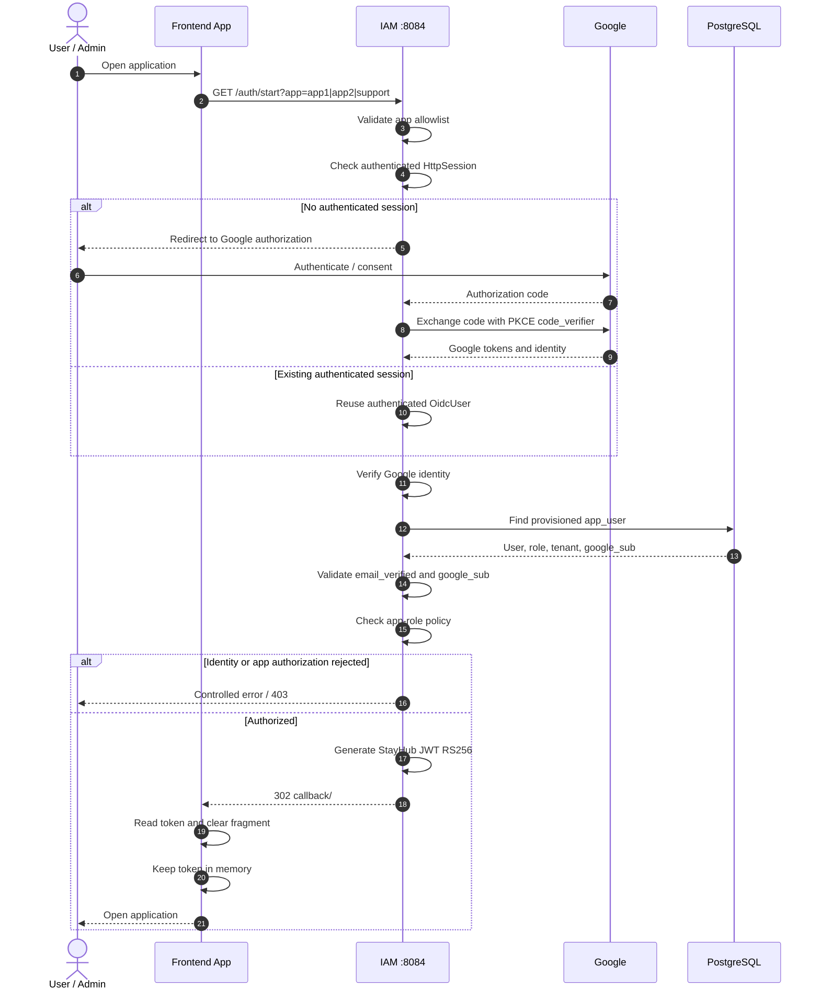

**Implementation status:**

- Google OAuth2, PKCE, HttpSession, JWT và JWKS được mô tả trong tài liệu IAM developer.
- Role-to-app policy và callback Support cần được bổ sung hoặc xác minh.
- Không tự động tạo `app_user` khi đăng nhập Google.

---

## 5. Cross-App SSO Workflow

### 5.1. SSO Principle

SSO sử dụng IAM HttpSession.

Khi trình duyệt đã có phiên đăng nhập hợp lệ tại IAM, ứng dụng thứ hai có thể yêu cầu IAM phát JWT mới mà không cần đăng nhập Google lại.

Các frontend không chia sẻ JWT trực tiếp.

### 5.2. Booking → Support

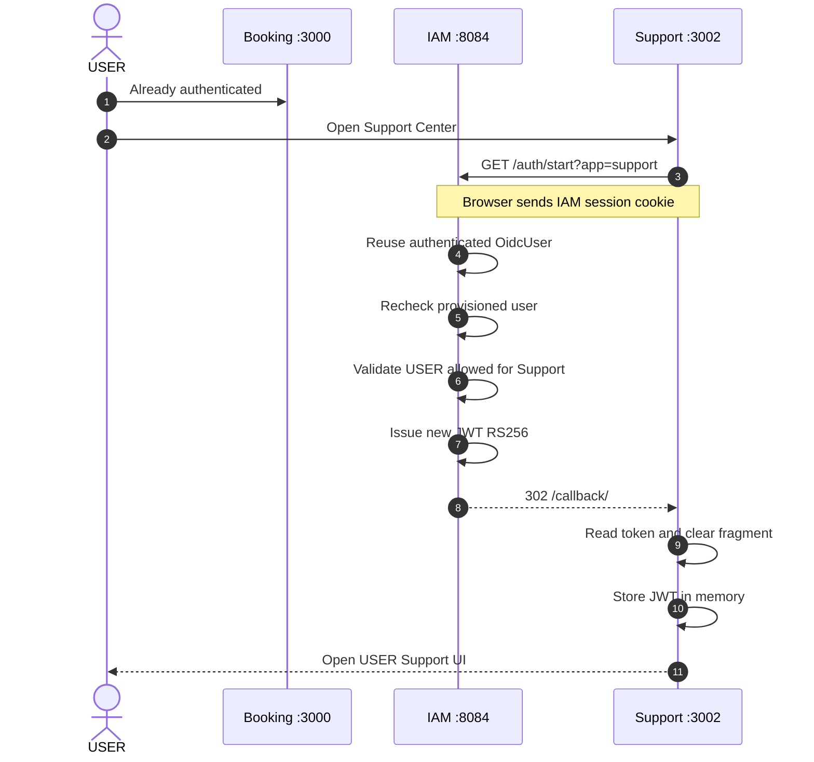

### 5.3. Admin → Support

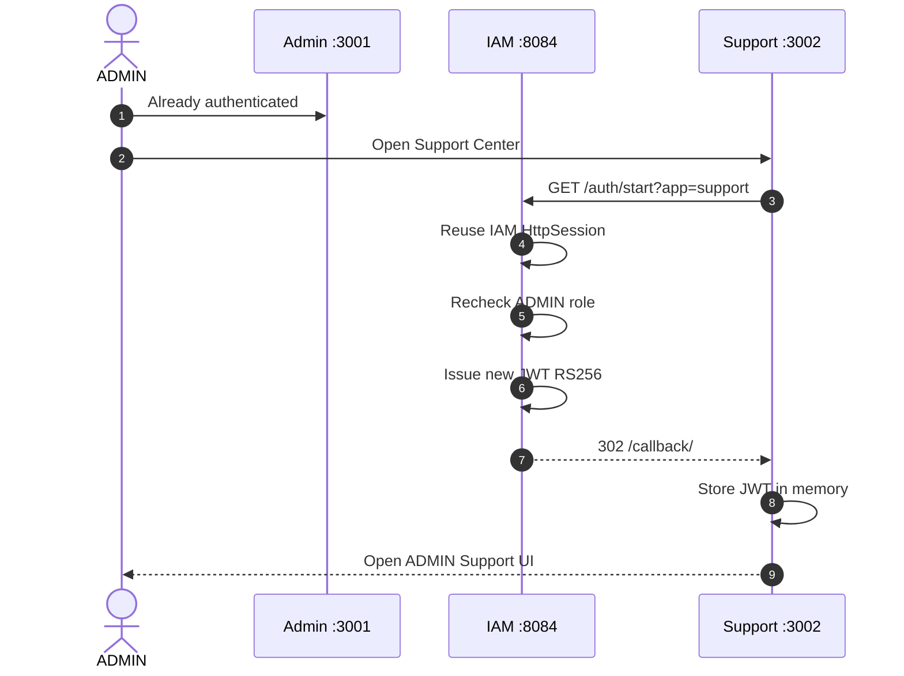

### 5.4. SSO vs RBAC

| Scenario | Result |
|---|---|
| USER → Booking | Allowed |
| USER → Admin | 403 |
| USER → Support | Allowed |
| ADMIN → Booking | 403 |
| ADMIN → Admin | Allowed |
| ADMIN → Support | Allowed |

SSO chỉ tái sử dụng authentication session.

Authorization vẫn phải kiểm tra role, tenant và ownership tại backend.

### 5.5. JWT Expiry vs IAM Session

JWT và IAM Session có vòng đời riêng.

- JWT mặc định 15 phút theo tài liệu developer.
- JWT hết hạn không đồng nghĩa IAM Session hết hạn.
- Nếu IAM Session còn hiệu lực, frontend có thể khởi tạo lại login flow để nhận JWT mới.
- Không tự động coi JWT refresh token đã được triển khai.
- Không truyền JWT từ Booking sang Support hoặc ngược lại.

---

## 6. Hotel & Room Availability Workflow

### 6.1. Business Goal

USER chọn khách sạn, ngày nhận phòng và ngày trả phòng, sau đó tìm các loại phòng còn đủ tồn kho cho toàn bộ kỳ lưu trú.

**Availability Search chỉ đọc dữ liệu, không giữ phòng.**

### 6.2. User Interaction

```text
Open Booking
    |
    v
Select Hotel
    |
    v
Select Check-in
    |
    v
Select Check-out
    |
    v
Click Search
    |
    v
GET /api/hotels/{hotelId}/availability
    |
    v
Validate Tenant & Dates
    |
    v
Read Room Type + Inventory
    |
    v
Return Available Room Types
```

### 6.3. Availability Sequence

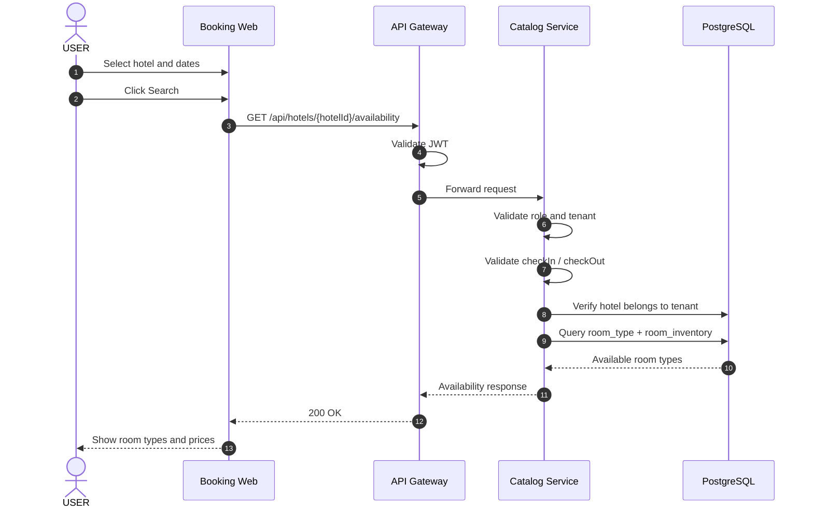

### 6.4. Availability Rules

- `tenant_id` lấy từ JWT đã xác minh.
- `checkIn` không được ở quá khứ.
- `checkOut > checkIn`.
- Số đêm tối đa: 30.
- Timezone nghiệp vụ: `Asia/Ho_Chi_Minh`.
- `checkOut` không được tính là đêm lưu trú.
- Phải có inventory row cho mọi đêm.
- Chỉ trả về loại phòng có tồn kho dương ở tất cả các đêm.

### 6.5. Availability SQL

```sql
SELECT
    rt.id,
    rt.name,
    rt.capacity,
    rt.base_price,
    MIN(i.total - i.sold) AS available_rooms
FROM room_type rt
JOIN room_inventory i
    ON i.tenant_id = rt.tenant_id
   AND i.room_type_id = rt.id
WHERE rt.tenant_id = :tenantId
  AND rt.hotel_id = :hotelId
  AND i.stay_date >= :checkIn
  AND i.stay_date < :checkOut
GROUP BY rt.id
HAVING COUNT(*) = :nights
   AND MIN(i.total - i.sold) > 0
ORDER BY rt.id;
```

### 6.6. Example

USER tìm:

```http
GET /api/hotels/1/availability?checkIn=2026-11-24&checkOut=2026-11-26
```

Kỳ lưu trú gồm hai đêm:

```text
2026-11-24
2026-11-25
```

Inventory:

| Room Type | 24/11 Available | 25/11 Available | Result |
|---|---:|---:|---|
| Standard | 2 | 1 | Available: 1 |
| Deluxe | 4 | 0 | Not available |

Response:

```json
[
  {
    "roomTypeId": 1,
    "name": "Standard",
    "capacity": 2,
    "pricePerNight": 500000.00,
    "nights": 2,
    "totalPricePerRoom": 1000000.00,
    "availableRooms": 1
  }
]
```

### 6.7. Error Handling

| Condition | HTTP |
|---|---|
| Available room types | `200` |
| No available room types | `200 []` |
| Invalid date range | `400` |
| Hotel not found | `404` |
| Hotel belongs to another tenant | `404` |

Kết quả search chỉ là snapshot tại thời điểm đọc. Booking phải kiểm tra tồn kho lại khi tạo đơn.

---

## 7. Booking Creation Workflow

### 7.1. Business Goal

USER đặt một hoặc nhiều phòng thuộc cùng loại phòng trong một khoảng ngày.

Booking Service phải đảm bảo:

- Không overselling.
- Không tạo booking khi thiếu tồn kho ở bất kỳ đêm nào.
- Inventory và booking được commit atomically.
- Không tin dữ liệu giá hoặc tenant do frontend gửi.

### 7.2. Booking Request

```http
POST /api/bookings
Authorization: Bearer <JWT>
Content-Type: application/json
```

```json
{
  "roomTypeId": 1,
  "checkIn": "2026-11-24",
  "checkOut": "2026-11-26",
  "roomCount": 1
}
```

### 7.3. Booking Transaction Sequence

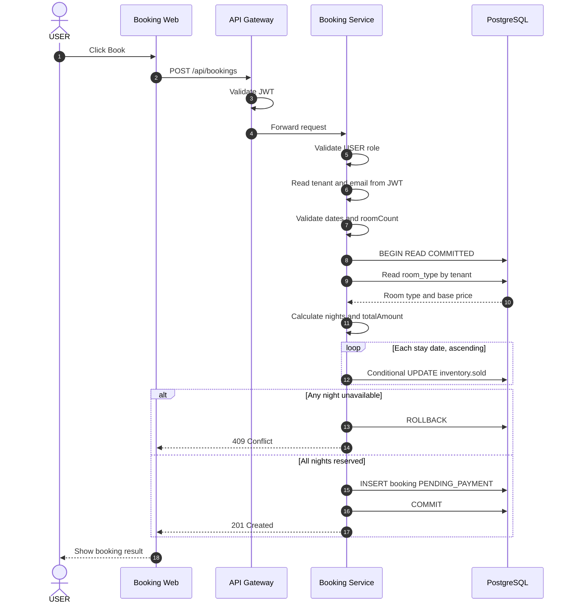

### 7.4. Conditional Inventory Update

```sql
UPDATE room_inventory
SET sold = sold + :roomCount
WHERE tenant_id = :tenantId
  AND room_type_id = :roomTypeId
  AND stay_date = :stayDate
  AND sold + :roomCount <= total;
```

### 7.5. Transaction Rules

1. Bắt đầu transaction với `READ COMMITTED`.
2. Xác thực `room_type` thuộc tenant.
3. Đọc giá phòng từ database.
4. Tính số đêm và tổng tiền.
5. Cập nhật inventory theo thứ tự ngày tăng dần.
6. Kiểm tra mỗi UPDATE ảnh hưởng đúng một dòng.
7. Nếu bất kỳ đêm nào thất bại, rollback toàn bộ.
8. Nếu tất cả thành công, tạo booking `PENDING_PAYMENT`.
9. Commit và trả `201 Created`.

### 7.6. Price Calculation

```text
totalAmount =
    basePrice
    × nights
    × roomCount
```

Ví dụ:

```text
500,000 × 2 × 1 = 1,000,000 VND
```

`total_amount` được chốt tại thời điểm booking.

### 7.7. Booking Response

```json
{
  "id": 5,
  "tenantId": 1,
  "roomTypeId": 1,
  "userEmail": "user-tenant1@example.com",
  "checkIn": "2026-11-24",
  "checkOut": "2026-11-26",
  "roomCount": 1,
  "totalAmount": 1000000.00,
  "status": "PENDING_PAYMENT",
  "paymentExpiresAt": "2026-11-04T02:30:00Z",
  "createdAt": "2026-11-04T02:15:00Z"
}
```

Các timestamps là dữ liệu minh họa.

### 7.8. Error Handling

| Condition | HTTP |
|---|---|
| Booking created | `201` |
| Invalid dates or room count | `400` |
| Room type not found | `404` |
| Room type belongs to another tenant | `404` |
| Inventory unavailable | `409` |
| USER identity not authorized | `403` |

---

## 8. Booking State Machine

### 8.1. States

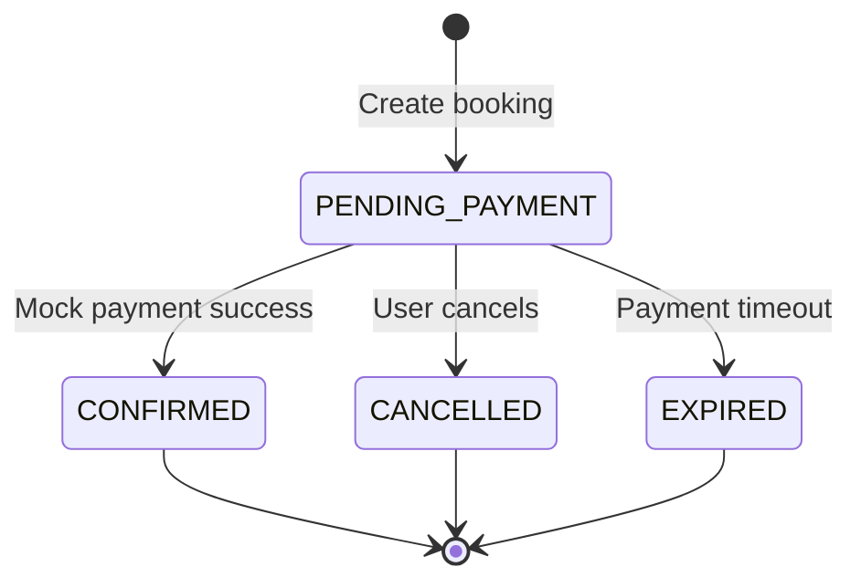

### 8.2. Inventory Occupancy

| Status | Occupies Inventory | Meaning |
|---|---|---|
| `PENDING_PAYMENT` | Yes | Reserved, waiting for payment |
| `CONFIRMED` | Yes | Confirmed reservation |
| `CANCELLED` | No | Cancelled and inventory released |
| `EXPIRED` | No | Expired and inventory released |

### 8.3. Transition Rules

| From | To | Trigger | Inventory Action |
|---|---|---|---|
| New | PENDING_PAYMENT | Create booking | Increment sold |
| PENDING_PAYMENT | CONFIRMED | Mock payment | No change |
| PENDING_PAYMENT | CANCELLED | USER cancellation | Decrement sold |
| PENDING_PAYMENT | EXPIRED | Expiry job | Decrement sold |

Không cho phép các transition khác trong MVP.

---

## 9. Mock Payment Workflow

### 9.1. Business Goal

USER thực hiện thanh toán mô phỏng cho booking đang chờ thanh toán.

Payment chỉ thay đổi trạng thái booking.

### 9.2. API

```http
POST /api/bookings/{id}/payment
Authorization: Bearer <JWT>
```

### 9.3. Sequence

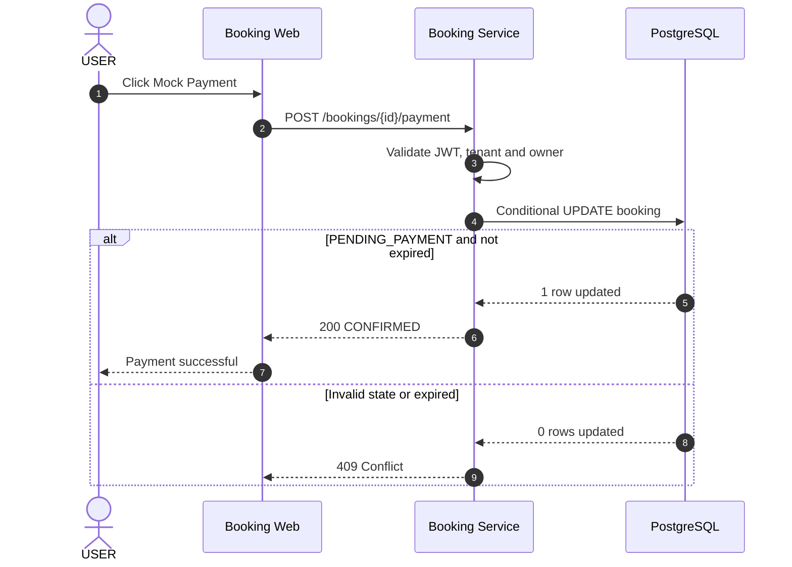

API đi qua Gateway; diagram rút gọn Gateway để tập trung vào business transition.

### 9.4. SQL

```sql
UPDATE booking
SET status = 'CONFIRMED'
WHERE id = :bookingId
  AND tenant_id = :tenantId
  AND user_email = :authenticatedEmail
  AND status = 'PENDING_PAYMENT'
  AND payment_expires_at > now();
```

### 9.5. Rules

- Chỉ USER là chủ booking được thanh toán.
- Booking phải ở trạng thái `PENDING_PAYMENT`.
- Booking chưa vượt quá `payment_expires_at`.
- Không tăng `room_inventory.sold` thêm lần nữa.
- Không cho phép thanh toán booking đã hủy hoặc hết hạn.
- Request thanh toán trùng không được tạo thêm inventory reservation.

---

## 10. Booking Cancellation Workflow

### 10.1. Business Goal

USER hủy booking đang chờ thanh toán và nhận lại inventory đã giữ.

### 10.2. API

```http
POST /api/bookings/{id}/cancel
Authorization: Bearer <JWT>
```

### 10.3. Cancellation Sequence

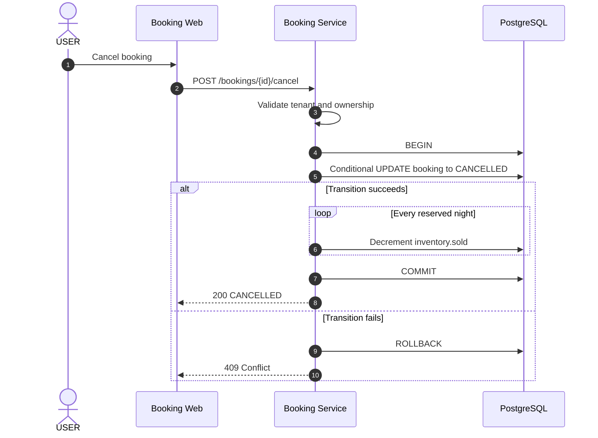

### 10.4. Conditional State Transition

```sql
UPDATE booking
SET status = 'CANCELLED'
WHERE id = :bookingId
  AND tenant_id = :tenantId
  AND user_email = :authenticatedEmail
  AND status = 'PENDING_PAYMENT';
```

### 10.5. Inventory Release

```sql
UPDATE room_inventory
SET sold = sold - :roomCount
WHERE tenant_id = :tenantId
  AND room_type_id = :roomTypeId
  AND stay_date = :stayDate
  AND sold >= :roomCount;
```

### 10.6. Cancellation Invariants

- Chỉ chủ booking được hủy.
- Chỉ hủy khi `PENDING_PAYMENT`.
- Chỉ hoàn inventory nếu state transition thành công.
- State transition và inventory release phải nằm trong cùng transaction.
- Nếu bất kỳ đêm nào release thất bại, rollback toàn bộ.
- Hủy hai lần không được hoàn inventory hai lần.
- Không xóa lịch sử booking.

---

## 11. Booking Expiry Workflow

### 11.1. Business Goal

Tự động hết hạn booking chưa thanh toán và hoàn tồn kho.

Thời gian thanh toán mặc định:

```text
15 minutes
```

Có thể cấu hình theo môi trường.

### 11.2. Expiry Job Sequence

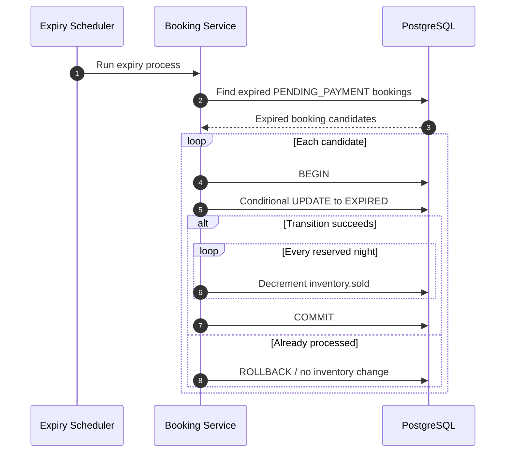

### 11.3. Find Expired Bookings

```sql
SELECT id
FROM booking
WHERE status = 'PENDING_PAYMENT'
  AND payment_expires_at <= now()
ORDER BY payment_expires_at;
```

### 11.4. Conditional Expiry

```sql
UPDATE booking
SET status = 'EXPIRED'
WHERE id = :bookingId
  AND status = 'PENDING_PAYMENT'
  AND payment_expires_at <= now();
```

Sau khi transition thành công, Booking Service hoàn inventory trong cùng transaction.

### 11.5. Expiry Rules

- Không hoàn inventory cho booking đã `CONFIRMED`.
- Không hoàn inventory hai lần.
- Job có thể chạy lặp lại an toàn.
- Job phải chịu được concurrent cancellation.
- Mỗi booking được xử lý trong một transaction riêng.
- Sử dụng index `idx_booking_pending_expiry` để tối ưu truy vấn.

---

## 12. Concurrency & Race Condition Workflow

### 12.1. Scenario

Hai USER cùng đặt một phòng cuối cùng trong cùng khoảng ngày.

```text
Room Type: Race Test
Total Rooms: 1
Sold: 0
Available: 1
```

### 12.2. Concurrent Booking Sequence

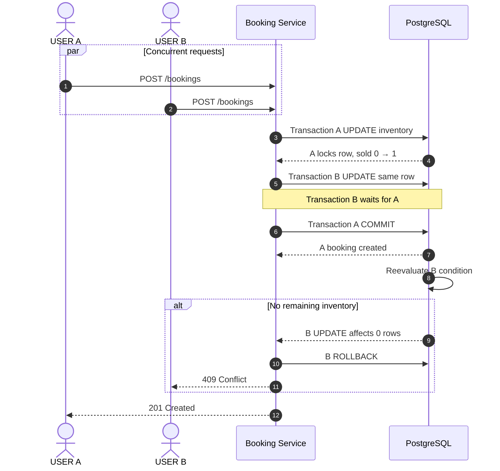

### 12.3. Concurrency Guarantees

- Sử dụng conditional UPDATE.
- Sử dụng PostgreSQL `READ COMMITTED`.
- Các inventory rows được cập nhật theo ngày tăng dần.
- Không sử dụng kết quả availability search để quyết định cuối cùng.
- Không commit từng đêm riêng lẻ.
- Không cho phép `sold > total`.
- Transaction thất bại phải rollback toàn bộ.

### 12.4. Multi-Night Example

Giả sử Standard có:

| Date | Total | Sold | Available |
|---|---:|---:|---:|
| 2026-11-24 | 3 | 1 | 2 |
| 2026-11-25 | 3 | 2 | 1 |

USER A và USER B cùng đặt một phòng từ 24/11 đến 26/11.

| Step | USER A | USER B |
|---|---|---|
| 1 | Update 24/11: sold 1 → 2 | Waiting |
| 2 | Update 25/11: sold 2 → 3 | Waiting |
| 3 | COMMIT | Continue |
| 4 | Booking created | Update 24/11: sold 2 → 3 |
| 5 | Success | Update 25/11 fails |
| 6 | — | ROLLBACK all changes |
| 7 | `201` | `409` |

Sau rollback của B:

```text
24/11 sold = 2
25/11 sold = 3
```

Không có inventory leakage.

---

## 13. Inventory Reconciliation Workflow

### 13.1. Business Goal

Kiểm tra `room_inventory.sold` có khớp với tổng số phòng của các booking đang giữ tồn hay không.

Các trạng thái chiếm tồn:

```text
PENDING_PAYMENT
CONFIRMED
```

### 13.2. Reconciliation SQL

```sql
SELECT
    i.tenant_id,
    i.room_type_id,
    i.stay_date,
    i.sold,
    COALESCE(SUM(b.room_count), 0) AS expected_sold
FROM room_inventory i
LEFT JOIN booking b
    ON b.tenant_id = i.tenant_id
   AND b.room_type_id = i.room_type_id
   AND b.status IN ('PENDING_PAYMENT', 'CONFIRMED')
   AND i.stay_date >= b.check_in
   AND i.stay_date < b.check_out
GROUP BY
    i.tenant_id,
    i.room_type_id,
    i.stay_date,
    i.sold
HAVING i.sold <> COALESCE(SUM(b.room_count), 0);
```

### 13.3. Acceptance Criteria

```text
Expected mismatched rows = 0
```

Chạy reconciliation sau:

- Booking creation tests.
- Mock payment tests.
- Cancellation tests.
- Expiry tests.
- Concurrent booking tests.

Nếu phát hiện sai lệch, phải xác định nguyên nhân trước khi sửa dữ liệu.

---

## 14. ADMIN Catalog Management Workflow

### 14.1. Create Room Type

ADMIN tạo loại phòng mới thuộc khách sạn trong tenant.

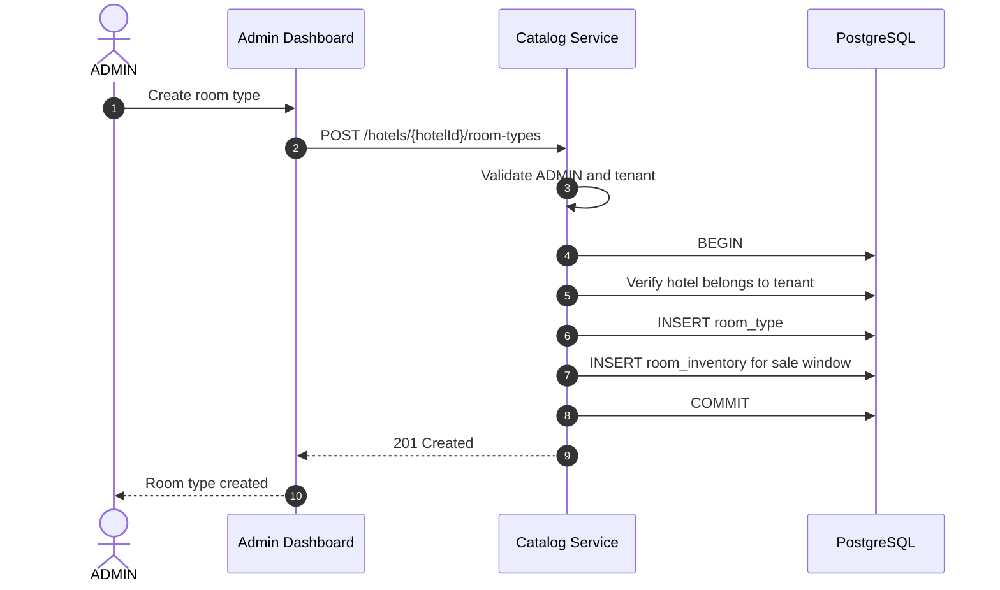

### 14.2. Create Room Type Rules

- Chỉ `ADMIN` được tạo loại phòng.
- Hotel phải thuộc tenant hiện tại.
- `capacity > 0`.
- `base_price > 0`.
- `total_rooms >= 0`.
- Inventory rows phải được tạo cho khoảng ngày mở bán.
- Room type và inventory creation nằm trong cùng transaction.

### 14.3. Update Price

```http
PUT /api/room-types/{id}/price
```

Rules:

- Chỉ ADMIN.
- Room type phải thuộc tenant.
- Giá mới chỉ ảnh hưởng booking được tạo sau khi cập nhật.
- Không thay đổi `booking.total_amount` đã chốt.

### 14.4. Update Inventory Total

ADMIN có thể thay đổi số phòng mở bán theo từng đêm.

Điều kiện:

```text
new_total >= current_sold
```

Ví dụ:

```sql
UPDATE room_inventory
SET total = :newTotal
WHERE tenant_id = :tenantId
  AND room_type_id = :roomTypeId
  AND stay_date = :stayDate
  AND :newTotal >= sold;
```

Nếu `newTotal < sold`, request phải bị từ chối.

Catalog không được trực tiếp thay đổi `sold`.

---

## 15. ADMIN Booking Inspection Workflow

### 15.1. Business Goal

ADMIN xem booking trong tenant để phục vụ vận hành.

### 15.2. Sequence

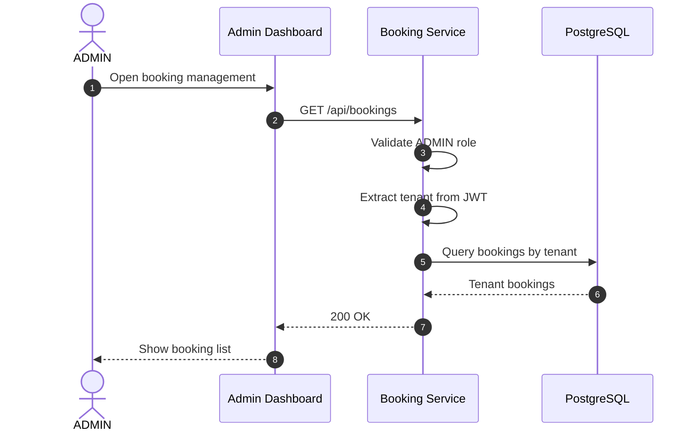

### 15.3. Authorization Rules

- ADMIN chỉ xem booking trong tenant.
- Không xem booking của tenant khác.
- Không được tự thanh toán thay USER.
- Không được tự thay đổi inventory `sold`.
- Các thao tác điều chỉnh booking ngoài phạm vi MVP phải được thiết kế riêng.

---

## 16. Support Center — USER Workflow

### 16.1. Business Goal

USER tạo ticket để yêu cầu hỗ trợ về booking hoặc vấn đề sử dụng dịch vụ.

### 16.2. Create Ticket

```text
USER
  |
  v
Open Support Center
  |
  v
IAM SSO
  |
  v
Select Booking (optional)
  |
  v
Enter Subject / Description
  |
  v
Create Ticket
  |
  v
OPEN
```

### 16.3. Create Ticket Sequence

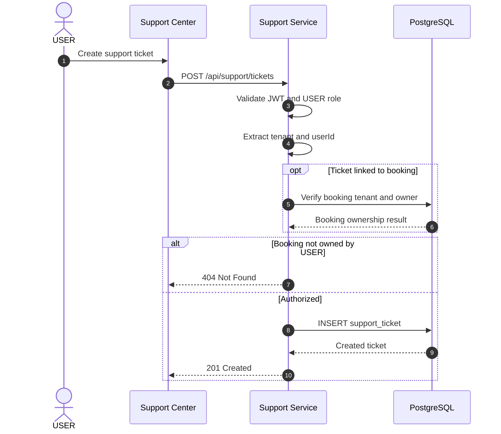

### 16.4. USER Ticket Rules

- USER chỉ tạo ticket dưới identity của mình.
- `requester_user_id` lấy từ JWT.
- `tenant_id` lấy từ JWT.
- Booking liên kết phải thuộc USER.
- USER chỉ xem ticket do mình tạo.
- USER chỉ gửi message vào ticket của mình.
- Không được tự assign ADMIN.
- Không được tự chuyển ticket sang `RESOLVED` hoặc `CLOSED` trong scope hiện tại.

---

## 17. Support Center — ADMIN Workflow

### 17.1. Ticket Queue

ADMIN xem danh sách ticket trong tenant.

```text
ADMIN
  |
  v
Support Center
  |
  v
Tenant Ticket Queue
  |
  v
OPEN
  |
  v
IN_PROGRESS
  |
  v
Reply / Investigate
  |
  v
RESOLVED
  |
  v
CLOSED
```

### 17.2. ADMIN Support Sequence

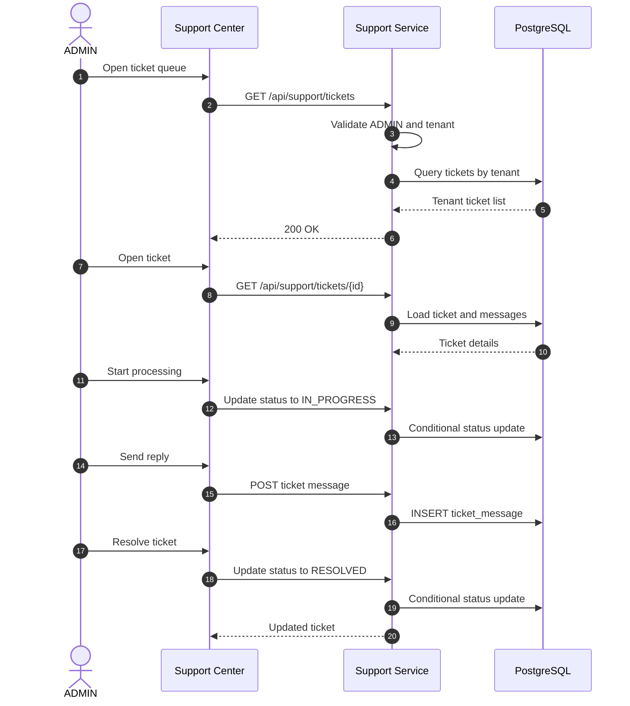

### 17.3. ADMIN Ticket Rules

- ADMIN chỉ xem ticket trong tenant.
- ADMIN có thể phản hồi ticket.
- ADMIN có thể thay đổi trạng thái ticket.
- ADMIN có thể assign ticket cho ADMIN thuộc cùng tenant.
- Không được xem ticket của tenant khác.
- Mỗi message phải lưu author và timestamp.

---

## 18. Support Ticket State Machine

### 18.1. Proposed States

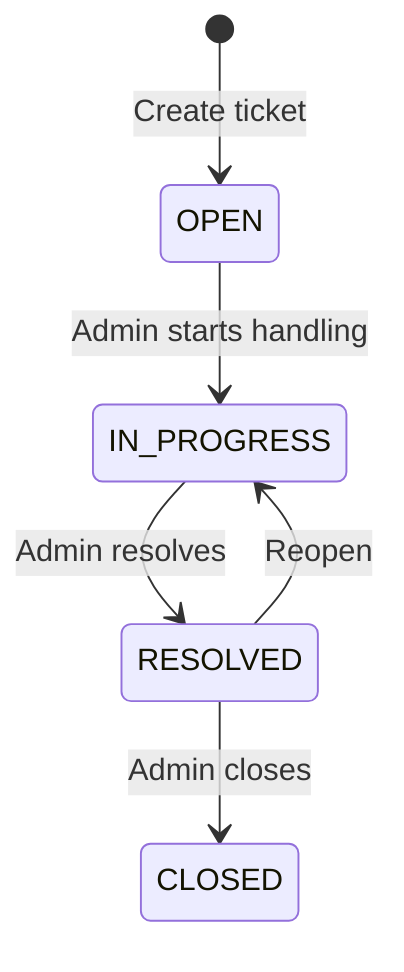

### 18.2. State Transition Matrix

| From | To | Actor | Meaning |
|---|---|---|---|
| New | OPEN | USER | Create ticket |
| OPEN | IN_PROGRESS | ADMIN | Start handling |
| IN_PROGRESS | RESOLVED | ADMIN | Issue resolved |
| RESOLVED | CLOSED | ADMIN | Close ticket |
| RESOLVED | IN_PROGRESS | ADMIN | Reopen ticket |

Đây là workflow đề xuất; cần thống nhất với Support API contract trước implementation.

### 18.3. Message Rules

- Message phải thuộc một ticket hợp lệ.
- Author lấy từ JWT.
- USER chỉ gửi message vào ticket của mình.
- ADMIN chỉ gửi message vào ticket trong tenant.
- Message lưu `created_at` do server tạo.
- Không sửa/xóa message trong MVP.
- Không lưu JWT hoặc session cookie trong nội dung message.

---

## 19. Cross-Tenant & Ownership Workflow

### 19.1. Tenant Isolation

Mọi business request phải sử dụng `tenant_id` từ JWT đã xác minh.

```text
Verified JWT
    |
    +-- sub
    +-- email
    +-- tenant_id
    +-- role
    |
    v
Business Service
    |
    v
Tenant-Scoped Query
```

### 19.2. Booking Ownership

```sql
SELECT *
FROM booking
WHERE id = :bookingId
  AND tenant_id = :tenantId
  AND user_email = :authenticatedEmail;
```

### 19.3. Ticket Ownership

```sql
SELECT *
FROM support_ticket
WHERE id = :ticketId
  AND tenant_id = :tenantId
  AND requester_user_id = :authenticatedUserId;
```

### 19.4. Authorization Error Policy

| Condition | HTTP |
|---|---|
| Missing or invalid JWT | `401` |
| Valid JWT but insufficient role | `403` |
| Resource not found | `404` |
| Resource belongs to another tenant | `404` |
| Resource belongs to another USER | `404` |
| Invalid request | `400` |
| Booking inventory conflict | `409` |

Không để lộ sự tồn tại của tài nguyên khác tenant thông qua response.

---

## 20. Logout & Session Lifecycle

### 20.1. Current Demo Behavior

Frontend có thể:

- Xóa JWT khỏi memory.
- Xóa trạng thái authentication cục bộ.
- Điều hướng về trang đăng nhập.

Tuy nhiên, việc xóa JWT khỏi frontend **không đồng nghĩa IAM Session đã bị hủy**.

### 20.2. Logout Limitation

```text
Frontend Local Logout
        |
        v
Clear Local JWT
        |
        v
IAM HttpSession may still exist
        |
        v
SSO may issue another JWT
```

### 20.3. Production Follow-up

Cần thiết kế thêm:

- IAM Session invalidation.
- Cross-app logout behavior.
- Token revocation strategy.
- Refresh/token renewal strategy.
- Persistent RSA keys và key rotation.
- Secure token delivery.
- Multi-tab SSO destination isolation.

Không mô tả local logout là Single Logout.

---

## 21. Failure Scenarios & Recovery

| Scenario | Expected Behavior |
|---|---|
| Google login rejected | Không phát StayHub JWT |
| User not provisioned | Từ chối đăng nhập |
| `google_sub` mismatch | Từ chối đăng nhập |
| Wrong app role | `403` |
| Expired JWT | `401`; yêu cầu xác thực lại |
| IAM session valid, JWT expired | Có thể chạy lại IAM login flow để nhận JWT mới |
| Hotel belongs to another tenant | `404` |
| Room type belongs to another tenant | `404` |
| Inventory unavailable | `409`; rollback booking |
| Payment after expiry | `409`; không xác nhận booking |
| Duplicate cancellation | Không hoàn inventory lần hai |
| Expiry and cancel race | Chỉ một state transition thành công |
| Concurrent booking | Không overselling |
| Ticket belongs to another USER | `404` |
| Ticket belongs to another tenant | `404` |
| Support Service unavailable | Trả lỗi phù hợp; không ảnh hưởng transaction booking |

---

## 22. End-to-End Acceptance Tests

### 22.1. IAM & SSO

- [ ] USER login Booking thành công.
- [ ] ADMIN login Admin thành công.
- [ ] USER mở Support qua SSO.
- [ ] ADMIN mở Support qua SSO.
- [ ] Không yêu cầu Google login lại khi IAM Session còn hiệu lực.
- [ ] USER truy cập Admin bị từ chối.
- [ ] ADMIN truy cập Booking bị từ chối.
- [ ] JWT invalid/expired bị từ chối.
- [ ] User chưa provision không được cấp JWT.

### 22.2. Booking

- [ ] Tìm phòng đúng theo toàn bộ kỳ lưu trú.
- [ ] Không hiển thị room type hết phòng.
- [ ] Booking tạo `PENDING_PAYMENT`.
- [ ] Inventory được giữ atomically.
- [ ] Mock payment chuyển sang `CONFIRMED`.
- [ ] Cancellation hoàn inventory.
- [ ] Expiry hoàn inventory.
- [ ] Không hoàn inventory hai lần.
- [ ] Concurrent booking không overselling.
- [ ] Reconciliation trả về 0 dòng sai lệch.

### 22.3. Admin

- [ ] ADMIN tạo room type thành công.
- [ ] Inventory được seed khi tạo room type.
- [ ] ADMIN cập nhật giá thành công.
- [ ] Giá mới không thay đổi booking cũ.
- [ ] Không giảm `total` xuống dưới `sold`.
- [ ] ADMIN chỉ xem booking trong tenant.

### 22.4. Support

- [ ] USER tạo ticket thành công.
- [ ] USER liên kết ticket với booking của mình.
- [ ] USER không thể liên kết booking của người khác.
- [ ] USER chỉ xem ticket của mình.
- [ ] ADMIN xem ticket trong tenant.
- [ ] ADMIN phản hồi ticket.
- [ ] ADMIN cập nhật ticket status.
- [ ] Không truy cập được ticket khác tenant.
- [ ] Message lưu đúng author và timestamp.

---

## 23. Workflow Metrics

| Metric | Target |
|---|---|
| SSO cross-app login | Không yêu cầu đăng nhập Google lại khi IAM Session hợp lệ |
| JWT validation | 100% protected endpoints |
| Tenant isolation | 0 cross-tenant data exposure |
| Booking overselling | 0 |
| Inventory reconciliation mismatch | 0 rows |
| Double inventory release | 0 |
| Unauthorized booking access | 0 |
| Unauthorized ticket access | 0 |
| Booking transaction atomicity | 100% successful commit hoặc full rollback |
| Ticket message author audit | 100% messages có author và timestamp |

Các giá trị trên là **acceptance targets**, không phải kết quả đo đạc thực tế.

---

## 24. Open Issues & Implementation Notes

| Issue | Status | Required Action |
|---|---|---|
| IAM Support callback | To implement | Add `support` app allowlist |
| IAM role-to-app policy | To implement | Enforce USER/ADMIN app restrictions |
| Booking migration tham chiếu `room` cũ | Reported blocker | Verify and update Flyway |
| Booking Inventory ERD v2 | Proposed | Align schema and implementation |
| Booking idempotency key | Not implemented | Consider future enhancement |
| Support Service | Proposed | Implement service and migrations |
| Support Ticket API | Proposed | Finalize API contract |
| IAM Single Logout | Not implemented | Design separately |
| Multi-tab IAM app selector | Known risk | Bind destination to OAuth2 request/state |
| Persistent RSA keys | Not confirmed | Required before production |

---

## 25. Documentation References

| Document | Responsibility |
|---|---|
| `../README.md` | Project overview |
| `architecture.md` | System architecture and service boundaries |
| `iam-sso.md` | Authentication, JWT, JWKS, SSO |
| `iam-integration-tasks.md` | IAM 3-App integration tasks |
| `iam-testing.md` | IAM and SSO test cases |
| `api-contract.md` | HTTP APIs, DTOs, authorization |
| `data-model.md` | ERD, DDL, inventory and constraints |
| `operations-and-tests.md` | Flyway, seed data, concurrency and integration tests |
| `decisions.md` | Architecture decisions |

---

## 26. Final Workflow Decisions

1. **Authentication:** Giữ Google OAuth2/OIDC và IAM Service hiện tại.
2. **SSO:** Sử dụng IAM HttpSession cho ba ứng dụng.
3. **JWT:** Mỗi ứng dụng nhận JWT mới từ IAM; không chia sẻ token trực tiếp.
4. **Authorization:** Kiểm tra role, tenant và ownership tại backend.
5. **Availability:** Chỉ đọc inventory, không giữ phòng.
6. **Booking:** Giữ inventory và tạo booking trong một transaction.
7. **Payment:** Mock payment chỉ đổi trạng thái booking.
8. **Cancellation:** Hoàn inventory đúng một lần.
9. **Expiry:** Tự động hoàn inventory cho booking quá hạn.
10. **Concurrency:** Conditional UPDATE + READ COMMITTED để chống overselling.
11. **Support:** USER quản lý ticket của mình; ADMIN xử lý ticket trong tenant.
12. **Logout:** Local logout chưa phải Single Logout.
13. **Testing:** Chỉ đánh dấu hoàn thành khi workflow có test evidence.

**Trạng thái cuối:** Đây là workflow specification mục tiêu cho StayHub 3-App, thống nhất với Custom IAM và Booking Inventory ERD v2. Các phần chưa được triển khai hoặc chưa được xác minh phải tiếp tục được đánh dấu là proposed/TODO.
