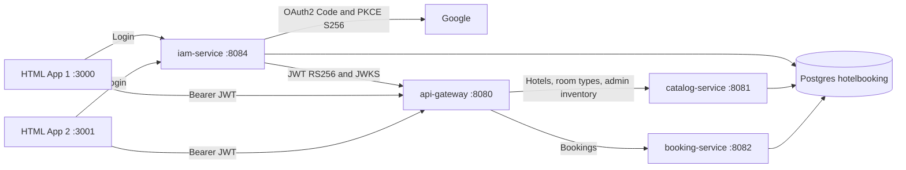
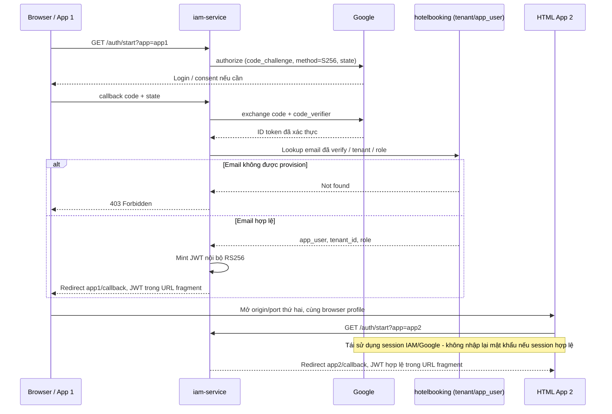
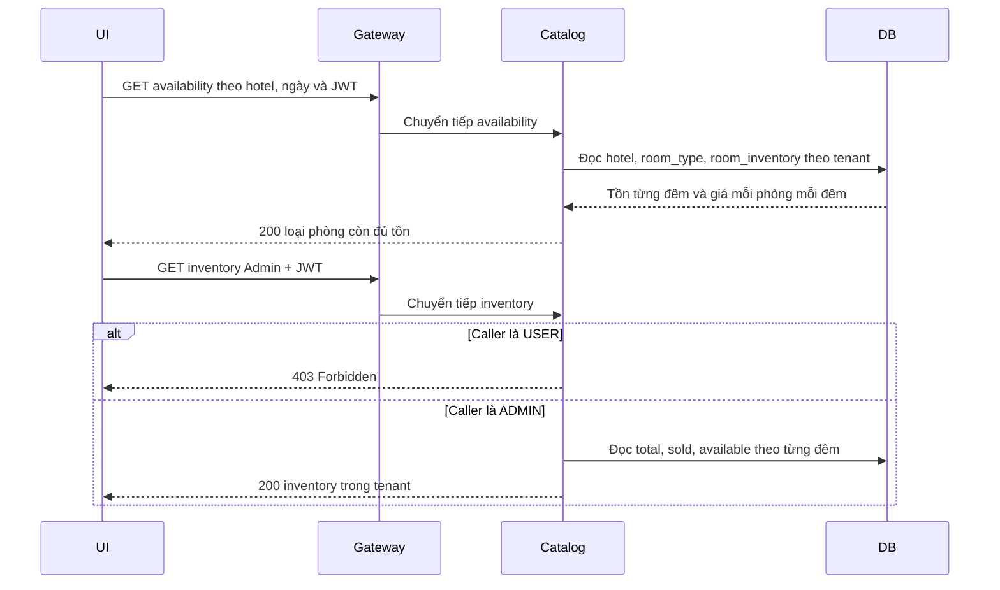
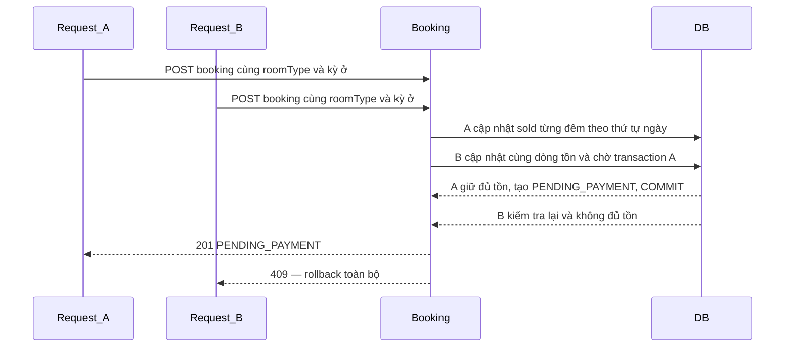
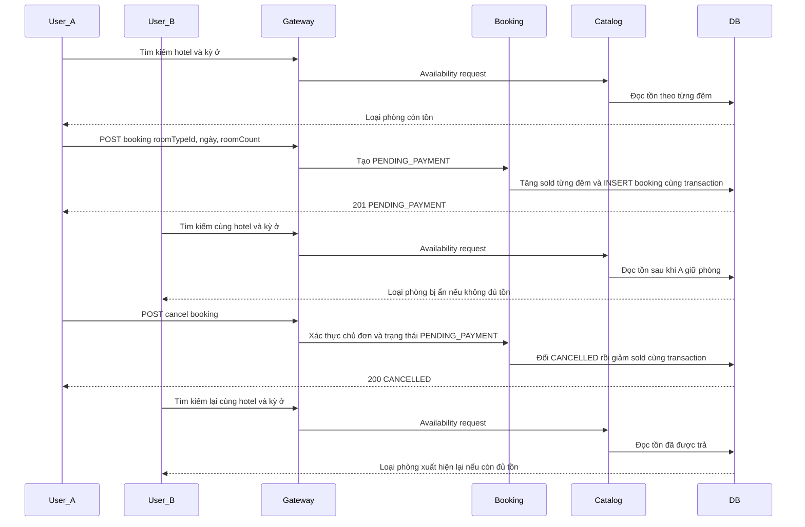

# STAYHUB — KẾ HOẠCH DEMO TỐI GIẢN: GOOGLE SSO + IAM + MULTI-TENANT + BOOKING

> **Phiên bản:** 2.0 — cập nhật ngày 02/11/2026  
> **Thay thế:** `iam-google-sso-demo-plan.md` (bản ngày 02/11/2026)  
> **Nguồn đối chiếu:** `erd-v2.md` và `api-contract.md` (v3.0). Các file `team-plan.md` và `StayHub_Execution_Roadmap_*.md` đã không còn trong `docs/`  
> **Thời lượng mục tiêu:** 3 ngày làm việc, 4 người A/B/C/D.  
> **Trạng thái:** Đề xuất kế hoạch mới để cả nhóm chốt trước khi triển khai; chưa phải bằng chứng dự án đã hoàn thành.
> **Nguồn sự thật cho mô hình Catalog/Booking:** `docs/erd-v2.md` và `docs/api-contract.md`. Ngày 03/11/2026 các đoạn còn nhắc `room` vật lý, `room_id`, `operational_status`, booking theo timestamp, `EXCLUDE`, `users` hoặc phân phòng đã được sửa theo schema `hotel`/`room_type`/`room_inventory` theo đêm. Nếu còn sót chỗ nào, theo `erd-v2.md` và `api-contract.md`. Schema dùng `hotel.address`, không có `room_type.code`, và `base_price` là giá một phòng mỗi đêm.

## 0. Quyết định và mục tiêu của bản cập nhật

**Mục tiêu:** giảm thời gian viết code và tích hợp so với plan 4 microservices nghiệp vụ cũ, nhưng vẫn có **bằng chứng triển khai thực tế cho ít nhất 8/9 chủ đề mentor giao (≈ 88,9%)**, nếu các tiêu chí nghiệm thu bên dưới đều PASS.

**Thay đổi đã được xác nhận từ yêu cầu hiện tại:** sử dụng **đăng nhập Google (Google SSO) thay cho V-ID** để demo. Không còn nhu cầu sử dụng Keycloak. Phương án được giữ là `iam-service` đóng vai trò **OAuth2/OIDC client của Google**, sau khi xác thực sẽ cấp JWT nội bộ cho các API của StayHub. **Đây không phải tự xây dựng một OAuth2 Authorization Server đầy đủ** và cũng không giả định Google SSO tương đương tích hợp V-ID ở cấp giao thức/nền tảng.

**Bổ sung bắt buộc so với bản v1:**

1. **Unit Test** cho IAM, Catalog, Booking; có test bằng lệnh Gradle và bằng chứng kết quả, không chỉ test thủ công.
2. **PKCE S256 thật ở chặng IAM ↔ Google** (Authorization Code Flow), có kiểm tra URL authorize chứa `code_challenge`/`code_challenge_method=S256` và việc trao đổi code hoàn tất thành công. Với OAuth2 client dạng web server có client secret, phải **kiểm tra/cấu hình tường minh** PKCE theo phiên bản Spring Security thực tế; không mặc định thư viện tự bật.
3. **Minh chứng SSO tối thiểu trên 2 trang HTML ở 2 origin/port khác nhau**, cùng dùng `iam-service`/phiên Google trong **cùng browser profile**; đăng nhập trang 1 rồi vào trang 2 không phải nhập lại mật khẩu. Không xây frontend booking đầy đủ.
4. **Phân công lại thành viên D**: chủ trì 2 trang HTML demo, bộ request kiểm thử tích hợp, kịch bản trình diễn, tổng hợp diagram và evidence. D **không** còn phụ trách `notification-service`.

**Flow phòng và booking theo ERD:** user chọn khách sạn, ngày nhận/trả rồi bấm **Tìm kiếm**; chỉ khi đó mới thấy loại phòng còn đủ tồn cho mọi đêm. Đơn vị bán là `room_type`, inventory theo đêm nằm ở `room_inventory`. `hotel.address` là địa chỉ; `room_type` không có `code`; `base_price` là giá mỗi loại phòng cho một phòng một đêm. Booking `PENDING_PAYMENT` giữ tồn; thanh toán thành công chuyển sang `CONFIRMED`; user huỷ khi còn `PENDING_PAYMENT` thì chuyển sang `CANCELLED` và trả tồn; hết hạn chuyển sang `EXPIRED` và trả tồn.

**Mức thanh toán:** MVP mô phỏng kết quả thanh toán, không tích hợp cổng thanh toán thật. Không notification, không idempotency-key, không PKCE public-client riêng ở frontend, không xây website hoàn chỉnh.

> **Phạm vi số liệu 8/9:** tính theo **9 chủ đề trong `team-plan.md`**, không phải 9 thư viện độc lập. **Chủ đề Mobile Push Notification bị bỏ**. IAM/SSO/PKCE chỉ tính đạt khi chứng minh được **cả ba nội dung** phù hợp với cách triển khai Google ở plan này. Nếu mentor bắt buộc phải thấy push thì phải xin xác nhận điều chỉnh phạm vi, không tuyên bố đã đạt đủ 9/9.

---

## 1. Phạm vi chức năng và những thứ KHÔNG làm

### 1.1 Phải làm (MVP)

- **2 tenant** cùng dùng 1 hệ thống: dữ liệu phòng/booking của tenant này không bị tenant khác đọc hoặc sửa.
- Role `USER` (tìm phòng theo khách sạn/ngày, đặt và huỷ booking `PENDING_PAYMENT` của mình) và `ADMIN` (quản lý loại phòng, xem số lượng tồn và booking trong tenant; không gán phòng vật lý).
- Google login qua `iam-service`; tài khoản phải được **provision trước** trong bảng `app_user`, không có tự đăng ký/gán tenant mặc định.
- IAM ký JWT nội bộ RS256 có `sub`, `email`, `tenant_id`, `role` (kèm `iss`, `iat`, `exp` và thông tin kiểm tra chữ ký); services verify bằng JWKS.
- Catalog lưu `hotel.address`, `room_type` không có `code`, và `room_type.base_price` là giá mỗi phòng mỗi đêm. Availability được tính từ `room_inventory` cho các đêm `[checkIn, checkOut)`.
- `USER` chỉ được đặt loại phòng có tồn đủ cho mọi đêm; booking `PENDING_PAYMENT` tăng `room_inventory.sold` ngay. Transaction có điều kiện ngăn bán quá tồn.
- Thanh toán mô phỏng chuyển `PENDING_PAYMENT → CONFIRMED`. User huỷ khi `PENDING_PAYMENT` chuyển sang `CANCELLED`; huỷ và hết hạn đều trả tồn đúng một lần trong transaction.
- `USER` chỉ xem/huỷ booking của mình. Chỉ `ADMIN` xem tổng tồn `total`/`sold`/`available` trong tenant. Demo không phân phòng vật lý cho booking.
- Flyway cho các DB nghiệp vụ, REST API, chuẩn lỗi, unit tests, sequence diagrams và demo E2E.
- 2 HTML demo rất nhỏ (2 origin) để chứng minh Google SSO/PKCE và các thao tác chính.

### 1.2 Không làm / ngoài scope 3 ngày

- `notification-service`, FCM/APNs, push token/inbox.
- Keycloak/V-ID thực, phát triển OAuth2 Authorization Server riêng, tích hợp hệ thống tài khoản production.
- Cổng thanh toán thật, xử lý refund tự động, notification, idempotency-key.
- Phân phòng vật lý, giá thay đổi theo ngày và định giá động. Inventory được quản lý theo đêm bằng `room_inventory`; `base_price` là một mức giá mỗi đêm cho mỗi loại phòng.
- Kubernetes, Kafka/RabbitMQ, service discovery, distributed transaction, hệ thống UI hoàn chỉnh, mua vé.
- Refresh token nội bộ, token revocation, JWT key rotation tự động; không tuyên bố phù hợp production.

**Không tự lấy lại đầu việc từ roadmap D cũ** nếu đã bị bỏ trong mục này. Mọi thay đổi scope phải có sự đồng ý của cả nhóm.

---

## 2. Kiến trúc, thành phần, công nghệ



Gateway, Catalog và Booking xác minh JWT dựa trên JWKS của IAM. IAM, Catalog và Booking dùng chung database `hotelbooking`, schema `public`. Các bảng tenant, app_user, hotel, room_type, room_inventory và booking có FK tương ứng; mỗi service sở hữu migration cho bảng của mình.

| Thành phần | Owner | Mục đích | Chú ý |
|---|---|---|---|
| Root Gradle + Compose | A | Build/khởi động dự án | Monorepo, Java 21; kiểm tra repo hiện tại trước khi sửa |
| `iam-service` | A | Google login, PKCE, allowlist user, JWT, JWKS | Không dùng Keycloak |
| `common-security` | A | Verify JWT, role, `TenantContext` | Module thư viện, không chạy như service |
| `api-gateway` :8080 | A | Forward API có Bearer token | Không route `/internal/**` |
| `catalog-service` :8081 | B | Tìm phòng theo lựa chọn/thời gian, quản lý phòng và inventory Admin | DB chung, dữ liệu theo tenant |
| `booking-service` :8082 | C | Tạo booking giữ tồn theo đêm, thanh toán mô phỏng, xem/huỷ booking | DB chung, cập nhật inventory và booking trong transaction |
| HTML App 1 :3000 và App 2 :3001 | D | Chứng minh SSO, gọi API/role | HTML/JS tối giản, không framework UI mới |
| `docs/demo.http`, test manual, diagrams và README demo | D chủ trì | Bằng chứng trình diễn, tích hợp | A/B/C cung cấp response, test report và sơ đồ của mình |

**Công nghệ:** Java 21, Spring Boot + Spring Security (OAuth2 Client / Resource Server), Gradle multi-project, PostgreSQL, Flyway, REST (`RestClient` giữa service), JUnit 5/Mockito (hoặc test support tương thích), Mermaid, Google OAuth2/OIDC. Sử dụng `ProblemDetail` hoặc một JSON lỗi thống nhất trong contract.

**Version gate trước khi code:** A xác minh phiên bản Spring Boot / Spring Security / Spring Cloud (nếu có dùng) / Gradle wrapper tương thích. **Không tự nâng cấp toàn repo chỉ vì thấy có phiên bản mới hơn**; ghi phiên bản khóa trong `docs/decisions.md`, chạy `./gradlew build` được rồi mới yêu cầu các service cùng tuân thủ.

**Cơ sở dữ liệu:** một PostgreSQL server local, **1 database chung** `hotelbooking`, 1 schema `public`. Có FK thật giữa `tenant`, `app_user`, `hotel`, `room_type`, `room_inventory` và `booking`; FK ghép chặn tham chiếu chéo tenant. Booking giữ kỳ ở theo ngày và cập nhật tồn từng đêm theo `docs/erd-v2.md`.

Mỗi service **vẫn chỉ sở hữu và chạy migration cho bảng của mình** (A: `tenant`, `app_user`; B: `hotel`, `room_type`, `room_inventory`; C: `booking`). Để 3 bộ Flyway độc lập không đụng version, mỗi service dùng riêng `spring.flyway.table` (`flyway_schema_history_iam`, `flyway_schema_history_catalog`, `flyway_schema_history_booking`). Dùng tên bảng vật lý `app_user`; tránh dùng tên `user` vì đó là từ khóa SQL.

**Phụ thuộc thứ tự migration:** `iam-service` tạo `tenant`/`app_user` trước, `catalog-service` tạo `hotel`/`room_type`/`room_inventory` tiếp theo, rồi `booking-service` tạo `booking` vì có FK tới các bảng trên.

---

## 3. Google SSO, IAM và PKCE — phạm vi minh chứng CHÍNH XÁC

### 3.1 Luồng xác thực

1. Người dùng mở HTML App 1/2 và chọn **Login with Google**.
2. Browser chuyển đến `iam-service` ở `/auth/start?app=app1` hoặc `app2` (mã app phải nằm trong allowlist). IAM có thể dùng phiên đăng nhập hiện có hoặc bắt đầu OAuth2 login Google.
3. Nếu cần OAuth2, Spring Security chuyển tới Google theo **Authorization Code Flow + PKCE S256**. Google gọi callback **về IAM**, ví dụ `http://localhost:8084/login/oauth2/code/google` (đăng ký chính xác URI này trong Google Cloud).
4. IAM kiểm tra danh tính Google đã xác thực, `email_verified` và tra `app_user` **theo email đã chuẩn hóa**. Email không được provision => **403**; tuyệt đối không tự gán tenant.
5. Có user hợp lệ => IAM tạo JWT nội bộ RS256: `sub` ổn định cho user nội bộ, `email`, `tenant_id`, `role`, `iss`, `iat`, `exp`. `google_sub` có thể lưu/đối chiếu với user được provision theo chính sách nhóm đã chốt; không cho Google account khác chiếm mapping đã liên kết.
6. IAM chỉ redirect về **địa chỉ callback trong allowlist** (`http://localhost:3000/callback/` hoặc `http://localhost:3001/callback/`, có dấu `/` cuối) kèm `#token=...`. Frontend đọc rồi **xóa fragment khỏi URL ngay**, giữ token **trong memory**; không ghi log, localStorage, query string hoặc Git.
7. App 1/2 dùng Bearer JWT nội bộ gọi Gateway. Gateway và service verify chữ ký, issuer/expiry, role, tenant.

**Giới hạn demo có chủ ý:** token trong URL fragment vẫn tiềm ẩn rủi ro nếu client bị XSS/extension độc hại. Cơ chế này **không dùng cho production**; không có refresh/revocation. Không dùng access token Google để gọi API nội bộ thay JWT StayHub.

### 3.2 Chứng minh SSO với 2 trang HTML

- **App 1** và **App 2** là hai origin khác nhau (`localhost:3000`, `localhost:3001`), cùng chuyển login về `iam-service`.
- Demo trong **một browser profile thường, không dùng incognito giữa hai app**: login Google tại App 1 → lấy JWT → mở App 2 → login lại qua IAM/Google nhưng **không phải nhập mật khẩu lần thứ hai** nhờ phiên đăng nhập có sẵn. IAM phải có hành vi session/login phù hợp; không được hard-code token để giả lập SSO.
- Minh chứng được yêu cầu là **SSO ở trải nghiệm đăng nhập Google/IAM cho hai ứng dụng demo**. Không mô tả IAM là Google, V-ID hay một Identity Provider chuẩn OIDC đầy đủ.
- Nếu Google hiện màn hình chọn tài khoản/consent tùy trạng thái phiên, ghi rõ; không bắt buộc mọi màn hình đều biến mất, nhưng không được nhập lại mật khẩu trong điều kiện session còn hợp lệ. `prompt=login` hoặc ép Google reauthenticate sẽ làm hỏng demo SSO.

### 3.3 Chứng minh PKCE S256, không chỉ tuyên bố

- **PKCE nằm trên chặng IAM OAuth2 Client ↔ Google**; không phải frontend public client tự trao code. Để mentor hiểu đúng, sơ đồ phải thể hiện vị trí `code_verifier` nằm ở IAM (server-side).
- Với OAuth2 Client server-side dùng Google `client-secret`, A phải kiểm tra cấu hình PKCE ở phiên bản Spring Security hiện tại; khi cần, dùng client setting `requireProofKey` hoặc `DefaultOAuth2AuthorizationRequestResolver` + `withPkce()` theo tài liệu tương ứng.
- Mở DevTools > Network, quan sát **authorization request tới Google** chứa `code_challenge` và `code_challenge_method=S256`. Đăng nhập hoàn tất chứng minh server đã trao authorization code theo flow được cấu hình. **Không log/in `code_verifier`, authorization code, secret hoặc JWT nguyên văn** vào chứng cứ.
- **Không được đánh dấu PASS** nếu chỉ thấy Google login hoạt động mà request không chứa PKCE, hoặc nếu PKCE chỉ được nhắc trong README mà không chạy thực tế.

### 3.4 Tài khoản và dữ liệu mẫu

- Tối thiểu **2 tenant**; mỗi tenant có 1 `ADMIN` và 1 `USER` dùng tài khoản Google thử nghiệm thật.
- Để chứng minh **hai người khác nhau** cùng tenant tranh một phòng, ưu tiên chuẩn bị thêm **USER thứ hai của tenant 1** (tổng tối thiểu 5 Google accounts). Nếu không chuẩn bị được tài khoản thứ 5, có thể chạy **2 request đồng thời bằng cùng một JWT** để chứng minh atomic update, nhưng phải nói rõ đó là hai request, **không được gọi là hai người dùng độc lập**.
- Khai báo seed `tenant` qua migration. Dữ liệu `app_user` demo có thể seed bằng script/SQL local ngoài Git với email thật (hoặc qua biến môi trường được quản lý đúng); **không commit email cá nhân, access token, client secret hoặc private key**. `docs/demo-data.md` chỉ lưu alias và ID test không nhạy cảm.
- Tài khoản Google chưa provision => 403; tenant/role lấy từ `app_user`, không lấy từ tham số trình duyệt.

---

## 4. Mô hình dữ liệu và API contract tối thiểu

### 4.1 Database schema

1 database chung `hotelbooking`, 1 schema `public`. Cột "Owner" chỉ nói ai giữ quyền sửa migration của bảng đó (ranh giới ownership §6), không phải database riêng.

| Bảng | Owner | Các trường bắt buộc | FK thật |
|---|---|---|---|
| `tenant` | A | `id`, `name` | — |
| `app_user` | A | `id`, `email` unique/lowercase, `tenant_id`, `role (USER/ADMIN)`, `google_sub`; unique `(tenant_id, email)` | `tenant_id → tenant.id` |
| `hotel` | B | `id`, `tenant_id`, `name`, `address` | `tenant_id → tenant.id`; unique `(tenant_id, id)` |
| `room_type` | B | `id`, `tenant_id`, `hotel_id`, `name`, `capacity`, `base_price` (giá mỗi phòng/đêm), `total_rooms` | FK ghép `(tenant_id, hotel_id) → hotel(tenant_id, id)` |
| `room_inventory` | B/C | `(tenant_id, room_type_id, stay_date)`, `total`, `sold` | FK ghép tới `room_type`; `0 ≤ sold ≤ total` |
| `booking` | C | `id`, `tenant_id`, `room_type_id`, `user_email`, `check_in`, `check_out`, `room_count`, `total_amount`, `status (PENDING_PAYMENT/CONFIRMED/CANCELLED/EXPIRED)`, `payment_expires_at`, `created_at` | FK ghép tới `room_type` và `app_user`; khoảng ngày hợp lệ |

- Flyway tạo schema, constraints/index, FK thật như trên; có seed data có thể tái hiện.
- Mỗi service dùng riêng `spring.flyway.table` (`flyway_schema_history_iam`/`_catalog`/`_booking`) vì 3 bộ migration độc lập cùng ghi vào 1 database — tránh đụng số version giữa các service.
- **Thứ tự migrate bắt buộc vì có FK thật:** A (`tenant`, `app_user`) → B (`hotel`, `room_type`, `room_inventory`) → C (`booking`). Chạy B/C trước A trên DB sạch sẽ fail ngay do thiếu bảng tham chiếu — đây là hành vi đúng, không phải bug.
- Giá phải lớn hơn 0, `room_type_id`/`tenant_id` không null. Nên dùng giá dạng decimal thay cho float.
- Không sửa migration đã chạy/merge; thay đổi thêm migration version mới.

### 4.2 REST API — hợp đồng dùng chung trước khi code

| Endpoint demo (qua Gateway) | Service thật | Quyền | Kết quả chính |
|---|---|---|---|
| `GET /api/hotels` | B | `USER`, `ADMIN` | 200 danh sách khách sạn trong tenant |
| `GET /api/hotels/{hotelId}/availability?checkIn=...&checkOut=...` | B | `USER`, `ADMIN` | 200 loại phòng còn đủ tồn; chỉ gọi sau khi bấm Tìm kiếm |
| `POST /api/hotels/{hotelId}/room-types` | B | `ADMIN` | 201; tạo room type và inventory mở bán |
| `PUT /api/room-types/{id}/price` | B | `ADMIN` | 200; đổi base price, đơn cũ không đổi |
| `GET /api/admin/hotels/{hotelId}/inventory` | B | `ADMIN` | Tổng `total`/`sold`/`available`; USER => 403 |
| `POST /api/bookings` `{ "roomTypeId", "checkIn", "checkOut", "roomCount" }` | C | `USER` | 201 `PENDING_PAYMENT`; thiếu tồn => 409; khác tenant/không có => 404 |
| `POST /api/bookings/{id}/payment` | C | `USER` là chủ booking | 200; mô phỏng thanh toán thành công, `PENDING_PAYMENT→CONFIRMED` |
| `POST /api/bookings/{id}/cancel` | C | `USER` là chủ booking | 200 `CANCELLED` nếu `PENDING_PAYMENT`; trả inventory trong cùng transaction |
| `GET /api/bookings` | `GET /bookings` — C | `USER`, `ADMIN` | USER chỉ xem của mình, ADMIN xem trong tenant |
| `GET /api/bookings/{id}` | `GET /bookings/{id}` — C | `USER`, `ADMIN` | 200 đúng quyền; khác tenant/owner => 404 |
| `GET /.well-known/jwks.json` | A/IAM | Public | Public RSA JWK, không chứa private key |
| `GET /auth/start?app=app1\|app2` | A/IAM | Public | Bắt đầu/tiếp tục login Google; app trong allowlist |

Form tìm phòng yêu cầu khách sạn, `checkIn`, `checkOut`; danh sách không tải trước. Sau khi bấm **Tìm kiếm**, UI gọi `/api/hotels/{hotelId}/availability`. Catalog chỉ trả các loại phòng còn tồn đủ mọi đêm trong `room_inventory`; `PENDING_PAYMENT` và `CONFIRMED` đã được tính trong `sold`. Booking trừ tồn có điều kiện vì kết quả tìm kiếm có thể cũ.

Chỉ Admin được gọi API inventory để xem `total`, `sold`, `available` theo đêm. User chỉ nhận số lượng còn đặt được. Không có API gán phòng vật lý; việc bán tồn theo loại phòng không tiết lộ số phòng cụ thể.

**Gateway rewrite:** `/api/hotels/**` → `/hotels/**`, `/api/room-types/**` → `/room-types/**`, `/api/admin/**` → `/admin/**`, `/api/bookings/**` → `/bookings/**`. Login/callback/JWKS có thể gọi **trực tiếp IAM :8084**; OAuth callback không đi qua gateway.

**Mã lỗi thống nhất:** `400` request sai (bao gồm `checkOut <= checkIn`), `401` thiếu/hỏng/hết hạn JWT, `403` sai role hoặc Google email không được provision, `404` không tồn tại hoặc thuộc tenant/owner khác, `409` thiếu tồn ở ít nhất một đêm hoặc trạng thái không cho phép chuyển.

**Điểm phải code đúng khi tạo booking/giữ tồn theo đêm:**

```sql
-- Lặp theo từng đêm từ check_in (bao gồm) tới check_out (không bao gồm), theo ngày tăng dần.
UPDATE room_inventory
SET sold = sold + :roomCount
WHERE tenant_id = :tenantId
  AND room_type_id = :roomTypeId
  AND stay_date = :stayDate
  AND sold + :roomCount <= total;
-- Nếu bất kỳ UPDATE nào ảnh hưởng 0 dòng, rollback cả transaction và trả 409.
-- Chỉ sau khi giữ đủ mọi đêm mới INSERT booking PENDING_PAYMENT.
```

- Booking đọc `room_type` theo tenant để lấy `base_price`, rồi chốt `total_amount = base_price × nights × room_count`.
- Booking/Catalog lấy `tenant_id` và email từ JWT đã verify, không tin body.
- `UPDATE` có điều kiện và `CHECK (sold <= total)` bảo đảm atomicity; không dựa vào search vừa trả tồn trống vì kết quả có thể cũ.
- Chỉ Admin xem inventory tổng theo ngày; user chỉ nhận số lượng còn đặt được. Không có gán/đổi phòng cụ thể.
- Catalog đọc availability từ `room_inventory`; Booking là service duy nhất ghi `booking` và sửa `sold`.
- Trạng thái `PENDING_PAYMENT` phải có thời hạn cấu hình; job đổi booking quá hạn thành `EXPIRED` để giải phóng thời gian. User huỷ booking ở `PENDING_PAYMENT` thì chuyển sang `CANCELLED` và trả tồn; trạng thái khác không được huỷ trong flow demo. Không xoá lịch sử booking.
- **Giới hạn biết trước:** nếu thanh toán thành công bên ngoài nhưng cập nhật booking thất bại, trạng thái cần reconciliation; demo chỉ mô phỏng thanh toán, không tuyên bố xử lý giao dịch tiền thật.

---

## 5. Định nghĩa Unit Test bắt buộc (không cần tối ưu coverage)

| Owner | Unit tests tối thiểu có ý nghĩa | Bằng chứng PASS |
|---|---|---|
| **A — IAM/security** | User chưa provision bị 403; token thiếu `tenant_id` bị reject; map role đúng; token hợp lệ/hết hạn | Test chạy local **không cần login Google thật**; verify JWT/security bằng fixture/mocks |
| **B — Catalog** | Tìm kiếm chỉ trả loại phòng còn tồn ở mọi đêm `[checkIn, checkOut)`; loại phòng có đêm hết hoặc chưa mở bán bị loại; lọc tenant; `POST room-types` tạo dòng tồn; chỉ Admin xem inventory | USER không xem inventory tổng/không gọi Admin API; kết quả tìm kiếm đúng theo đêm |
| **C — Booking** | Thiếu tồn ở một đêm trả 409 và rollback; tạo `PENDING_PAYMENT` trừ tồn; payment mô phỏng → `CONFIRMED`; cancel/expiry trả tồn đúng một lần; USER chỉ xem/huỷ booking mình | Test đủ/thiếu tồn, kỳ ở giáp nhau, thanh toán, huỷ lặp, expiry và quyền; booking huỷ không còn giữ tồn |
| **D — Demo/QA** | D **không thay A/B/C viết test cho service của họ**; D viết bộ kiểm thử HTTP/integration xuyên service và hướng dẫn chạy test | `docs/demo.http`, `docs/test-evidence.md`, script và response PASS/FAIL tái hiện |

**Phân biệt:** Unit Test chạy với JUnit/Mockito và không phụ thuộc Google/DB thật; test **concurrency** và **cross-tenant** trong luồng demo nên dùng integration/manual check với PostgreSQL thật. Không chỉ gọi `curl` rồi ghi là Unit Test.

Lệnh bằng chứng tối thiểu: `./gradlew clean build` (Windows `gradlew.bat clean build`) và test của từng service. Giữ test có assertion; không skip/xóa test để làm xanh build.

---

## 6. Phân công 4 thành viên và ranh giới sửa file

### A — IAM / Platform / Security (phần chủ trì kỹ thuật)

- Sở hữu `iam-service` (bảng `tenant`, `app_user`), `common-security`, `api-gateway`, cấu hình root Gradle và Compose (bao gồm database chung `hotelbooking`).
- Cấu hình Google Cloud OAuth Client, redirect URI IAM, PKCE S256, Google account allowlist, JWT RS256 và JWKS.
- Cung cấp cho B/C/D: issuer/JWKS, JWT claims/roles/tenant IDs, API login/callback, các port và ví dụ lỗi auth.
- Test IAM/JWT/401/403, diagram IAM login + PKCE + SSO.
- **Không sửa HTML và demo HTTP của D** nếu chưa báo trước.

### B — Catalog / Flyway / Multi-tenancy

- Sở hữu `catalog-service`, migration/seed `hotel`, `room_type`, `room_inventory`, API hotels/availability/room-types/price và Admin inventory.
- Tìm kiếm trả loại phòng còn tồn ở mọi đêm; mọi truy vấn lọc `tenant_id` từ JWT; hotel/room type của tenant khác trả 404.
- Chỉ Admin xem `total`/`sold`/`available` và thêm loại phòng (kèm dòng tồn trong cùng transaction). Chỉ Booking được ghi `sold`; Catalog không giữ hay trả phòng.
- Unit/integration checks cho tìm kiếm theo đêm, tenant filter, Admin permission, tạo loại phòng sinh dòng tồn.

### C — Booking / REST / Unit Test

- Sở hữu `booking-service`, migration bảng `booking`, POST/GET/cancel booking, thanh toán mô phỏng và expiry.
- Tạo `PENDING_PAYMENT` để giữ khoảng giờ; payment thành công thành `CONFIRMED`; cancel/expiry giải phóng giờ. Không tích hợp cổng thanh toán thật.
- Trừ và trả `room_inventory.sold` có điều kiện trong cùng transaction với `booking`; chạy truy vấn đối soát (`erd-v2.md` §8) sau race test.
- Cung cấp cho D request/response/error booking, quyền USER/ADMIN, script test cạnh tranh.
- Unit tests/validation và diagram booking với nhánh 404/409.

### D — Frontend demo / Integration QA / Documentation (phân công MỚI)

- Sở hữu **2 trang HTML/JS tối giản** (khác port) để gọi login Google qua IAM, nhận JWT nội bộ vào memory và demo SSO.
- App 1 hiển thị form tìm phòng; chỉ hiện kết quả sau khi chọn đủ tiêu chí và bấm Tìm kiếm. USER đặt/huỷ booking của mình. Với `ADMIN`, hiện inventory theo đêm, danh sách booking và form thêm loại phòng/sửa giá. **Chỉ làm UI đủ để trình diễn endpoint, không làm website đẹp/full-feature.**
- Sở hữu `docs/demo.http`, `docs/demo-data.md` phần alias (A/B/C xác nhận), `docs/demo-script.md`, `docs/test-evidence.md`, phần README chạy demo, tổng hợp sequence diagrams do A/B/C gửi.
- Test thực tế: SSO giữa App 1–2; role USER/ADMIN; cross-tenant; tranh phòng; API lỗi; JWT thiếu/invalid; kiểm tra Flyway và kết quả test của từng service.
- **Không chỉnh** service IAM/Catalog/Booking, migration, root Gradle hoặc gateway bằng Codex trên branch D nếu chưa được owner đồng ý. Bug thuộc owner nào thì tạo issue kèm HTTP request/log đã lược bí mật.

### Quy tắc Git & AI agent

- Mỗi người làm branch riêng: `feat/a-*`, `feat/b-*`, `feat/c-*`, `feat/d-*`; tài liệu chéo thay bằng PR có owner review. `main` không push trực tiếp.
- Trước khi Codex code, xác nhận: branch hiện tại, owner file, API contract version, ranh giới edit. **Prompt một task / một đầu ra**, bắt Codex liệt kê file thay đổi, lệnh test, kết quả, rủi ro và các phần chưa làm.
- Không thay đổi API field/path, role, tenant IDs, ports, cấu hình auth hoặc migrations đã khóa nếu bên cung cấp và bên dùng chưa chấp thuận.
- Code do AI viết phải được người giao PR giải thích và kiểm tra, không merge chỉ vì Codex báo thành công.

---

## 7. Timeline 3 ngày + Gate nghiệm thu

### Ngày 1 — Chốt hợp đồng, dựng các service độc lập

| Giờ (tương đối) | A | B | C | D | Điều kiện chốt |
|---|---|---|---|---|---|
| **09:00–10:00 — G0** | Kiểm tra repo/versions/Google OAuth | Chốt `hotel`/`room_type`/`room_inventory` và JSON search/admin | Chốt booking/payment/cancel và quy tắc trừ tồn theo đêm | Ghi decisions, kịch bản demo và ports App 1/2 | Mọi người chấp thuận scope + 8/9, owner, seed, tài khoản Google test và Git rule |
| **10:00–12:00 — G1/G2** | Gradle skeleton, Compose, IAM claim/API auth | JSON hotels, availability, room-types, inventory | API booking/payment/cancel JSON | Soạn `docs/demo-script.md`, `docs/demo.http` placeholder, HTML skeleton | `./gradlew build` trên skeleton; **contract đã chốt** và mỗi bên nhận API ký nhận |
| **13:00–15:00** | Migrate database chung (bảng `tenant`/`app_user`), Google client, provision, JWT/JWKS | Migrate `hotel`/`room_type`/`room_inventory`, seed 3 khách sạn, 6 loại phòng, 552 dòng tồn; `GET /hotels` | Migrate bảng `booking` (ngày `DATE`, `room_count`, `total_amount`, FK ghép; không dùng `EXCLUDE`) | HTML callback nhận token memory, form tìm kiếm tối giản | 3 bộ migration chạy đúng thứ tự A→B→C; seed đúng ID khách sạn và loại phòng (1–6) |
| **15:00–17:00** | Google login thật, PKCE config, common-security | `GET availability`, `POST room-types`, `PUT price`, tenant filter, Admin inventory | POST booking `PENDING_PAYMENT`, mock payment/cancel | Kết nối form tìm kiếm và kết quả vào API | Dùng được từng phần độc lập, chưa lấy stub làm bằng chứng security |
| **17:00–18:00 — G3** | JWT hợp lệ và auth tests | API B + ID seed cho C/D | POST booking mock, unit tests đầu tiên | Script login/rooms demo bản nháp, tổng hợp issues | Build xanh; **có đường lấy JWT Google** hoặc báo rõ Google Cloud blocker; từng service khởi động được |

### Ngày 2 — Tích hợp và chứng minh stack

| Giờ | A | B | C | D | Điều kiện chốt |
|---|---|---|---|---|---|
| **09:00–11:00** | JWKS/JWT ở gateway và service; PKCE S256 | Tìm kiếm theo đêm (`MIN(total - sold)`) + Admin inventory | Booking trừ `sold` từng đêm theo ngày tăng dần rồi INSERT booking trong một transaction | 2 HTML ở 2 origin, login Google; search theo form | JWT thật đi được các service, 2 app không lộ secret |
| **11:00–12:00 — G4** | Hỗ trợ issuer/CORS/redirect | Availability + Admin inventory, tạo loại phòng sinh dòng tồn | Tạo booking `PENDING_PAYMENT`, chống bán quá tồn | HTTP script test search/booking | Search → booking `PENDING_PAYMENT` hoạt động; tenant đúng, không bán quá tồn |
| **13:00–15:00** | Minh chứng SSO + PKCE, JWT negative | Cross-tenant, `POST room-types`, `PUT price`, validation ngày | Payment mock, cancel, expiry; GET bookings role/owner | Hoàn thiện App 1/2, role USER/ADMIN và demo.http | Có bằng chứng SSO/PKCE/isolation và tồn được trả đúng các đêm khi huỷ/hết hạn |
| **15:00–17:00** | Unit tests IAM | Unit tests + race test với C | Unit tests + race test với B | Test hai requests, cross-tenant, 401/403/404/409; ghi evidence | Test chạy không phụ thuộc thao tác mơ hồ; lỗi cross-service có issue/owner |
| **17:00–18:00 — G5** | Build/security evidence | Seed/reset + test evidence | Booking evidence | Run toàn bộ luồng, nháp diagrams & README | Happy path/negative path qua gateway PASS; `./gradlew build` xanh |

### Ngày 3 — Test, đối chiếu mentor, freeze

| Giờ | A | B | C | D | Điều kiện chốt |
|---|---|---|---|---|---|
| **09:00–11:00** | Test login/PKCE/SSO, token lỗi | Test tìm kiếm theo đêm, tenant, Admin inventory | Test pending/payment/cancel/expiry/bán quá tồn | Chạy `docs/demo.http` trên state sạch; ghi PASS/FAIL | Không có lỗi P0 chưa phân owner |
| **11:00–12:00** | Gửi IAM sequence & test log | Gửi sequence catalog & DB history | Gửi payment/cancel/booking sequence & test log | Gom diagrams + sơ đồ demo; hoàn thiện docs | Diagrams, endpoint, roles, JSON thực khớp code |
| **13:00–15:00 — G6** | Dẫn Google IAM/PKCE/SSO | Dẫn tìm kiếm, Admin inventory và tenant isolation | Dẫn booking, payment mock, cancel/expiry | Chạy 2 lần E2E, xác nhận evidence | User B không thấy loại phòng khi A giữ hết tồn; sau cancel loại phòng hiện lại; không bán quá tồn |
| **15:00–18:00** | Sửa P0 duy nhất | Sửa P0 duy nhất | Sửa P0 duy nhất | Freeze demo và hỏi chéo 9 chủ đề (push nói rõ ngoài scope) | Không thêm feature mới; mỗi người giải thích được code của mình và luồng chung |

**Quy tắc Gate:** PASS khi có PR/commit, lệnh chạy, response/log/test có thể tái hiện và bên nhận xác nhận. Không đánh dấu PASS chỉ vì agent báo đã code xong.

---

## 8. Handoff quan trọng — đặc biệt để D không phải chờ

| Khi nào | Bên giao → bên nhận | Cần cung cấp | Dùng để làm gì |
|---|---|---|---|
| D1 trước 12:00 | A → B/C/D | Google login start/callback, issuer, claims, ports, 2 frontend callback origins | D code login/callback, B/C security |
| D1 trước 12:00 | B → C/D | JSON hotels/availability/room-types/inventory, ID seed, khoảng mở bán | C/D viết client và demo request |
| D1 trước 12:00 | C → D | Booking API + USER/ADMIN semantics, response/error | D làm UI nút book & tests |
| D1 cuối ngày | A → D | Hướng dẫn tạo test accounts/tokens và PKCE evidence, không kèm secret | D thử login và SSO |
| D1 cuối ngày | B → C/D | ID khách sạn/loại phòng, seed/reset DB (`TRUNCATE booking` + `sold = 0`), tồn đã mở bán | C tạo booking thật, D cố định demo data |
| D2 trước 12:00 | B → C | Migration `room_type`/`room_inventory` đã merge (FK của `booking`) và truy vấn đối soát | C trừ tồn và ghi booking thật |
| D2 trước 15:00 | C → D | Booking end-to-end thực, response/ID status | D cập nhật demo script |
| D2 cuối ngày | A/B/C → D | PR, test commands/reports, diagrams, actual paths | D tổng hợp minh chứng |
| D3 trước 12:00 | Tất cả → D | Test logs cuối và known limitations | D freeze bản demo |

**Khi dependency chưa đến:** D dùng mock JSON theo contract để dựng UI/script; gắn nhãn `MOCK ONLY`, không coi là E2E PASS. D báo blocker quá 30 phút kèm expected/actual + owner + thời hạn, không tự sửa service khác.

---

## 9. Kịch bản demo cuối cho mentor (D chủ trì)

| # | Trình diễn | Bằng chứng **phải nhìn thấy** | Chủ trì |
|---|---|---|---|
| 1 | Start repo/database chung, Gradle build | Gateway + IAM + B/C chạy, mỗi service có `flyway_schema_history_*` riêng dù chung 1 database | A/B/D |
| 2 | App 1 login Google | Email provision đúng role/tenant, JWT được issuer nội bộ ký | A/D |
| 3 | PKCE S256 | Authorization request Google có `code_challenge` và `S256`; code flow kết thúc login thành công | A/D |
| 4 | App 2 ở origin khác | Cùng browser profile, không nhập lại mật khẩu; dùng JWT mới/hợp lệ để gọi API | A/D |
| 5 | USER chọn khách sạn, ngày nhận/trả rồi bấm Tìm kiếm | Danh sách chỉ xuất hiện sau khi bấm; chỉ thấy `availableRooms`, đúng tenant | B/D |
| 6 | USER A tạo booking và tới bước thanh toán | Booking `PENDING_PAYMENT`; user B tìm cùng kỳ ở không thấy loại phòng đó nếu đã hết tồn | C/D |
| 7 | A huỷ booking trước khi hoàn tất | Booking `CANCELLED`; user B tìm lại cùng kỳ ở thấy loại phòng còn tồn | C/D |
| 8 | Thanh toán mô phỏng thành công và booking được xác nhận | `PENDING_PAYMENT→CONFIRMED`; tồn tiếp tục bị giữ ở các đêm đã đặt | C/D |
| 9 | ADMIN xem inventory (`total`/`sold`/`available`) và thêm loại phòng | ADMIN thành công; USER gọi các API này nhận 403; loại phòng mới hiện trong tìm kiếm | B/C/D |
| 10 | Hai request cùng lúc tranh loại phòng `5` (1 phòng) cùng kỳ ở | Một 201, request kia 409; `sold` không vượt `total`; truy vấn đối soát 0 dòng | B/C/D |
| 11 | Token tenant 2 đọc/sửa/đặt tài nguyên tenant 1 | 404/403 theo contract, không lộ dữ liệu tenant 1 | A/B/C/D |
| 12 | Token thiếu/hỏng/hết hạn; email Google chưa provision | API 401; email chưa provision 403, không tự tạo account | A/D |
| 13 | `./gradlew clean build` và unit tests A/B/C | Test report xanh có assertions; có test mock phù hợp | A/B/C/D |
| 14 | Sequence diagrams + giải thích code | Diagrams khớp code, cả nhóm giải thích quyết định và giới hạn | A/B/C/D |

**Phải chuẩn bị state sạch:** dùng cùng một kỳ ở test rõ ràng; reset (`TRUNCATE booking` + `UPDATE room_inventory SET sold = 0`) giữa các lần chạy. Sau khi test A pending, chạy search bằng B; sau cancel, chạy lại cùng search và xác nhận phòng xuất hiện. Tài khoản tenant 2 nên test trong browser profile tách biệt; không gửi token thật vào Git/evidence.

**Quy ước tài liệu cho D:**

```text
docs/
  decisions.md                  # A điều phối, cả nhóm xác nhận
  api-contract.md               # A/B/C cung cấp hợp đồng, D đối chiếu script
  demo-data.md                  # alias tenant/user/room, không có PII/token thật
  demo.http                     # các request có biến, không hard-code JWT
  demo-script.md                # checklist từng bước cho mentor
  test-evidence.md              # PASS/FAIL + lệnh/HTTP/log đã ẩn thông tin nhạy cảm
  sequence-iam.md               # A
  sequence-catalog.md           # B
  sequence-booking.md           # C
  known-limitations.md          # cả nhóm cung cấp, D tổng hợp
frontend-demo/
  app1/                         # D, host local :3000
  app2/                         # D, host local :3001
```

Cấu trúc trên là **gợi ý**, phải kiểm tra thư mục thật trong repo trước khi Codex tạo file. Nếu repo đã có quy ước khác thì dùng đường dẫn thực, không tự di chuyển module của A/B/C.

---

## 10. Ma trận 9 chủ đề mentor: mục tiêu 8/9

| Chủ đề gốc mentor | Có trong plan v2? | Ai trình bày / minh chứng | Khi nào tính đạt |
|---|---|---|---|
| 1. Java 21 / Spring Boot / Gradle | **Có** | A; build multi-project + DI/Bean | Các service compile/chạy và người làm giải thích được |
| 2. Flyway | **Có** | B dẫn, A/C chứng minh migration của mình | 3 bộ migration (1 database chung) có history riêng, reset/recreate được, FK thật giữa bảng |
| 3. RESTful API | **Có** | C/B; method, 200/201/400/401/403/404/409 | API thực chạy đúng contract |
| 4. Unit Test | **Có (bổ sung bắt buộc)** | A/B/C; D tổng hợp report | Test assertions chạy, không skip vô lý |
| 5. IAM / SSO / PKCE | **Có (phải chứng minh)** | A + D; Google login, app1/app2 SSO, PKCE S256 | Cả 3 đều có evidence; không nhầm với V-ID thật |
| 6. Multi-tenancy | **Có** | B; token tenant1/2, room và booking isolation | Không lộ dữ liệu dù sửa ID trong URL/body |
| 7. Mobile Push Notification | **Không** | D giải thích là ngoài scope | **0 điểm chủ đề này**, không giả là đã triển khai |
| 8. Nghiệp vụ khách sạn | **Có (đơn giản hóa)** | C/B; đặt phòng, status, tranh phòng | Hai request không thể cùng chiếm một phòng |
| 9. Sequence Diagram | **Có** | A/B/C xây, D gom | Mermaid mô tả đúng luồng thực và nhánh lỗi |

**Kết quả dự kiến:** **8/9 = 88,9%** nếu toàn bộ 8 dòng “Có” đều PASS. Đây là **mức bao phủ chủ đề**, không có nghĩa đã đạt 88,9% yêu cầu chi tiết của mentor; đánh giá cuối cùng vẫn phụ thuộc tiêu chí mentor. Nếu mentor yêu cầu riêng mobile push hoặc PKCE **ở browser public client**, mức bao phủ và scope phải được xác nhận lại trước kickoff.

---

## 11. Thứ tự ưu tiên và nguyên tắc cắt giảm

**Không cắt** trong 3 ngày: Google login thật, PKCE S256 minh chứng, SSO 2 trang, tenant isolation, Flyway, unit test, sequence diagram, tìm kiếm theo đêm, giữ tồn khi `PENDING_PAYMENT`, cancel/expiry trả tồn, Admin-only inventory.

**Có thể đơn giản hóa khi trễ:**

1. UI đẹp, responsive, animation, nhiều màn hình; giữ hai HTML rất nhỏ và đầy đủ thao tác demo.
2. Các tính năng ngoài MVP; giữ `GET hotels`, availability, `POST room-types`, `PUT price`, `POST/GET bookings`, payment/cancel, Google login, test.
3. Các báo cáo/trang dashboard, test automation UI nâng cao; giữ `docs/demo.http` và test Gradle bắt buộc.
4. Nếu lỗi Gateway không thể giải quyết kịp, chỉ dùng service trực tiếp **khi cả nhóm chấp thuận**, vẫn verify JWT ở B/C, và ghi rõ Gateway đã bị cắt khỏi demo; khi đó chủ đề REST/auth vẫn có nhưng phải báo thay đổi kiến trúc.

Không mở rộng thanh toán mô phỏng thành cổng thanh toán thật; không thêm refund tự động, push, idempotency, giá theo ngày, external auth service, UI framework hoặc tính năng AI. **Không nâng cấp dependency giữa dự án khi không cần**.

**Blocker Google Cloud:** cần Client ID/Secret và cấu hình OAuth consent/test users, các email Google thật được provision, đúng redirect URI. Nếu chưa có, A mock IAM cho unit tests và D dựng UI theo contract; nhưng **G6 không được ghi PASS ở Google SSO/PKCE khi chưa login Google thật**.

---

## 12. Definition of Done (DoD) cho từng người

- **A PASS:** Build/Compose chạy; IAM Google login + pre-provision 403; PKCE S256 thực; SSO session cho 2 frontend; JWT RS256 + JWKS/claims; A/B/C verify JWT; Gateway không route internal; IAM/security unit tests; diagram.
- **B PASS:** Flyway Catalog; search chỉ sau submit, trả loại phòng còn tồn đủ mọi đêm; Admin-only inventory và thêm loại phòng sinh dòng tồn; tenant isolation; diagram.
- **C PASS:** Flyway Booking; POST tạo `PENDING_PAYMENT`; payment mock xác nhận; cancel/expiry trả tồn; thiếu tồn trả 409; GET đúng role/owner/tenant; đối soát `sold` 0 dòng; unit tests; diagram.
- **D PASS:** 2 HTML khác origin dùng Google login thật và demo các thao tác; `docs/demo.http` đầy đủ các case 401/403/404/409/201; `demo-script`, `test-evidence`, diagrams và README nhất quán; demo từ state sạch chạy được 2 lần; không sửa file owner khác để né bug.
- **Cả nhóm PASS:** Từng người giải thích được code/PR mình, chủ đề mình và ít nhất hai luồng kỹ thuật khác; commit/PR có người review, test/build xanh, không secret/PII trong repo.

## 13. Việc cả nhóm cần CHỐT trước khi thay thế hoàn toàn kế hoạch cũ

- [ ] Công nhận **kế hoạch này thay** `iam-google-sso-demo-plan.md` v1 về phạm vi, **và thay các đầu việc Notification/Keycloak/Payment trong roadmap 3 ngày cũ**; roadmap cũ chỉ tham khảo cách phối hợp/gate, không áp nguyên các task đã bỏ.
- [ ] Đồng ý mục tiêu **8/9** và xác nhận mentor chấp nhận **bỏ mobile push**. Google SSO thay V-ID là yêu cầu đã có, không cần quay về Keycloak.
- [ ] Chốt **A = IAM**, **B = Catalog**, **C = Booking**, **D = Frontend Demo + QA/Docs** cùng quyền sở hữu file/branch.
- [ ] Chốt version Gradle/Spring và port/origin/JWT contract; README có lệnh chạy từ máy mới.
- [ ] Tạo Google OAuth client **Web application**, redirect IAM chính xác, test users và email allowlist; không commit secret.
- [ ] Chốt 2 tenant, 4–5 tài khoản demo, room IDs/seed/reset, data alias; chuẩn bị ít nhất một phòng riêng cho race test.
- [ ] A/B/C/D ký nhận `docs/api-contract.md` trước khi cho Codex code tích hợp.

**Chốt cuối:** Đây là **plan 3 ngày có thể dùng để phân công ngay sau G0**, tập trung trình diễn kỹ thuật chứ không phát triển sản phẩm đặt phòng thương mại. Mục tiêu 8/9 chỉ thành hiện thực khi có bằng chứng thực tế; tuyệt đối không đánh đổi tính chính xác bằng việc “giả vờ” SSO, PKCE, multi-tenancy hoặc unit tests đã có.

### Tài liệu kỹ thuật tham khảo để implement (không thay API contract nội bộ)

- Spring Security — [Authorization Grant Support / PKCE](https://docs.spring.io/spring-security/reference/servlet/oauth2/client/authorization-grants.html)
- Spring Security — [OAuth2AuthorizationRequestCustomizers.withPkce()](https://docs.spring.io/spring-security/reference/api/java/org/springframework/security/oauth2/client/web/OAuth2AuthorizationRequestCustomizers.html)
- Google Developers — [OAuth 2.0 for Web Server Applications](https://developers.google.com/identity/protocols/oauth2/web-server)
- Spring Boot — [System Requirements](https://docs.spring.io/spring-boot/system-requirements.html)

---

## Phụ lục A — Sequence diagrams nháp để nhóm tham chiếu

> Các sơ đồ dưới đây là **bản nháp hợp đồng**; A/B/C sẽ sửa theo code thực tế rồi gửi D tổng hợp. Không dùng sơ đồ nháp để nhận PASS nếu runtime khác.

### A1. Google login + PKCE S256 + JWT nội bộ + SSO hai app



### A2. Tìm kiếm, quyền Admin và inventory theo đêm



### A3. Hai yêu cầu cùng tranh tồn kho



Request nào thắng cũng được; kết quả phải có một booking `PENDING_PAYMENT` và một lỗi `409`. Booking đang chờ thanh toán đã giữ tồn.

### A4. Huỷ booking đang chờ thanh toán và tìm kiếm lại



Kết quả tìm kiếm không phải quyền giữ phòng. Khi A huỷ hợp lệ, lần tìm kiếm mới của B tính lại availability từ inventory đã cập nhật.
