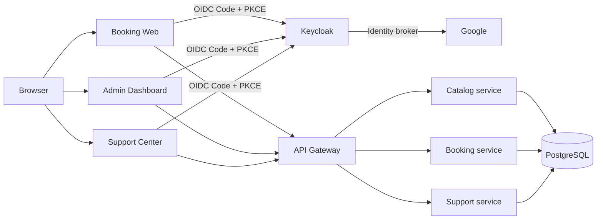

# Architecture — 3 apps / 2 roles / Keycloak SSO

**Status: PROPOSED — G2 approval required.**

## Scope
- Booking Web: USER searches hotels, creates/reads/pays (mock)/cancels own bookings.
- Admin Dashboard: ADMIN manages catalog/inventory and views bookings in authorized tenant.
- Support Center: USER creates/views/replies to own tickets; ADMIN triages/replies/resolves tickets in authorized tenant.
- Exactly two application roles: `USER`, `ADMIN`. Ticket assignment is a field, not a third role.
- Google acts as upstream identity provider; **Keycloak is the OIDC authorization server and SSO session authority**. Backend services are JWT resource servers; do not mint parallel IAM JWTs.

## SSO & security contract
- One Keycloak realm; three distinct OIDC clients: `booking-web`, `admin-web`, `support-web`; each has its own exact redirect URI and allowed web origins. Public SPA clients use Authorization Code + PKCE S256; no client secret in browser. Prefer BFF + HttpOnly/Secure/SameSite cookies for production browser apps; select **one** token handling pattern at G2.
- Google login is configured as Keycloak identity brokering; first-login flow must map to a pre-provisioned internal user and tenant membership. Unknown accounts denied; no implicit ADMIN assignment. Link Google identity using stable issuer + subject; do not rely on mutable email alone.
- Validate JWT signature via Keycloak JWKS, `iss`, `exp`, `nbf`, expected `aud`, and explicit mapped roles. `tenant_id` is a server-validated membership claim or resolved against DB; never trust request body/header tenant. Cross-tenant resources return 404 to avoid enumeration.
- USER cannot open Admin Dashboard; ADMIN is not automatically authorized to place USER bookings. Both roles can access Support Center with different policies.
- Switching apps: each app performs its own OIDC redirect/code exchange; Keycloak SSO session can avoid re-entering credentials. Separate app sessions/tokens; SSO does not mean token sharing.
- Logout: RP-initiated Keycloak logout plus coordinated local/BFF session cleanup; back-channel/front-channel logout must be designed/tested separately. Token expiry alone is not instant revocation.
- CSRF protections for cookie/BFF apps; CORS allowlist for browser API calls; do not place tokens in URL fragments, logs or localStorage in target architecture.

## Ownership and boundary
- Keycloak owns authentication session; app database owns tenant membership and application business data.
- Catalog owns `hotel`, `room_type`, `room_inventory.total`; Booking exclusively changes `room_inventory.sold` and `booking`; Support owns `support_ticket` and `ticket_message`.
- Shared PostgreSQL is an MVP compromise for booking/inventory atomic transactions; do not describe it as independent microservice databases.
