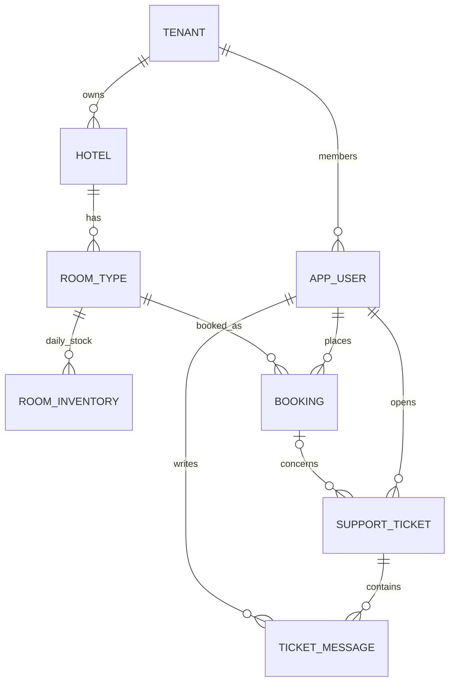

# Data model — Logical target (PostgreSQL)

**Status: PROPOSED; verify actual Flyway migrations.** Replaces `erd-v2.md` as active reference.

## Core tables
- `tenant(id, name)`; `app_user(id, tenant_id, keycloak_sub, email, role)`; use `(tenant_id, keycloak_sub)` uniqueness, and consider separate membership table if one person may belong to multiple tenants. Avoid coupling ownership to mutable email.
- `hotel(id, tenant_id, name, address)`.
- `room_type(id, tenant_id, hotel_id, name, capacity, base_price NUMERIC(10,2), total_rooms)`; no `room` physical table in MVP.
- `room_inventory(tenant_id, room_type_id, stay_date, total, sold)` primary key `(tenant_id, room_type_id, stay_date)`; CHECK `0 <= sold <= total`.
- `booking(id, tenant_id, room_type_id, user_id, check_in DATE, check_out DATE, room_count, total_amount NUMERIC(14,2), status, payment_expires_at, created_at)`; FK `(tenant_id, user_id)` -> app_user; FK `(tenant_id, room_type_id)` -> room_type. **Migration needed** from legacy `user_email` FK.
- `support_ticket(id, tenant_id, requester_user_id, booking_id NULL, subject, description, status, assigned_admin_user_id NULL, created_at, updated_at, closed_at NULL)`.
- `ticket_message(id, tenant_id, ticket_id, author_user_id, body, created_at)`; immutable messages; audit author. Add composite tenant-scoped FKs to requester, booking, assignee, ticket and author. Enforce ticket.booking ownership in service transaction (FK alone cannot ensure owner equality).

## Booking invariants
- Stay interval `[checkIn, checkOut)`; price snapshot = `base_price * nights * roomCount`; date validation uses `Asia/Ho_Chi_Minh` for demo policy.
- `PENDING_PAYMENT` and `CONFIRMED` occupy stock. `CANCELLED` and `EXPIRED` do not.
- Booking creates pending reservation by conditional per-night `UPDATE room_inventory SET sold=sold+:count WHERE ... AND sold+:count<=total`, ordered ascending by date, then inserts booking **in the same READ COMMITTED transaction**. On any failed night, rollback all and return 409.
- Payment mock: pending and not expired -> confirmed; stock unchanged.
- Cancel or expiry: conditional booking state transition, then decrement sold for every night in same transaction **only if transition succeeds**; retries cannot release twice. Reconciliation must compare sold against active booking counts.
- `room_inventory.total` managed by Catalog, `sold` only by Booking. Do not reduce `total` below `sold`.
- Inventory seed window is finite; missing nightly row means not for sale. Do not assume historical hardcoded seed dates are future-proof.

## Data security
- Always scope reads/writes by tenant and ownership. Composite FKs `(tenant_id, id)` on referenced entities, including booking/ticket.
- Avoid copying PII or token material into fixtures or documentation. Retention and deletion policy for support messages needs approval.

## Migration caveat
Original schema may use `app_user.google_sub` and `booking.user_email`. Do **not** rename columns in place without checking data, dependencies, migration history and a rollback plan. Use additive versioned Flyway migrations on any shared DB.
