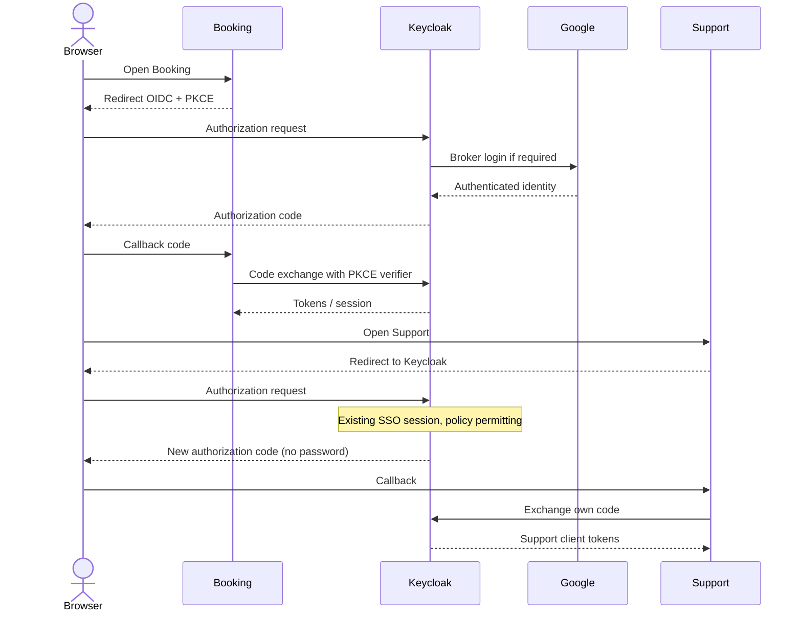

# End-to-end workflows — USER / ADMIN / 3 apps

**Status: PROPOSED.** This document owns sequence diagrams; do not duplicate diagrams in separate service files.

## USER lifecycle
1. Open Booking → redirect to Keycloak OIDC Authorization Code + PKCE → Keycloak brokers Google login if no session → app receives own session/token.
2. USER selects hotel/dates, searches availability (read-only snapshot), reserves room type; Booking atomically holds stock as `PENDING_PAYMENT`.
3. Mock payment before expiry -> `CONFIRMED`; pending cancel/expiry -> release stock exactly once.
4. Open Support Center from booking details. Support redirects to Keycloak; valid SSO session avoids another password prompt. Support receives its **own** code/token, validates USER and tenant.
5. Create ticket linked to own booking; add messages, read updates, see final `RESOLVED/CLOSED` state.
6. Logout through Keycloak and clear local app session; verify other apps detect logout under configured session strategy.

## ADMIN lifecycle
1. Open Admin Dashboard → Keycloak/Google sign-in; validate ADMIN role and tenant.
2. Manage room types/prices, inspect inventory and bookings within tenant; no USER booking checkout permission.
3. Open Support Center; Keycloak SSO reuses login session, Support obtains its own tokens.
4. View tenant ticket queue, move `OPEN -> IN_PROGRESS`, reply, `RESOLVED -> CLOSED`; maintain audit author/time.
5. Logout; invalidate local sessions and test cross-app behavior.

## SSO sequence


## Booking and ticket sequence
```mermaid
sequenceDiagram
 actor U as USER
 participant C as Catalog
 participant B as Booking
 participant T as Support
 participant DB as PostgreSQL
 U->>C: Search hotel/date availability
 C->>DB: Read daily inventory (tenant scoped)
 C-->>U: Available room types
 U->>B: POST booking
 B->>DB: BEGIN; conditional daily stock updates
 B->>DB: INSERT PENDING_PAYMENT; COMMIT
 B-->>U: 201 booking
 U->>T: POST ticket with bookingId
 T->>B: Validate ownership (or shared DB query under policy)
 T->>DB: Insert OPEN ticket
 T-->>U: 201 ticket
```

## Failure paths
- Invalid/missing token: 401; wrong role: 403; foreign tenant/booking/ticket: 404.
- Inventory race: one 201, loser 409; no oversell.
- Expired payment: cannot confirm; expiry worker releases stock once.
- No SSO session: Keycloak requests authentication; no guarantee of silent login after expiry or explicit logout.
