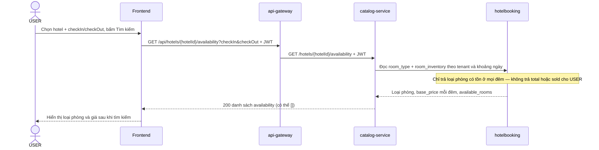
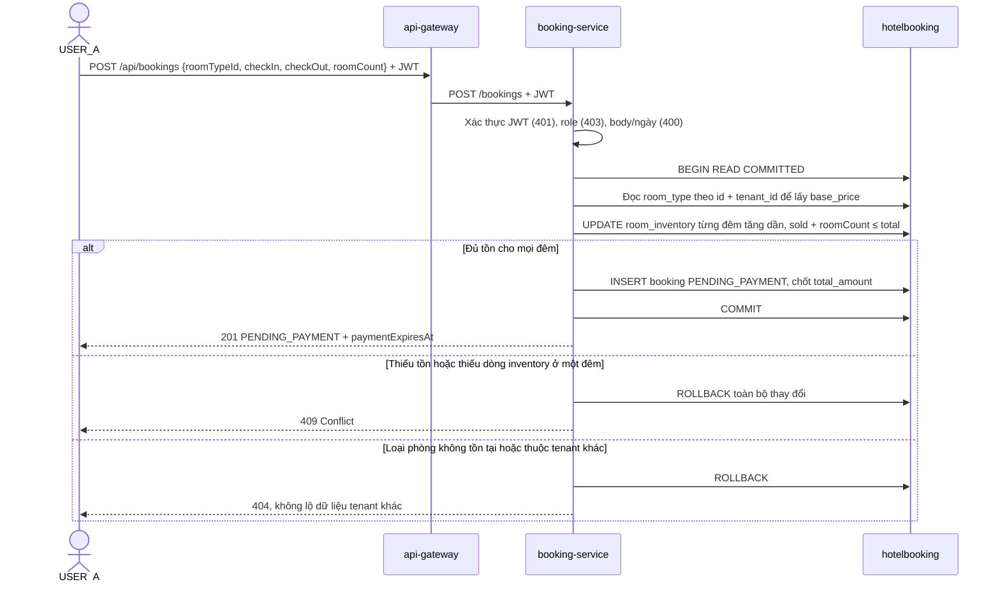
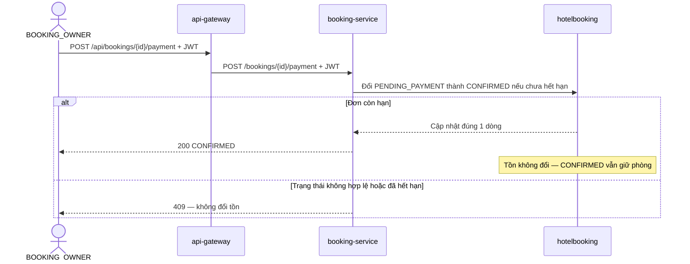
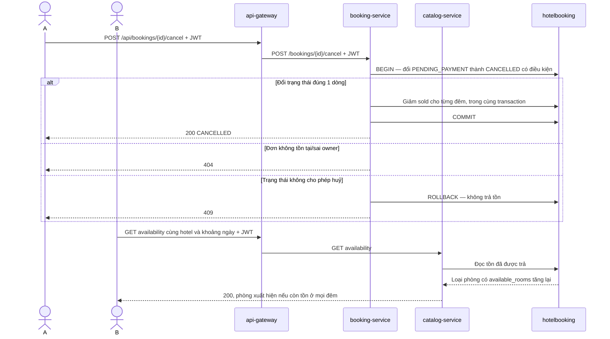
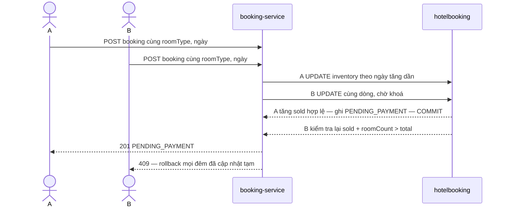

# Sequence diagram: Tìm kiếm, đặt, thanh toán và huỷ booking

Owner: Phúc (C). Bám theo [api-contract.md §4–5](api-contract.md) và [erd-v2.md](erd-v2.md). `hotelbooking` là database chung.

## Tìm kiếm sau khi người dùng gửi đủ lựa chọn

## Tạo booking giữ tồn

## Thanh toán mô phỏng

## User huỷ khi đang chờ thanh toán

## Hai request đặt cùng tồn đồng thời

## Các quy tắc trạng thái

| Từ trạng thái | Thao tác | Sang trạng thái | Tồn kho |
|---|---|---|---|
| `PENDING_PAYMENT` | Thanh toán mô phỏng thành công trước hạn | `CONFIRMED` | Giữ nguyên |
| `PENDING_PAYMENT` | User chủ đơn huỷ | `CANCELLED` | Trả đúng một lần |
| `PENDING_PAYMENT` | Quá hạn thanh toán | `EXPIRED` | Trả đúng một lần |
| `CONFIRMED` | Thử huỷ | `409` | Không đổi trạng thái hoặc tồn kho |
| `CANCELLED` / `EXPIRED` | Thanh toán hoặc huỷ lại | Không đổi; thao tác không trả tồn lần nữa | Không đổi |

User chỉ thấy booking của mình; Admin xem trong tenant. Chỉ Admin được gọi API kiểm kê tổng `total`/`sold`/`available`.
