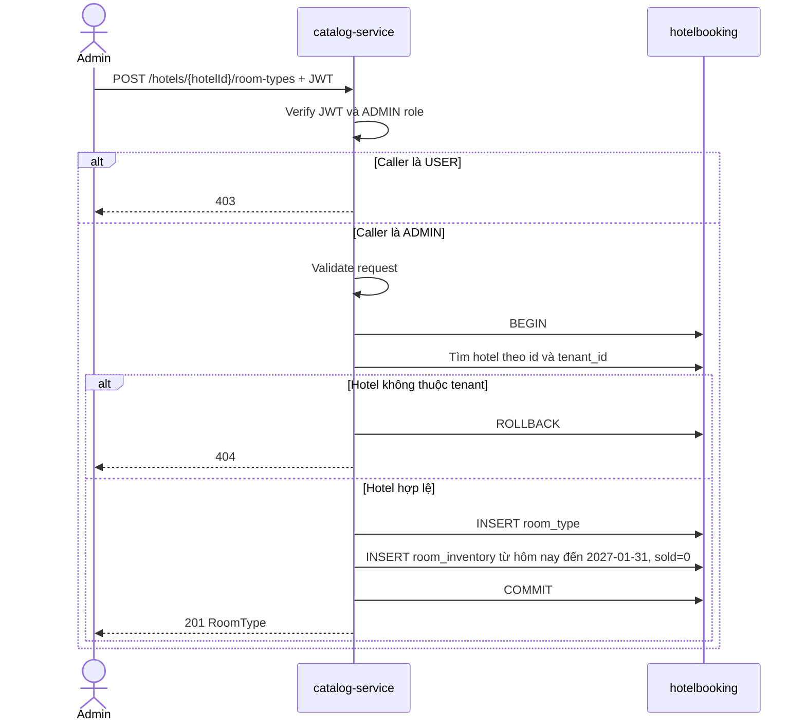

# Catalog sequence

Owner: Hòa (B). Catalog API chạy ở cổng `8081`; database `hotelbooking` được dùng chung với IAM và Booking.

## Đọc khách sạn và tìm availability

```mermaid
sequenceDiagram
    actor User
    participant Gateway as api-gateway
    participant Catalog as catalog-service
    participant DB as hotelbooking

    User->>Gateway: GET /api/hotels hoặc availability + Bearer JWT
    Gateway->>Catalog: Chuyển tiếp request và JWT
    Catalog->>Catalog: Verify RS256, issuer, exp/iat, role, tenant_id
    alt JWT thiếu/sai
        Catalog-->>User: 401
    else JWT hợp lệ
        Catalog->>DB: Truy vấn hotel/room_type/room_inventory với tenant_id từ JWT
        DB-->>Catalog: Chỉ dữ liệu trong tenant
        Catalog-->>User: 200 Hotels hoặc Availability
    end
    Note over Catalog,DB: Availability yêu cầu tồn ở đủ mọi đêm; chỉ trả availableRooms, không trả total/sold
```

## Admin tạo loại phòng và tồn theo đêm



Catalog không cập nhật `room_inventory.sold`; Booking quản lý cột đó trong transaction đặt/huỷ/hết hạn.
