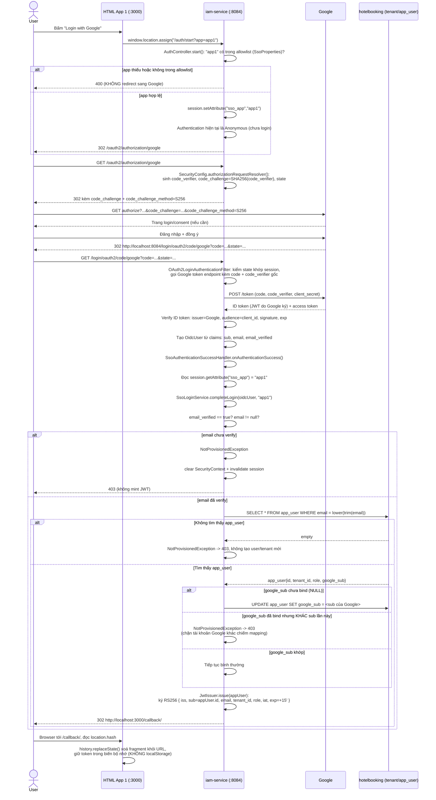
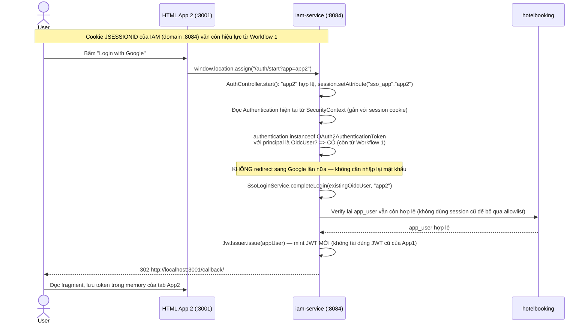
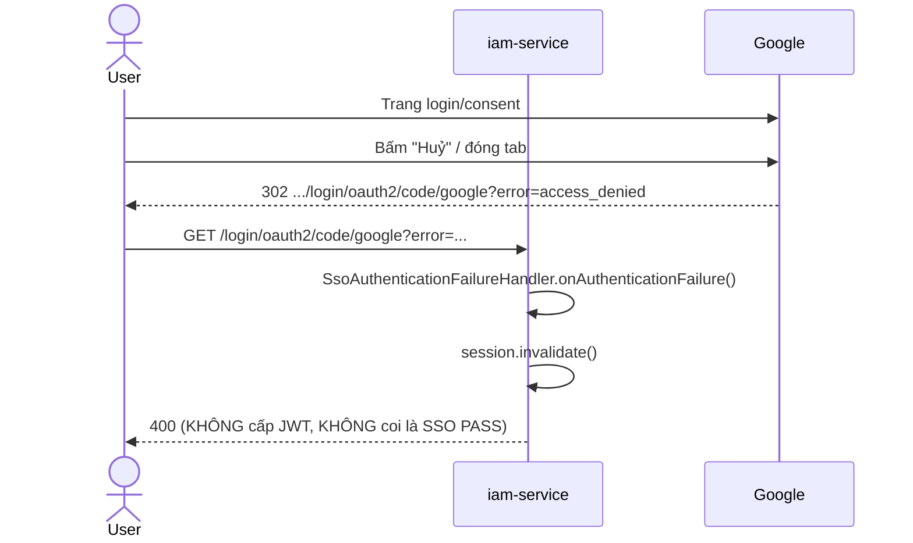
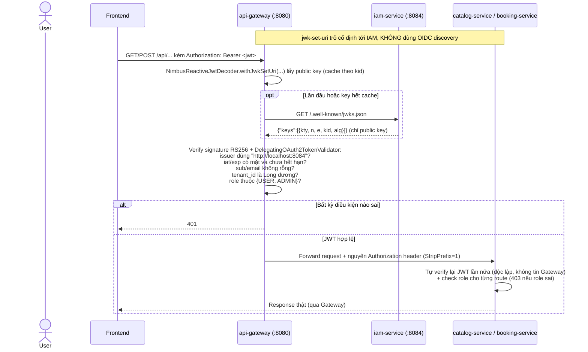

# IAM — Google SSO, PKCE, JWT/JWKS (A)

> Owner: Bảo (A). IAM chạy ở cổng `8084`, database `hotelbooking` dùng chung với Catalog/Booking
> (bảng `tenant`, `app_user`). Tài liệu này giải thích **kiến thức nền** + **workflow chi tiết**
> của toàn bộ phần IAM đã code trong `iam-service` và `api-gateway`, để A (và D khi tổng hợp demo)
> hiểu đúng từng bước, không chỉ đọc code. Nguồn hợp đồng: `docs/api-contract.md` §3, §6.

## 0. Vì sao thiết kế thế này — kiến thức nền

### 0.1 OAuth2 Authorization Code Flow là gì

OAuth2 "Authorization Code Flow" giải quyết bài toán: **IAM (server) muốn biết người dùng là ai
theo Google, mà không bao giờ thấy mật khẩu Google của họ**. Luồng gồm 2 chặng:

1. **Chặng ủy quyền (authorization):** browser được điều hướng sang Google. Người dùng đăng nhập
   /đồng ý tại Google. Google không trả thông tin người dùng trực tiếp cho browser — nó trả về
   một **authorization code** (chuỗi dùng một lần, sống rất ngắn) bằng cách redirect browser về
   một `redirect_uri` đã đăng ký trước ở Google Cloud Console.
2. **Chặng đổi code (token exchange):** server (ở đây là `iam-service`, **không phải browser**)
   gọi thẳng tới Google kèm `code` + `client_secret` để đổi lấy **ID token** (một JWT do Google ký,
   chứa `sub`, `email`, `email_verified`...). Vì bước này diễn ra server-to-server, `client_secret`
   không bao giờ lộ ra browser.

**Vì sao không cho browser tự gọi Google luôn?** Vì browser là môi trường không tin cậy (JS có thể
bị đọc bởi extension độc hại, XSS...). Để browser giữ được `client_secret` thì ai cũng lấy được.
Authorization Code Flow tách việc "người dùng đồng ý" (browser) khỏi việc "đổi code lấy định danh"
(server), đúng mô hình OAuth2 cho **confidential client** (ứng dụng server có khả năng giữ bí mật).

### 0.2 PKCE (Proof Key for Code Exchange) — vì sao cần dù đã có `client_secret`

PKCE sinh ra ban đầu để bảo vệ **public client** (SPA, mobile app — không giữ được secret). Câu hỏi
hợp lý: `iam-service` là confidential client (có `client_secret`), vậy còn cần PKCE không?

**Có, và đây là lý do mentor/plan bắt buộc kiểm tra PKCE dù là confidential client:** PKCE chống lại
kiểu tấn công **authorization code interception** — nếu authorization code bị đánh cắp giữa đường
(ví dụ qua log, qua redirect bị proxy, qua một app khác trên cùng máy bắt được callback), kẻ tấn
công có code nhưng **không có `code_verifier`** (chỉ IAM giữ, không bao giờ rời server) nên không
đổi được code đó lấy token. Đây là lớp bảo vệ bổ sung, độc lập với `client_secret`.

Cơ chế toán học:

- IAM sinh một chuỗi ngẫu nhiên `code_verifier` (43–128 ký tự).
- Tính `code_challenge = BASE64URL(SHA256(code_verifier))`.
- Authorization request gửi Google gồm `code_challenge` + `code_challenge_method=S256`.
- Khi đổi code, IAM gửi kèm `code_verifier` gốc. Google tự hash lại và so khớp với `code_challenge`
  đã nhận trước đó. Khớp mới cấp token.

**Vì sao phải S256 mà không phải `plain`?** `plain` nghĩa là `code_challenge = code_verifier` —
không có hash, nên nếu `code_challenge` bị lộ (nó đi trong URL, có thể nằm trong access log của
proxy/CDN) thì kẻ tấn công có luôn `code_verifier`. S256 đảm bảo chỉ IAM (nơi giữ `code_verifier`
gốc) mới đổi code được, vì hash là một chiều.

**Vì sao Spring Security không tự bật PKCE cho client này?** Thư viện chỉ **tự động** bật PKCE khi
`client-authentication-method = none` (public client, không có secret). `iam-service` đăng ký
Google là confidential client (`client-secret` có giá trị), nên theo thiết kế của Spring Security,
PKCE phải được **bật tường minh** bằng một `OAuth2AuthorizationRequestResolver` tùy chỉnh — đây
chính là lý do code có `SecurityConfig.authorizationRequestResolver()`.

### 0.3 Vì sao JWT nội bộ dùng RS256 (asymmetric) chứ không HS256 (symmetric)

- **HS256** dùng một khóa bí mật (secret) để **vừa ký vừa verify**. Muốn Catalog/Booking/Gateway
  verify được token, họ phải biết secret đó → secret phải chia sẻ cho 4 service → bất kỳ service
  nào bị lộ secret cũng tự ký giả JWT ADMIN cho tenant khác.
- **RS256** dùng cặp khóa RSA: **private key chỉ IAM giữ** để ký; **public key** phát công khai qua
  `/.well-known/jwks.json` để Gateway/Catalog/Booking **chỉ verify**, không thể tự ký token mới.
  Đây là lý do contract bắt buộc RS256: tách quyền "phát hành" (chỉ IAM) khỏi quyền "xác minh"
  (mọi service), đúng nguyên tắc least privilege.
- **JWKS (JSON Web Key Set)** là định dạng chuẩn để công bố public key kèm `kid` (key ID), để
  service biết dùng đúng khóa nào verify khi có nhiều khóa cùng lúc (không áp dụng ở demo này vì
  chỉ có 1 khóa, nhưng vẫn theo chuẩn để Spring Security's `NimbusJwtDecoder`/`NimbusReactiveJwtDecoder`
  dùng được `withJwkSetUri(...)` có sẵn).

### 0.4 Vì sao IAM không dùng OIDC Discovery (`/.well-known/openid-configuration`)

OIDC chuẩn có một endpoint discovery để client tự tìm `jwks_uri`, `authorization_endpoint`... IAM
ở đây **không phải một Authorization Server OIDC đầy đủ** — nó chỉ là OAuth2 **Client** của Google
(để login) và một **JWT issuer nội bộ** tự chế (để các service StayHub verify). Vì vậy Gateway/
Catalog/Booking phải cấu hình cứng `jwk-set-uri: http://localhost:8084/.well-known/jwks.json` và
tự thêm validator kiểm `iss`, **không dùng** `issuer-uri` (Spring sẽ cố gọi discovery và lỗi vì
endpoint đó không tồn tại ở IAM).

---

## 1. Kiến trúc & vai trò từng file

```
iam-service/src/main/java/com/hotelbooking/iam/
├── IamServiceApplication.java        # @EnableConfigurationProperties(SsoProperties.class)
├── config/SsoProperties.java         # allowlist "app" -> callback URL (app1/app2)
├── domain/
│   ├── AppUser.java                  # entity map bảng app_user (id, email, tenant_id, role, google_sub)
│   └── AppUserRepository.java        # findByEmail
├── jwt/
│   ├── JwtKeyProvider.java           # sinh RSA keypair 1 lần khi app start, kid="stayhub-key-1"
│   └── JwtIssuer.java                # mint JWT RS256: iss/sub/email/tenant_id/role/iat/exp
├── security/
│   ├── NotProvisionedException.java  # luôn -> 403, không mint JWT, không auto-provision
│   ├── SsoLoginService.java          # logic nghiệp vụ: verify email, bind/check google_sub, gọi JwtIssuer
│   ├── SsoAuthenticationSuccessHandler.java  # chạy sau khi Spring Security đổi code xong
│   ├── SsoAuthenticationFailureHandler.java  # chạy khi user huỷ login / state-code sai
│   └── SecurityConfig.java           # filter chain + bật PKCE tường minh
└── web/
    ├── AuthController.java           # GET /auth/start?app=
    └── JwksController.java           # GET /.well-known/jwks.json

api-gateway/src/main/java/com/hotelbooking/gateway/
└── security/
    ├── StayHubJwtValidator.java      # mirror của Catalog/Booking: tenant_id phải Long, role USER/ADMIN
    └── SecurityConfig.java           # reactive resource server: verify JWT trước khi forward route
```

---

## 2. Workflow 1 — Login lần đầu (App 1, chưa có session IAM)



**Điểm mấu chốt dễ hiểu sai:**
- `code_verifier` **không bao giờ** rời server IAM — nó sống trong `OAuth2AuthorizationRequest`
  mà Spring Security tự lưu trong session, IAM không tự tay quản lý biến này.
- `app=app1` được IAM giữ trong **HttpSession của chính IAM** (cookie `JSESSIONID` ở domain
  `localhost:8084`), không phải trong `state` OAuth2 (state do Spring Security tự sinh để chống
  CSRF, khác mục đích). Sau khi Google redirect về, cùng session đó còn sống nên đọc lại được `app1`.
- 403 do chưa provision **luôn xảy ra ở bước sau khi đã xác minh Google thành công** — nghĩa là
  Google đã tin người này, nhưng IAM từ chối cấp JWT nội bộ vì chưa có trong `app_user`. Đây đúng
  là hành vi contract yêu cầu: không tự tạo user/tenant mới.

---

## 3. Workflow 2 — SSO: mở App 2 sau khi đã login App 1 (cùng browser)



**Vì sao đây tính là SSO hợp lệ:** người dùng không phải nhập lại mật khẩu Google lần 2 — vì
browser vẫn giữ session cookie của chính IAM (`localhost:8084`), Spring Security thấy
`Authentication` đã có sẵn trong `SecurityContext` nên bỏ qua toàn bộ chặng redirect sang Google.
Google có thể vẫn hiện màn hình "chọn tài khoản" tuỳ cấu hình consent, nhưng **không** bắt nhập
mật khẩu — đúng điều kiện contract §3.2.

**Giới hạn:** nếu reload lại tab App1/App2, JS mất token trong memory → phải gọi lại `/auth/start`
(nhưng vẫn SSO được vì session IAM còn sống, không cần login Google lại).

---

## 4. Workflow 3 — Người dùng huỷ đăng nhập / `state` sai



---

## 5. Workflow 4 — Gateway/Catalog/Booking verify JWT qua JWKS



**Vì sao verify 2 lần (Gateway + Service)?** Vì contract chủ động không cho Gateway là **lớp bảo
mật duy nhất** — Catalog/Booking vẫn phải tự bảo vệ nếu ai đó gọi trực tiếp `:8081`/`:8082` bỏ qua
Gateway. Gateway chỉ là lớp chặn sớm, không phải điểm tin cậy duy nhất.

---

## 6. Vì sao có bug `sendError` → fix bằng `setStatus` (ghi lại để nhớ)

Lúc code xong, test `/auth/start?app=bad` trả **302 redirect sang Google** thay vì 400. Nguyên
nhân: `HttpServletResponse.sendError(400)` không tự viết response ngay — nó yêu cầu container
(Tomcat) **forward nội bộ** sang `/error` để Spring Boot render trang lỗi. Nhưng `/error` không
nằm trong danh sách `permitAll()` của `SecurityConfig`, nên request forward đó bị
`ExceptionTranslationFilter` coi là "chưa đăng nhập, cần xác thực" → kích hoạt
`AuthenticationEntryPoint` của `oauth2Login` → vì chỉ có 1 provider đăng ký (Google), Spring tự
redirect thẳng sang `/oauth2/authorization/google` **thay vì** hiện trang lỗi 400.

**Fix:** dùng `response.setStatus(400)` thay cho `sendError(400)` — chỉ set status code, không
trigger forward nội bộ nào, response trả ngay đúng status cho client.

**Bài học áp dụng cho cả nhóm:** bất kỳ handler nào trả lỗi thủ công trong một `SecurityFilterChain`
có `anyRequest().authenticated()` nên dùng `setStatus`, tránh `sendError`, trừ khi `/error` cũng
được permitAll tường minh.

---

## 7. Bảng tổng hợp claim/JWT (tham chiếu nhanh)

| Claim | Nguồn | Kiểu JSON | Ghi chú |
|---|---|---|---|
| `iss` | `security.jwt.issuer` (application.yml) | string | Phải khớp tuyệt đối ở mọi service |
| `sub` | `app_user.id` | string | Ép sang String khi mint |
| `email` | `app_user.email` | string | Đã chuẩn hoá lowercase khi provision |
| `tenant_id` | `app_user.tenant_id` | **number** (Long) | Chuỗi `"1"` bị tất cả service từ chối |
| `role` | `app_user.role` | string | Chỉ `USER`/`ADMIN` |
| `iat`/`exp` | `Instant.now()` / `+15 phút` | number (Unix seconds) | TTL cấu hình `security.jwt.ttl-minutes` |

---

## 8. Giới hạn đã biết (phải khai báo khi demo, không che giấu)

1. **Key không persist.** Mỗi lần restart `iam-service`, `JwtKeyProvider` sinh keypair RSA mới →
   JWT cũ phát trước đó hết hiệu lực ngay (JWKS cũ không còn phục vụ được). Không có key rotation
   tự động, không lưu private key ra đĩa (đúng chủ đích demo, tránh lộ secret ra Git).
2. **`app` được ghim vào HttpSession của IAM**, không phải trong OAuth2 `state`. Nếu người dùng mở
   2 tab cùng lúc gọi `/auth/start` với `app` khác nhau trước khi hoàn tất 1 trong 2, tab hoàn tất
   sau sẽ đè `sso_app` của tab trước (giới hạn demo, không ảnh hưởng tới tính đúng của mỗi lần
   login riêng lẻ vì mint JWT là atomic theo request).
3. **Token nằm trong URL fragment** (`#token=...`) — có rủi ro nếu trình duyệt bị XSS/extension
   độc hại đọc được `location.hash` trước khi JS của App dọn dẹp. Đây là đánh đổi có chủ đích của
   demo, không dùng cho production.
4. Chưa có refresh token, chưa có revoke, chưa có `/auth/logout` thật (chỉ xoá token phía client).

---

## 9. Kế hoạch việc cần làm tiếp (Checklist cho A)

### 9.1 Bắt buộc để demo chạy được thật (chặn cứng)

- [ ] **Tạo Google OAuth Client** tại Google Cloud Console:
  - Loại **Web application**.
  - Authorized redirect URI: **chính xác** `http://localhost:8084/login/oauth2/code/google`
    (không thêm `/` thừa, không dùng `127.0.0.1`).
  - Lấy `Client ID` + `Client secret`, **không commit vào Git** — set qua biến môi trường
    `GOOGLE_CLIENT_ID`, `GOOGLE_CLIENT_SECRET` khi chạy `iam-service`.
  - Thêm OAuth consent screen ở chế độ **Testing**, thêm các **Test users** là các email Gmail
    thật sẽ dùng để demo (ADMIN_1, USER_1, USER_1B, ADMIN_2, USER_2 theo alias ở
    `docs/api-contract.md` §7.1).
- [ ] **Seed `app_user` thật** (không commit email thật):
  - Tạo file `docker/seed/seed-app-users.local.sql` (đã có trong `.gitignore` theo plan) insert
    5 dòng theo alias: `admin-tenant1@...`, `user-tenant1@...`, `user2-tenant1@...`,
    `admin-tenant2@...`, `user-tenant2@...` — thay bằng email Gmail thật của nhóm, `tenant_id`
    và `role` đúng bảng seed. `google_sub` để `NULL`, IAM sẽ tự bind ở lần login đầu.
  - Chạy file này trực tiếp vào DB (`psql` hoặc client bất kỳ) sau khi `iam-service` đã migrate
    xong bảng `app_user`.
- [ ] **Test login thật bằng ít nhất 1 email đã seed:**
  1. `docker compose up -d postgres`
  2. `GOOGLE_CLIENT_ID=... GOOGLE_CLIENT_SECRET=... ./gradlew :iam-service:bootRun`
  3. Mở browser thật, vào `http://localhost:8084/auth/start?app=app1`
  4. Đăng nhập Google bằng email đã seed → kỳ vọng: redirect về
     `http://localhost:3000/callback/#token=...` (App 1 chưa tồn tại thì sẽ 404 ở bước cuối, đó là
     bình thường — D chưa làm callback page; vẫn chứng minh được JWT đã phát qua Network tab).
  5. Mở DevTools → Network → request `authorize` tới Google → xác nhận có
     `code_challenge`/`code_challenge_method=S256` thật (không chỉ tin vào test ở môi trường giả).
  6. Test email **chưa seed** → kỳ vọng 403, không tạo `app_user` mới.
- [ ] **Test SSO 2 app thật:** sau bước trên, mở `http://localhost:8084/auth/start?app=app2` trong
  cùng browser profile → xác nhận không bị hỏi lại mật khẩu Google.

### 9.2 Cần làm để tích hợp với B/C/D

- [ ] Chạy đồng thời `iam-service` (:8084) + `catalog-service` (:8081) + `booking-service`
  (:8082) + `api-gateway` (:8080) trên cùng DB, test gọi `GET /api/hotels` qua Gateway bằng JWT
  thật mint từ IAM → xác nhận 200 (hiện mới test JWT từ unit test giả, chưa test tích hợp 4
  service cùng chạy).
- [ ] Phối hợp B/C: do `booking-service` hiện có 17 test fail (migration cũ `V1__create_room.sql`
  chưa khớp schema `room_type`/`room_inventory` — xem báo cáo trước), cần C cập nhật trước khi
  test tích hợp end-to-end có ý nghĩa.
- [ ] Gửi D: cách lấy JWT test (không kèm secret thật) để D viết `docs/demo.http`,
  `docs/demo-data.md` alias.

### 9.3 Tài liệu & đóng gói

- [x] `docs/sequence-iam.md` — file này.
- [ ] Cập nhật `docs/decisions.md` nếu có thay đổi phát sinh trong lúc test thật (ví dụ TTL JWT,
  format allowlist `sso.callbacks`).
- [ ] Review lại `README` chạy demo (biến môi trường cần set, lệnh `docker compose up`, lệnh
  `bootRun` từng service theo đúng thứ tự IAM → Catalog → Booking).
- [ ] Commit các file đã tạo trên branch `feat/a-iam-google-sso`, mở PR để nhóm review theo quy
  tắc Git & AI agent ở `plan-v2.md` §6 (không merge chỉ vì "chạy thử local là xong").

### 9.4 Không bắt buộc nhưng nên làm nếu còn thời gian

- [ ] Thêm test tích hợp (`@SpringBootTest` + `MockMvc`/`WebTestClient`) cho `AuthController` với
  `app` hợp lệ/không hợp lệ, dùng `@MockBean` cho `OAuth2AuthorizedClientService` để không cần
  Google thật — hiện chỉ có unit test thuần (`SsoLoginServiceTest`, `JwtIssuerTest`).
- [ ] Viết test riêng cho case "đổi redirect sang trang lỗi an toàn" khi `state`/`code` sai (hiện
  `SsoAuthenticationFailureHandlerTest` chưa có).
