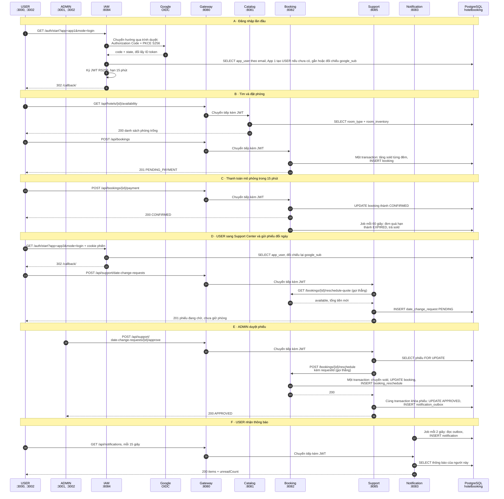
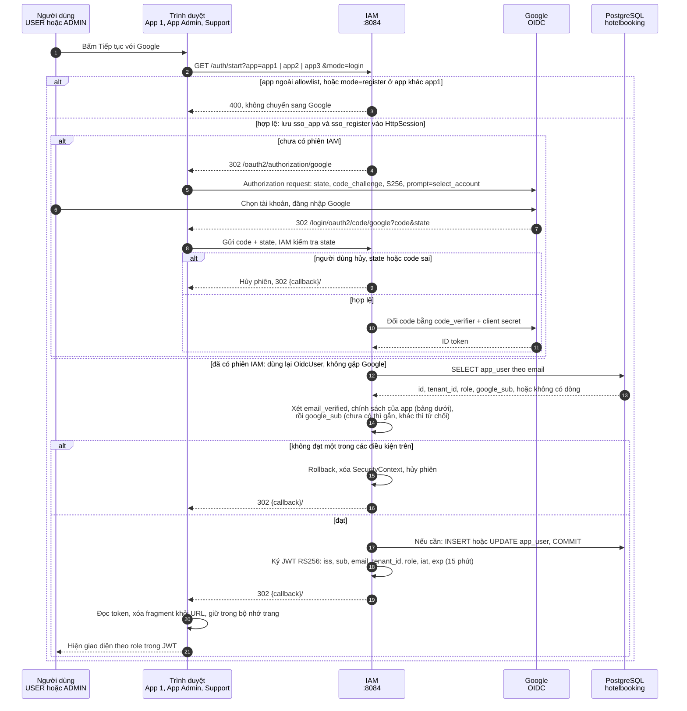
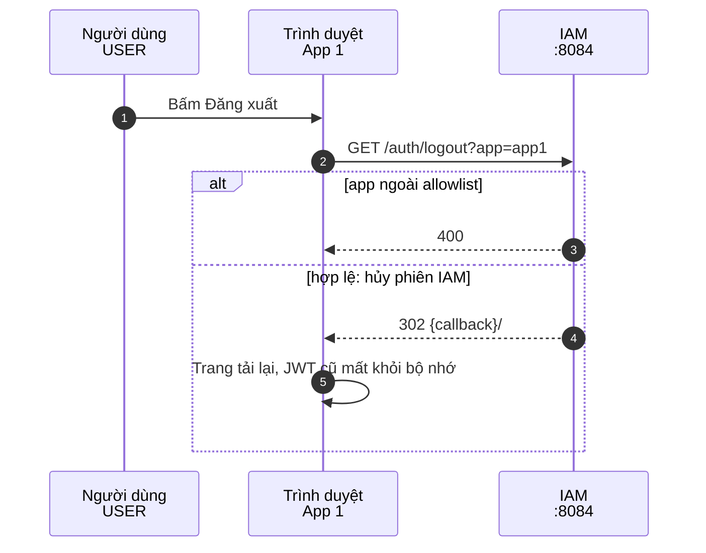
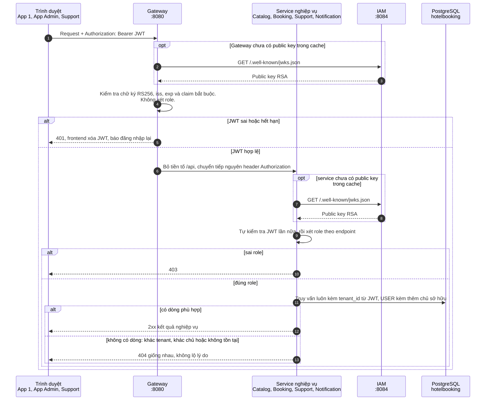
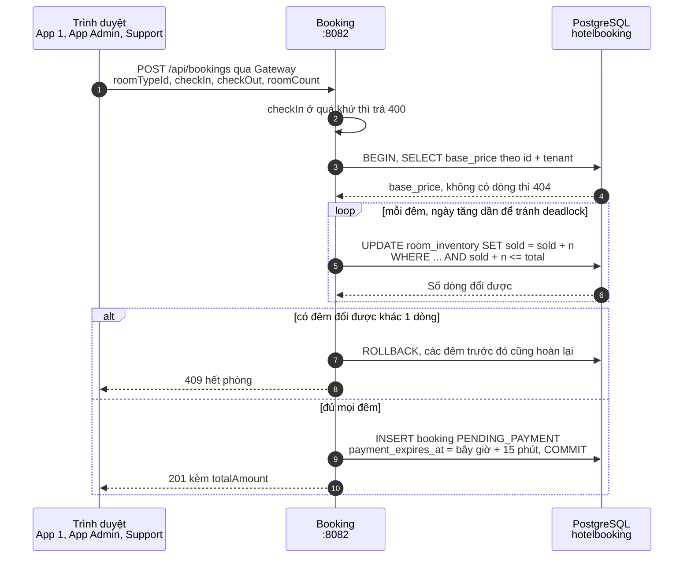
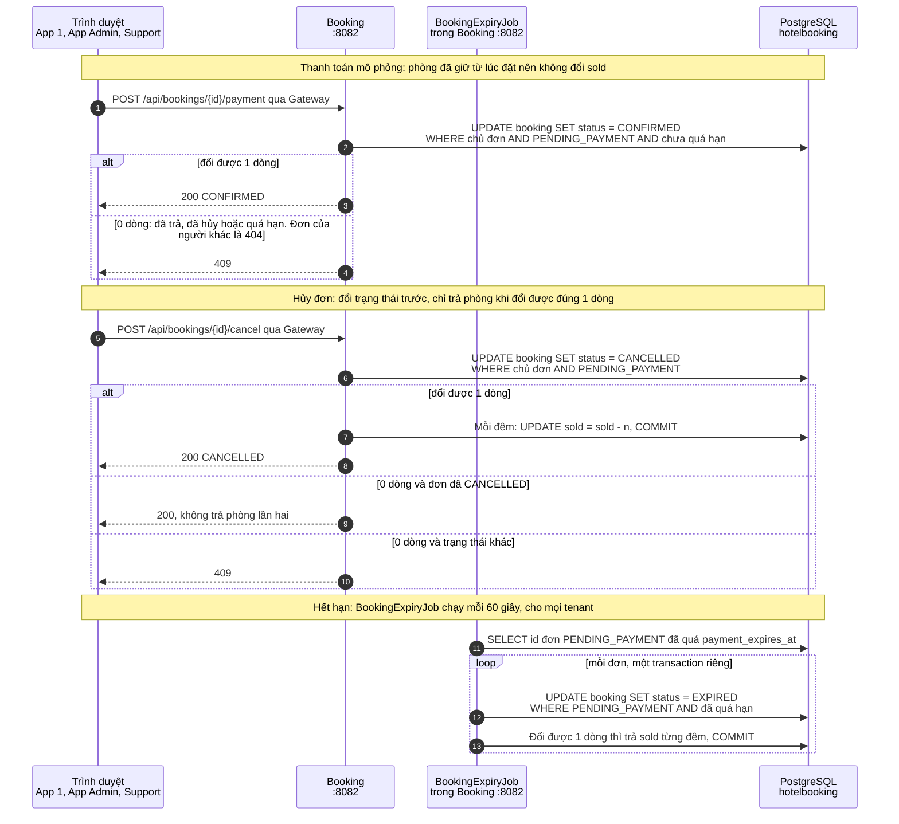
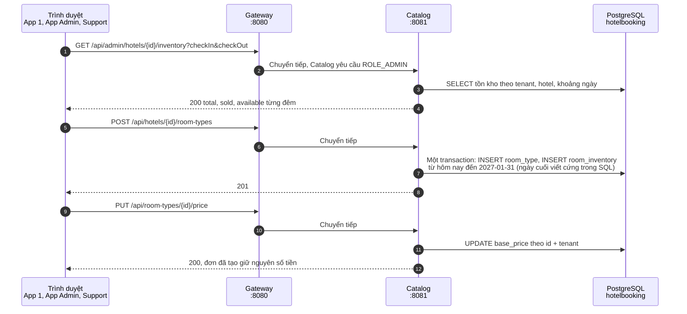
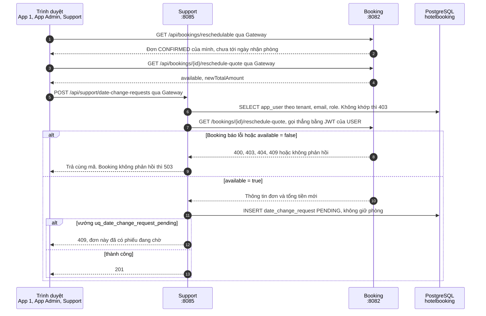
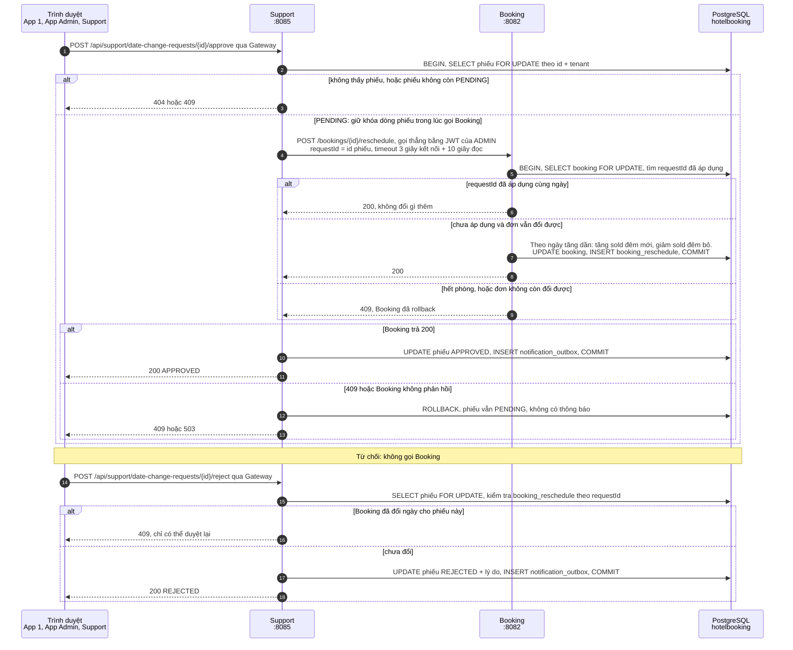
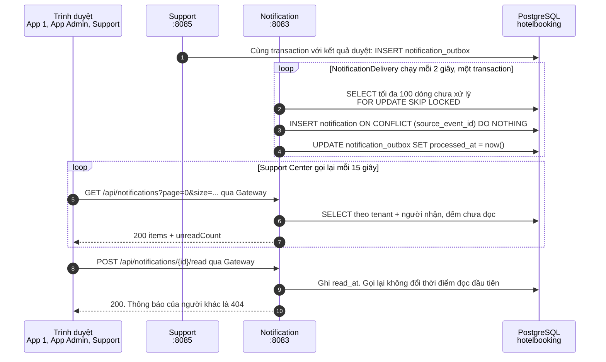

# StayHub: sequence diagram toàn hệ thống

Vẽ theo source code của `main`, commit `1737b60`, đối chiếu ngày 05/11/2026. Các luồng đặt phòng, thanh toán, đổi ngày và thông báo đã chạy qua workflow Docker với JWT của `dev-token`. Đăng nhập bằng tài khoản Google thật chưa chạy, nên phần có Google là điều code quy định, chưa phải kết quả E2E. Chi tiết ở [documents/README.md](documents/README.md#6-mức-độ-kiểm-chứng).

Quy ước: nét liền là request, nét đứt là response. Số thứ tự đánh riêng trong từng sơ đồ. Nhãn "gọi thẳng" là lời gọi từ Support sang Booking không qua Gateway.

## Toàn hệ thống: một đơn đi từ lúc đăng nhập đến khi đổi ngày xong

Sơ đồ đi theo luồng thành công dài nhất, chạm đủ 10 thành phần. Cột USER và ADMIN là trình duyệt của từng người. Hai điểm dễ bỏ sót: IAM không đi qua Gateway, và Support với Notification không gọi nhau mà trao đổi qua bảng outbox.

Bước A rút gọn chặng chuyển hướng qua trình duyệt. Response thực tế đi ngược qua Gateway, sơ đồ vẽ gộp về trình duyệt. Chi tiết và nhánh lỗi nằm ở các sơ đồ bên dưới.

## Đăng nhập Google và SSO

Mỗi app nhận JWT riêng, còn phiên đăng nhập nằm ở cookie của IAM. Khi đã có phiên, app được phép có thể lấy JWT mà không qua Google. Mọi lần từ chối đều trả về trang callback của app kèm mã lỗi. Tải lại trang sẽ mất JWT và phải bấm đăng nhập lại.

Mở một app không được phép cũng hủy luôn phiên IAM, nên các app khác phải qua Google lại khi cần JWT mới.

### IAM xét gì ở từng app

Cả ba app đều yêu cầu `email_verified` và `google_sub` khớp. Tham số `mode` không đổi kết quả: App 1 tạo tài khoản mới kể cả với `mode=login`, còn `mode=register` ở app khác nhận 400.

| App | Khi email chưa có tài khoản | Điều kiện nhận JWT | Role trong JWT |
|---|---|---|---|
| App 1 (`app1`, `:3000`) | Tạo tài khoản USER trong tenant mặc định (Tenant 1) | Email khác `IAM_ADMIN_EMAIL` và role đang là USER | USER |
| App Admin (`app2`, `:3001`) | Tạo tài khoản ADMIN trong tenant mặc định, chỉ với `IAM_ADMIN_EMAIL` | Email đúng bằng `IAM_ADMIN_EMAIL`. Tài khoản đang là USER được nâng thành ADMIN và giữ nguyên tenant | ADMIN |
| Support (`app3`, `:3002`) | Từ chối | Tài khoản đã tồn tại | USER hoặc ADMIN đang lưu |

### Đăng xuất

Chỉ App 1 có nút Đăng xuất. Lệnh này hủy phiên IAM, không hủy phiên Google và không thu hồi JWT đã cấp. Tab App Admin hoặc Support đang mở vẫn dùng được JWT của nó đến khi hết hạn.

## Kiểm tra JWT trên mỗi request

Gateway chỉ xác nhận token hợp lệ, còn role và tenant do service tự xét. Service gọi thẳng vào cổng riêng vẫn từ chối token sai.

IAM chỉ được gọi để lấy public key khi gặp `kid` chưa có trong cache, không tham gia từng request nghiệp vụ.

## Đặt phòng

Kết quả tìm phòng không giữ chỗ. Khi đặt, Booking kiểm tra lại bằng chính câu `UPDATE` có điều kiện, nên hai request tranh phòng cuối chỉ có một bên thắng.

Booking trực tiếp ghi room_inventory.sold và không gọi Catalog. Hai service chia sẻ dữ liệu qua database chung.

## Thanh toán, hủy đơn và hết hạn

Cả ba luồng đều đổi trạng thái bằng `UPDATE ... WHERE status = 'PENDING_PAYMENT'`. Khi hủy đơn trùng lúc job hết hạn chạy, chỉ một bên đổi được dòng đó nên phòng chỉ được trả một lần.

Số thứ tự chạy liên tục qua ba luồng để tiện tham chiếu, ba luồng này không nối tiếp nhau.

## ADMIN quản lý catalog

Loại phòng mới chỉ có tồn kho đến 2027-01-31, nên đặt phòng sau ngày đó sẽ nhận 409.

## Đổi ngày: USER gửi phiếu

Đây là đường gọi service-to-service duy nhất của hệ thống. Support dùng lại JWT của người đang thao tác để Booking tự kiểm tra quyền.

Phòng chưa được giữ trong lúc phiếu chờ duyệt, nên lúc duyệt vẫn có thể hết phòng.

## Đổi ngày: ADMIN duyệt hoặc từ chối

Booking commit trước, phiếu ghi nhận sau. Nếu Support lỗi giữa hai bước, phiếu vẫn PENDING. ADMIN duyệt lại là an toàn nhờ `requestId`, còn từ chối sẽ bị chặn.

Transaction của Support mở suốt lời gọi HTTP sang Booking, nên Booking chậm sẽ giữ khóa dòng phiếu và một kết nối DB tối đa khoảng 13 giây.

## Thông báo qua outbox

Phiếu đã duyệt thì sự kiện đã nằm trong database, nên Notification tắt cũng không mất thông báo. Khi chạy lại, job xử lý tiếp phần còn tồn.

Thời gian từ lúc duyệt đến lúc USER thấy thông báo tối đa khoảng 17 giây: 2 giây của job cộng 15 giây của frontend. Con số này tính từ cấu hình, chưa đo.

## Giới hạn và việc còn lại

Danh sách đầy đủ ở [documents/architecture.md](documents/architecture.md#12-giới-hạn-đã-biết) và [documents/iam-integration-tasks.md](documents/iam-integration-tasks.md). Ba điểm ảnh hưởng trực tiếp tới các sơ đồ trên:

- **Khởi động lại IAM:** IAM sinh RSA key mới nhưng giữ nguyên `kid`. Đo bằng bản sao `dev-token` cố định `kid`: JWT mới bị từ chối ở mọi nơi, Catalog, Booking, Support hồi phục sau khoảng 5 phút, Gateway chỉ hết `401` khi được restart.
- **JWT trong Docker Compose:** Gateway và các service mặc định tin `dev-token`. Đăng nhập Google thật cần đặt `SECURITY_JWT_ISSUER` và `SPRING_SECURITY_OAUTH2_RESOURCESERVER_JWT_JWK_SET_URI` trong `.env.local`.
- **Cổng Notification:** chạy local dùng `8083`, Compose dùng cổng host `8086`. Đi qua Gateway thì không bị ảnh hưởng.
