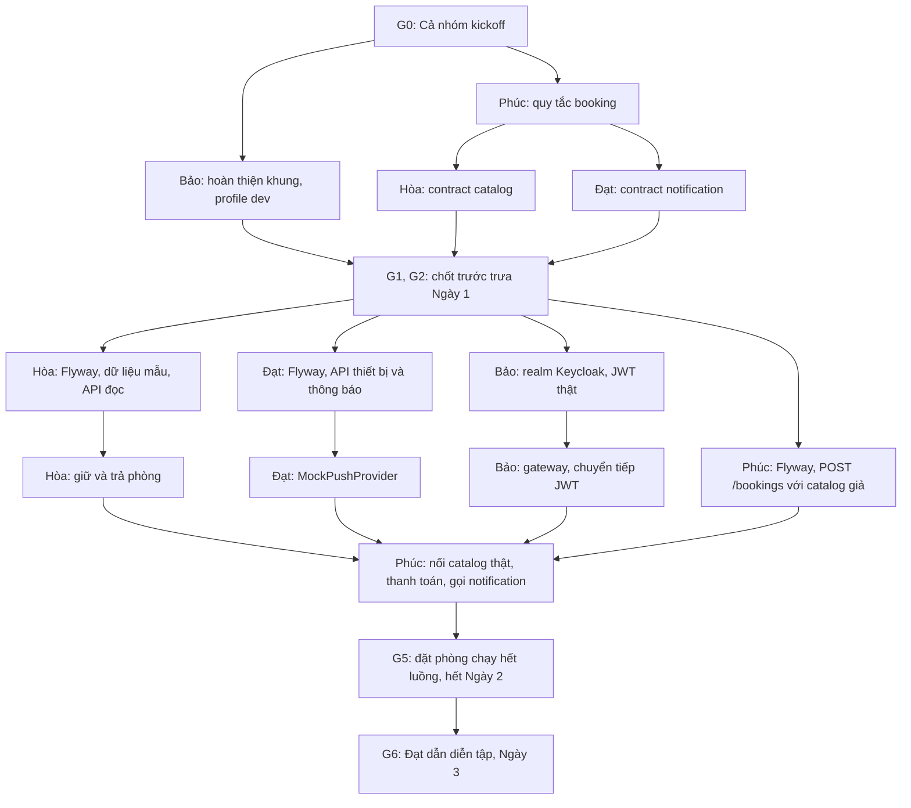

# STAYHUB — LỘ TRÌNH THỰC THI CHUNG CHO 4 THÀNH VIÊN (A / B / C / D)

> **Phiên bản:** 1.1 — bản 1.0 do Đạt soạn theo `team-plan.md`; bản 1.1 gộp hiện trạng khung Bảo đã dựng và thứ tự công việc (§0.4, §0.5), ngày 02/11/2026  
> **Thời lượng:** 03 ngày làm việc, 04 thành viên; các mốc giờ là **giờ làm việc tương đối** (có thể dời đồng bộ cho cả nhóm).  
> **Trạng thái:** Sẵn sàng dùng để giao việc sau khi hoàn thành **G0 — Kickoff**.  
> **Mục đích:** Mỗi người đọc đúng mục A/B/C/D để biết **làm gì → cần gì từ người khác → giao gì → điều kiện qua bước**.  
> **Vai trò tài liệu:** Đây là bản thực thi chính. `team-plan.md` giữ phạm vi, kiến trúc và checklist việc.  
> **Căn cứ chính:** Kế hoạch nhóm `team-plan.md` do thành viên đề xuất. Các điểm mới về phối hợp, test và tiêu chí bàn giao được ghi dưới dạng **quy tắc thực thi/đề xuất phải chốt**; không mặc nhiên là yêu cầu mentor bổ sung.

---

## 0. Đọc trong 5 phút — cả nhóm phải hiểu giống nhau

### 0.1 Mục tiêu cuối ngày 3

Chạy **một luồng demo end-to-end** qua **4 ứng dụng**:

1. Mở hai trang HTML demo ở **hai origin/port khác nhau**; dùng **Keycloak** (thay V-ID trong demo) để chứng minh **OIDC Authorization Code + PKCE S256** và **SSO**.
2. Dùng JWT có `tenant_id` gọi API qua **`api-gateway`**.
3. `catalog-service` cung cấp khách sạn, loại phòng và tồn kho theo ngày **đúng tenant**.
4. `booking-service` gọi Catalog để **hold phòng**, tạo booking **`PENDING`**, rồi gọi API **thanh toán giả lập** để đổi sang **`CONFIRMED`**.
5. `booking-service` gọi `notification-service`; thông báo được ghi vào inbox và xử lý qua **`MockPushProvider`** (không tuyên bố đã gửi push tới điện thoại thật).
6. Demo **Idempotency-Key**, **hai yêu cầu tranh phòng cuối cùng**, **truy cập chéo tenant bị chặn**, **Flyway history** và **unit tests**.

**Giới hạn giữ nguyên kế hoạch gốc:** Đây là **backend/microservices demo có trang HTML tối giản để thử SSO**, **không phải website booking đầy đủ**. Không làm Kubernetes, Kafka, service discovery, thanh toán thực, app mobile. Nghiệp vụ mua vé: **tìm hiểu, chưa code** trừ khi dư thời gian.

### 0.2 Không đổi kiến trúc và quyền chủ trì

| Thành viên | Chủ trì | Thành phần/đầu ra chính |
|---|---|---|
| **A: Bảo** | IAM & nền tảng | Gradle multi-project; `api-gateway` (8080); Keycloak (8180); `common-security`; 2 HTML client demo SSO/PKCE |
| **B: Hòa** | Dữ liệu & tenant | `catalog-service` (8081), `catalog_db`; Flyway; Hotel/Room/Inventory; tenant isolation; hold/release |
| **C: Phúc** | Booking | `booking-service` (8082), `booking_db`; trạng thái; giá; idempotency; gọi Catalog và Notification |
| **D: Đạt** | Notification & demo | `notification-service` (8083), `notification_db`; MockPush; inbox/token/retry; `docs/demo.http`; tổng hợp diagrams |

> `common-security` là **module thư viện dùng chung**, không phải service chạy riêng. Ba database nghiệp vụ nằm trong **cùng một PostgreSQL server** nhưng **tách database** theo plan.

### 0.3 Trật tự phụ thuộc quan trọng

- **A → B/C/D:** bản hoàn thiện khung (§0.4), quy ước chạy, Keycloak realm, token mẫu, cấu hình security. Đừng để mọi người chờ: B/C/D dùng **stub/mock** đã thống nhất khi A chưa xong.
- **B → C:** hợp đồng `availability`, `hold`, `release`; tenant/room type/price/booking period; response/error; **bằng chứng hold chống overbooking**.
- **C → D:** hợp đồng notification event/API; booking/user/tenant IDs; thời điểm chuyển `CONFIRMED`.
- **D → C:** endpoint notification ổn định và quy tắc mock **không làm fail booking**.
- **B + A → D:** dữ liệu demo và danh tính tài khoản để viết `docs/demo.http` chính xác.
- **Tất cả → D:** diagram đúng theo code và bằng chứng test để gom vào tài liệu demo.

**Nguyên tắc chặn xung đột:** Không tự đổi tên endpoint, JSON field, role, `tenant_id`, trạng thái, port, database hoặc luật giữ phòng. Người muốn thay đổi phải viết đề xuất vào issue/PR, nhận xác nhận từ **bên cung cấp và bên sử dụng API**, cập nhật contract **trước** khi sửa code.

### 0.4 Hiện trạng khung Bảo đã dựng trên `main`

**Đã kiểm tra:** `gradlew build` thành công với JDK 21, dù chưa có test nào. Lần build đầu trên một máy mất khoảng 9 phút, nên mỗi người nên chạy trước kickoff.

**Chưa kiểm tra:** chưa chạy thử service, PostgreSQL và Keycloak, vì Docker chưa bật trên máy dùng để kiểm tra.

Vì khung đã có, việc đầu tiên của Bảo là hoàn thiện các điểm sau:

| Điểm cần xử lý | Vì sao chặn nhóm |
|---|---|
| `docker-compose.yml` dùng Keycloak 25 với biến `KC_BOOTSTRAP_ADMIN_*` | Biến này có vẻ chỉ có từ bản 26, nên bản 25 có thể không tạo tài khoản admin (chưa chạy thử). Nếu không đăng nhập được, hãy đổi sang `KEYCLOAK_ADMIN`, `KEYCLOAK_ADMIN_PASSWORD`, hoặc nâng lên bản 26 |
| Chưa có realm `hotelbooking` | Các service đang trỏ `issuer-uri` vào realm này, nên chưa lấy được token |
| Service đã có Spring Security nhưng `common-security` còn trống | Mọi API sẽ đòi xác thực, nên Hòa, Phúc, Đạt không gọi thử được |
| `package-info.java` khai báo `com.hotelbooking.common` nhưng nằm trong thư mục `security` | Package sai với thư mục |
| Class trong `com.hotelbooking.security` nằm ngoài phạm vi quét của `@SpringBootApplication` | Bean trong `common-security` sẽ không được nạp nếu không đăng ký thêm |
| Gateway chưa có route cho `/devices` | Đạt không gọi được API thiết bị qua gateway |

### 0.5 Ai làm trước, ai chờ ai



| Lượt | Khi nào | Ai làm trước | Xong thì mở khóa cho |
|---|---|---|---|
| 0 | Đầu Ngày 1 | Cả nhóm: kickoff, chốt tenant ID và tên claim | Tất cả |
| 1 | Sáng Ngày 1 | Bảo: hoàn thiện khung. Phúc: quy tắc booking | Hòa và Đạt viết contract theo quy tắc của Phúc |
| 2 | Trước trưa Ngày 1 | Hòa, Phúc, Đạt: contract | Cả 3 service code độc lập |
| 3 | Chiều Ngày 1 | Hòa, Phúc, Đạt: Flyway và API đầu tiên. Bảo: realm, JWT | Cuối ngày, cả nhóm có token thật và ID dữ liệu mẫu |
| 4 | Sáng Ngày 2 | Hòa: giữ và trả phòng. Đạt: API thông báo thật. Bảo: gateway | Phúc nối service thật |
| 5 | Trưa đến hết Ngày 2 | Phúc: nối luồng chính. Những người khác hỗ trợ | Đạt hoàn thiện `docs/demo.http` |
| 6 | Ngày 3 | Mỗi người: test và sơ đồ. Đạt: gom và dẫn diễn tập | Demo |

**Hai chỗ Phúc phải chờ:** `hold` của Hòa và API thông báo của Đạt, nên hai phần này cần merge sớm vào sáng Ngày 2. Trong lúc chờ, Phúc dùng `CatalogClient` và `NotificationClient` giả theo contract (§10.2).

**Trước khi bắt đầu, mỗi người:** chạy `git pull` trên `main`, kiểm tra `java -version` ra JDK 21 và `JAVA_HOME` đã đặt, bật Docker Desktop, rồi chạy `gradlew build`.

---

## 1. Các mốc GATE — chỉ được kết luận “xong bước” khi đủ bằng chứng

| Gate | Thời điểm tối đa | Người chốt | Điều kiện PASS (bắt buộc) | Nếu FAIL |
|---|---|---|---|---|
| **G0 — Kickoff** | Ngày 1, 09:00–10:00 | Cả 4 | Chốt người A/B/C/D, phiên bản framework, dữ liệu tenant, API contract tối thiểu, quy tắc Git, lịch check-in và các quyết định ở §2 | Chưa được viết API phụ thuộc contract; được tạo skeleton/mock độc lập |
| **G1 — Foundation** | Ngày 1, **trước 12:00** | A (B/C/D xác nhận) | Khung trên `main` build được; các điểm ở §0.4 đã xử lý, trừ realm và JWT thật (làm chiều Ngày 1); có `TenantContext` và profile `dev`; mỗi người chạy được service của mình theo README; ports/DB names đã chốt; không có secret trong Git | B/C/D vẫn code theo stub/contract; A tập trung gỡ nghẽn khung |
| **G2 — API Contract Freeze** | Ngày 1, **trước 12:00** | B + C + D + A ký nhận | Có bảng API + request/response/error, tenant/JWT, hold/release, booking/pay, notification. Ví dụ JSON hợp lệ; mỗi người xác nhận đã đọc | Không viết logic tích hợp thực; dùng mock interface tạm và mở blocker |
| **G3 — End of Day 1** | Ngày 1, 18:00 | A phối hợp cả nhóm | 4 service chạy riêng, Keycloak phát JWT có claim đã chốt; Flyway V1 của 3 DB chạy; endpoint health/hello và các mock gọi được; các PR cần tích hợp đã merge | Sang ngày 2 chỉ giải quyết blocker, hoãn tính năng phụ |
| **G4 — Mid Day 2 Integration** | Ngày 2, 12:00 | C (B/A/D xác nhận) | Gateway → Booking → Catalog thực chạy được cho **hold → `PENDING`**; JWT/tenant đúng; D nhận được request mẫu từ C (mock hoặc thực) | Đóng băng thay đổi không thiết yếu; dùng test sớm từng cạnh API |
| **G5 — End of Day 2** | Ngày 2, 18:00 | C + A + B + D | Luồng login → hold/PENDING → pay/CONFIRMED → notification/inbox qua gateway chạy được; test tenant và overbooking có ít nhất một trường hợp PASS; `./gradlew build` qua | Cắt theo đúng thứ tự §10 trước khi sang ngày 3 |
| **G6 — Demo Ready** | Ngày 3, 15:00 (freeze) | Cả nhóm | Full demo tại §9 chạy hai lần liên tiếp; test/build xanh; diagrams khớp code; demo.http chạy đúng; README nêu rõ mock vs thật; mỗi thành viên trả lời được stack mình không chủ trì | Không thêm tính năng; sửa lỗi P0 hoặc dùng fallback đã công bố |

**Định nghĩa “PASS”:** Có **đường dẫn commit/PR đã merge**, **lệnh chạy**, **log hoặc HTTP response có thể tái hiện**, và **người nhận bàn giao xác nhận**. Chỉ nói “em code xong rồi” hoặc screenshot riêng lẻ **chưa đủ**.

---

## 2. G0 — Quyết định phải chốt trong 60 phút kickoff

**09:00–09:15 — Trách nhiệm và môi trường**

- [x] Đã gán vai: Bảo (A), Hòa (B), Phúc (C), Đạt (D).
- [ ] Phân công người chủ trì cuộc họp (đề nghị Đạt ghi biên bản), người merge PR, giờ check-in (ví dụ 09:00 / 12:00 / 17:30).
- [ ] Tất cả máy có JDK 21, Docker, Git, môi trường chạy Gradle wrapper; thử lệnh `java -version`, `docker version`, `./gradlew --version` / `gradlew.bat --version`.
- [x] Bảo đã dựng khung trên `main`: 5 module, bỏ `app`, `list`, `utilities`, thêm Docker Compose.
- [ ] Xác nhận giữ phiên bản trong khung: Java 21, Gradle 9.8.2, Spring Boot 3.3.5, Spring Cloud 2023.0.3 (đã build qua). Boot 3.3.5 đã cũ, nhưng đề xuất giữ để không mất thời gian trong 3 ngày và nêu rõ phiên bản khi hỏi AI. Ghi vào `docs/decisions.md`.

**09:15–09:35 — Danh tính, tenant và nghiệp vụ**

- [ ] Thống nhất **2 tenant ID chính xác**, hai tài khoản CUSTOMER, ít nhất một HOTEL_ADMIN/tenant, **role trong JWT**, claim `tenant_id`, `sub` và seed IDs dùng chung. A chịu trách nhiệm phát **bảng mapping** cho B/C/D (không gửi mật khẩu thật vào Git).
- [ ] Quyết định rõ theo **plan gốc**: demo mỗi tài khoản thuộc **một tenant**; API đọc Catalog và Booking hoạt động trong tenant từ JWT. **Không âm thầm mở rộng** thành khách đặt được xuyên tenant; đây là điểm cần đổi scope/thiết kế nếu sau này muốn làm website booking chung nhiều khách sạn.
- [ ] Thống nhất giá/đêm, `room_type`, `room_inventory` theo ngày, múi giờ khách sạn, cách tính số đêm, ngày demo; ai seed dữ liệu.
- [ ] Thống nhất điều kiện hủy: trạng thái nào được hủy, có giải phóng hold/inventory hay không, có quy tắc thời hạn hủy không. Plan gốc chưa đặc tả đầy đủ, **C phải ghi quyết định** trước khi code logic hủy.

**09:35–09:50 — Hợp đồng kỹ thuật tối thiểu**

- [ ] Ký nhận API list tại §3 (nhất là `hold/release`, `Idempotency-Key`, `/pay`, `/internal/notifications`). Chọn payload JSON thực tế, HTTP status, ProblemDetail error code.
- [ ] Chốt `hold` được liên kết với booking bằng khóa nào (`holdId`/`reservationRef`), cách gọi **release idempotent**, xử lý hold thành công nhưng lưu booking lỗi, và việc tồn kho nhiều ngày phải cập nhật **nguyên tử**.
- [ ] Chốt hành vi khi notification service lỗi: **booking `CONFIRMED` không rollback**; ghi nhận lỗi và mô tả phần chưa đảm bảo trong demo. D thống nhất mã phản hồi với C.
- [ ] Chốt cơ chế bảo vệ `/internal/**`: gateway không expose, service không chấp nhận tự do request nội bộ từ client; ghi rõ mức bảo vệ **demo-local** và giới hạn security nếu còn lỗ hổng.

**09:50–10:00 — Git và lịch giao tiếp**

- [ ] `main` chỉ nhận PR; branch `feat/a-*`, `feat/b-*`, `feat/c-*`, `feat/d-*`, `docs/*`; PR cần ít nhất một người khác review.
- [ ] Phân định **chủ sở hữu file**: A kiểm soát root Gradle/Compose/Keycloak/common-security/Gateway; B kiểm soát Catalog + migration Catalog; C Booking; D Notification + `docs/demo.http`; tài liệu `docs` thay đổi qua PR.
- [ ] Chốt thứ tự ưu tiên cắt giảm ở §10, mốc G1–G6 và kênh báo blocker.

**Output G0:** `docs/decisions.md` có ngày/owner/quyết định; `docs/api-contract.md` (hoặc OpenAPI YAML) được cả 4 phản hồi “đồng ý”; danh sách Issues có owner. **G0 không PASS khi còn bỏ trống các trường khiến API không tương thích.**

---

## 3. API contract và dữ liệu bàn giao chung (chốt trước trưa ngày 1)

> **Quan trọng:** Bảng dưới là **danh sách interface theo plan gốc**, không tự coi những JSON minh họa là schema chính thức. Bên **cung cấp API** soạn request/response + status + example; bên **gọi API** kiểm tra và ký nhận. Lưu bản chốt trong `docs/api-contract.md` trước G2.

| Interface | Cung cấp → Sử dụng | Điều bắt buộc phải chốt |
|---|---|---|
| `GET /hotels` | **B → A/D** | Có yêu cầu auth không? Danh sách mặc định lọc tenant JWT; field `hotelId`, `tenantId`, tên, active, dữ liệu seed |
| `GET /hotels/{id}/availability?checkIn&checkOut` | **B → C/D** | Hình thức ngày ISO `YYYY-MM-DD`; tồn kho theo **từng ngày**; ID `roomTypeId`, giá, `available`, lỗi 400/404 |
| `POST /hotels` | **B → A** | Chỉ `HOTEL_ADMIN`; 401/403; không để client tự gán tenant |
| `POST /internal/inventory/hold` | **B → C** | Tenant từ JWT đã xác minh, roomType, checkIn/out, quantity, `holdId/reservationRef`, idempotency; response giữ thành công/409 |
| `POST /internal/inventory/release` | **B → C** | Key định danh hold đã cấp, rollback từng ngày, tránh release trùng khiến tồn kho vượt tổng lượng |
| `POST /bookings` | **C → A/D** | Header `Idempotency-Key`; input room/date/guest; server tính price; response 201 `bookingId`, status `PENDING`; lỗi 400/401/409 |
| `GET /bookings/{id}` | **C → A/D** | Tự kiểm tra `tenant_id` và quyền; không lộ booking khác tenant |
| `POST /bookings/{id}/pay` | **C → A/D** | Thanh toán **giả lập**, chuyển `PENDING`→`CONFIRMED`; xử lý gọi lại, lỗi trạng thái, notify best-effort |
| `POST /bookings/{id}/cancel` | **C → A/D/B** | Hủy từ trạng thái hợp lệ; release tồn kho đúng lần; HTTP lỗi hợp đồng; **có thể cắt nếu trễ** theo plan |
| `POST /devices` / `DELETE /devices/{token}` | **D → A** | `user sub` + tenant lấy từ JWT; token mẫu; token không phải secret production |
| `GET /notifications` | **D → A** | Chỉ xem inbox của chủ token/người dùng thuộc tenant; định dạng trả về; sort theo tạo mới nhất |
| `POST /internal/notifications` | **D → C** | `bookingId`, `eventType`, `recipientSub`, `tenantId`, `eventId` chống gửi trùng; response 2xx hoặc lỗi; C không rollback booking do lỗi này |

**Đường dẫn qua gateway theo cấu hình hiện tại:** `/api/catalog/hotels` tới `/hotels`, `/api/bookings/...` tới `/bookings/...`, `/api/notifications` tới `/notifications`. Bảo thêm `/api/devices/...` tới `/devices/...`.

**Checklist contract của TỪNG endpoint:** method/path; public/private/internal; scope tenant và role; headers; request mẫu; success response mẫu; `ProblemDetail` cho lỗi; ai gọi; có cần retry/idempotency; test ví dụ bằng curl hoặc HTTP file.

### 3.1 Tài nguyên/seed dùng chung — không cho mỗi service tự nghĩ ID

Tạo `docs/demo-data.md` một lần và khóa tại G2, gồm tối thiểu:

| Trường | Nguồn thật | Ai cung cấp | Ai cần |
|---|---|---|---|
| Tenant IDs/roles, JWT claims, usernames | Keycloak realm | **A** | **B, C, D** |
| `hotelId`, `roomTypeId`, số phòng khả dụng/ngày, giá, ngày demo | `catalog_db` Flyway seed | **B** (A phối hợp mapping tenant) | **C, D, A** |
| `bookingId`, header Idempotency-Key, trạng thái, số tiền | Booking API | **C** | **A, D** |
| User/token giả lập; `eventType`, notification ID/status | Notification API | **D** | **C, A** |

**Khuyến nghị dữ liệu xác định để tái hiện:** 2 tenant; mỗi tenant có 1 khách sạn mẫu; ít nhất 1 loại phòng với số lượng = 1 trong ngày demo để chạy test tranh phòng; thêm 1 loại phòng còn chỗ để chạy happy-path. Dùng ngày tương lai so với ngày demo, chốt lại trước khi chạy test. **Không dùng chung ID hard-code trong source nếu seed và realm chưa thống nhất.**

### 3.2 Những vấn đề kỹ thuật phải được ghi là “đã giải” hoặc “giới hạn demo”

1. **Giữ chỗ nhiều ngày:** Hold phải kiểm tra và cập nhật đầy đủ các ngày lưu trú trong **một transaction của Catalog**; không được có trường hợp trừ tồn kho được hai ngày đầu nhưng không trừ ngày cuối.
2. **Giữ chỗ thất bại hoặc booking lưu DB thất bại:** C phải gọi release/compensation và log correlation; release thực hiện lặp lại không được tăng tồn kho hai lần.
3. **Không có tự hết hạn hold trong plan bắt buộc:** Đây là **giới hạn** khi user bỏ ngang `PENDING`, request mạng bị mất và compensation thất bại. Phải công bố rõ, có script reset/seed lại môi trường demo; không khẳng định đã xử lý đầy đủ distributed transaction.
4. **`Idempotency-Key`:** Phải chốt uniqueness theo `(tenant_id, customer/sub, key)` hoặc cơ chế tương đương, hành vi khi retry cùng payload và khi dùng cùng key với payload khác; tuyệt đối không để tạo booking thứ hai vì network retry.
5. **Tenant security:** `@TenantId` giúp lọc ORM trong ngữ cảnh đúng, nhưng SQL native phải tự thêm tenant predicate; không tin header/client truyền tenant. REST internal không tự coi là bảo mật chỉ vì tên `/internal`.
6. **Không gửi “đã push thành công” giả:** Log/inbox và `MockPushProvider` là giả lập; muốn gọi là push thật phải có client/device và provider thực tế.
7. **Giữ nhất quán hợp đồng:** Nếu `pay` thành công nhưng notify lỗi, booking vẫn `CONFIRMED`; log/record lỗi notification để D điều tra. Không trả một lỗi khiến client tưởng thanh toán thất bại rồi tự trả phòng.

---

## 4. Lộ trình chi tiết — THÀNH VIÊN A: BẢO (IAM & PLATFORM)

**Bạn sở hữu:** root build, Gradle convention, Docker Compose, Keycloak, `common-security`, gateway và 2 trang HTML. **Không tự sửa entity/contract trong Catalog, Booking, Notification khi chưa có đồng ý từ chủ service.**

### Ngày 1 — Kết cấu và phát JWT

| Mốc | Việc A phải làm theo thứ tự | Cần nhận trước | Output để bàn giao | Điều kiện chốt |
|---|---|---|---|---|
| **09:00–10:00** | Tham gia G0; kiểm tra repo hiện có; chốt Java/Gradle/Boot/Cloud; cùng B/C/D chốt ports, claims/roles và contract | Repo, thông tin máy các thành viên | `docs/decisions.md` phần platform; phiên bản đã khóa | Không còn bất đồng phiên bản, port, claim/role |
| **10:00–11:00** | Hoàn thiện khung theo §0.4: Keycloak admin, `package-info`, nạp bean `common-security`, route `/api/devices/**` | G0 | PR hoàn thiện khung | `gradlew build` qua; Compose chạy và đăng nhập được Keycloak admin |
| **11:00–12:00** | Thêm `TenantContext` và profile `dev` (TEST ONLY, mặc định tắt, tenant cố định); viết README chạy local; chạy thử các service | B/C/D xác nhận DB names, ports | PR nền tảng được merge và B/C/D chạy thử | **G1 PASS**: mọi người chạy được service của mình theo hướng dẫn và gọi được API bằng profile `dev` |
| **13:00–15:00** | Cấu hình realm Keycloak, 2 tenant, role `CUSTOMER`/`HOTEL_ADMIN`, claim `tenant_id`, 2 public clients PKCE S256; export realm | G0: tenant IDs, origins, redirect URIs | `docker/keycloak` realm export và bảng tài khoản demo ở `docs/demo-data.md` | Đăng nhập thành công, lấy access token có `sub` + `tenant_id`/role đúng; không commit secret |
| **15:00–17:00** | `common-security`: JWT validation/issuer/JWKS, extraction `TenantContext`, role mapping; hỗ trợ chuyển tiếp Bearer token khi REST call | Keycloak realm chạy; contract auth | Shared module dùng được trong B/C/D; ví dụ cấu hình | Test token hợp lệ/không hợp lệ, sai tenant claim; B/C/D dùng được bằng cách import |
| **17:00–18:00** | `api-gateway`: routes cho 3 service, xác minh JWT, chặn `/internal/**` ở gateway; smoke test; gửi evidence G3 | B/C/D service health URL | Route qua 8080; `docs/routes.md` hoặc mục trong README | Gateway chuyển request đúng; 401 với API cần auth khi thiếu JWT; G3 hỗ trợ PASS |

**Handoff A bắt buộc trước 12h:** bản hoàn thiện khung đã merge hoặc PR có commit build được, profile `dev` và hướng dẫn config môi trường. **Không để B/C/D phải chờ Keycloak hoàn chỉnh mới bắt đầu viết domain code**.

### Ngày 2 — Kiểm chứng SSO/PKCE và tích hợp security

| Mốc | Việc A phải làm | Cần từ người khác | Output/điều kiện chốt |
|---|---|---|---|
| **09:00–11:00** | Viết 2 HTML client demo ở 2 origin/port, Authorization Code + PKCE S256; xem `code_challenge` và chứng minh SSO | D danh sách bước demo; Keycloak redirect URIs đã chốt | Mở trang 1 đăng nhập; mở trang 2 cùng browser không cần nhập lại mật khẩu; không lộ `code_verifier` ngoài luồng hợp lệ |
| **11:00–12:00** | Test truy cập qua Gateway; sửa role/tenant extraction; giúp C test forwarded JWT | B/C trả API /health và API private, C endpoint booking | Token đúng đi tới service; thiếu/invalid token bị từ chối; claim thiếu không được coi là tenant mặc định |
| **13:00–16:00** | Tích hợp `common-security` cho B/C/D, JWT forwarding khi C gọi B/D; phân quyền `HOTEL_ADMIN` và CUSTOMER | B/C/D đã import module hoặc nêu lỗi | Không có nhánh service bỏ qua JWT để chạy demo thật; phân biệt rõ stub/local test |
| **16:00–18:00** | Chạy end-to-end cùng cả nhóm, sửa lỗi gateway/issuer/CORS/redirect; nộp sequence diagram PKCE bản đầu | C luồng booking, D mock inbox | SSO + API gọi qua gateway PASS, đóng issues blocker A; góp phần G5 |

### Ngày 3 — Chốt bảo mật và chứng cứ mentor

| Mốc | Việc A phải làm | Output/điều kiện chốt |
|---|---|---|
| **09:00–11:00** | Test `401` thiếu token, token lỗi/hết hạn; test thiếu `tenant_id`, role không phù hợp; kiểm tra `/internal/**` không mở trên gateway | Lưu lệnh/response test; không có endpoint public ngoài dự kiến |
| **11:00–12:00** | Rà `docs/security-pkce-sequence.md`, phiên bản dependency, secrets/config; xác nhận 2 client thực sự PKCE S256 | Sequence khớp thực thi; không commit credential thật |
| **13:00–15:00** | Làm người dẫn phần PKCE/SSO trong demo, thử từ môi trường sạch; hỗ trợ G6 | Demo 2 lần PASS; nộp evidence và hướng dẫn restart |
| **15:00–18:00** | Freeze; hỏi chéo các stack Flyway/booking/push; sửa duy nhất lỗi P0 | Xác nhận đã hiểu API và luồng chung; không thêm tính năng |

**Lưu ý riêng A:** (1) A phải công bố cấu trúc thư mục sớm nhất vì ảnh hưởng cả nhóm; (2) A chỉ cung cấp tenant ID, còn **B viết và sở hữu migration dữ liệu mẫu của Catalog**; (3) Gateway chặn route không thay cho auth ở service/internal network; (4) không hard-code `tenant_id` mặc định trong môi trường demo thật; (5) đừng ôm thêm full website UI; (6) gateway là reactive, 3 service là servlet, nên không dùng chung một class cấu hình security.

---

## 5. Lộ trình chi tiết — THÀNH VIÊN B: HÒA (CATALOG, FLYWAY & MULTI-TENANCY)

**Bạn sở hữu:** `catalog-service`, `catalog_db`, `hotel`, `room_type`, `room_inventory`, `@TenantId`, API Catalog và inventory hold/release. **B là người có quyền chốt seed/migration Catalog.**

### Ngày 1 — Schema và API Contract

| Mốc | Việc B phải làm theo thứ tự | Cần nhận trước | Output để bàn giao | Điều kiện chốt |
|---|---|---|---|---|
| **09:00–10:00** | G0; chốt tenant IDs, kiểu phòng, cách tính inventory theo ngày, giá và mapping role | A cung cấp naming; C cung cấp nhu cầu booking | Bản domain model tối thiểu gửi C và D | Đủ thông tin thiết kế schema và payload hold |
| **10:00–12:00** | Viết contract `GET /hotels`, availability, `hold`, `release` (ưu tiên internal API B↔C); quy ước tên migration; thống nhất lỗi | C nhu cầu request, A tenant claim | `docs/api-contract.md` phần Catalog; `docs/demo-data.md` phần hotel/room | **G2 PASS**: C xác nhận contract và nhận JSON ví dụ |
| **13:00–15:00** | Tạo `catalog_db`, Flyway `V1__...` cho `hotel`, `room_type`, `room_inventory`; PK/FK/unique theo tenant, ngày; cài `@TenantId` | A skeleton + JDBC env | Migration chạy DB mới, có `flyway_schema_history` | Có schema và seed thử; restart không fail checksum |
| **15:00–17:00** | API đọc Hotel và Availability, seed ít nhất 2 tenant và ngày demo; tenant filter | A claim/`TenantContext` hoặc tạm stub | `GET /hotels`, availability chạy với JSON đúng contract | Tenant 1 chỉ thấy dữ liệu tenant 1 theo plan; khoảng ngày hợp lệ |
| **17:00–18:00** | Gửi Catalog API và seed IDs cho C/D; PR + test smoke; phối hợp G3 | A auth sơ bộ | C nhận request mẫu và dữ liệu tồn kho thật | Bản code chạy trong service của B, không chỉ mock |

### Ngày 2 — Hold/release và kiểm thử tranh tồn kho

| Mốc | Việc B phải làm | Cần từ người khác | Output/điều kiện chốt |
|---|---|---|---|
| **09:00–11:00** | Implement `POST /internal/inventory/hold`, cập nhật điều kiện `available >= quantity`, transaction bao phủ từng ngày của kỳ lưu trú | C hold payload/`reservationRef` đã chốt, A TenantContext | 1 hold thành công giảm đúng số chỗ **mọi đêm**; ngày bất kỳ thiếu chỗ → **không ngày nào bị trừ** |
| **11:00–12:00** | Implement `release`, không cộng lại hai lần; cung cấp bộ thử cURL/HTTP cho C; kết nối C thật | C client nội bộ; A JWT forwarding | C gọi được hold/release, lỗi 409 theo ProblemDetail; **G4 PASS** ở cạnh C↔B |
| **13:00–15:00** | `@TenantId` trong ORM, tenant predicate cho native SQL; `POST /hotels` role `HOTEL_ADMIN` | A role claims, C test payload | Cross-tenant read/write bị chặn; `POST /hotels` CUSTOMER nhận 403 |
| **15:00–17:00** | Test concurrency: hai request tranh suất cuối (capacity=1), ít nhất 1 thành công và 1 bị từ chối; kiểm tra inventory không âm | C chạy concurrent test và cung cấp correlation IDs | DB cuối cùng có lượng tồn hợp lệ; log/HTTP chứng minh không oversell |
| **17:00–18:00** | Hoàn thiện unit/integration tests, PR, sơ đồ tenant/query và cập nhật seed ID | D kịch bản demo | B đủ bằng chứng cho G5; các test lặp lại ổn định |

### Ngày 3 — Xác nhận migration, tenant và inventory

| Mốc | Việc B phải làm | Output/điều kiện chốt |
|---|---|---|
| **09:00–11:00** | Chạy lại từ DB sạch; kiểm tra Flyway history, seed hai tenant, test availability và hold/release | Có lệnh reset DB an toàn trong README; không cần thao tác tay bí mật |
| **11:00–12:00** | Test tenant 1 không đọc/sửa tenant 2 (ORM và native), race condition, release lặp | Có response 403/404/409 và snapshot DB, không oversell |
| **13:00–15:00** | Nộp diagram `docs/sequence-tenant.md`, xác nhận script demo của D dùng ID đúng | Diagram và test khớp code, G6 PASS |
| **15:00–18:00** | Freeze; hỗ trợ C nếu hold/release còn lỗi P0; hỏi chéo các stack khác | Không merge tính năng mới |

**Lưu ý riêng B:** (1) `room_inventory` là **theo ngày**, không phải một cờ `isBooked`; (2) xác định khoảng ngày `[checkIn, checkOut)` và inventory đêm check-in đến trước check-out; (3) khi dùng SQL native không được quên tenant; (4) `UPDATE ... WHERE available >= n` trên từng row là cần nhưng **chưa đủ** nếu cập nhật nhiều ngày ngoài transaction; (5) tránh hai người cùng sửa Flyway Catalog; (6) nếu A chưa có auth, tạm dùng stub **được đánh dấu TEST ONLY**, bỏ trước G5.

---

## 6. Lộ trình chi tiết — THÀNH VIÊN C: PHÚC (BOOKING-SERVICE & BUSINESS LOGIC)

**Bạn sở hữu:** `booking-service`, `booking_db`, API Booking, idempotency, state machine, tính tiền, giữ/trả tồn kho qua B và gửi sự kiện cho D.

### Ngày 1 — Nghiệp vụ và booking skeleton

| Mốc | Việc C phải làm theo thứ tự | Cần nhận trước | Output để bàn giao | Điều kiện chốt |
|---|---|---|---|---|
| **09:00–10:00** | G0; chủ trì quyết định booking lifecycle `PENDING`→`CONFIRMED`/`CANCELLED`; chính sách cancel, pay giả lập, price snapshot, no-show/refund chỉ ghi chú | B inventory model; D notification events | Một trang `docs/booking-policy.md` có rules đã chốt | B/D hiểu khi nào hold, release, notify; không có trạng thái ngầm |
| **10:00–12:00** | Viết contract `POST /bookings`, GET, `/pay`, `/cancel`, Idempotency-Key; ký nhận `hold/release` B và `POST /internal/notifications` D | A auth claim; B/D JSON examples | Contract booking + lỗi 400/401/403/409 và trạng thái | **G2 PASS**: B, D, A đều xác nhận dữ liệu bắt buộc |
| **13:00–15:00** | Tạo `booking_db`, Flyway `V1__...`: booking có `tenant_id`, customer/sub, roomType, dates, price snapshot, `holdId`, status, key; unique cho idempotency | A skeleton, B ID/price fields | DB khởi động & migration chạy, một booking thử persist được | Snapshot trường hợp hợp lệ; không truyền tổng tiền từ client như giá thật |
| **15:00–17:00** | Implement `POST /bookings` với **Catalog mock client**; validate ngày, số lượng, calculate nights/total; trả `201 PENDING` | B response giả lập đã ký | API chạy với stub; unit tests state/validation đầu tiên | Không tạo trùng khi replay cùng key trong cùng scope |
| **17:00–18:00** | Tạo client interface gọi B và D, nộp PR; chia sẻ sample request/response cho D | A JWT config hoặc mock | Service C chạy độc lập, có thể demo POST với fake Catalog | G3 đạt mức skeleton, không chặn B bởi việc C chưa tích hợp |

### Ngày 2 — Tích hợp booking / payment giả lập / notification

| Mốc | Việc C phải làm | Cần từ người khác | Output/điều kiện chốt |
|---|---|---|---|
| **09:00–11:00** | Thay Catalog mock bằng REST thực; hold trước khi lưu `PENDING`, gửi Bearer JWT, bảo toàn `tenant_id` | B endpoint hold thật và demo inventory, A JWT forwarding | Happy path tạo booking 201 PENDING, inventory giảm; lỗi hết phòng → 409, không có booking |
| **11:00–12:00** | Bổ sung release khi lưu booking thất bại; chốt idempotency retry/key trùng payload khác; test call B | B release idempotent | Đủ bằng chứng cho **G4**: không có hold “mồ côi” ở đường lỗi đã test |
| **13:00–15:00** | Implement `/pay` giả lập: chỉ PENDING→CONFIRMED; không thanh toán thật; gửi event sau xác nhận; notification lỗi không rollback payment | D endpoint notification/inbox; A auth | `200 CONFIRMED` và D có notification, thử notification lỗi vẫn CONFIRMED |
| **15:00–16:30** | Implement GET booking/ownership, `/cancel` + release đối với chuyển trạng thái hợp lệ; khóa/cạnh tranh vừa đủ để không trả tồn kho hai lần | B release; G0 cancel policy | Truy cập sai tenant/owner bị chặn; state sai → 409; cancel thành công hoàn inventory |
| **16:30–18:00** | Chạy API qua Gateway và full flow; viết unit tests state/error/idempotency; mở PR và demo G5 | A gateway/roles; B inventory; D notification | End-to-end xanh, retry cùng key không tạo booking thứ hai; G5 PASS |

### Ngày 3 — Kiểm tra tính nhất quán và hoàn thiện demo

| Mốc | Việc C phải làm | Output/điều kiện chốt |
|---|---|---|
| **09:00–11:00** | Test cùng key 2 lần, cùng key khác payload, hold thất bại, booking lưu thất bại, `/pay` lặp, notify lỗi, trạng thái không hợp lệ | Test xanh hoặc giới hạn ghi rõ; no duplicate bookings, no unintended rollback |
| **11:00–12:00** | Chạy tranh suất cuối cùng cùng B; kiểm tra booking IDs/tenant match, release idempotent | Chỉ một yêu cầu 201, một 409; inventory không âm |
| **13:00–15:00** | Hoàn thiện `docs/sequence-booking.md` có nhánh hết phòng và lỗi notify, `docs/booking-policy.md`, gửi D script | Diagram đúng route/payload thực, G6 PASS |
| **15:00–18:00** | Freeze, làm người trình bày nghiệp vụ booking và trả lời hỏi chéo | Không thêm chức năng mới |

**Lưu ý riêng C:** (1) đây là **thanh toán giả lập**, không có cổng thu tiền; (2) `PENDING` vẫn đang hold inventory — nếu client bỏ ngang, cơ chế tự hết hạn chỉ là **stretch goal** theo plan, phải nói đúng giới hạn; (3) DB Booking và DB Catalog **không chung transaction**, release chỉ là compensation best-effort; (4) xử lý notification sau khi booking `CONFIRMED` được lưu; (5) `Idempotency-Key` phải gắn đúng tenant+user để không đè dữ liệu người khác; (6) C cần bàn giao cho D cả happy path và JSON lỗi, không chỉ mã 200.

---

## 7. Lộ trình chi tiết — THÀNH VIÊN D: ĐẠT (NOTIFICATION-SERVICE & DEMO)

**Bạn sở hữu:** `notification-service`, `notification_db`, API đăng ký/xóa token, inbox, mock push, retry tối đa 3 lần và kịch bản demo. **Không chỉ viết tài liệu:** đây là một backend service thực với REST, Flyway, unit tests.

### Ngày 1 — Notification skeleton và hợp đồng với C

| Mốc | Việc D phải làm theo thứ tự | Cần nhận trước | Output để bàn giao | Điều kiện chốt |
|---|---|---|---|---|
| **09:00–10:00** | G0; ghi notes/quyết định, nắm luồng booking, phân biệt notification thật trong DB và push giả lập | C state/event, A token/roles | Danh sách event nhận từ C và test cases gửi thất bại | C biết D cần những field nào |
| **10:00–12:00** | Viết contract `POST /internal/notifications`, `POST /devices`, DELETE, GET inbox; chốt `eventId`/recipient/tenant/status; ký nhận C contract | A `sub`/JWT, C booking event | `docs/api-contract.md` phần Notification + JSON ví dụ | **G2 PASS:** C gọi mock JSON được ngay, thống nhất 2xx/5xx |
| **13:00–15:00** | Tạo `notification_db`, Flyway `V1__...` cho `device_token`, `notification`; khóa theo tenant+owner; index phục vụ inbox | A skeleton, tenant/user mapping | Migration chạy database sạch, có lịch sử; tạo/đọc notification DB được | Không lộ inbox tenant hoặc user khác |
| **15:00–17:00** | Implement `POST /devices`, `DELETE /devices/{token}`, `GET /notifications`, `POST /internal/notifications` với logging/ProblemDetail | A auth stub hoặc module, C JSON | API chạy độc lập và có request mẫu cho C | C có thể POST event; D lưu DB đúng recipient/tenant |
| **17:00–18:00** | Viết bộ file `docs/demo.http` bản nháp, nhận demo-data từ A/B/C, PR và test service | A client URLs, B seed IDs, C booking payload | D chạy được thông báo riêng, service health pass | G3: API mock nhận sự kiện không đợi payment hoàn chỉnh |

### Ngày 2 — MockPushProvider và tích hợp event

| Mốc | Việc D phải làm | Cần từ người khác | Output/điều kiện chốt |
|---|---|---|---|
| **09:00–11:00** | Viết `PushProvider` interface và `MockPushProvider`, mô phỏng token OK, token lỗi, transient failure; mapping trạng thái `PENDING`→`SENT`/`FAILED` | C `eventType`, recipient, tenant; A auth | Demo mock nhận sự kiện; log rõ `MOCK`, không giả là FCM thật |
| **11:00–12:00** | Kết nối C gọi notification thật và lưu inbox, hỗ trợ chạy G4 | C REST client/event ID | Request đúng nhận 2xx; user không có token vẫn có inbox; notification lỗi không phá booking C |
| **13:00–15:00** | Thử lại tối đa 3 lần (nếu chưa bị cắt phạm vi), loại bỏ token được xác định invalid; chống notification trùng khi C retry | C eventId, test cases | Test trạng thái/retry/token failure xanh; duplicate event không sinh duplicate inbox/push ở mức đã cam kết |
| **15:00–17:00** | Hoàn thiện `docs/demo.http`: token, hotel/availability, booking/pay, inbox, replay key, tranh tồn kho, cross-tenant; chuẩn hóa biến | A 2 token, B seed, C các response cuối cùng | D chạy tuần tự toàn bộ script trên máy mới với ít thao tác tay |
| **17:00–18:00** | Gom 4 sequence diagram bản đầu, rà với A/B/C; PR tổng hợp demo | A/B/C nộp diagram | Sơ đồ nhất quán endpoint/status/owner; G5 có thể demo bằng HTTP file |

### Ngày 3 — Kiểm thử, bằng chứng và trình diễn

| Mốc | Việc D phải làm | Output/điều kiện chốt |
|---|---|---|
| **09:00–11:00** | Test token hợp lệ/lỗi, retry, không có token nhưng inbox vẫn lưu, owner/tenant isolation; chạy `docs/demo.http` sau reset | Test xanh, log mock có event ID, inbox đúng user |
| **11:00–12:00** | Hoàn thiện `docs/sequence-notification.md`: flow thật FCM/APNs đối chiếu flow **đang mock**; gom diagrams của A/B/C; cập nhật README | Ghi rõ “MOCK/NOT IMPLEMENTED” ở phần không có thiết bị/app mobile |
| **13:00–15:00** | Dẫn buổi diễn tập; kiểm tra mỗi bước trong §9, quay lại lỗi và phân người sửa; chuẩn bị câu hỏi chéo | Hai lần demo liên tục từ state reset đều PASS; G6 PASS |
| **15:00–18:00** | Freeze; kiểm tra PR/README/demo note, dẫn phần Notification và Sequence Diagrams; hỏi chéo stack | Tất cả tài liệu có link, thao tác demo không phụ thuộc bí quyết cá nhân |

**Lưu ý riêng D:** (1) không biến notification thành điểm nghẽn booking; (2) khác biệt **inbox record ≠ push tới mobile**; (3) token demo dùng giá trị giả, không commit khóa FCM/APNs; (4) `eventId` cần chống ghi trùng khi C retry; (5) đầu ngày 2 cần có endpoint thật để C tích hợp, retry làm sau; (6) đừng chờ đủ tất cả payload mới viết skeleton và test bằng mock JSON.

---

## 8. Bảng bàn giao chéo — ai cần giao gì, trước giờ nào?

| Deadline | Bên giao → bên nhận | Artifact và cách chứng minh đã giao | Người nhận chấp nhận khi |
|---|---|---|---|
| **D1 10:00** | C → B + D | Booking state/events + field cần từ hold/notification (`docs/booking-policy.md`) | B biết hold cần trừ gì; D biết trigger notification |
| **D1 11:00** | A → B/C/D | Bản hoàn thiện khung, `TenantContext`, profile `dev` + hướng dẫn local | Chạy được service của mình và gọi được API |
| **D1 12:00** | A → B/C/D | Tenant IDs, JWT claim/role, service ports, realm/client origins dự thảo | B/C/D biết nơi lấy tenant và sub, không tự nghĩ field |
| **D1 12:00** | B → C | Contract `availability`, `hold`, `release` + JSON success/409 | C có thể viết REST client giả lập theo schema |
| **D1 12:00** | C → A/D | Contract booking/pay/status + Idempotency-Key, error codes | A định tuyến được; D viết kịch bản chuẩn |
| **D1 12:00** | D → C | Notification event contract + `eventId`, status và response | C có thể code gọi client giả lập |
| **D1 17:00** | A → B/C/D | Realm export, cách lấy token tenant1/tenant2, `common-security` dùng được | Service xác minh JWT và đọc đúng tenant |
| **D1 18:00** | B → C/D | Catalog migration chạy, seed IDs/ngày/giá; availability demo URL | C thử được roomType còn chỗ, D ghi vào demo.http |
| **D2 11:00** | B → C | Hold/release thực chạy được, có 201/409 (hoặc 200/409 theo contract) | C chứng minh tạo PENDING và conflict không oversell |
| **D2 12:00** | D → C | Notification API thật, inbox truy vấn được; test mock payload | C có thể gửi event sau pay, ngay cả chưa có retry |
| **D2 15:00** | C → D/A | Booking/pay API thực và IDs/status/lỗi cuối cùng | D script happy path và replay chạy qua Gateway |
| **D2 17:00** | A/B/C → D | Sequence Diagrams bản đầu, lệnh chạy/test, output evidence | D có thể lắp kịch bản end-to-end không đoán |
| **D3 12:00** | Tất cả → D | Final diagrams, test logs, hướng dẫn run/restart, known limitations | D freeze kịch bản, README và bằng chứng |

**Quy tắc bàn giao:** Đăng link PR/commit và HTTP request/response mẫu vào GitHub Issue; người nhận phản hồi **ACCEPTED** hoặc **BLOCKED: lý do + ai sửa + mốc cần xong**. Khi phụ thuộc chưa xong, người nhận dùng mock theo contract, không tự thay contract.

---

## 9. Kịch bản demo nghiệm thu cuối cùng (D chủ trì, A/B/C đồng thực hiện)

| # | Thao tác trình diễn | Owner dẫn | Bằng chứng chuẩn phải nhìn thấy | PASS/FAIL |
|---|---|---|---|---|
| 1 | Từ repo mới, chạy Docker/Gradle; xem 3 DB | A/B | Cả 4 app chạy; `flyway_schema_history` tồn tại riêng ở 3 DB; bản migration đúng | Không PASS nếu cần sửa DB bằng tay không ghi README |
| 2 | Trang HTML 1 OIDC + PKCE S256 | A | Redirect và `code_challenge` quan sát được; token có tenant1 và quyền đúng | Không PASS nếu frontend lưu password hoặc bỏ PKCE |
| 3 | Trang HTML 2 ở origin khác dùng SSO | A | Không phải nhập lại mật khẩu trong cùng browser session | Không PASS nếu chỉ chuyển tab cùng một trang |
| 4 | Gọi `GET /hotels`, availability qua gateway | B | Data đúng tenant và ngày còn tồn kho | Không PASS nếu client tùy ý đổi `tenant_id` để xem tenant khác |
| 5 | Tạo booking với Idempotency-Key | C | `201 PENDING`, booking DB có một row, Catalog hold giảm tồn kho đúng | Không PASS nếu response PENDING nhưng không có hold |
| 6 | Gọi `/pay` (giả lập) | C/D | Booking chuyển `CONFIRMED`, inbox notification ghi nhận, MockPush log rõ `MOCK` | Không PASS nếu notification fail làm booking bị chuyển trạng thái sai |
| 7 | Replay request booking với **cùng key và payload** | C | Không tạo thêm booking hoặc hold mới; trả kết quả được chốt trong contract | Không PASS nếu sinh thêm booking/hold |
| 8 | Hai request đồng thời tranh suất cuối | B/C | Một request có booking/hold thành công, yêu cầu còn lại `409`; DB inventory không âm | Không PASS nếu hai booking vượt capacity |
| 9 | Chuyển sang token tenant2, truy vấn tài nguyên tenant1 | A/B/C | Không đọc/ghi được dữ liệu tenant1; HTTP lỗi an toàn | Không PASS nếu lộ record do native query |
| 10 | Test không có token/role sai | A | 401/403 theo contract, API private không mở tự do | Không PASS nếu endpoint protected trả 200 |
| 11 | Push mock: invalid token, no-token, retry | D | Inbox đúng, mock status và invalid token handling có log/test; nếu retry bị cắt thì nói rõ | Không PASS nếu nói là FCM thực khi không dùng FCM |
| 12 | `./gradlew clean build` và unit tests | Cả 4 | Build xanh, test report của từng service, diagram khớp endpoints hiện tại | Không PASS nếu còn test bị skip vô lý |

**Cách chuẩn bị:** D tạo `docs/demo.http`/script với biến rõ ràng: `BASE_URL`, `TOKEN_TENANT_1`, `TOKEN_TENANT_2`, `HOTEL_ID`, `ROOM_TYPE_ID`, `CHECK_IN`, `CHECK_OUT`, `BOOKING_ID`, `IDEMPOTENCY_KEY`. **Không commit JWT/token thật**; chỉ dùng placeholder và hướng dẫn lấy token.

**Đặc biệt:** để bước 8 công bằng, cần có **một room type khác hoặc reset tồn kho**; tránh chạy bước 7/8 trên một seed đã bị bước 5 chiếm hết làm test sai. Trước khi demo, D đánh dấu điểm reset hoặc chuẩn bị inventory riêng.

---

## 10. Khi bị chậm, bị lỗi hoặc có conflict — quy tắc xử lý

### 10.1 Thứ tự cắt giảm **giữ nguyên** `team-plan.md`

1. **Cắt retry push** trước; vẫn ghi `SENT`/`FAILED` và inbox/mock.
2. **Cắt `/bookings/{id}/cancel` và inventory release do hủy** nếu vẫn trễ; **không cắt release/compensation khi lưu booking lỗi** vì sẽ làm demo tồn kho sai. Ghi rõ trong README tính năng hủy chưa triển khai.
3. **Cắt `POST /hotels`**, giữ seed Flyway và API GET.
4. **Cắt `api-gateway`** nếu không cứu được lỗi tích hợp, các client gọi service trực tiếp; **mỗi service phải xác minh JWT** và demo nói rõ đã cắt gateway.

**KHÔNG cắt theo plan:** PKCE, Multi-tenancy, Flyway, unit test, sequence diagrams, luồng đặt phòng và notification mock tối thiểu. **Không tự thêm** auto-expire hold, mua vé, FCM thật hay RabbitMQ trước khi G5 PASS.

### 10.2 Blocker cần báo sớm (không đợi cuối ngày)

- **Blocker > 30 phút:** đăng GitHub Issue/nhắn nhóm: `BLOCKED | người | phần bị kẹt | lỗi/log | phụ thuộc ai | cần trước lúc nào`.
- **A chưa xong bản hoàn thiện khung (G1):** B/C/D vẫn viết API contract + domain classes trong branch riêng hoặc mock; **không** tự tạo cấu trúc Gradle khác.
- **A chưa có JWT/`common-security`:** B/C/D test bằng cấu hình `dev-only stub`, gắn TODO và **phải bỏ trước G5**; không claim là tenant isolation hoàn chỉnh khi còn stub.
- **B chưa có hold thật:** C dùng fake Catalog client theo G2; D hoàn thành notification API độc lập.
- **D chưa có notify thật:** C dùng fake Notification client **không làm thay đổi booking**, ghi event JSON; thay bằng call thật trước G5.
- **C chưa có booking thật:** D chạy mock event để hoàn thành inbox/MockPush và các unit tests; A demo login trước.
- **Conflict Git:** Không sửa chéo file của owner; rebase/merge `main` theo nhóm trước khi tạo PR; PR phải nêu file shared đã chạm tới và báo owner.
- **Bug giữa service:** Bên **gọi API** gửi HTTP request/response, header đã lược token, trace/correlation và kỳ vọng từ contract; bên **cung cấp** tái hiện và sửa. Không đổi payload để “cho chạy” mà không cập nhật contract.

### 10.3 Chính sách code review/merge

- Một PR cho một việc có thể kiểm chứng; tối thiểu có mục **What / How to test / Dependency / Evidence**.
- Một người khác đọc PR và hỏi chủ PR **ít nhất một câu về stack đang dùng**; không giải thích được thì chưa merge.
- `main` phải build xanh trước merge; không sửa migration Flyway đã merge/chạy: tạo migration version mới.
- Không commit `.env`, credential Keycloak thật, FCM/APNs key, access token, log chứa PII.
- Lỗi test không được sửa bằng cách xóa assertion/skip test nếu không có giải trình trong PR.

---

## 11. Definition of Done theo từng service (dùng để duyệt PR cuối)

| Service / chủ trì | Checklist kết quả cuối cùng phải đạt |
|---|---|
| **A — Platform/IAM** | [ ] Gradle build tất cả module; [ ] Compose dựng PostgreSQL + Keycloak; [ ] 2 public clients PKCE S256; [ ] SSO hai trang; [ ] JWT/tenant/role đúng; [ ] Gateway routes đúng; [ ] 401/403 và `/internal` protection theo contract; [ ] diagram PKCE |
| **B — Catalog/Tenant** | [ ] Flyway + seed 2 tenants; [ ] `GET /hotels`/availability; [ ] hold/release nguyên tử và idempotent theo contract; [ ] không oversell; [ ] tenant isolation (kể cả native SQL); [ ] test role `HOTEL_ADMIN`; [ ] diagram tenant-query |
| **C — Booking** | [ ] Flyway booking; [ ] POST/GET/pay (cancel nếu chưa bị cắt); [ ] `PENDING`/`CONFIRMED`/`CANCELLED` đúng; [ ] giá theo đêm và snapshot; [ ] Idempotency-Key; [ ] gọi B hold/release; [ ] gọi D sau pay; [ ] notification lỗi không rollback booking; [ ] unit tests + diagram |
| **D — Notification/Demo** | [ ] Flyway notification; [ ] POST/DELETE device, GET inbox, POST internal notification; [ ] MockPushProvider; [ ] token invalid/no token; [ ] statuses; [ ] retry tối đa 3 nếu chưa bị cắt; [ ] test owner/tenant; [ ] `docs/demo.http`; [ ] gom bốn diagrams, README ghi rõ mock |

### 11.1 Bằng chứng cho cả 9 chủ đề mentor giao

| Chủ đề | Người dẫn chính | Bằng chứng đưa ra |
|---|---|---|
| Java 21 / Spring Boot / Gradle | A | Root Gradle build, service khởi động và giải thích DI/Bean |
| Flyway | B | 3 `flyway_schema_history`, V1 + phiên bản thay đổi sau nếu thực sự phát sinh |
| RESTful API | C | HTTP methods, ProblemDetail, 201/401/403/409; API Contract |
| Unit Test | C, cả nhóm | Test mỗi service chạy được và giải thích mock/assertion |
| IAM / SSO (V-ID) / PKCE | A | Keycloak **thay** V-ID trong demo, 2 client public S256, SSO |
| Multi-tenants | B | Token tenant1/tenant2, dữ liệu không lẫn, native SQL có predicate |
| Mobile push notification | D | MockPushProvider và sơ đồ quy trình thật; **không gọi đó là push thực tế** |
| Nghiệp vụ du lịch/khách sạn | C | Check availability, hold, PENDING/pay mock, state/cancel, tranh phòng |
| Sequence Diagram | A/B/C/D, D tổng hợp | 4 sơ đồ Mermaid, mô tả yêu cầu/phản hồi và nhánh lỗi đúng code |

### 11.2 Câu hỏi chéo bắt buộc vào ngày 3

- **A hỏi B/C:** Flyway migration đổi checksum thì sao? Vì sao hold nhiều ngày phải dùng transaction? Idempotency-Key cần phân phạm vi gì?
- **B hỏi A/D:** PKCE bảo vệ điều gì? Vì sao JWT không lấy tenant từ header? Vì sao mock push không phải mobile push thực tế?
- **C hỏi D/A:** Thông báo lỗi sao không rollback booking? Keycloak realm/client/role liên hệ thế nào? 401 khác 403?
- **D hỏi C/B:** `PENDING` giữ tồn kho như thế nào? Vì sao release phải idempotent? Multi-tenancy ORM và native SQL khác nhau gì?

**Quy tắc PASS:** Mỗi thành viên giải thích được **service mình phụ trách**, nêu được **một rủi ro và một bài test** cho ít nhất **hai service khác**, và mô tả được luồng end-to-end trong 2 phút.

---

## 12. Cấu trúc repo và GitHub Issues gợi ý (không tạo repo mới)

```text
HotelBookingSystem/
├── api-gateway/               # A
├── common-security/           # A, thư viện dùng chung
├── catalog-service/           # B
│   └── src/main/resources/db/migration/
├── booking-service/           # C
│   └── src/main/resources/db/migration/
├── notification-service/      # D
│   └── src/main/resources/db/migration/
├── docker-compose.yml         # A
├── docker/
│   ├── postgres-init/         # A
│   └── keycloak/              # A, realm export
├── docs/
│   ├── decisions.md           # D ghi, cả nhóm duyệt
│   ├── api-contract.md        # B/C/D soạn, A kiểm tra bảo mật
│   ├── demo-data.md           # A mapping, B seed IDs, C/D tham chiếu
│   ├── booking-policy.md      # C
│   ├── demo.http              # D
│   ├── sequence-auth.md       # A
│   ├── sequence-tenant.md     # B
│   ├── sequence-booking.md    # C
│   └── sequence-notification.md # D
├── buildSrc/                  # A, convention plugin và phiên bản
├── gradle/
├── settings.gradle
├── gradlew / gradlew.bat
└── README.md
```

**Issues đủ để bắt đầu:** `A-01 foundation`, `A-02 Keycloak/PKCE`, `A-03 gateway/security`; `B-01 schema/seed`, `B-02 catalog availability`, `B-03 hold/release+tenant`; `C-01 booking contract/schema`, `C-02 booking+idempotency`, `C-03 pay/cancel+notify`; `D-01 notification contract/schema`, `D-02 mock push/inbox/retry`, `D-03 demo/script/diagrams`; cùng `INT-01 G4`, `INT-02 G5`, `QA-01 G6` do cả nhóm phụ trách.

Issue nào cũng phải có: **owner, dependency, deadline, đầu ra, cách test, điều kiện PASS**. Bảng tiến độ dùng `TODO → IN PROGRESS → BLOCKED/REVIEW → DONE`. Chỉ đưa `DONE` khi PR đã merge và người nhận bàn giao xác nhận.

---

## 13. Mẫu cập nhật tiến độ 2 phút (dùng mỗi lần check-in)

```text
[ROLE: A/B/C/D] | [D1/D2/D3, giờ]
DONE: [Issue + commit/PR + test đã chạy]
NEXT: [Việc tiếp theo + hạn hoàn thành]
WAITING ON: [Người nào, cần API/data/claim gì, trước mấy giờ]
BLOCKER: [Mô tả + log/link issue; hoặc NONE]
GATE: [G0–G6 PASS / NOT PASS; lý do]
```

**Chốt cuối:** Tài liệu này được thiết kế để **thực thi đúng kế hoạch microservices đã được team lựa chọn**, không đổi vai A/B/C/D và không ép chuyển sang modular monolith. Nếu nhóm quyết định chuyển sang **website booking đầy đủ, khách có thể đặt xuyên tenant**, hoặc **đổi khỏi 4 microservices**, đó là **thay đổi scope/architecture** cần một vòng phê duyệt riêng, không tự sửa bằng các PR nhỏ.
