# ERD & Database Design — theo `iam-google-sso-demo-plan-v2.md` (bản 1 database, đặt phòng theo khoảng thời gian)

> 1 database Postgres chung `hotelbooking`, 1 schema `public`. Đặt phòng theo **khoảng thời gian thật** (`check_in`/`check_out` có giờ cụ thể), không phải cờ on/off tĩnh — vì 1 phòng có thể được nhiều khách đặt ở các khoảng thời gian khác nhau, miễn không đè giờ nhau.

## 1. ERD

```mermaid
erDiagram
    TENANT ||--o{ APP_USER : "có"
    TENANT ||--o{ ROOM : "sở hữu"
    TENANT ||--o{ BOOKING : "sở hữu"
    ROOM ||--o{ BOOKING : "được đặt trong khoảng [check_in, check_out)"
    APP_USER ||--o{ BOOKING : "đặt bởi (FK ghép tenant_id+email)"

    TENANT {
        BIGINT id PK
        VARCHAR name
    }
    APP_USER {
        BIGINT id PK
        VARCHAR email "UNIQUE, NOT NULL, phải lowercase (CHECK)"
        BIGINT tenant_id FK
        VARCHAR role "CHECK IN (USER, ADMIN)"
        VARCHAR google_sub "nullable, UNIQUE"
    }
    ROOM {
        BIGINT id PK
        BIGINT tenant_id FK
        VARCHAR name
        NUMERIC price "CHECK price > 0"
    }
    BOOKING {
        BIGINT id PK
        BIGINT tenant_id FK
        BIGINT room_id "FK ghép (tenant_id, room_id)"
        VARCHAR user_email "FK ghép (tenant_id, user_email), phải lowercase"
        TIMESTAMPTZ check_in
        TIMESTAMPTZ check_out "CHECK check_out > check_in"
        VARCHAR status "CHECK status = CONFIRMED"
        TIMESTAMPTZ created_at
    }
```



**Thay đổi so với bản trước:** `room` **không còn cột `available`** — "còn trống" không phải thuộc tính tĩnh của phòng nữa, mà phụ thuộc vào **có booking nào đã chiếm khoảng giờ đó chưa**. `booking` thêm `check_in`, `check_out` kiểu `TIMESTAMPTZ` (có giờ, không chỉ ngày).

**Ai sở hữu bảng nào:** `TENANT`, `APP_USER` → A (`iam-service`). `ROOM` → B (`catalog-service`). `BOOKING` → C (`booking-service`).

## 2. Vì sao phải lưu GIỜ, không chỉ NGÀY — ví dụ thật đã test

Ví dụ: khách A đặt ngày 2 → ngày 3, khách B đặt ngày 3 → ngày 4 (cùng phòng). Khách sạn có giờ **check-in 12:00 trưa, check-out 14:00 chiều**.

Nếu chỉ lưu `DATE` (không giờ): hệ thống sẽ coi 2 booking này **không đè nhau** (A kết thúc "ngày 3", B bắt đầu "ngày 3" — tưởng là bàn giao sạch). Nhưng tính theo giờ thật: A ở tới **14:00 ngày 3**, B muốn vào từ **12:00 ngày 3** → **2 giờ (12:00–14:00 ngày 3) cả hai cùng có quyền ở trong phòng** — đây là xung đột thật, hệ thống phải từ chối 1 trong 2. Chỉ lưu `DATE` sẽ **không phát hiện được** lỗi này.

**Đã test bằng Postgres thật:**

| Giờ check-in/check-out | A | B (liền ngày, cùng phòng) | Kết quả |
|---|---|---|---|
| check-in 12:00, check-out 14:00 (checkin SỚM hơn checkout — như ví dụ bạn đưa ra) | ngày 2 12:00 → ngày 3 14:00 | ngày 3 12:00 → ngày 4 14:00 | ❌ bị chặn — đè giờ 12:00–14:00 ngày 3 (`EXCLUDE constraint` báo `conflicting key value`) |
| check-in 14:00, check-out 11:00 (checkout SỚM hơn checkin — cách khách sạn thường làm, có buffer dọn phòng) | ngày 2 14:00 → ngày 3 11:00 | ngày 3 14:00 → ngày 4 11:00 | ✅ cho qua — không đè giờ nào |

→ Nếu khách sạn thật sự định checkin-sớm-hơn-checkout như ví dụ đầu, 2 booking liền ngày **sẽ luôn xung đột 2 giờ cuối** — đây không phải bug, mà là đúng theo giờ chính sách đã khai; muốn cho phép đặt liền ngày không xung đột thì checkout phải **sớm hơn hoặc bằng** checkin (ví dụ checkout 11:00/12:00, checkin 14:00 — quy ước phổ biến ở khách sạn thật, để có thời gian dọn phòng).

## 3. Cơ chế chống tranh giờ — `EXCLUDE` constraint (thay cho `UPDATE ... WHERE available=true` cũ)

```sql
CREATE EXTENSION IF NOT EXISTS btree_gist;

CREATE TABLE booking (
    ...
    check_in   TIMESTAMPTZ NOT NULL,
    check_out  TIMESTAMPTZ NOT NULL,
    status     VARCHAR(20) NOT NULL DEFAULT 'CONFIRMED',
    ...
    CONSTRAINT excl_booking_room_overlap
        EXCLUDE USING gist (room_id WITH =, tstzrange(check_in, check_out) WITH &&)
        WHERE (status = 'CONFIRMED')
);
```

`EXCLUDE` là constraint của Postgres: với mọi 2 row **cùng `room_id`**, nếu khoảng `[check_in, check_out)` của chúng **giao nhau** (`&&`), Postgres **tự chặn INSERT/UPDATE thứ hai**, trả lỗi `conflicting key value violates exclusion constraint`. Đây là cơ chế **atomic thật ở tầng DB** — không cần tự `SELECT` kiểm tra rồi `INSERT` (cách đó có race condition: 2 request đọc "còn trống" cùng lúc trước khi request nào insert xong). `btree_gist` là extension bắt buộc để tạo index GiST kết hợp cột thường (`room_id`, so sánh `=`) với cột kiểu range (`tstzrange`, so sánh `&&`).

**Vì sao dùng `tstzrange` chứ không phải `tsrange`:** cột khai `TIMESTAMPTZ` (có timezone) thì hàm range tương ứng là `tstzrange`; dùng nhầm `tsrange` (dành cho `TIMESTAMP` không timezone) sẽ lỗi ngay lúc tạo bảng — đã gặp lỗi này thật lúc test và sửa lại.

**`WHERE (status = 'CONFIRMED')`:** đề phòng sau này có thêm trạng thái khác (ví dụ `CANCELLED` nếu làm thêm hủy booking) — booking đã hủy không còn chiếm giờ, không tính vào exclusion. Hiện tại `status` luôn là `CONFIRMED` (v2 chưa làm hủy) nên điều kiện này chưa có hiệu lực khác biệt, nhưng để sẵn cho đúng logic nếu mở rộng.

## 4. Ảnh hưởng tới API — cần cập nhật `POST /bookings`

API `POST /bookings` (do C/`booking-service` triển khai) giờ phải nhận thêm `checkIn`, `checkOut` trong request body (trước đây chỉ có `roomId`), ví dụ:
```json
{ "roomId": 1, "checkIn": "2026-11-02T12:00:00+07:00", "checkOut": "2026-11-03T14:00:00+07:00" }
```
Và `GET /rooms` (do B/`catalog-service` triển khai) nếu muốn trả về "còn trống hay không" cho 1 khoảng thời gian cụ thể, cần thêm query param (`checkIn`/`checkOut`) và tự `SELECT` từ bảng `booking` (gọi sang `booking-service`, hoặc đọc trực tiếp bảng `booking` nếu chấp nhận đọc chéo bảng trong cùng DB) để tính "trống" — **không còn** cột `room.available` để đọc trực tiếp như trước.

## 5. Vì sao vẫn cần verify `tenant_id` từ JWT ở code, dù đã có FK ghép

Không đổi so với bản trước: FK ghép (`(tenant_id, room_id) → room(tenant_id, id)`, `(tenant_id, user_email) → app_user(tenant_id, email)`) chặn được dữ liệu rác (booking trỏ sai tenant), nhưng không thay được việc đọc đúng `tenant_id` từ JWT đã verify ở code — nếu code tin tham số client gửi lên, vẫn có thể tạo ra 1 cặp `(tenant_id, room_id)` "hợp lệ" nhưng tenant đó không phải tenant thật của người gọi.

## 6. Thứ tự migrate bắt buộc (không đổi)

A (`iam-service`: `tenant`, `app_user`) → B (`catalog-service`: `room`) → C (`booking-service`: `booking`, cần cả `tenant`/`room`/`app_user` đã tồn tại). Mỗi service dùng riêng `spring.flyway.table` (`flyway_schema_history_iam/_catalog/_booking`).
