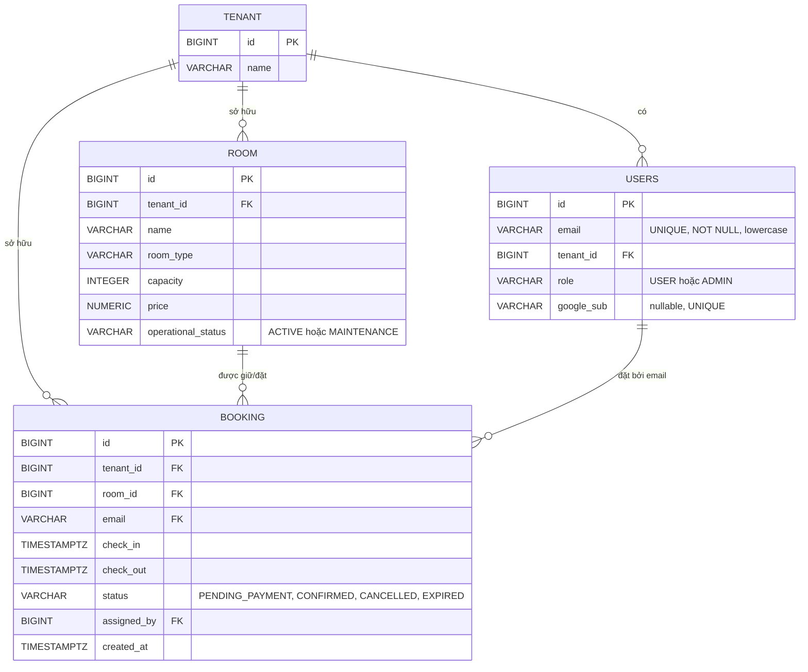
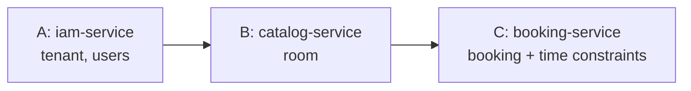

# ERD & Database Design — tìm phòng theo thời gian, booking và huỷ

> Một PostgreSQL database `hotelbooking`, schema `public`. Tình trạng trống được xác định theo khoảng thời gian người dùng tìm kiếm (`check_in`, `check_out`). Booking đang chờ thanh toán cũng giữ phòng; huỷ booking giải phóng đúng khoảng thời gian đó.

## 1. Mô hình dữ liệu



**Tên bảng user:** nghiệp vụ gọi là `user`; tên vật lý PostgreSQL dùng `users` để tránh đụng từ khóa `USER`. Booking dùng cột `email`, không dùng tên `user_email`.

| Bảng | Service sở hữu | Trường/ràng buộc chính |
|---|---|---|
| `tenant` | IAM | `id`, `name` |
| `users` | IAM | `id`, `email` unique/lowercase, `tenant_id`, `role`, `google_sub`; unique `(tenant_id, email)` |
| `room` | Catalog | `id`, `tenant_id`, `name`, `room_type`, `capacity`, `price`, `operational_status` (`ACTIVE`/`MAINTENANCE`); unique `(tenant_id, id)` |
| `booking` | Booking | `id`, `tenant_id`, `room_id`, `email`, `check_in`, `check_out`, `status`, `assigned_by`, `created_at`; FK ghép giữ tenant nhất quán |

`room.operational_status` là tình trạng vận hành của phòng (`ACTIVE`/`MAINTENANCE`); phòng bảo trì không được bán. Trong response tìm kiếm, trường `status` là `AVAILABLE`/`BOOKED` được tính theo khung giờ yêu cầu. Không lưu trạng thái trống tĩnh trên room vì phòng có thể đã đặt buổi sáng nhưng trống buổi tối. `checkIn`/`checkOut` là tiêu chí tìm kiếm và nằm trên booking; không phải cột cố định của room.

## 2. Tìm kiếm phòng theo lựa chọn và thời gian

Người dùng chưa thấy danh sách phòng ngay khi mở trang. UI thu thập các tiêu chí bắt buộc rồi chỉ gọi tìm kiếm sau khi người dùng bấm **Tìm kiếm**:

- `checkIn` và `checkOut` (timestamp có timezone; `checkOut > checkIn`);
- số khách (`guestCount`);
- loại phòng nếu người dùng chọn (`roomType`), cùng các bộ lọc tùy chọn được UI cung cấp.

Ví dụ: `GET /api/rooms/search?checkIn=2026-11-10T14:00:00%2B07:00&checkOut=2026-11-12T11:00:00%2B07:00&guestCount=2&roomType=DELUXE`.

Catalog chỉ trả phòng tenant hiện tại có `room.operational_status='ACTIVE'`, đủ sức chứa/đúng loại phòng, và **không có booking đang giữ hoặc đã xác nhận chồng thời gian**. Response phòng tìm kiếm có `status='AVAILABLE'`. User B không nhận được phòng đang nằm trong booking `PENDING_PAYMENT` của A; sau khi booking A được huỷ, phòng xuất hiện lại trong kết quả nếu các tiêu chí và thời gian vẫn khớp.

## 3. Trạng thái booking, thanh toán và huỷ

Các trạng thái:

| Booking status | Có giữ khoảng thời gian không? | Ý nghĩa |
|---|---:|---|
| `PENDING_PAYMENT` | Có | User đã chọn phòng và đang thanh toán; ẩn phòng khỏi kết quả tìm kiếm trùng thời gian |
| `CONFIRMED` | Có | Thanh toán thành công/booking được xác nhận |
| `CANCELLED` | Không | Đã huỷ; giải phóng khoảng thời gian để user khác tìm và đặt |
| `EXPIRED` | Không | Hết thời hạn thanh toán; giải phóng phòng |

Room có `operational_status='MAINTENANCE'` sẽ không hiện trong kết quả tìm kiếm kể cả khi không có booking. `ACTIVE` chỉ có nghĩa phòng vận hành được; availability vẫn phải được tính theo ngày/giờ yêu cầu.

Flow chính:

1. User chọn tiêu chí và bấm Tìm kiếm; chọn một phòng `AVAILABLE` trong khoảng thời gian mong muốn.
2. Booking service kiểm tra quyền và room còn phù hợp, rồi insert booking `PENDING_PAYMENT` với `room_id`, `email`, `check_in`, `check_out`. Exclusion constraint giữ khoảng giờ ngay trong transaction insert. Từ lúc này, user B tìm cùng khoảng giờ sẽ không thấy phòng đó.
3. Thanh toán thành công chuyển booking `PENDING_PAYMENT → CONFIRMED`; khoảng giờ tiếp tục bị chiếm.
4. User huỷ booking khi còn được phép: chuyển sang `CANCELLED`. Booking không còn chặn tìm kiếm; phòng lại xuất hiện cho user B ở khoảng giờ bị giải phóng. Nếu thanh toán đã thu tiền, refund là flow riêng cần tích hợp/chính sách rõ ràng.
5. Booking không thanh toán trong thời hạn cấu hình chuyển `PENDING_PAYMENT → EXPIRED`, giải phóng phòng để không bị giữ vô hạn.

Chỉ cho huỷ booking thuộc chính user, hoặc admin trong tenant theo chính sách. Huỷ phải cập nhật trạng thái có điều kiện/transaction để không giải phóng nhầm booking đã thay đổi trạng thái.

## 4. Ràng buộc chống đặt chồng giờ

Không làm `SELECT` availability rồi insert tách rời mà không có khóa/ràng buộc DB, vì hai request đồng thời có thể cùng thấy phòng trống. Dùng exclusion constraint PostgreSQL để chặn overlap ở tầng DB:

```sql
CREATE EXTENSION IF NOT EXISTS btree_gist;

ALTER TABLE booking
    ADD CONSTRAINT chk_booking_time
        CHECK (check_out > check_in),
    ADD CONSTRAINT excl_active_room_booking_overlap
        EXCLUDE USING gist (
            tenant_id WITH =,
            room_id WITH =,
            tstzrange(check_in, check_out, '[)') WITH &&
        )
        WHERE (status IN ('PENDING_PAYMENT', 'CONFIRMED'));
```

Khoảng `[check_in, check_out)` bao gồm giờ check-in và không bao gồm giờ check-out. Hai booking cho cùng phòng được phép nối tiếp nhau khi khoảng giờ không giao nhau. Exclusion constraint làm cho một trong hai booking cạnh tranh bị từ chối; API ánh xạ xung đột này thành `409 Conflict`.

Khi huỷ hoặc hết hạn, đổi status khỏi tập `PENDING_PAYMENT`/`CONFIRMED`; booking không còn tham gia exclusion constraint, nên cùng phòng có thể được đặt ở khoảng giờ đó. Không xoá booking lịch sử.

## 5. FK và tenant isolation

```sql
-- users
CONSTRAINT uq_users_tenant_email UNIQUE (tenant_id, email)

-- room
CONSTRAINT uq_room_tenant_id UNIQUE (tenant_id, id)

-- booking
FOREIGN KEY (tenant_id, room_id) REFERENCES room (tenant_id, id),
FOREIGN KEY (tenant_id, email) REFERENCES users (tenant_id, email)
```

`tenant_id` và `email` phải lấy từ JWT đã xác minh, không lấy từ body do client gửi. `assigned_by` lưu user Admin đã thực hiện điều phối, nếu có.

## 6. Quyền xem số lượng và điều phối phòng

- User thường chỉ tìm/xem các phòng còn trống khớp tiêu chí và thời gian; không được xem tổng inventory tenant hoặc danh sách điều phối. Số phòng trong kết quả tìm kiếm chỉ là kết quả khớp filter.
- Chỉ `ADMIN` được xem tổng số phòng theo tenant và tình trạng vận hành, số phòng trống/đang giữ trong một khoảng giờ, danh sách booking cần xếp phòng và gán/đổi phòng.
- Mọi lần gán phòng phải kiểm tra room cùng tenant, `room.operational_status='ACTIVE'`, đủ sức chứa và không có booking `PENDING_PAYMENT`/`CONFIRMED` bị overlap trong khoảng đó. Ghi Admin thực hiện vào `assigned_by`/audit log.
- Nếu user đã chọn phòng cụ thể khi đặt, Admin chỉ được đổi sang phòng thay thế còn trống cho đúng khoảng giờ. Cập nhật room/booking và kiểm tra overlap phải nguyên tử để không tạo double booking.

## 7. API flow

### Tìm phòng

`GET /api/rooms/search` yêu cầu `checkIn`, `checkOut`, `guestCount`; `roomType` là tùy chọn. Không trả danh sách trước khi tiêu chí hợp lệ và người dùng bấm tìm kiếm. Mỗi kết quả có `status='AVAILABLE'` theo khoảng giờ yêu cầu.

### Tạo booking / thanh toán

```json
{
  "roomId": 1,
  "checkIn": "2026-11-10T14:00:00+07:00",
  "checkOut": "2026-11-12T11:00:00+07:00"
}
```

Booking lấy `tenant_id`/`email` từ JWT, ghi booking `PENDING_PAYMENT` cùng khoảng giờ. Exclusion constraint trong DB giữ khoảng giờ ngay khi insert; thanh toán thành công chuyển thành `CONFIRMED`. Trùng giờ hoặc phòng vừa được người khác giữ trả `409`.

### Huỷ booking

`POST /api/bookings/{id}/cancel`: user huỷ booking của mình (hoặc Admin trong tenant theo policy); thành công chuyển thành `CANCELLED`. Lần tìm kiếm kế tiếp cho cùng khung giờ có thể trả phòng vừa được giải phóng. Request lặp lại phải trả kết quả ổn định và không giải phóng một booking khác.

### Admin inventory / assign

`GET /api/admin/rooms/summary?checkIn=...&checkOut=...`, `GET /api/admin/rooms?checkIn=...&checkOut=...` và `PUT /api/admin/bookings/{id}/room` chỉ cho `ADMIN`. Summary trả tổng số phòng cùng số `AVAILABLE`/`BOOKED` trong khoảng đã chọn; danh sách Admin có thể xem cả trạng thái vận hành/bận. Endpoint kiểm tra/gán phòng chỉ thao tác trong tenant từ JWT; user thường nhận `403`.

## 8. Thứ tự migration



Chạy lần đầu trên DB sạch theo A → B → C vì FK tham chiếu bảng service trước. Mỗi service dùng bảng Flyway history riêng (`flyway_schema_history_iam`, `_catalog`, `_booking`).
