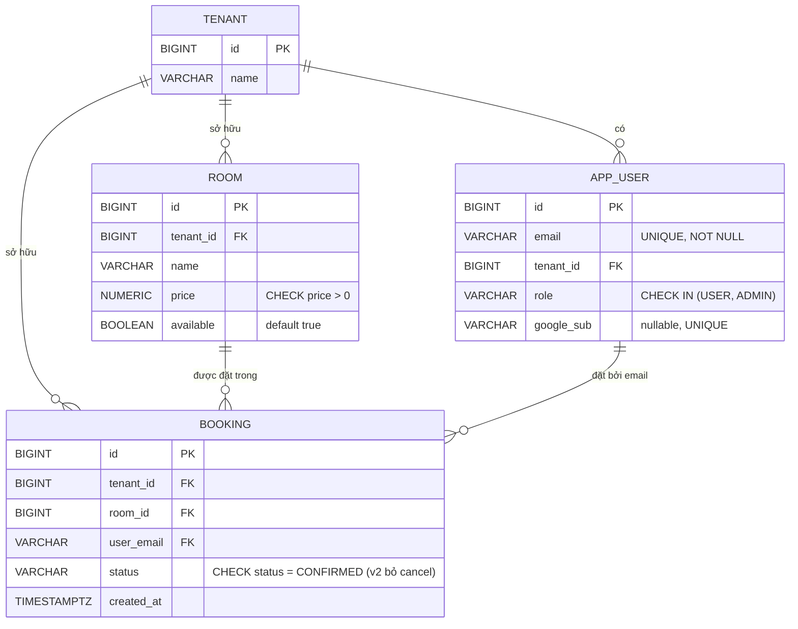
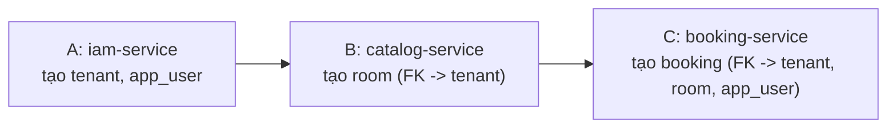

# ERD & Database Design — theo `iam-google-sso-demo-plan-v2.md` (bản 1 database chung)

> 1 database Postgres chung `hotelbooking`, 1 schema `public`. Không tách `iam_db`/`catalog_db`/`booking_db` — mỗi service (A/B/C) vẫn chỉ sở hữu migration cho bảng của mình, nhưng vì cùng nằm trong 1 database nên có **FK thật**, Postgres tự chặn dữ liệu rác (không tồn tại tenant/room/user thì không insert được), không cần tự verify tay như bản tách DB.

## 1. ERD — 1 database, toàn bộ FK đều thật

Tất cả 5 đường quan hệ đều là **FK thật** (`REFERENCES`), vì mọi bảng nằm trong cùng 1 database `hotelbooking`:
- `app_user.tenant_id → tenant.id`
- `room.tenant_id → tenant.id`
- `booking.tenant_id → tenant.id`
- `booking.room_id → room.id`
- `booking.user_email → app_user.email`

**Ai sở hữu bảng nào (ownership giữ nguyên dù chung DB):** `TENANT`, `APP_USER` → A (`iam-service`). `ROOM` → B (`catalog-service`). `BOOKING` → C (`booking-service`).

## 2. Thứ tự migrate bắt buộc (vì có FK thật)

Flyway của từng service vẫn chạy độc lập (migration riêng, `flyway.table` riêng — `flyway_schema_history_iam/_catalog/_booking`), nhưng vì `room` và `booking` có FK trỏ sang bảng do service khác tạo, **thứ tự chạy lần đầu trên DB sạch phải đúng:**

Nếu chạy `catalog-service` hoặc `booking-service` trước khi `iam-service` từng migrate ít nhất 1 lần trên DB đó, Flyway sẽ **fail ngay với lỗi rõ ràng** (thiếu bảng tham chiếu) — đây là hành vi đúng và hữu ích (báo lỗi sớm lúc migrate), khác với bản tách DB trước đây (sai tenant chỉ phát hiện lúc runtime, qua test, không phải lúc migrate).

## 3. Vì sao vẫn cần verify `tenant_id` từ JWT ở từng service, dù đã có FK

FK chỉ đảm bảo **"giá trị này có tồn tại"** (ví dụ `room_id` phải là 1 room thật), **không đảm bảo "người gọi có quyền trên giá trị đó"**. Ví dụ: user tenant A có thể biết được `room_id` của tenant B (ID là số tuần tự, dễ đoán) — FK không ngăn được việc insert `booking(tenant_id=A, room_id=<room của B>)` nếu code không tự kiểm tra `room.tenant_id` khớp JWT trước khi cho hold/booking. Vì vậy `catalog-service` vẫn phải tự verify lại `tenant_id` lấy từ JWT khi xử lý `/internal/rooms/{id}/hold`, **không chỉ dựa vào FK**.

## 4. Vì sao chọn `BIGINT GENERATED ALWAYS AS IDENTITY` thay UUID

ID nhất quán, dễ đọc log/test tay (so với UUID dài khó debug bằng mắt) — hợp quy mô demo 3 ngày, không cần chống đoán ID giữa service (không phải public-facing ID lộ ra ngoài internet). Vì giờ có FK thật, rủi ro "ID lệch giữa các DB" của bản cũ (phải tự khớp tay `tenant_id` giữa 3 database) **không còn tồn tại** — `room.tenant_id`/`booking.room_id` giờ tham chiếu trực tiếp đúng `id` thật trong cùng database, Postgres tự báo lỗi ngay nếu sai, không thể âm thầm lệch.
