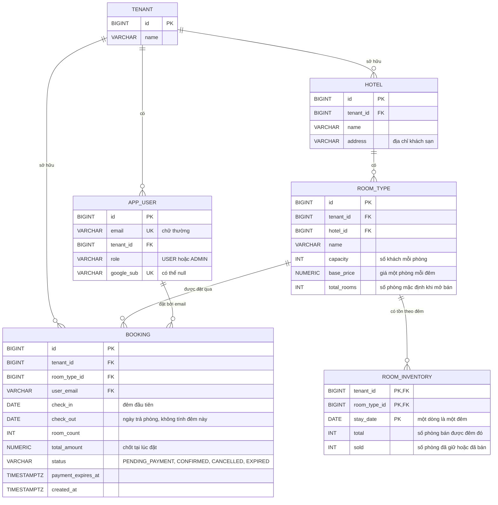
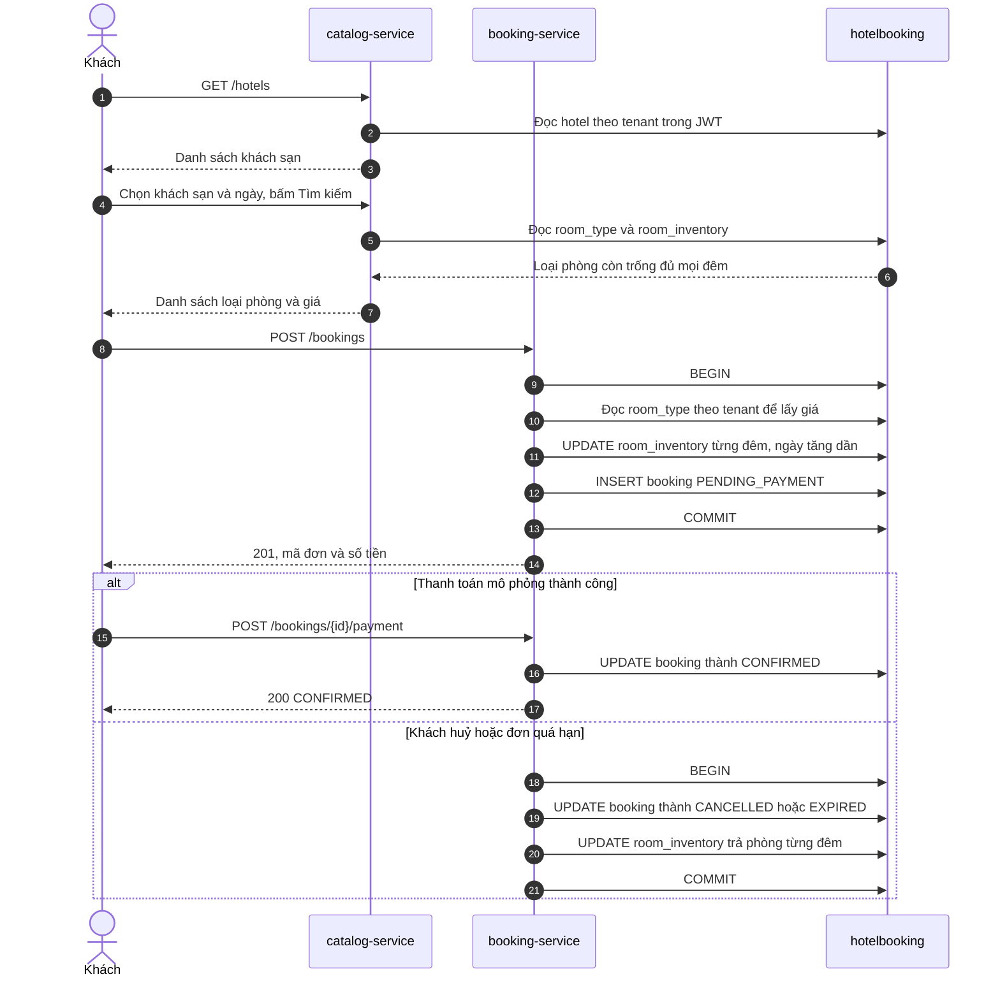
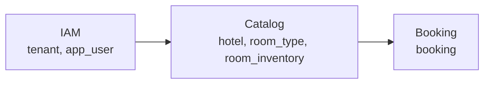

# ERD và flow tìm kiếm, đặt phòng theo `room_inventory`

Tài liệu này mô tả database theo flow: **khách chọn khách sạn, ngày nhận và trả phòng, bấm Tìm kiếm → xem các loại phòng còn trống → đặt phòng → thanh toán mô phỏng hoặc huỷ**.

> **Trạng thái:** thiết kế đề xuất, chưa có trong migration và code (xem §12). Thiết kế này dùng tồn kho theo đêm trong `room_inventory`, khớp scope hiện hành của `iam-google-sso-demo-plan-v2.md` và `api-contract.md`.
>
> Một PostgreSQL database `hotelbooking`, schema `public`. Giá phòng và dữ liệu mẫu chỉ để minh họa.

## 1. ERD



| Bảng | Service tạo migration | Ai được ghi |
|---|---|---|
| `tenant`, `app_user` | IAM | IAM |
| `hotel`, `room_type` | Catalog | Catalog |
| `room_inventory` | Catalog | Catalog thêm dòng và sửa `total`. Booking chỉ sửa `sold` |
| `booking` | Booking | Booking |

**Ba điểm dễ nhầm:**

- `booking` và `room_inventory` không nối trực tiếp với nhau. Một đơn gắn với các đêm qua `room_type_id` và khoảng ngày, nên service phải cập nhật cả hai bảng trong cùng một transaction.
- Đơn vị bán là **loại phòng**, không phải phòng cụ thể. Bảng `room` cũ, cột `operational_status` và `assigned_by` được bỏ. Muốn ngừng bán một số phòng để bảo trì thì giảm `room_inventory.total` của các đêm đó.
- "Còn trống" là `total - sold`, chỉ tính khi đọc, không lưu thành cột.

## 2. Mỗi bước dùng bảng nào

| Bước | `hotel` | `room_type` | `room_inventory` | `booking` |
|---|---|---|---|---|
| 1. Mở form, chọn khách sạn | Đọc | | | |
| 2. Bấm Tìm kiếm | Đọc | Đọc | Đọc | |
| 3. Bấm Đặt | | Đọc | **Sửa** `sold` | **Thêm** |
| 4a. Thanh toán thành công | | | | **Sửa** |
| 4b. Huỷ hoặc quá hạn thanh toán | | | **Sửa** `sold` | **Sửa** |

`tenant_id` luôn lấy từ JWT đã xác minh, không lấy từ dữ liệu client gửi.



## 3. Dữ liệu ban đầu

Giữ nguyên các ID loại phòng hiện có (`1`–`6`) để ít phải sửa tài liệu kiểm thử. ID chỉ đúng trên DB vừa tạo sạch.

**`hotel`**

| id | tenant_id | name | address |
|---|---|---|---|
| 1 | 1 | Demo Hotel A - Hà Nội | 12 Hàng Trống, Hoàn Kiếm, Hà Nội |
| 2 | 2 | Demo Hotel B - TP.HCM | 25 Nguyễn Huệ, Quận 1, TP.HCM |
| 3 | 1 | Demo Hotel A - Đà Nẵng | 08 Bạch Đằng, Hải Châu, Đà Nẵng |

Tenant 1 có hai khách sạn để bước chọn khách sạn có ý nghĩa khi demo. User chỉ thấy khách sạn trong tenant của mình.

**`room_type`**

| id | tenant_id | hotel_id | name | capacity | base_price (mỗi phòng/đêm) | total_rooms | Dùng cho |
|---|---|---|---|---|---|---|---|---|
| 1 | 1 | 1 | Standard | 2 | 500,000 | 3 | Luồng chính |
| 2 | 1 | 1 | Deluxe | 2 | 900,000 | 4 | Luồng chính |
| 3 | 2 | 2 | Standard | 2 | 450,000 | 5 | Kiểm thử khác tenant |
| 4 | 2 | 2 | Deluxe | 2 | 850,000 | 6 | Kiểm thử khác tenant |
| 5 | 1 | 3 | Race Test | 2 | 500,000 | 1 | Chỉ dùng cho race test |
| 6 | 1 | 3 | Standard | 2 | 600,000 | 5 | Luồng chính |

**`room_inventory`**

Mỗi loại phòng có một dòng cho mỗi đêm từ 01/11/2026 đến 31/01/2027, `total = total_rooms`, `sold = 0`. Đêm chưa có dòng nghĩa là chưa mở bán.

```sql
INSERT INTO room_inventory (tenant_id, room_type_id, stay_date, total)
SELECT rt.tenant_id, rt.id, d::date, rt.total_rooms
FROM room_type rt
CROSS JOIN generate_series(DATE '2026-11-01', DATE '2027-01-31', INTERVAL '1 day') AS d;
```

Ngày cố định giúp `docs/demo.http` và test cho cùng một kết quả. Demo chưa có job tự mở bán thêm ngày. Khi `ADMIN` tạo loại phòng mới, Catalog phải thêm dòng tồn cho khoảng mở bán trong cùng transaction, nếu không loại phòng đó sẽ không bao giờ hiện trong kết quả tìm kiếm.

**Ví dụ dùng ở các mục sau.** Đã có 4 đơn `CONFIRMED`:

| id | Loại phòng | check_in | check_out | room_count | total_amount |
|---|---|---|---|---|---|
| 1 | Standard | 21/11 | 23/11 | 1 | 1,000,000 |
| 2 | Standard | 24/11 | 26/11 | 1 | 1,000,000 |
| 3 | Standard | 25/11 | 27/11 | 1 | 1,000,000 |
| 4 | Deluxe | 25/11 | 26/11 | 4 | 3,600,000 |

Tồn kho tương ứng:

| Loại phòng | stay_date | total | sold | Còn trống |
|---|---|---|---|---|
| Standard | 23/11 | 3 | 0 | 3 |
| Standard | 24/11 | 3 | 1 | 2 |
| Standard | 25/11 | 3 | 2 | 1 |
| Standard | 26/11 | 3 | 1 | 2 |
| Standard | 27/11 | 3 | 0 | 3 |
| Deluxe | 24/11 | 4 | 0 | 4 |
| Deluxe | 25/11 | 4 | 4 | 0 |

## 4. Flow tìm kiếm

Danh sách phòng chưa hiện khi mở trang. Khách chọn **Khách sạn 1, nhận phòng 24/11, trả phòng 26/11**, rồi bấm Tìm kiếm:

```http
GET /api/hotels/1/availability?checkIn=2026-11-24&checkOut=2026-11-26
```

Kỳ ở này có **2 đêm: 24 và 25/11**. Flow này chỉ đọc dữ liệu, chưa giữ phòng nào.

```sql
SELECT rt.id, rt.name, rt.capacity, rt.base_price,
       MIN(i.total - i.sold) AS available_rooms
FROM room_type rt
JOIN room_inventory i
  ON i.tenant_id = rt.tenant_id
 AND i.room_type_id = rt.id
WHERE rt.tenant_id = :tenantId            -- từ JWT
  AND rt.hotel_id = :hotelId
  AND i.stay_date >= :checkIn             -- ngày nhận phòng
  AND i.stay_date <  :checkOut            -- ngày trả phòng, không tính đêm này
GROUP BY rt.id
HAVING COUNT(*) = :nights                 -- đủ dòng tồn cho mọi đêm
   AND MIN(i.total - i.sold) > 0          -- đêm ít phòng nhất vẫn còn phòng
ORDER BY rt.id;
```

| Loại phòng | Đêm 24 | Đêm 25 | `MIN` | Kết quả |
|---|---|---|---|---|
| Standard | 2 | 1 | 1 | Hiển thị, còn 1 phòng |
| Deluxe | 4 | 0 | 0 | Không hiển thị, vì đêm 25 đã hết |

Response `200`:

```json
[
  {
    "roomTypeId": 1,
    "name": "Standard",
    "capacity": 2,
    "pricePerNight": 500000.00,
    "nights": 2,
    "totalPricePerRoom": 1000000.00,
    "availableRooms": 1
  }
]
```

| Tình huống | Kết quả |
|---|---|
| Không loại phòng nào còn đủ mọi đêm, hoặc có đêm chưa mở bán | `200` với `[]` |
| Khách sạn không tồn tại hoặc thuộc tenant khác | `404`, cùng một body cho cả hai trường hợp |
| Ngày sai định dạng, `checkOut` không sau `checkIn`, `checkIn` ở quá khứ, hoặc ở quá 30 đêm | `400` |

"Hôm nay" tính theo giờ Việt Nam (`Asia/Ho_Chi_Minh`). Vì cột là `DATE`, request dùng dạng `YYYY-MM-DD`, không có giờ và múi giờ. Giờ nhận và trả phòng là quy định của khách sạn, không phải dữ liệu khách nhập.

## 5. Flow đặt phòng

Khách bấm **Đặt** 1 phòng Standard:

```json
{ "roomTypeId": 1, "checkIn": "2026-11-24", "checkOut": "2026-11-26", "roomCount": 1 }
```

`roomCount` từ 1 đến 10. Số liệu lúc tìm kiếm có thể đã cũ, nên hệ thống kiểm tra lại ngay khi trừ phòng.

### 5.1 Trong một transaction

```sql
-- Chạy cho từng đêm, theo ngày tăng dần: 24/11 rồi 25/11
UPDATE room_inventory
SET sold = sold + :roomCount
WHERE tenant_id = :tenantId
  AND room_type_id = :roomTypeId
  AND stay_date = :stayDate
  AND sold + :roomCount <= total;
```

| Bước | Lệnh | Kiểm tra | Kết quả |
|---|---|---|---|
| 1 | `BEGIN` | | Bắt đầu transaction |
| 2 | Đọc `room_type` theo `id` và `tenant_id` | Không có dòng thì trả `404` | Tính tiền: 500,000 x 2 đêm x 1 phòng = 1,000,000 |
| 3 | `UPDATE` đêm 24/11 | `1 + 1 <= 3`, đúng | `sold`: 1 → **2** |
| 4 | `UPDATE` đêm 25/11 | `2 + 1 <= 3`, đúng | `sold`: 2 → **3** |
| 5 | `INSERT` đơn 5 | | Thêm đơn `PENDING_PAYMENT` |
| 6 | `COMMIT` | | Các thay đổi được lưu và người khác thấy được |

Nếu đêm nào cập nhật được 0 dòng (hết phòng hoặc chưa mở bán), hệ thống rollback toàn bộ và trả `409`.

Transaction phải dùng mức **READ COMMITTED**, là mặc định của PostgreSQL và Spring. Khi chờ khóa xong, `UPDATE` đánh giá lại `sold + :roomCount <= total` trên giá trị mới nhất. Ở mức `REPEATABLE READ`, bên chờ sẽ nhận lỗi serialization thay vì kết quả này.

### 5.2 Sau khi `COMMIT`

Chỉ 2 dòng in đậm thay đổi. Đêm 26/11 không đổi vì đó là ngày khách trả phòng.

| stay_date | total | sold | Còn trống |
|---|---|---|---|
| 23/11 | 3 | 0 | 3 |
| **24/11** | 3 | **2** | **1** |
| **25/11** | 3 | **3** | **0** |
| 26/11 | 3 | 1 | 2 |
| 27/11 | 3 | 0 | 3 |

Response `201`:

```json
{
  "id": 5,
  "tenantId": 1,
  "roomTypeId": 1,
  "userEmail": "user-tenant1@example.com",
  "checkIn": "2026-11-24",
  "checkOut": "2026-11-26",
  "roomCount": 1,
  "totalAmount": 1000000.00,
  "status": "PENDING_PAYMENT",
  "paymentExpiresAt": "2026-11-03T02:30:30Z",
  "createdAt": "2026-11-03T02:15:30Z"
}
```

### 5.3 Kết quả theo tình huống

| Tình huống | Kết quả | Dữ liệu |
|---|---|---|
| Đủ phòng mọi đêm | `201 PENDING_PAYMENT` | Trừ tồn và thêm 1 đơn |
| Loại phòng không tồn tại hoặc thuộc tenant khác | `404` | Không đổi |
| Có đêm hết phòng hoặc chưa mở bán | `409` | Rollback |
| `user_email` không khớp `app_user` trong tenant | `403` | Rollback |
| `checkIn` ở quá khứ, ở quá 30 đêm, hoặc `roomCount` ngoài 1–10 | `400` | Không đổi |

## 6. Thanh toán, huỷ và hết hạn

| Booking status | Có giữ phòng không? | Ý nghĩa |
|---|---|---|
| `PENDING_PAYMENT` | Có | Đã trừ tồn, đang chờ thanh toán. `payment_expires_at` mặc định sau 15 phút, cấu hình được |
| `CONFIRMED` | Có | Thanh toán mô phỏng thành công |
| `CANCELLED` | Không | Đã huỷ và trả phòng |
| `EXPIRED` | Không | Quá hạn thanh toán và trả phòng |

**Thanh toán thành công:** chỉ đổi `booking`, vì phòng đã được trừ lúc đặt.

```sql
UPDATE booking
SET status = 'CONFIRMED'
WHERE id = :id AND tenant_id = :tenantId AND user_email = :email
  AND status = 'PENDING_PAYMENT'
  AND payment_expires_at > now();
```

Cập nhật được 0 dòng thì đơn đã huỷ, đã hết hạn hoặc đã thanh toán, trả `409`.

**Huỷ hoặc hết hạn:** đổi trạng thái có điều kiện trước, **chỉ khi đổi được đúng 1 dòng** mới trả phòng, trong cùng một transaction. Nhờ vậy huỷ hai lần, hoặc huỷ trùng lúc job hết hạn chạy, không trả phòng hai lần.

```sql
UPDATE booking
SET status = 'CANCELLED'
WHERE id = :id AND tenant_id = :tenantId
  AND user_email = :email
  AND status = 'PENDING_PAYMENT';  -- chỉ chủ đơn huỷ khi đang chờ thanh toán

-- Job hết hạn dùng status = 'EXPIRED' và chỉ xét PENDING_PAYMENT.

-- Nếu đổi được 1 dòng: chạy cho từng đêm, theo ngày tăng dần
UPDATE room_inventory
SET sold = sold - :roomCount
WHERE tenant_id = :tenantId
  AND room_type_id = :roomTypeId
  AND stay_date = :stayDate
  AND sold >= :roomCount;
```

Huỷ đơn 5 đưa `sold` đêm 24/11 về 1 và đêm 25/11 về 2. Không xoá lịch sử booking. Job hết hạn tìm đơn bằng index `idx_booking_pending_expiry` và xử lý mỗi đơn trong một transaction riêng.

## 7. Các quy tắc

### 7.1 Mỗi dòng là một đêm ngủ

Booking chỉ trừ từ đêm nhận phòng đến đêm trước ngày trả phòng. Ví dụ với loại phòng chỉ có 1 phòng:

| Khách đầu | Khách sau | Đêm trùng | Kết quả |
|---|---|---|---|
| 27→29 | 29→31 | Không | Cả hai đặt được |
| 27→29 | 28→30 | Đêm 28 | Khách sau bị từ chối |

### 7.2 Đặt sau khi đơn 5 đã giữ phòng

| Khách mới đặt | Các đêm | Kết quả |
|---|---|---|
| 23→25/11 | 23, 24 | Đặt được |
| 24→26/11 | 24, 25 | `409`, vì đêm 25 đã hết phòng |
| 26→28/11 | 26, 27 | Đặt được |

### 7.3 Hai người đặt cùng lúc

A và B cùng đặt 24→26/11 khi đêm 25 chỉ còn 1 phòng, và A cập nhật trước:

| Thứ tự | A | B |
|---|---|---|
| 1 | Đêm 24: `sold` 1 → 2 | Chờ A, vì cùng dòng |
| 2 | Đêm 25: `sold` 2 → 3 | Vẫn chờ |
| 3 | `COMMIT`, đặt thành công | Đêm 24: `sold` 2 → 3 (tạm thời) |
| 4 | | Đêm 25: `3 + 1 <= 3` sai, cập nhật 0 dòng |
| 5 | | Rollback, đêm 24 về `sold` = 2, trả `409` |

Mọi request đều khóa các đêm theo ngày tăng dần, nên hai đơn có khoảng ngày giao nhau không tạo deadlock. Hai khách không trùng đêm thì cập nhật các dòng khác nhau, không phải chờ nhau.

### 7.4 Cách ly tenant

- Mọi truy vấn đều có `tenant_id` từ JWT. Loại phòng hoặc khách sạn của tenant khác trả `404`, giống như không tồn tại.
- Booking đọc `room_type` theo tenant **trước** khi trừ tồn, nên không thể nhận `409` từ tồn kho của tenant khác. Nhờ đó không còn lỗi lộ lịch như khi dùng `EXCLUDE` (phải kiểm tra lại để đổi `409` thành `404`).
- FK ghép chặn ngay ở database: `room_type`, `room_inventory` và `booking` không thể trỏ sang dữ liệu thuộc tenant khác.

### 7.5 `room_inventory` và `booking` nằm chung một database

Như vậy trừ phòng và tạo đơn nằm trong một `COMMIT`, cùng thành công hoặc cùng thất bại, và Booking không cần gọi HTTP sang Catalog. Nếu tách database thì cần giữ chỗ có thời hạn qua API, bước bù trừ, idempotency và job đối soát.

## 8. Database đảm bảo gì, service đảm bảo gì

| Quy tắc | Ai đảm bảo |
|---|---|
| Không bán quá số phòng trong một đêm | Database: `CHECK (sold >= 0 AND sold <= total)` |
| Không giảm `total` xuống dưới số đã bán | Database: cùng `CHECK` trên |
| Không trỏ sang dữ liệu tenant khác | Database: FK ghép |
| `sold` khớp với các booking đang giữ phòng | **Service**: cập nhật hai bảng trong cùng transaction |

**Đánh đổi so với `EXCLUDE`:** trước đây database tự chặn trùng giờ dù service viết gì. Giờ một đoạn code `INSERT booking` mà quên trừ tồn sẽ không bị database chặn. Vì vậy chỉ một service được ghi `sold`, và truy vấn đối soát sau đây phải trả về **0 dòng** sau mọi test và race test:

```sql
SELECT i.tenant_id, i.room_type_id, i.stay_date, i.sold,
       COALESCE(SUM(b.room_count), 0) AS expected_sold
FROM room_inventory i
LEFT JOIN booking b
  ON b.tenant_id = i.tenant_id
 AND b.room_type_id = i.room_type_id
 AND b.status IN ('PENDING_PAYMENT', 'CONFIRMED')
 AND i.stay_date >= b.check_in
 AND i.stay_date <  b.check_out
GROUP BY i.tenant_id, i.room_type_id, i.stay_date, i.sold
HAVING i.sold <> COALESCE(SUM(b.room_count), 0);
```

**Reset demo:** xoá booking thôi là chưa đủ, phải đưa `sold` về 0 trong cùng lệnh:

```sql
BEGIN;
TRUNCATE booking RESTART IDENTITY;
UPDATE room_inventory SET sold = 0;
COMMIT;
```

## 9. Định nghĩa bảng

`tenant` và `app_user` giữ nguyên theo migration của IAM.

```sql
-- catalog-service
CREATE TABLE hotel (
    id        BIGINT GENERATED ALWAYS AS IDENTITY PRIMARY KEY,
    tenant_id BIGINT       NOT NULL REFERENCES tenant (id),
    name      VARCHAR(100) NOT NULL,
    address   VARCHAR(255) NOT NULL,
    CONSTRAINT uq_hotel_tenant_id UNIQUE (tenant_id, id)
);

CREATE TABLE room_type (
    id          BIGINT GENERATED ALWAYS AS IDENTITY PRIMARY KEY,
    tenant_id   BIGINT         NOT NULL,
    hotel_id    BIGINT         NOT NULL,
    name        VARCHAR(100)   NOT NULL,
    capacity    INT            NOT NULL,
    base_price  NUMERIC(10, 2) NOT NULL, -- giá một phòng mỗi đêm
    total_rooms INT            NOT NULL,
    CONSTRAINT uq_room_type_tenant_id UNIQUE (tenant_id, id),
    CONSTRAINT fk_room_type_hotel_same_tenant
        FOREIGN KEY (tenant_id, hotel_id) REFERENCES hotel (tenant_id, id),
    CONSTRAINT chk_room_type_capacity CHECK (capacity > 0),
    CONSTRAINT chk_room_type_price CHECK (base_price > 0),
    CONSTRAINT chk_room_type_total_rooms CHECK (total_rooms >= 0)
);

CREATE TABLE room_inventory (
    tenant_id    BIGINT NOT NULL,
    room_type_id BIGINT NOT NULL,
    stay_date    DATE   NOT NULL,
    total        INT    NOT NULL,
    sold         INT    NOT NULL DEFAULT 0,
    PRIMARY KEY (tenant_id, room_type_id, stay_date),
    CONSTRAINT fk_inventory_room_type_same_tenant
        FOREIGN KEY (tenant_id, room_type_id) REFERENCES room_type (tenant_id, id),
    CONSTRAINT chk_inventory_not_oversold CHECK (sold >= 0 AND sold <= total)
);

-- booking-service
CREATE TABLE booking (
    id                 BIGINT GENERATED ALWAYS AS IDENTITY PRIMARY KEY,
    tenant_id          BIGINT         NOT NULL REFERENCES tenant (id),
    room_type_id       BIGINT         NOT NULL,
    user_email         VARCHAR(255)   NOT NULL,
    check_in           DATE           NOT NULL,
    check_out          DATE           NOT NULL,
    room_count         INT            NOT NULL,
    total_amount       NUMERIC(14, 2) NOT NULL,
    status             VARCHAR(20)    NOT NULL DEFAULT 'PENDING_PAYMENT',
    payment_expires_at TIMESTAMPTZ    NOT NULL,
    created_at         TIMESTAMPTZ    NOT NULL DEFAULT now(),
    CONSTRAINT chk_booking_status
        CHECK (status IN ('PENDING_PAYMENT', 'CONFIRMED', 'CANCELLED', 'EXPIRED')),
    CONSTRAINT chk_booking_email_lowercase CHECK (user_email = lower(user_email)),
    CONSTRAINT chk_booking_checkout_after_checkin CHECK (check_out > check_in),
    CONSTRAINT chk_booking_room_count CHECK (room_count > 0),
    CONSTRAINT chk_booking_total_amount CHECK (total_amount > 0),
    CONSTRAINT fk_booking_room_type_same_tenant
        FOREIGN KEY (tenant_id, room_type_id) REFERENCES room_type (tenant_id, id),
    CONSTRAINT fk_booking_user_same_tenant
        FOREIGN KEY (tenant_id, user_email) REFERENCES app_user (tenant_id, email)
);

CREATE INDEX idx_booking_tenant_user ON booking (tenant_id, user_email);
CREATE INDEX idx_booking_room_type ON booking (tenant_id, room_type_id);
CREATE INDEX idx_booking_pending_expiry ON booking (payment_expires_at)
    WHERE status = 'PENDING_PAYMENT';
```

- `total_amount` dùng `NUMERIC(14,2)` vì là giá nhân số đêm và số phòng, có thể vượt giới hạn `NUMERIC(10,2)` của `base_price`.
- `total_amount` được chốt lúc đặt, nên đổi giá sau đó không ảnh hưởng đơn cũ.
- `room_inventory.total` tách khỏi `room_type.total_rooms` để từng đêm có thể bán ít hơn, ví dụ khi bảo trì. `total_rooms` chỉ là giá trị mặc định khi tạo dòng tồn.
- Không còn `btree_gist` và `EXCLUDE`, vì tồn kho theo đêm đã thay vai trò chống bán trùng.

## 10. API theo thiết kế này

| Frontend gọi | Service | Role | Mục đích |
|---|---|---|---|
| `GET /api/hotels` | Catalog | `USER`, `ADMIN` | Danh sách khách sạn trong tenant |
| `GET /api/hotels/{hotelId}/availability?checkIn&checkOut` | Catalog | `USER`, `ADMIN` | Loại phòng còn trống (§4) |
| `POST /api/hotels/{hotelId}/room-types` | Catalog | `ADMIN` | Thêm loại phòng và tạo dòng tồn |
| `PUT /api/room-types/{id}/price` | Catalog | `ADMIN` | Sửa giá, chỉ ảnh hưởng đơn mới |
| `GET /api/admin/hotels/{hotelId}/inventory?checkIn&checkOut` | Catalog | `ADMIN` | Xem `total`, `sold`, còn trống theo từng đêm |
| `POST /api/bookings` | Booking | `USER` | Đặt phòng (§5) |
| `POST /api/bookings/{id}/payment` | Booking | `USER` là chủ đơn | Thanh toán mô phỏng (§6) |
| `POST /api/bookings/{id}/cancel` | Booking | `USER` là chủ đơn | Huỷ đơn chỉ khi `PENDING_PAYMENT` (§6) |
| `GET /api/bookings`, `GET /api/bookings/{id}` | Booking | `USER`, `ADMIN` | Xem đơn, quyền như hiện tại |

`USER` chỉ thấy `availableRooms` trong kết quả tìm kiếm, không thấy `total` và `sold`.

**Giới hạn cần nói rõ khi demo:** gửi lại cùng một request đặt phòng sẽ **tạo thêm đơn thứ hai** nếu còn phòng, vì không còn `EXCLUDE` và demo không có idempotency key. Frontend cần khóa nút Đặt sau lần bấm đầu. Đơn thừa chưa thanh toán sẽ tự hết hạn và trả phòng.

## 11. Thứ tự migration



Chạy lần đầu trên DB sạch theo IAM → Catalog → Booking vì có FK tham chiếu bảng của service trước. Mỗi service dùng bảng lịch sử Flyway riêng như hiện tại.

**Cách chuyển đổi đề xuất:** sửa trực tiếp các migration chưa phát hành (`V1__create_room.sql`, `V2__seed_rooms.sql` của Catalog, `V1__create_booking.sql` của Booking), rồi cả nhóm chạy lại DB local bằng `docker compose down -v`. Dữ liệu chỉ là seed nên không mất gì.

Không nên thêm migration mới để xoá `room`. Trên DB sạch, Catalog chạy trước Booking, nên nếu Catalog xoá `room` thì `V1` của Booking sẽ lỗi vì thiếu bảng để tạo FK. Còn trên DB đã có dữ liệu, Catalog không xoá được `room` khi `booking` còn FK trỏ tới.

## 12. Khác biệt so với code hiện tại

| Nội dung | Thiết kế này | Code và migration trên `main` |
|---|---|---|
| Đơn vị bán | `room_type`, có `room_count` | `room` là một phòng cụ thể |
| Khách sạn | Bảng `hotel`, một tenant có nhiều khách sạn | Không có, tenant được coi như khách sạn |
| Thời gian | `DATE`, tính theo đêm | `TIMESTAMPTZ`, có giờ thật |
| Tìm phòng trống | Đọc `room_inventory` theo từng đêm | Catalog chưa có API, `GET /rooms` cũng chưa có code |
| Chống bán trùng | `UPDATE` có điều kiện theo từng đêm | `EXCLUDE` trên `booking` |
| Booking service | Cần `@Transactional`, trừ tồn rồi mới `INSERT` | Chỉ `INSERT` rồi đổi lỗi database thành lỗi nghiệp vụ |
| Trạng thái đơn | 4 trạng thái, có thanh toán mô phỏng, huỷ, hết hạn | Chỉ `CONFIRMED` |
| Giá trên đơn | `total_amount` | Không lưu giá |
| Tên bảng user | `app_user`, `user_email` theo migration | Giống thiết kế này. Bản `erd-v2.md` trước và plan ghi `users`, `email` là chưa khớp migration |
