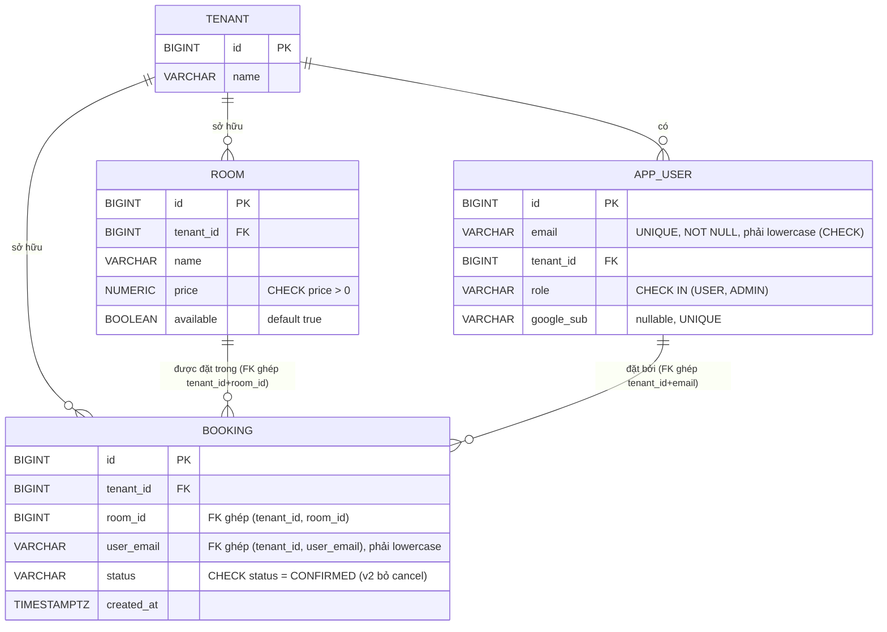
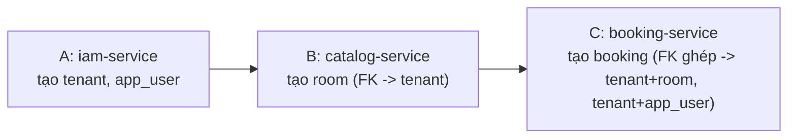

# ERD & Database Design — theo `iam-google-sso-demo-plan-v2.md` (bản 1 database chung)

> 1 database Postgres chung `hotelbooking`, 1 schema `public`. Không tách `iam_db`/`catalog_db`/`booking_db` — mỗi service (A/B/C) vẫn chỉ sở hữu migration cho bảng của mình, nhưng vì cùng nằm trong 1 database nên có **FK thật**, Postgres tự chặn dữ liệu rác, không cần tự verify tay như bản tách DB.

## 1. ERD — 1 database, FK ghép (composite FK) để chặn cả sai-tenant



**Ai sở hữu bảng nào (ownership giữ nguyên dù chung DB):** `TENANT`, `APP_USER` → A (`iam-service`). `ROOM` → B (`catalog-service`). `BOOKING` → C (`booking-service`).

## 2. FK đơn cột KHÔNG đủ cho multi-tenant — đây là lỗi đã tìm và sửa

Thiết kế ban đầu dùng FK đơn cột: `booking.room_id → room.id`, `booking.user_email → app_user.email`. Lỗi: FK đơn cột chỉ đảm bảo **"giá trị này tồn tại ở đâu đó"**, không đảm bảo **nó thuộc đúng `tenant_id` của booking**. Ví dụ DB (bản cũ) vẫn cho insert `booking(tenant_id=1, room_id=<phòng thật nhưng của tenant 2>)` — vì phòng đó *có tồn tại*, FK đơn cột không biết/không quan tâm tenant.

**Fix: đổi sang FK ghép (composite FK)**, bắt cả `tenant_id` phải khớp:

```sql
-- room (catalog-service) — thêm composite unique làm "đích" cho FK ghép
CONSTRAINT uq_room_tenant_id UNIQUE (tenant_id, id)

-- app_user (iam-service) — thêm composite unique làm "đích" cho FK ghép
CONSTRAINT uq_app_user_tenant_email UNIQUE (tenant_id, email)

-- booking (booking-service) — FK ghép thay cho FK đơn cột
CONSTRAINT fk_booking_room_same_tenant
    FOREIGN KEY (tenant_id, room_id) REFERENCES room (tenant_id, id)
CONSTRAINT fk_booking_user_same_tenant
    FOREIGN KEY (tenant_id, user_email) REFERENCES app_user (tenant_id, email)
```

**Đã test bằng Postgres thật (không chỉ suy luận):**

| Test | Insert | Kết quả |
|---|---|---|
| Sai tenant ở room | `booking(tenant_id=1, room_id=<room của tenant 2>)` | ❌ bị chặn — `violates foreign key constraint fk_booking_room_same_tenant` |
| Sai tenant ở user | `booking(tenant_id=1, room_id=<room tenant 1>, user_email=<user tenant 2>)` | ❌ bị chặn — `violates foreign key constraint fk_booking_user_same_tenant` |
| Đúng tenant cả 2 phía | `booking(tenant_id=1, room_id=<room tenant 1>, user_email=<user tenant 1>)` | ✅ `INSERT 0 1` |
| Email viết hoa | `app_user(email='Admin-Tenant1@Example.com', ...)` | ❌ bị chặn — `violates check constraint chk_app_user_email_lowercase` |

## 3. Vì sao vẫn cần verify `tenant_id` từ JWT ở code, dù đã có FK ghép

FK ghép chặn được **dữ liệu rác trong DB**, nhưng không thay được việc kiểm tra **quyền của người gọi request**. Ví dụ: FK đảm bảo không ai tạo được `booking` trỏ sai tenant, nhưng nếu `catalog-service` không tự đọc `tenant_id` từ JWT mà tin tham số client gửi lên, 1 request có thể tự khai `tenant_id` giả để pass qua FK (vì request đó có thể tạo đúng 1 cặp `(tenant_id, room_id)` hợp lệ — chỉ là tenant đó không phải tenant thật của người gọi). Vì vậy `tenant_id` dùng trong mọi INSERT/UPDATE **phải luôn lấy từ claim trong JWT đã verify**, không bao giờ nhận trực tiếp từ body/param client gửi — FK ghép là lớp bảo vệ thứ 2 (chặn bug code), không thay cho lớp bảo vệ thứ 1 (đọc đúng tenant từ JWT).

## 4. Chuẩn hoá email — lý do thêm `CHECK (email = lower(email))`

`iam-google-sso-demo-plan-v2.md` §3.1 yêu cầu "tra `app_user` **theo email đã chuẩn hóa**". Nếu không ép tại DB, 1 user có thể vô tình được seed `User@Gmail.com` còn JWT trả về `user@gmail.com` (Google luôn trả lowercase ở claim `email`) → tra không khớp → bị 403 nhầm, rất khó debug vì nhìn bằng mắt 2 chuỗi "giống nhau". Thêm `CHECK (email = lower(email))` ở cả `app_user.email` và `booking.user_email` để lỗi này **bị chặn ngay lúc insert/seed**, không phải lúc runtime khi user login.

## 5. Thứ tự migrate bắt buộc (không đổi so với bản trước)



Mỗi service dùng riêng `spring.flyway.table` (`flyway_schema_history_iam/_catalog/_booking`) để 3 bộ migration độc lập không đụng version nhau dù chung 1 database. Chạy sai thứ tự (B/C trước A) → Flyway fail ngay lúc migrate với lỗi rõ ràng (thiếu bảng tham chiếu) — đã test thật, đúng như mô tả.

## 6. Vì sao chọn `BIGINT GENERATED ALWAYS AS IDENTITY` thay UUID

ID nhất quán, dễ đọc log/test tay — hợp quy mô demo 3 ngày, không cần chống đoán ID (không phải public-facing ID lộ ra internet). Vì có FK ghép thật, rủi ro "tenant_id lệch giữa các bảng" **không còn tồn tại** — Postgres tự chặn ngay lúc insert nếu sai, không thể âm thầm lệch.
