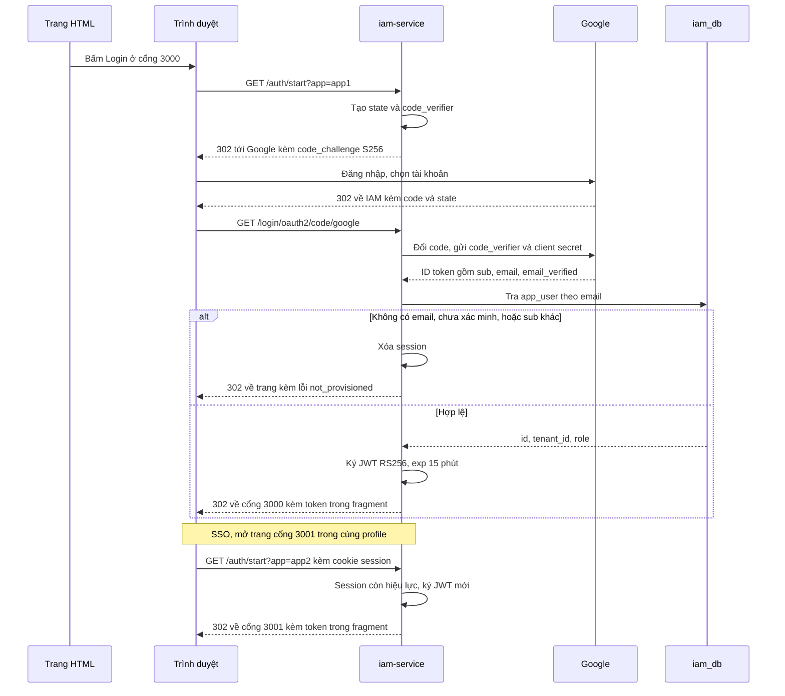
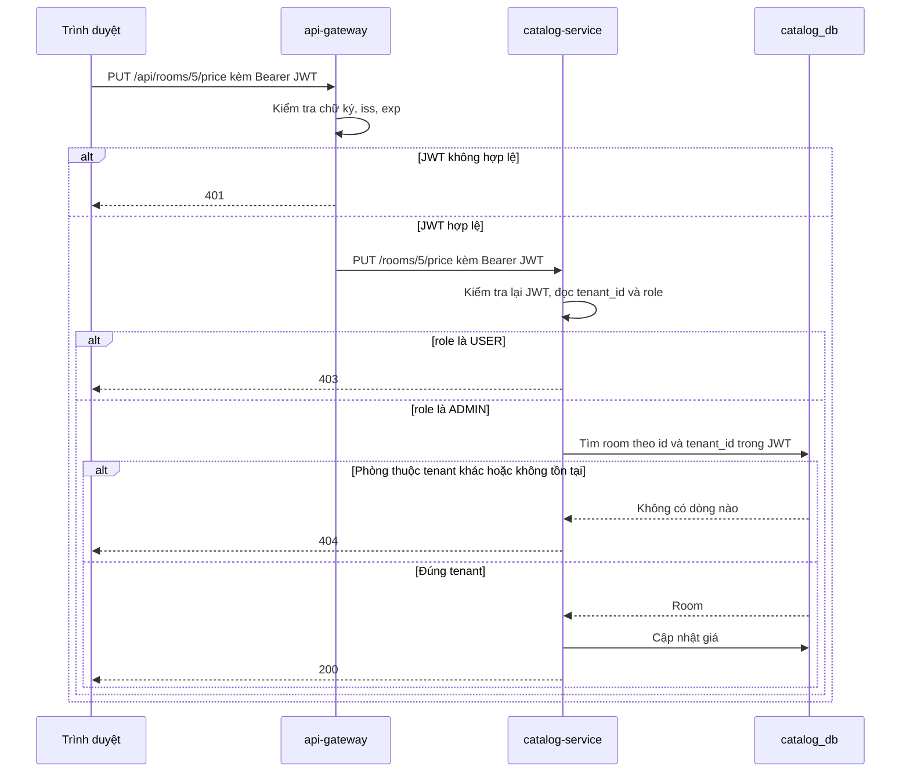
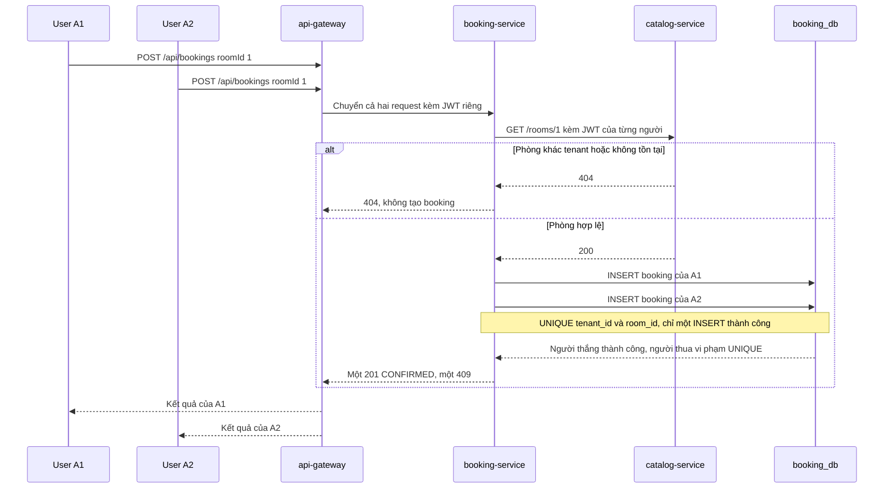

# StayHub: Kế hoạch demo IAM và isolation với Google SSO (v3)

> **Cập nhật:** 02/11/2026  
> **Thay thế:** `iam-google-sso-demo-plan.md` (v1) và `iam-google-sso-demo-plan-v2.md` (v2). `team-plan.md` và `StayHub_Execution_Roadmap_ABCD_3Days.md` chỉ còn để tham khảo.  
> **Trạng thái:** đề xuất, chờ cả nhóm chốt ở mục 14. Chưa có code nào theo plan này.

## 1. Mục tiêu

Mentor đề xuất một demo đơn giản, tập trung vào **IAM và isolation giữa các role**, có thể dùng Google SSO.

Demo phải chứng minh được 3 điều:

1. **Danh tính:** đăng nhập bằng Google, và chỉ email đã được cấp quyền mới vào được.
2. **Role:** `USER` và `ADMIN` chỉ làm được đúng việc của mình.
3. **Tenant:** người của tenant này không đọc, sửa hay đặt được dữ liệu của tenant khác, kể cả khi tự đổi ID trong URL hoặc body.

**Demo hoàn thành khi toàn bộ bảng kiểm tra ở mục 9 PASS** và mỗi người giải thích được phần code của mình.

## 2. Phạm vi

| Làm | Không làm |
|---|---|
| Google login qua `iam-service`, JWT nội bộ, JWKS | Keycloak, V-ID thật, tự xây Authorization Server |
| 2 tenant, 2 role, tài khoản cấp trước | Tự đăng ký, gán tenant tự động |
| Xem, thêm phòng, sửa giá | Tồn kho theo ngày, loại phòng, giá theo ngày |
| Đặt phòng tối giản, xem booking theo quyền | Thanh toán, hủy booking, idempotency key |
| SSO giữa 2 origin, PKCE S256 | Refresh token, revocation, xoay khóa |
| Flyway, unit test, 3 sequence diagram | Notification, push, Kafka, Kubernetes, website đầy đủ, mua vé |

Đề bài ban đầu vẫn được bao phủ, trừ push:

| Chủ đề | Thể hiện ở đâu |
|---|---|
| Java 21, Spring Boot, Gradle | Monorepo hiện có |
| Flyway | `iam_db`, `catalog_db`, `booking_db` |
| RESTful API | Mục 7 |
| Unit test | Mục 10 |
| IAM, SSO, PKCE | Mục 5, với Google thay V-ID |
| Multi-tenancy | Mục 6, 7 và 9 |
| Nghiệp vụ khách sạn | Phòng và đặt phòng ở mức tối giản |
| Sequence diagram | Mục 13 |
| Mobile push | **Không code.** Cần nói rõ với mentor, không tuyên bố đã làm |

## 3. Các quyết định chính

| Vấn đề | Chọn | Lý do |
|---|---|---|
| Nguồn đăng nhập | `iam-service` là OAuth2 client của Google, tự ký JWT nội bộ | Google không biết tenant và role của StayHub. Đây chính là phần IAM cần chứng minh |
| Chống đặt trùng | `UNIQUE (tenant_id, room_id)` trong `booking_db`, **bỏ `hold`, `/internal/**` và cờ `available`** | Ghi vào đúng một DB nên không có phòng bị kẹt, không cần `release`, không có endpoint nội bộ để bảo vệ |
| Lọc tenant | Viết tường minh `findByIdAndTenantId`, không dùng `@TenantId` | Dễ đọc, dễ giải thích và dễ test với nhóm mới học |
| Lấy thông tin user | Đọc từ `Jwt` qua `CurrentUser`, không dùng `ThreadLocal` | Không phải dọn context, ít lỗi hơn |
| Frontend | **Một** trang HTML chạy trên 2 cổng bằng 2 container nginx | Có đủ 2 origin để chứng minh SSO mà không phải viết 2 ứng dụng |
| PKCE | Giữ, cấu hình ở chặng IAM với Google | Vài dòng cấu hình và có thể quan sát được. Xem giới hạn thời gian ở mục 5.3 |
| Token khi phát triển | `POST /dev/token`, chỉ có ở profile `dev` | Hòa, Phúc, Đạt không phải chờ Google, và test được cả token hỏng hoặc hết hạn |
| Đo tiến độ | Bảng kiểm tra mục 9 | Bỏ con số 8/9 của v2 vì mentor đã đổi trọng tâm |

## 4. Kiến trúc

```text
Trang HTML :3000 ─┐
                  ├─ điều hướng ──> iam-service :8084 ── Code + PKCE ──> Google
Trang HTML :3001 ─┘                     │
      │                                 └─ iam_db, JWKS
      │ Bearer JWT
      v
api-gateway :8080 ─┬─ /api/rooms/**    ──> catalog-service :8081 ──> catalog_db
                   └─ /api/bookings/** ──> booking-service :8082 ──> booking_db
                                              │
                                              └─ GET /rooms/{id} + JWT ──> catalog-service
```

Trình duyệt gọi **thẳng** `iam-service` để login, không đi qua gateway. Gateway và các service tự kiểm tra JWT bằng JWKS của IAM.

| Thành phần | Công nghệ |
|---|---|
| Ngôn ngữ, build | Java 21, Gradle hiện có |
| Framework | Spring Boot 3.3.5, Spring Cloud 2023.0.3. **Không nâng phiên bản trong 3 ngày này** |
| Database | Một PostgreSQL 16, 3 database, Flyway |
| Gọi giữa service | `RestClient` |
| Lỗi | `ProblemDetail` |
| Test | JUnit 5, Mockito, `spring-security-test` |

## 5. IAM

### 5.1 Luồng login

1. Trang HTML điều hướng tới `GET http://localhost:8084/auth/start?app=app1`.
2. IAM kiểm tra `app` nằm trong allowlist. Sai thì trả 400 và không redirect.
3. Nếu session IAM đã đăng nhập, IAM ký JWT mới và redirect về trang đó ngay. Nếu chưa, IAM lưu `app` vào session và chuyển sang login Google.
4. Google gọi về `http://localhost:8084/login/oauth2/code/google`.
5. IAM kiểm tra `email_verified`, chuẩn hóa email về chữ thường rồi tra `app_user`:
   - Không có email: từ chối.
   - `google_sub` còn trống: ghi `sub` của Google vào. Việc này chỉ xảy ra ở lần login đầu.
   - `google_sub` đã có nhưng khác: từ chối. Google khuyến nghị dùng `sub`, không dùng email, làm định danh.
6. Thành công: redirect về `http://localhost:3000/#token=<jwt>`.
7. Bị từ chối: **xóa session IAM**, rồi redirect về `http://localhost:3000/#error=not_provisioned`. Không để lại trang 403 trần.
8. Trang HTML đọc fragment, xóa ngay bằng `history.replaceState`, và chỉ giữ token trong bộ nhớ.

`GET /auth/logout?app=app1` xóa session IAM rồi quay về trang. Khi chuyển sang Google, IAM gửi `prompt=select_account` để đổi tài khoản được. **Không dùng `prompt=login`** vì sẽ bắt nhập lại mật khẩu và làm hỏng demo SSO.

### 5.2 SSO

Login ở cổng 3000, sau đó mở cổng 3001 trong cùng browser profile và bấm Login. Session IAM còn hiệu lực nên trang 3001 nhận JWT ngay, **không phải nhập lại mật khẩu**.

Cần trình bày đúng: SSO giữa 2 trang đến từ session của IAM, còn Google chứng minh danh tính ở lần đầu.

### 5.3 PKCE

- `code_verifier` nằm ở IAM, không nằm ở trình duyệt. Sơ đồ phải thể hiện đúng điều này.
- Với client có secret, Spring **không tự bật** PKCE. Dự án đang dùng Boot 3.3.5, nên thử `DefaultOAuth2AuthorizationRequestResolver` với `OAuth2AuthorizationRequestCustomizers.withPkce()`. Tài liệu Spring mới nhất dùng `requireProofKey`, có thể chưa có ở phiên bản của nhóm.
- **Bằng chứng:** DevTools cho thấy request tới Google có `code_challenge` và `code_challenge_method=S256`, và login hoàn tất. Không ghi lại verifier, code, secret hay JWT.
- **Giới hạn thời gian:** nhóm chưa chạy thử phần này. Nếu sau 1 giờ chưa chạy được với Google, Bảo báo cả nhóm, tạm tắt PKCE để không chặn các việc khác và ghi rõ là chưa đạt.

### 5.4 JWT nội bộ

```json
{
  "iss": "http://localhost:8084",
  "sub": "<id trong app_user>",
  "email": "user-a1@example.com",
  "tenant_id": "11111111-1111-1111-1111-111111111111",
  "role": "USER",
  "iat": 1793000000,
  "exp": 1793000900
}
```

- Ký RS256, `exp` là 15 phút. Không có refresh token, hết hạn thì login lại.
- Sinh RSA key lúc khởi động, có `kid`, giữ trong bộ nhớ. Restart IAM thì phải login lại, đổi lại không có private key để lộ.
- `GET /.well-known/jwks.json` phải để `permitAll`, nếu không chain của `oauth2Login` sẽ redirect request này sang Google.

### 5.5 Token phát triển

`POST /dev/token` chỉ tồn tại ở profile `dev`:

```json
{ "sub": "user-a1", "tenantId": "1111...", "role": "USER", "expiresInSeconds": 900 }
```

Token được ký bằng đúng key và `iss` của IAM. Cho phép bỏ `tenantId` hoặc đặt `expiresInSeconds` âm để tạo ca lỗi. **Không bật profile `dev` khi demo Google** (kiểm tra I-19).

## 6. Bảo mật ở service và gateway

### `common-security` (hiện chỉ có `package-info.java`, cần viết mới)

- Dùng cho **`catalog-service` và `booking-service`**. Bỏ dependency này khỏi `api-gateway`, vì gateway là reactive còn 2 service kia là servlet.
- Sửa `package-info.java` đang khai báo sai package.
- Đăng ký bean bằng auto-configuration, vì `com.hotelbooking.security` nằm ngoài phạm vi scan của các service.
- Gồm:
  - `SecurityFilterChain` ở chế độ `STATELESS`.
  - Chuyển claim `role` thành `ROLE_USER` hoặc `ROLE_ADMIN`.
  - Validator bắt buộc phải có `exp`, `tenant_id`, `role`. Spring mặc định không từ chối token thiếu `exp`.
  - `CurrentUser(sub, email, tenantId, role)` đọc từ `Jwt`.

### Cấu hình trong `application.yml` của gateway và 2 service

Đặt **cả hai** giá trị. Nếu chỉ có `issuer-uri`, Spring sẽ tìm endpoint discovery mà IAM không có. Nếu chỉ có `jwk-set-uri`, `iss` sẽ không được kiểm tra.

```yaml
spring:
  security:
    oauth2:
      resourceserver:
        jwt:
          issuer-uri: http://localhost:8084
          jwk-set-uri: http://localhost:8084/.well-known/jwks.json
```

### `api-gateway`

| Đường dẫn ngoài | Service | Bộ lọc |
|---|---|---|
| `/api/rooms/**` | `http://localhost:8081` | `StripPrefix=1` |
| `/api/bookings/**` | `http://localhost:8082` | `StripPrefix=1` |

- Bật CORS cho `http://localhost:3000` và `http://localhost:3001`, cho phép header `Authorization`.
- Viết `SecurityWebFilterChain` riêng: cho qua `OPTIONS`, các request khác cần JWT hợp lệ. Nếu không, preflight sẽ bị 401 và trình duyệt không gọi được API.

### Quy tắc bắt buộc

1. `tenant_id`, `sub` và `role` **chỉ lấy từ JWT**, không lấy từ query, header hay body.
2. Không dùng `findById` hay `findAll` trần trên bảng có `tenant_id`.
3. Dữ liệu của tenant khác hoặc người khác trả **404**, không phải 403, để không lộ là bản ghi có tồn tại.
4. Sai role trả **403**. Thiếu token hoặc token hỏng trả **401**.

## 7. API

| Qua gateway | Service | Quyền | Kết quả |
|---|---|---|---|
| `GET /api/rooms` | `GET /rooms` | `USER`, `ADMIN` | 200, chỉ phòng của tenant |
| `GET /api/rooms/{id}` | `GET /rooms/{id}` | `USER`, `ADMIN` | 200, khác tenant trả 404 |
| `POST /api/rooms` | `POST /rooms` | `ADMIN` | 201, tenant lấy từ JWT, body không có trường tenant |
| `PUT /api/rooms/{id}/price` | `PUT /rooms/{id}/price` | `ADMIN` | 200, giá phải lớn hơn 0, khác tenant trả 404 |
| `POST /api/bookings` | `POST /bookings` | `USER` | 201 `CONFIRMED`, đã có người đặt trả 409, khác tenant trả 404 |
| `GET /api/bookings` | `GET /bookings` | `USER`, `ADMIN` | `USER` thấy của mình, `ADMIN` thấy cả tenant |
| `GET /api/bookings/{id}` | `GET /bookings/{id}` | `USER`, `ADMIN` | `USER` đọc booking người khác trả 404, khác tenant trả 404 |

Endpoint của IAM, gọi trực tiếp ở cổng 8084:

| Endpoint | Mục đích |
|---|---|
| `GET /auth/start?app=app1\|app2` | Bắt đầu login |
| `GET /auth/logout?app=app1\|app2` | Xóa session IAM |
| `GET /.well-known/jwks.json` | Khóa công khai |
| `POST /dev/token` | Chỉ ở profile `dev` |

### Luồng đặt phòng

`POST /bookings` với body `{ "roomId": 1 }`:

1. Lấy `tenant_id` và `sub` từ JWT.
2. Gọi `GET /rooms/{roomId}` sang catalog, forward JWT. Catalog trả 404 thì trả 404. Catalog không gọi được thì trả 503.
3. `INSERT` booking. Vi phạm `UNIQUE` thì trả 409.
4. Trả 201 với trạng thái `CONFIRMED`.

Booking lỗi không làm thay đổi gì ở catalog, nên không có phòng bị kẹt.

## 8. Dữ liệu

| Database | Bảng | Cột |
|---|---|---|
| `iam_db` | `tenant` | `id` UUID, `name` |
| `iam_db` | `app_user` | `id` UUID, `email` unique, `tenant_id`, `role`, `google_sub` unique, có thể trống |
| `catalog_db` | `room` | `id` BIGINT, `tenant_id`, `name`, `price` NUMERIC(12,2) lớn hơn 0 |
| `booking_db` | `booking` | `id` BIGINT, `tenant_id`, `room_id`, `user_sub`, `user_email`, `status`, `created_at`, `UNIQUE (tenant_id, room_id)` |

- Tenant ID cố định, Bảo công bố ở G0: `11111111-1111-1111-1111-111111111111` (tenant A) và `22222222-2222-2222-2222-222222222222` (tenant B).
- `room` seed ID cố định từ 1 đến 6, mỗi tenant 3 phòng. Identity bắt đầu từ 100 để không trùng.
- Không sửa migration đã merge, thay đổi thì thêm version mới.
- Reset demo: `TRUNCATE booking;` trong `booking_db`.

### Tài khoản

| Alias | Tenant | Role | Dùng cho |
|---|---|---|---|
| `admin-a` | A | `ADMIN` | Google thật |
| `user-a1` | A | `USER` | Google thật |
| `admin-b` | B | `ADMIN` | Google thật |
| `user-b1` | B | `USER` | Google thật |
| `user-a2` | A | `USER` | Token dev, hoặc tài khoản Google thứ 5 nếu có |
| `outsider` | Không có | Không có | Google thật, chưa cấp quyền |

**Email thật không vào Git.** Flyway chỉ seed `tenant`. `docs/seed-users.example.sql` là mẫu, còn file thật là `docker/local/seed-users.sql`, chạy tay sau khi Flyway xong.

## 9. Bảng kiểm tra isolation

Đây là tiêu chí hoàn thành. Trừ I-16 đến I-19 phải kiểm tra khi tắt profile `dev`, các ca còn lại chạy được bằng `scripts/isolation-check.sh` với token dev và in PASS hoặc FAIL.

| ID | Người gọi | Hành động | Kỳ vọng |
|---|---|---|---|
| I-01 | Không có token | `GET /api/rooms` | 401 |
| I-02 | Token hết hạn | `GET /api/rooms` | 401 |
| I-03 | Token sai chữ ký | `GET /api/rooms` | 401 |
| I-04 | Token thiếu `tenant_id` | `GET /api/rooms` | 401 |
| I-05 | `user-a1` | `POST /api/rooms` | 403 |
| I-06 | `user-a1` | `PUT` giá phòng của A | 403 |
| I-07 | `admin-a` | `POST /api/rooms`, body kèm `tenantId` của B | 201, phòng thuộc A, B không thấy |
| I-08 | `admin-a` | `PUT` giá phòng của B | 404, giá không đổi |
| I-09 | `user-a1` | `GET /api/rooms` | Chỉ phòng của A |
| I-10 | `user-a1` | `GET` một phòng của B | 404 |
| I-11 | `user-a1` | Đặt phòng của B | 404, không có booking |
| I-12 | `admin-a` | `POST /api/bookings` | 403 |
| I-13 | `user-a1` | `GET` booking của `user-a2` | 404 |
| I-14 | `user-a1` | `GET /api/bookings` | Chỉ booking của mình |
| I-15 | `admin-a` | `GET /api/bookings` | Mọi booking của A, không có của B |
| I-16 | `outsider` | Login Google | Không có JWT, trang hiện `not_provisioned` |
| I-17 | Tài khoản được cấp quyền | Login cổng 3000, rồi cổng 3001 | Không nhập lại mật khẩu |
| I-18 | Tài khoản được cấp quyền | Xem request tới Google | Có `code_challenge`, `S256` |
| I-19 | Bất kỳ | `POST /dev/token` khi không bật `dev` | Không phát token |
| I-20 | `user-a1`, `user-a2` | Cùng đặt một phòng | Một 201, một 409, chỉ 1 dòng trong DB |
| I-21 | Bất kỳ | `/auth/start?app=evil` | 400, không redirect |

Với I-20, script gửi 2 request song song nhiều lần, mỗi lần với một phòng mới hoặc sau khi reset. Nếu dùng token dev, nói rõ khi demo là mô phỏng 2 người dùng.

## 10. Unit test

Unit test không cần Google. Controller test dùng `@WebMvcTest` với `jwt()` của `spring-security-test`. Gọi `curl` không được tính là unit test. Lệnh bằng chứng: `gradlew clean build`.

| Người | Tối thiểu |
|---|---|
| **Bảo** | Email lạ bị từ chối; `email_verified=false` bị từ chối; `sub` khác bị từ chối; `app` lạ bị từ chối; JWT có đủ claim; validator từ chối token thiếu `exp` hoặc `tenant_id` |
| **Hòa** | `USER` thêm hoặc sửa giá trả 403; khác tenant trả 404; danh sách gọi đúng `tenantId`; giá không hợp lệ trả 400 |
| **Phúc** | Catalog 404 thì không tạo booking; trùng phòng trả 409; `USER` chỉ đọc của mình; `ADMIN` đọc trong tenant; `ADMIN` đặt phòng trả 403 |
| **Đạt** | Không viết unit test thay người khác. Sở hữu `scripts/isolation-check.sh` và kết quả chạy |

## 11. Phân công

### Bảo: IAM và nền tảng

- `iam-service`, `iam_db`, `common-security`, root Gradle, Compose.
- Dọn repo:
  - Gỡ Keycloak khỏi Compose và `notification-service` khỏi `settings.gradle`, xóa thư mục service này cùng `services.notification-service` trong config của booking.
  - Script init tạo `iam_db`, bỏ `notification_db`. Script chỉ chạy khi volume trống, nên ai đã chạy Compose cần `docker compose down -v`.
  - Thêm `.env`, `.idea/`, `docker/local/` vào `.gitignore` và gỡ `.idea/` khỏi Git.
- Tạo Google OAuth client loại **Web application**. Redirect URI đúng `http://localhost:8084/login/oauth2/code/google`. Luôn dùng `localhost`, không dùng `127.0.0.1`. Client ID và secret để trong `iam-service/.env`.
- Sequence diagram login, SSO, PKCE.

### Hòa: Catalog và tenant

- `catalog-service`, migration và seed `catalog_db`, API phòng.
- Sequence diagram isolation. Dẫn phần role và tenant khi demo.

### Phúc: Booking

- `booking-service`, migration `booking_db`, API booking, gọi catalog bằng `RestClient` kèm JWT, xử lý 409 và 503.
- Sequence diagram đặt phòng. Dẫn phần đặt phòng và tranh phòng khi demo.

### Đạt: Gateway, frontend và kiểm thử

- `api-gateway`: route, CORS, `SecurityWebFilterChain`. Gỡ `common-security` khỏi gateway.
- `frontend-demo/index.html` và 2 container nginx trong Compose ở cổng 3000, 3001, phối hợp với Bảo vì Bảo sở hữu Compose. Chỉ cần nút login, logout, danh sách phòng, nút đặt, danh sách booking, form của `ADMIN`.
- `scripts/isolation-check.sh`, `docs/demo-guide.md` gồm alias, kịch bản và kết quả kiểm tra.
- Dẫn phần mở đầu và điều phối buổi demo.

### Tài liệu cần có

Chỉ cần: `docs/api-contract.md`, `docs/sequence-diagrams.md`, `docs/demo-guide.md`, `docs/seed-users.example.sql`, và phần chạy dự án trong `README.md`.

### Quy tắc Git và AI

- Mỗi người làm trên nhánh `feat/<tên>-<việc>`, merge qua PR có một người khác review.
- Đổi API, claim, role, port hay migration đã merge phải được cả bên cung cấp và bên dùng đồng ý.
- Mỗi prompt AI chỉ giao một việc. Chỉ merge khi bạn giải thích được code và test đã chạy thật.
- Không commit secret, email thật, token, private key.

## 12. Thứ tự và mốc

**Bảo làm trước**, vì mọi người phụ thuộc vào JWT. Trong lúc chờ, Hòa và Phúc viết test bằng `jwt()`, Đạt dùng JSON mẫu theo contract.

| Mốc | Khi nào | Bảo | Hòa | Phúc | Đạt | Điều kiện đạt |
|---|---|---|---|---|---|---|
| **G0** | Ngày 1, đầu buổi sáng | Công bố tenant ID, port, JWT | Chốt API phòng | Chốt API booking | Viết `api-contract.md`, nhận gateway | Cả nhóm đồng ý mục 14 |
| **G1** | Ngày 1, trưa | Dọn repo, IAM có Flyway, JWKS, `/dev/token` | Flyway, seed | Flyway | Route, CORS, trang HTML khung | `gradlew build` xanh, lấy được token dev |
| **G2** | Ngày 1, cuối ngày | `common-security`, Google login chạy thật | API phòng + test | `POST /bookings` với catalog mock + test | Gateway verify JWT, trang gọi được `/api/rooms` | Gọi được qua gateway bằng token dev |
| **G3** | Ngày 2, trưa | Từ chối email lạ, `sub`, PKCE | Hoàn thiện lỗi 403, 404, 400 | Gọi catalog thật, `GET /bookings` | Trang login Google thật, viết script kiểm tra | Luồng chính chạy bằng JWT Google |
| **G4** | Ngày 2, cuối ngày | SSO 2 cổng, logout, test IAM | Sửa lỗi từ script | Race test, sửa lỗi từ script | Chạy đủ bảng mục 9 | I-01 đến I-21 PASS, hoặc mỗi lỗi có người nhận |
| **G5** | Ngày 3, sáng | Hoàn tất diagram | Hoàn tất diagram | Hoàn tất diagram | Gom tài liệu, dựng lại từ máy sạch | README đủ để máy mới chạy được |
| **G6** | Ngày 3, chiều | Dẫn IAM | Dẫn isolation | Dẫn đặt phòng | Điều phối | Tập demo 2 lần PASS, hỏi chéo, ngừng thêm tính năng |

### Nếu bị trễ, cắt theo thứ tự

1. Giao diện: chỉ giữ login và hiện JSON trả về.
2. `GET /api/bookings/{id}`, giữ danh sách.
3. PKCE, theo mục 5.3, và phải nói rõ là chưa đạt.
4. Gateway: gọi thẳng service, nếu cả nhóm đồng ý và các service vẫn tự kiểm tra JWT.

**Không cắt:** Google login thật, từ chối email lạ, kiểm tra role, kiểm tra tenant, Flyway, unit test.

### Kịch bản demo

Dùng Chrome profile riêng cho mỗi tài khoản để không lẫn session.

| # | Trình diễn | Bằng chứng |
|---|---|---|
| 1 | `gradlew clean build`, chạy dịch vụ | Test xanh, có `flyway_schema_history` trong mỗi DB |
| 2 | `outsider` login | Bị từ chối, không có JWT |
| 3 | `user-a1` login ở cổng 3000 | Request tới Google có PKCE, token có đúng tenant và role |
| 4 | Mở cổng 3001, bấm Login | Không nhập lại mật khẩu |
| 5 | `user-a1` xem phòng, thử thêm phòng | Chỉ thấy phòng A, thêm bị 403 |
| 6 | `admin-a` thêm phòng, sửa giá, thử sửa phòng của B | Thành công, phòng của B trả 404 |
| 7 | `user-a1` đặt phòng, thử đặt phòng của B | 201, phòng của B trả 404 |
| 8 | Chạy `scripts/isolation-check.sh` | Toàn bộ PASS, có ca tranh phòng |
| 9 | Sequence diagram và giới hạn | Giải thích được thiết kế và điều chưa làm |

### Giới hạn cần nói thẳng khi demo

- Token trong URL fragment và không có revocation chỉ phù hợp cho demo.
- Google không phải V-ID, nên đây chỉ chứng minh cách tích hợp SSO theo chuẩn OIDC.
- PKCE nằm ở chặng IAM với Google, không phải ở trình duyệt.
- Mỗi phòng chỉ đặt được một lần, vì chưa có ngày nhận và trả phòng.
- Không có push notification.

## 13. Sequence diagram

Đây là bản nháp. Cập nhật theo code thật trước G5.

### Login, PKCE và SSO



### Role và tenant isolation



### Đặt phòng và tranh phòng



Người thắng có thể là A1 hoặc A2. Kết quả đúng luôn là một 201 và một 409.

## 14. Cả nhóm cần chốt ở G0

- [ ] Plan này thay v1, v2 và phần việc tương ứng trong roadmap cũ.
- [ ] Đồng ý **bỏ `hold`**, dùng `UNIQUE` trong `booking_db`.
- [ ] Đồng ý phân công: Bảo IAM, Hòa Catalog, Phúc Booking, Đạt Gateway, Frontend và kiểm thử.
- [ ] Báo mentor rằng demo **không có push notification**, và PKCE nằm ở chặng IAM với Google.
- [ ] Bảo có quyền tạo OAuth client trên Google Cloud. App chỉ xin `openid`, `email`, `profile` nên theo tài liệu Google không cần thêm test user, nhưng cần thử sớm để chắc chắn.
- [ ] 4 thành viên gửi Gmail cho Bảo qua kênh riêng, không qua Git.

## Tài liệu tham khảo

- [Spring Security: Authorization Grant Support](https://docs.spring.io/spring-security/reference/servlet/oauth2/client/authorization-grants.html)
- [Spring Security: Resource Server JWT](https://docs.spring.io/spring-security/reference/servlet/oauth2/resource-server/jwt.html)
- [Google: OpenID Connect](https://developers.google.com/identity/openid-connect/openid-connect)
- [Google: Manage App Audience](https://support.google.com/cloud/answer/15549945)
