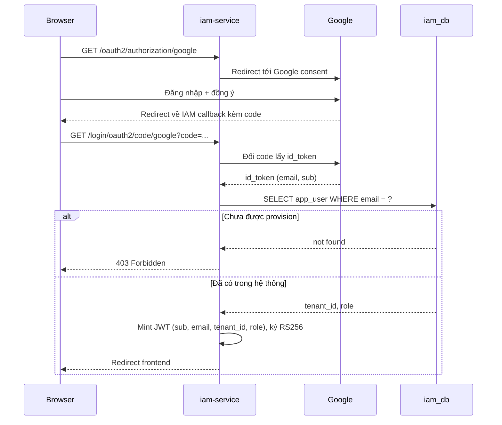
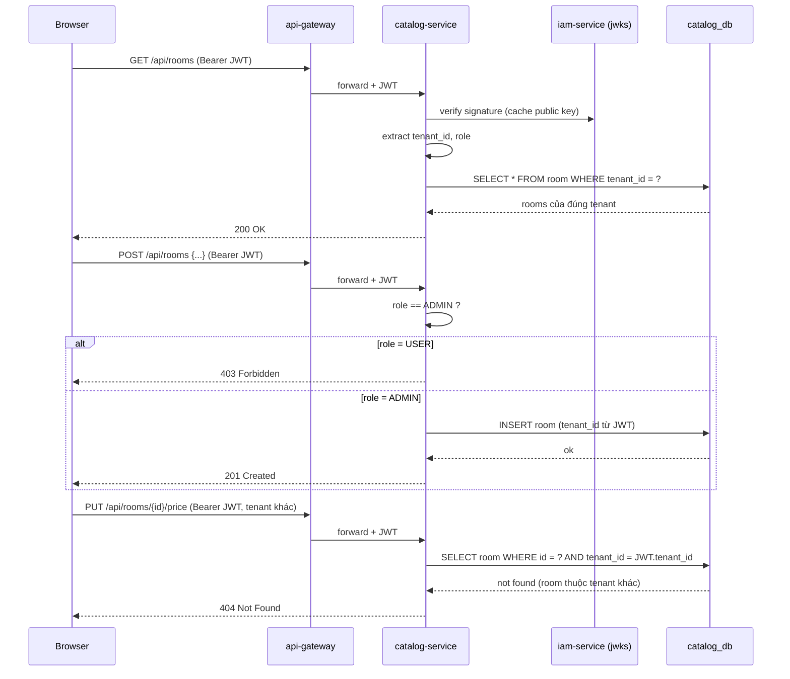
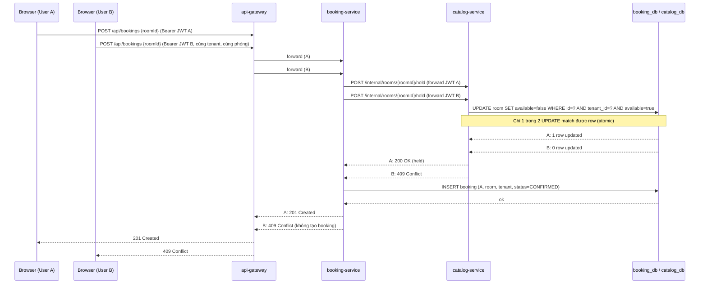

# Plan: Custom IAM service (OAuth2 Client to Google) cho demo multi-tenant đơn giản

Cập nhật: 2026-11-02

> Đây là bản plan cho một **demo thu hẹp phạm vi** so với `team-plan.md` và `StayHub_Execution_Roadmap_ABCD_3Days.md`: bỏ hẳn booking/payment/notification, chỉ còn IAM tự dựng (OAuth2 với Google) + quản lý phòng (xem/thêm/sửa giá) theo tenant.

## Phạm vi

- 2 tenant dùng chung một platform (không clone project khi thêm tenant mới).
- 2 role: `USER` (xem phòng của tenant mình, đặt phòng) và `ADMIN` (thêm phòng, sửa giá của tenant mình).
- Nghiệp vụ booking tối giản: `USER` đặt một phòng còn trống trong tenant của mình; hai người tranh cùng một phòng thì chỉ một người đặt thành công (chống race condition), không có thanh toán/hủy/push — đó vẫn ngoài phạm vi.
- Authentication/authorization: **tự viết `iam-service`** đóng vai trò OAuth2 Client với Google, tự mint JWT nội bộ có `tenant_id` + `role`.
- Tenant isolation bắt buộc: user/admin của tenant A không đọc/sửa/đặt được dữ liệu tenant B.

**Bỏ khỏi phạm vi so với plan cũ:** `notification-service`, Keycloak, PKCE-client-pages, idempotency-key, thanh toán, push, hủy booking (cancel) — ghi là stretch goal nếu dư thời gian.

## Kiến trúc

```
Browser ──login──> iam-service ──OAuth2──> Google
Browser ──Bearer JWT──> api-gateway ──> catalog-service (rooms, tenant_id)
                                  └──> booking-service (bookings, tenant_id)
booking-service ──internal hold──> catalog-service
api-gateway/catalog-service/booking-service ──verify JWT──> iam-service /.well-known/jwks.json
```

Giữ lại và sửa: `api-gateway`, `common-security`, `catalog-service` (CRUD phòng). Thêm mới: `iam-service`, và dùng lại module `booking-service` đã scaffold sẵn (hiện đang trống) cho nghiệp vụ đặt phòng.

## Mô hình dữ liệu (iam_db)

| Bảng | Cột chính |
|---|---|
| `tenant` | `id`, `name` |
| `app_user` | `id`, `email` (unique), `tenant_id`, `role` (`USER`/`ADMIN`), `google_sub` |

Không có flow tự đăng ký: mỗi email Google phải được **pre-seed** vào `app_user` kèm tenant + role trước. Email Google đăng nhập mà không có trong bảng → **403, không tự tạo user mặc định** — đây là chốt isolation quan trọng nhất; nếu auto-provision thì không kiểm soát được user rơi vào tenant nào.

## `iam-service` — việc cần làm

1. Module Gradle mới, add vào `settings.gradle`.
2. `spring-boot-starter-oauth2-client` cấu hình Google (client-id/secret từ Google Cloud Console, redirect URI cố định).
3. Flyway V1: `tenant`, `app_user` + seed 2 tenant × 2 user (1 `USER`, 1 `ADMIN` mỗi tenant, dùng email Gmail thật để test được).
4. `OAuth2LoginSuccessHandler` tùy biến:
   - Lấy email từ ID token Google.
   - Tra `app_user`; không có → trả 403.
   - Có → mint **JWT nội bộ** (RS256), claims: `sub`, `email`, `tenant_id`, `role`.
   - Redirect về frontend kèm token (`http://localhost:3000/callback#token=...`) — dùng URL fragment để token không vào access log server, nhưng ghi rõ đây là simplification cho demo (không có refresh token/revocation).
5. Endpoint `GET /.well-known/jwks.json` publish public key cho các service khác verify.
6. Key: sinh RSA keypair tĩnh lúc khởi động hoặc nạp từ file — đủ cho demo, không cần rotation.

## `common-security` — sửa lại

- Đổi `jwk-set-uri` trỏ từ Keycloak sang `iam-service` JWKS endpoint.
- Converter: map claim `role` → `ROLE_USER`/`ROLE_ADMIN`, claim `tenant_id` → `TenantContext`.
- Giữ nguyên nguyên tắc: JWT thiếu `tenant_id` → reject.

## `catalog-service` — rooms CRUD

- Flyway V1: bảng `room` (`id`, `tenant_id`, `name`, `price`, `available` boolean default `true`), seed vài phòng/tenant (ít nhất 1 phòng có `available=true` duy nhất để test tranh phòng).
- `GET /rooms` — `USER` hoặc `ADMIN`, luôn filter theo `tenant_id` lấy từ JWT (không nhận tenant từ query param).
- `POST /rooms` — chỉ `ADMIN`, `tenant_id` gán từ JWT, không nhận từ body.
- `PUT /rooms/{id}/price` — chỉ `ADMIN`, phải kiểm tra `room.tenant_id == JWT.tenant_id` trước khi sửa, sai thì 404 (không lộ là phòng tồn tại ở tenant khác).
- `POST /internal/rooms/{id}/hold` — **nội bộ, không đi qua gateway**, chỉ gọi từ `booking-service`. Cập nhật nguyên tử `UPDATE room SET available=false WHERE id=? AND tenant_id=? AND available=true`; 0 row ảnh hưởng → trả 409 (phòng đã bị người khác giữ). Đây là điểm chống tranh phòng.
- (Stretch, chưa code) `POST /internal/rooms/{id}/release` — trả phòng về `available=true` khi cần hủy booking.

## `booking-service` — đặt phòng

- Flyway V1: bảng `booking` (`id`, `tenant_id`, `room_id`, `user_email`, `status` (`CONFIRMED`), `created_at`).
- `POST /bookings` body `{ "roomId": ... }` — chỉ `USER` (hoặc `ADMIN`, nếu muốn cho admin cũng đặt được — mặc định chỉ `USER` theo đúng nghiệp vụ đã mô tả).
  1. Lấy `tenant_id`, `email` từ JWT.
  2. Gọi `POST /internal/rooms/{roomId}/hold` sang `catalog-service`, forward JWT để `catalog-service` tự kiểm tra lại `tenant_id`.
  3. Hold thành công (room cùng tenant + còn trống) → insert `booking` status `CONFIRMED`, trả `201`.
  4. Hold thất bại (409 từ catalog, hoặc room thuộc tenant khác/không tồn tại → 404) → trả lỗi tương ứng, **không** tạo booking.
- `GET /bookings` — `USER` chỉ thấy booking của chính mình (`user_email` + `tenant_id`); `ADMIN` thấy toàn bộ booking trong tenant của mình. Không ai thấy booking tenant khác.
- `GET /bookings/{id}` — kiểm tra `tenant_id` khớp JWT và (nếu role `USER`) `user_email` khớp chủ booking, sai thì 404.
- Không có thanh toán: booking tạo ra là `CONFIRMED` ngay (không có trạng thái `PENDING` chờ pay, khác với plan gốc, vì thanh toán ngoài phạm vi demo này).

## `api-gateway`

- Route `/auth/**` → `iam-service` (không cần JWT, đây là login flow).
- Route `/api/rooms/**` → `catalog-service` (cần JWT hợp lệ).
- Route `/api/bookings/**` → `booking-service` (cần JWT hợp lệ).
- `/internal/**` của mọi service **không** được route ra qua gateway.

## Frontend demo tối giản

Một trang HTML: nút "Login with Google" → redirect iam-service → callback đọc token từ URL fragment → lưu trong memory → gọi `GET /api/rooms` hiển thị danh sách; nếu `role=ADMIN` hiện thêm form thêm phòng/sửa giá.

## Sequence diagram 1 — Login & phát JWT



## Sequence diagram 2 — Xem phòng (USER) & thêm/sửa phòng (ADMIN) có tenant isolation



## Sequence diagram 3 — Đặt phòng (USER), hai người tranh cùng một phòng



## Thứ tự implement đề xuất

1. `iam-service` skeleton + Google OAuth2 + seed data + mint JWT + JWKS.
2. `common-security` đổi sang verify qua JWKS của `iam-service`.
3. `catalog-service` rooms CRUD + `available` flag + endpoint internal `hold` + tenant/role enforcement.
4. `booking-service` tạo booking (gọi `catalog-service` hold) + xem booking theo role.
5. `api-gateway` route 3 service trên (`iam-service`, `catalog-service`, `booking-service`), chặn `/internal/**`.
6. Frontend demo 1 trang: login, xem phòng, đặt phòng (user), thêm phòng/sửa giá (admin).
7. Test tay: 2 tenant × (user, admin) login thật bằng Gmail; xác nhận isolation; hai user cùng tenant tranh 1 phòng chỉ 1 thành công.

## Điểm cần chốt / có thể đổi

- **Chính sách provisioning:** hiện chốt là pre-seed thủ công, từ chối email lạ. Nếu muốn tự động tạo user mới khi lần đầu login thì cần quy tắc gán tenant (ví dụ theo domain email) — chưa chốt trong bản này.
- **Cơ chế giao token về frontend:** hiện dùng URL fragment redirect, không có refresh token/revocation — là simplification cho demo, không dùng cho production.
- **Booking không có ngày check-in/check-out:** mỗi phòng chỉ có cờ `available` on/off, không phải tồn kho theo ngày như plan gốc — đơn giản hóa chủ ý cho demo. Nếu sau này cần đặt theo khoảng ngày, phải đổi `room` sang bảng tồn kho theo ngày (giống `room_inventory` ở plan cũ).
- **Hủy booking (cancel) và trả phòng (`release`):** chưa code, để là stretch goal nếu dư thời gian — nếu làm thì cần thêm trạng thái `CANCELLED` và gọi `/internal/rooms/{id}/release`.
