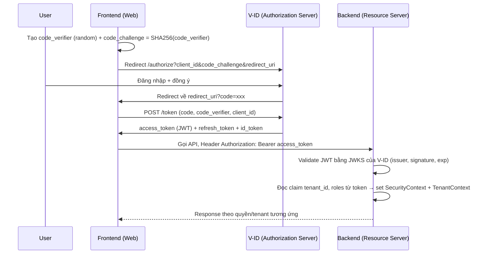
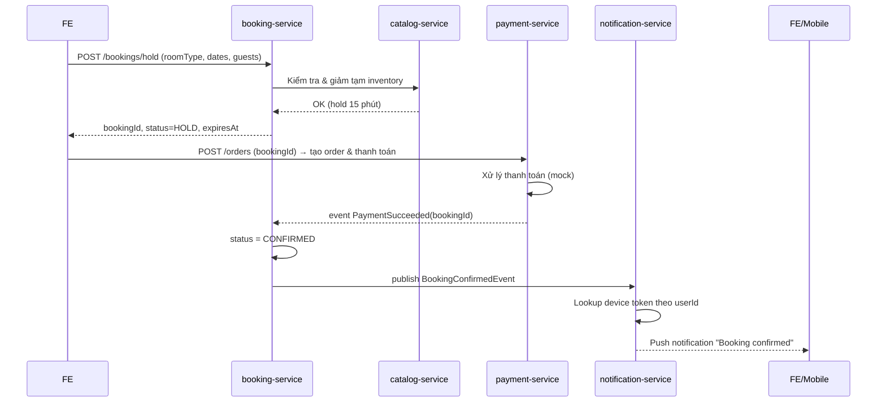

# HotelBookingSystem — Project Plan

> Tài liệu này là bản kế hoạch triển khai cho team 4 người. Mục tiêu: xây một hệ thống Hotel Booking (đặt phòng + mua vé dịch vụ du lịch) theo mô hình **modular monolith** (dễ tách thành microservice sau), dùng Java 21 (LTS, tương thích lên tới 25), Spring Boot 3.x, Gradle multi-module, Flyway, REST API, IAM/SSO qua V-ID (OIDC + PKCE), multi-tenant, và tích hợp push notification (không build app mobile, nhưng backend phải hiểu và chủ động thiết kế đúng luồng).

## 0. Nguyên tắc chung

- **Cả 4 người đều là backend dev, đều phải nắm vững toàn bộ tech stack mentor giao** (Java/Spring Boot/Gradle, Flyway, REST API, Unit Test, IAM/SSO V-ID/PKCE, Multi-tenant, push notification) — không chia ai "nhẹ" ai "nặng" theo kiểu 1 người ôm FE còn 3 người ôm backend. FE **không phải là một vai trò riêng/một người riêng** — màn hình FE được vibecode nhanh bằng AI, gắn kèm theo module của chính người phụ trách module đó (ai làm module nào thì vibecode luôn phần UI gọi API của module mình), nên không ai bị thiệt phần học backend vì phải lo FE.
- Mỗi người chủ 1-2 module backend (xem mục 10), nhưng **đều phải hiểu toàn bộ hệ thống** (kiến trúc, luồng nghiệp vụ, sequence diagram của module khác), không chỉ module mình code.
- Cơ chế đảm bảo hiểu: mỗi sprint có 1 buổi **cross-review** — mỗi người thuyết trình lại (bằng lời, không cần slide) luồng của module người khác dựa trên sequence diagram. Mentor có thể hỏi bất kỳ ai về bất kỳ module.
- Toàn bộ nghiệp vụ, luồng quan trọng phải có **sequence diagram** (Mermaid, vẽ trong `docs/diagrams/`) trước khi code, review bởi cả team trước khi merge.

---

## 1. Phạm vi MVP

Giữ scope đủ nhỏ để 4 người hoàn thành trong ~8 tuần (4 sprint x 2 tuần):

**In-scope:**
- Đăng nhập/đăng ký qua SSO V-ID (Authorization Code + PKCE), multi-tenant (mỗi khách sạn/đại lý là 1 tenant).
- Quản lý khách sạn, loại phòng, giá, tồn phòng (inventory) theo ngày.
- Tìm phòng trống theo ngày/số khách, đặt phòng (booking), giữ chỗ tạm (hold), hủy, xác nhận.
- Mua vé dịch vụ kèm (tour/vé tham quan) gắn với booking hoặc độc lập.
- Thanh toán: mock/sandbox payment provider (không cần tích hợp cổng thật) + trạng thái đơn hàng.
- Push notification: khi booking được xác nhận / thanh toán thành công / sắp đến ngày check-in → gửi notification (thiết kế & implement notification-service gửi qua FCM, FE/mobile chỉ cần đăng ký device token).
- Unit test + 1 lớp integration test (Testcontainers) cho mỗi service.

**Out-of-scope (ghi rõ để khỏi lan phạm vi):**
- Build app mobile thật (chỉ cần hiểu & expose API cho nó).
- Cổng thanh toán thật (VNPay/Momo) — chỉ làm adapter interface + 1 implementation giả lập.
- Schema-per-tenant đầy đủ (dùng shared-schema + `tenant_id` cho MVP, ghi chú hướng mở rộng).

---

## 2. Kiến trúc tổng thể

**Modular monolith** — một Spring Boot application, chia theo Gradle module theo domain (bounded context), giao tiếp nội bộ qua Java interface/service layer (không qua HTTP nội bộ) để đơn giản, nhưng **tách rõ package & module** để sau này convert sang microservices nếu cần (mỗi module gần như đã là 1 "service" độc lập về domain + có thể có DB schema riêng).

```
HotelBookingSystem/
├── app/                      # Spring Boot entrypoint, cấu hình chung, API Gateway nội bộ (@RestController tổng)
├── common/                   # DTO chung, exception handler, utils, security context, tenant context
├── iam-service/              # SSO/OIDC/PKCE integration, JWT validation, role/permission, tenant resolver
├── catalog-service/          # Hotel, RoomType, RatePlan, Inventory/Availability
├── booking-service/          # Booking, Hold/Reservation, Cancellation
├── ticketing-service/        # Vé dịch vụ/tour, gắn với booking hoặc đứng riêng
├── payment-service/          # Order, Payment adapter (mock), Invoice
├── notification-service/     # Device token registry, template, FCM adapter, event listener
└── docs/
    ├── project-plan.md       # (file này)
    └── diagrams/              # Mermaid sequence/ERD diagrams
```

> Module `list`, `utilities` hiện tại trong `settings.gradle` là skeleton mặc định của `gradle init`, sẽ bị xóa/đổi tên khi dựng lại cấu trúc trên.

**Giao tiếp giữa module:** gọi trực tiếp qua Spring bean (interface trong mỗi module expose, implement nội bộ). Giao tiếp **bất đồng bộ** giữa booking/payment → notification dùng **Spring Application Event** (đơn giản, trong-process) cho MVP; ghi chú trong docs là điểm có thể thay bằng message broker (RabbitMQ/Kafka) khi tách microservice.

**Database:** 1 PostgreSQL instance, 1 schema cho MVP, mọi bảng nghiệp vụ có cột `tenant_id`. Flyway migration đặt tại `app/src/main/resources/db/migration`, đặt tên file theo module để dễ trace: `V1__iam_core.sql`, `V2__catalog_core.sql`, `V3__booking_core.sql`, v.v. (Flyway chạy theo thứ tự version, không theo module, nên **thứ tự migration phải tôn trọng FK dependency**: iam → catalog → booking → ticketing → payment → notification).

---

## 3. Tech stack cụ thể

| Thành phần | Lựa chọn |
|---|---|
| Ngôn ngữ | Java 21 (baseline), viết code tương thích để nâng lên 25 khi cần (tránh API preview/incubator) |
| Framework | Spring Boot 3.3+ (Spring Security 6, Spring Data JPA) |
| Build | Gradle (Groovy DSL, giữ nguyên style hiện có), version catalog `gradle/libs.versions.toml` |
| DB | PostgreSQL 16 |
| Migration | Flyway |
| Auth | Spring Security OAuth2 Resource Server (JWT, JWKS) + V-ID là Authorization Server ngoài (OIDC), FE/BFF làm PKCE |
| API docs | springdoc-openapi (Swagger UI) — bắt buộc, vì màn hình FE của từng module sẽ được chính người đó vibecode dựa vào spec này |
| Test | JUnit 5, Mockito, AssertJ, Testcontainers (Postgres), MockMvc/WebTestClient cho test controller |
| Push notification | Firebase Cloud Messaging (FCM) HTTP v1 API qua `notification-service` |
| Diagram | Mermaid (`.md` render trực tiếp trên GitHub) |

---

## 4. IAM / SSO (V-ID) + PKCE — ai cũng phải hiểu luồng này

V-ID đóng vai trò **Authorization Server (OIDC)**. Backend chỉ là **Resource Server** — không tự cấp token, chỉ validate.

**Luồng Authorization Code + PKCE (chuẩn OAuth2):**



**Việc backend cần làm (cả 4 người đều phải hiểu, không riêng ai):**
1. Cấu hình `spring.security.oauth2.resourceserver.jwt.jwk-set-uri` trỏ tới V-ID.
2. Viết `JwtAuthenticationConverter` map claim `roles`/`tenant_id` → `GrantedAuthority` + `TenantContext` (ThreadLocal/RequestScope).
3. `TenantFilter`/`TenantInterceptor` set tenant hiện tại cho mọi request, mọi query JPA tự động filter theo `tenant_id` (Hibernate `@Filter` hoặc `@TenantId` nếu dùng Hibernate 6.4+).
4. Không lưu password, không tự làm login form — **mọi login đi qua V-ID**.

> ⚠️ Cần hỏi mentor: V-ID có cấp sẵn sandbox/client_id, authorize/token/jwks endpoint, hay nhóm phải tự dựng mock OIDC server (ví dụ Keycloak) để giả lập V-ID lúc dev? Đây là rủi ro lớn nhất về timeline, nên hỏi **ngay đầu sprint 1**.

---

## 5. Multi-tenant

- Chiến lược: **Shared database, shared schema, discriminator column `tenant_id`** (đơn giản nhất, đủ cho MVP học tập).
- Tenant được xác định từ JWT claim (`tenant_id`) sau khi login qua V-ID — **không** nhận tenant từ request param do client gửi lên (tránh tenant spoofing).
- Mọi entity nghiệp vụ (`Hotel`, `Booking`, `Ticket`, `Payment`, ...) có `tenant_id`, index composite `(tenant_id, ...)`.
- Áp Hibernate filter theo tenant ở tầng base repository, không để rải điều kiện `WHERE tenant_id = ?` thủ công từng chỗ (dễ quên → lộ dữ liệu tenant khác — phải tránh).
- Ghi chú hướng mở rộng (không làm ở MVP): schema-per-tenant hoặc database-per-tenant khi cần cách ly mạnh hơn.

---

## 6. Domain nghiệp vụ & data model (rút gọn)

Entity chính:

- **Tenant** — khách sạn/đại lý.
- **Hotel** — thuộc 1 tenant.
- **RoomType** — loại phòng (Standard, Deluxe...), thuộc Hotel.
- **RatePlan** — giá theo RoomType + khoảng ngày + điều kiện (refundable/non-refundable).
- **Inventory** — số phòng trống theo `(room_type_id, date)`.
- **Booking** — đặt phòng: guest info, check-in/out date, status (`HOLD → CONFIRMED → CHECKED_IN → COMPLETED/CANCELLED`).
- **Ticket** — vé dịch vụ/tour, có thể đứng riêng hoặc gắn `booking_id`.
- **Order** — gộp Booking + Ticket để thanh toán 1 lần; có `Payment`.
- **Payment** — trạng thái thanh toán, gắn `Order`.
- **DeviceToken** — token push notification của user (do FE/mobile đăng ký).
- **NotificationLog** — lịch sử notification đã gửi.

**Luồng đặt phòng (ví dụ sequence cần vẽ chi tiết trong `docs/diagrams/booking-flow.md`):**



---

## 7. Notification Service (Push Notification) — không build mobile nhưng phải hiểu đúng

Vì team không làm app mobile, trọng tâm là **backend expose đúng contract** để mobile (do bên khác/tương lai làm) tích hợp được, và **hiểu cơ chế delivery** để không thiết kế sai:

- `POST /api/v1/notifications/device-tokens` — mobile app gọi để đăng ký FCM token (`{userId, token, platform}`).
- `notification-service` lắng nghe domain event (`BookingConfirmedEvent`, `PaymentSucceededEvent`, `CheckInReminderEvent` — reminder dùng scheduled job) → build payload → gọi FCM Admin SDK/HTTP v1 API gửi tới token tương ứng.
- Phải hiểu: FCM **không đảm bảo delivery tức thì**, cần lưu `NotificationLog` (trạng thái SENT/FAILED) để debug & không gửi trùng.
- Multi-tenant: template notification có thể khác theo tenant (tên khách sạn trong nội dung) — lấy từ `tenant_id` trong event.

---

## 8. REST API chuẩn

- Versioning: `/api/v1/...`.
- Response lỗi theo RFC 7807 (`application/problem+json`) — 1 `GlobalExceptionHandler` chung trong `common`.
- Phân trang: `?page=&size=&sort=`, response bọc `PageResponse<T>`.
- DTO tách biệt hoàn toàn Entity (không trả JPA entity ra API).
- OpenAPI/Swagger UI bắt buộc bật ở mọi service — **đây là hợp đồng để chính người phụ trách module vibecode UI cho module đó**, phải cập nhật spec trước khi bắt đầu vibecode màn hình liên quan.

---

## 9. Testing

- Mỗi module: unit test cho service/business logic (Mockito mock repository), tối thiểu test các nhánh rẽ trạng thái (ví dụ booking: hold hết hạn, double-booking, hủy sau khi confirm).
- Integration test: dùng Testcontainers Postgres, test ít nhất 1 flow end-to-end quan trọng/module (ví dụ: hold → confirm → inventory giảm đúng).
- Không mock DB trong integration test (tránh lệch hành vi thật, đặc biệt với tenant filter & Flyway migration).
- CI (nếu có): chạy `./gradlew test` trên mọi PR trước khi merge.

---

## 10. Phân chia công việc 4 người

Chia đều 4 module backend cho 4 người — **ai cũng code backend full stack tech (Spring/Flyway/REST/Unit Test) trên module của mình**, không ai bị "đẩy" ra làm thuần FE. Phần UI (web) của từng module do đúng người phụ trách module đó vibecode luôn (nhanh, không tính là khối lượng học chính), vì họ hiểu rõ API/luồng nhất để vibecode đúng.

| # | Vai trò | Module backend phụ trách | UI vibecode kèm theo | Vì sao vẫn cần hiểu toàn hệ thống |
|---|---|---|---|---|
| 1 | **Platform/IAM Dev** | `iam-service`, `common` (security, tenant context), base Flyway setup | Màn hình login/redirect SSO (PKCE), quản lý tenant | Mọi module khác phụ thuộc vào auth/tenant context của người này — phải hiểu rõ nghiệp vụ booking/ticket để thiết kế đúng claim/permission |
| 2 | **Catalog & Booking Dev** | `catalog-service`, `booking-service` | Màn hình search phòng, tạo booking, hold/cancel | Trung tâm nghiệp vụ, phải hiểu IAM (ai được đặt phòng cho tenant nào) và payment/notification (khi nào confirm, khi nào bắn event) |
| 3 | **Ticketing & Payment Dev** | `ticketing-service`, `payment-service` | Màn hình mua vé kèm/độc lập, thanh toán, lịch sử order | Phải hiểu booking-service để biết khi nào order được tạo/khi nào cần thanh toán; phải hiểu IAM để biết token/tenant truyền qua ra sao |
| 4 | **Notification & Platform Infra Dev** | `notification-service`, hạ tầng chung (docker-compose, Swagger aggregation, CI) | Màn hình đăng ký device token (demo), trang "thông báo của tôi" | Phải hiểu booking/payment để biết event nào trigger notification; phải hiểu IAM để lấy đúng user/tenant khi gửi push |

Gợi ý phân nhỏ hơn theo tuần nằm ở mục Sprint Plan dưới.

---

## 11. Sprint Plan (8 tuần, 4 sprint x 2 tuần)

**Sprint 0 (chuẩn bị, trước khi code — 2-3 ngày):**
- Cả team: đọc & chốt tài liệu này, vẽ nháp ERD + các sequence diagram chính trong `docs/diagrams/`.
- Platform/IAM Dev: hỏi mentor rõ V-ID (sandbox endpoint/credential, hay cần mock bằng Keycloak).
- Dựng skeleton Gradle module theo mục 2, setup Flyway + Postgres (docker-compose), setup Swagger.

**Sprint 1 — Nền tảng:**
- Platform/IAM Dev: tích hợp OIDC Resource Server, JWT validation, `TenantContext`, role-based `@PreAuthorize`; vibecode màn hình login redirect tới V-ID (PKCE).
- Catalog & Booking Dev: `catalog-service` — CRUD Hotel/RoomType/RatePlan/Inventory + Flyway schema; vibecode màn hình đọc danh sách hotel.
- Ticketing & Payment Dev: `ticketing-service` CRUD cơ bản + thiết kế event contract (`BookingConfirmedEvent`,...); vibecode màn hình danh sách vé.
- Notification & Infra Dev: dựng docker-compose, Swagger aggregation, CI; khung `notification-service` (chưa cần FCM thật).
- Cuối sprint: **cross-review** — mỗi người giải thích luồng PKCE bằng sơ đồ.

**Sprint 2 — Luồng đặt phòng:**
- Catalog & Booking Dev: `booking-service` hold/confirm/cancel, kiểm tra double-booking; vibecode màn hình search phòng + tạo booking.
- Ticketing & Payment Dev: `payment-service` (mock), publish event khi payment success; vibecode màn hình thanh toán mock.
- Platform/IAM Dev: hoàn thiện authorization theo role (admin tenant vs guest), viết integration test cho tenant isolation (test quan trọng nhất: user tenant A không thấy data tenant B).
- Notification & Infra Dev: thiết kế `DeviceToken`/`NotificationLog` schema (Flyway), API đăng ký device token.
- Cross-review: giải thích luồng booking end-to-end + tenant isolation.

**Sprint 3 — Notification & vé dịch vụ:**
- Notification & Infra Dev: `notification-service` — FCM adapter, event listener, gửi log "đã gửi"; vibecode trang "thông báo của tôi".
- Catalog & Booking Dev: gắn `ticketing-service` vào booking flow (mua vé kèm phòng).
- Ticketing & Payment Dev: vibecode màn hình mua vé kèm/độc lập; hoàn thiện order gộp booking+ticket.
- Platform/IAM Dev: rà soát security toàn hệ thống (OWASP checklist cơ bản), viết test cho JWT hết hạn/invalid.
- Cross-review: giải thích luồng push notification end-to-end.

**Sprint 4 — Hardening & demo:**
- Cả team: hoàn thiện unit/integration test còn thiếu, dọn code, review bảo mật.
- Viết lại toàn bộ sequence diagram theo code thật (không theo thiết kế ban đầu nếu có lệch).
- Demo end-to-end cho mentor: login SSO → search → book → pay → ticket → push notification.
- Mỗi người bốc ngẫu nhiên 1 module **không phải của mình** để demo/trình bày cho mentor (kiểm tra mức hiểu toàn hệ thống).

---

## 12. Danh sách Sequence Diagram cần có (file riêng trong `docs/diagrams/`)

1. `sso-pkce-login.md` — luồng login V-ID (đã nháp ở mục 4).
2. `booking-flow.md` — hold → pay → confirm (đã nháp ở mục 6).
3. `cancellation-flow.md` — hủy booking, hoàn inventory, (có thể) hoàn tiền.
4. `ticket-purchase-flow.md` — mua vé độc lập vs mua kèm booking.
5. `push-notification-flow.md` — domain event → notification-service → FCM.
6. `tenant-resolution-flow.md` — request vào hệ thống → extract JWT → set TenantContext → query bị filter.

---

## 13. Rủi ro & câu hỏi cần hỏi mentor sớm

1. **V-ID**: có sandbox thật không, hay nhóm tự mock OIDC provider (Keycloak) để dev song song? (Rủi ro cao nhất, cần trả lời trước Sprint 1).
2. **Multi-tenant**: mentor kỳ vọng mức độ nào — chỉ cần cột `tenant_id` hay cần demo schema-per-tenant?
3. **Push notification**: có cần demo thật với app mobile/FCM console, hay chỉ cần log ra là "đã gửi"?
4. **Payment**: có yêu cầu tích hợp cổng thật (VNPay/Momo sandbox) không, hay mock là đủ?
5. Có cần deploy (Docker/K8s/cloud) hay chỉ chạy local là đủ cho buổi demo?

---

## 14. Định nghĩa Done

- Code: build xanh (`./gradlew build`), test pass, có OpenAPI spec cập nhật.
- Mỗi tính năng: có sequence diagram tương ứng đã merge trước code (hoặc cập nhật lại nếu lệch thiết kế).
- Mỗi sprint: tất cả 4 người pass được "random module demo" (mentor hỏi bất kỳ, ai cũng trả lời được luồng chính).
