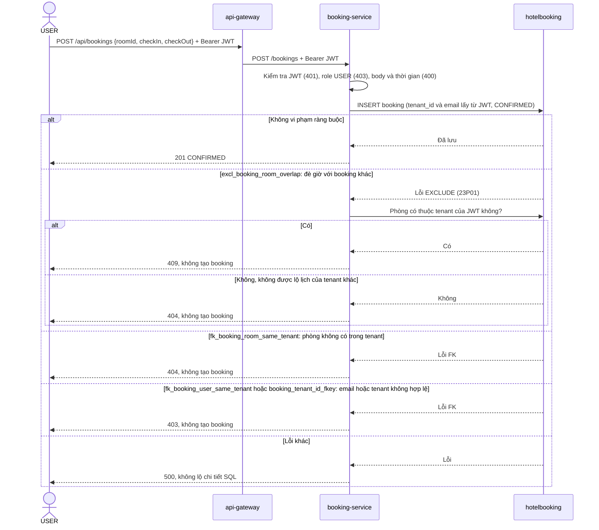
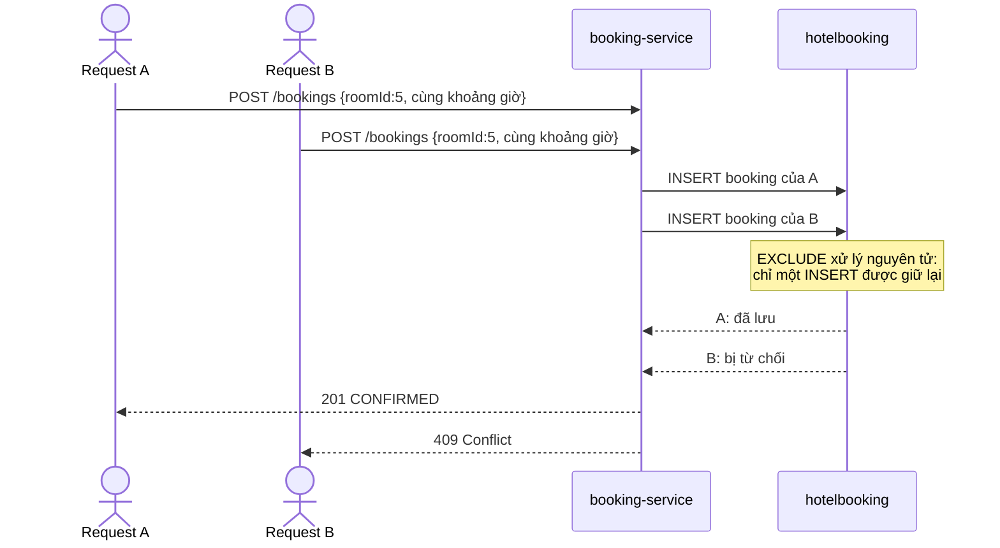
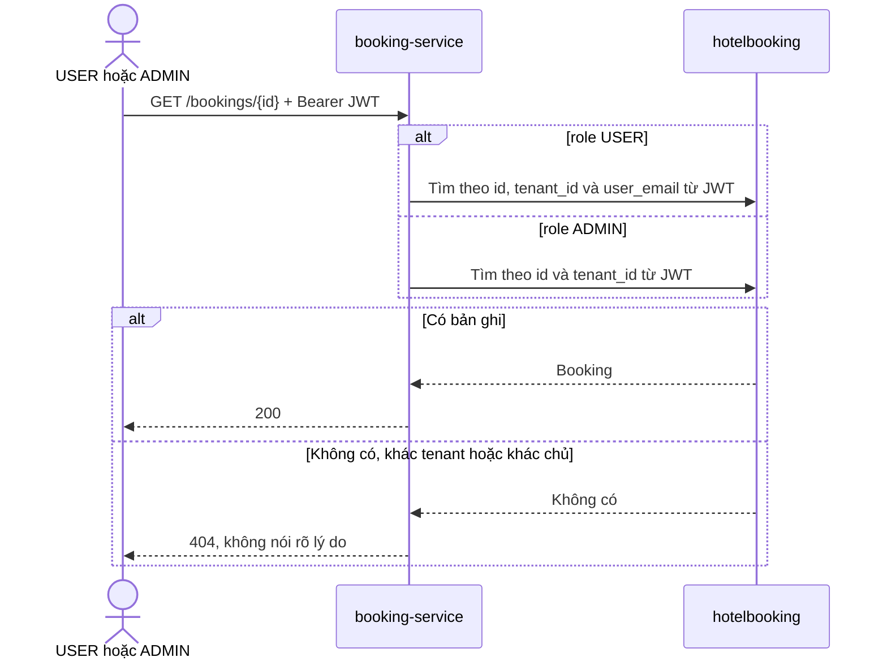

# Sequence diagram: Đặt phòng

Owner: Phúc (C). Bám theo [api-contract.md §5](api-contract.md), [erd-v2.md §3 và §4](erd-v2.md) và code trong `booking-service`.

Nét liền là yêu cầu, nét đứt là phản hồi. `hotelbooking` là database chung của cả hệ thống.

## Đặt phòng và các nhánh lỗi

## Hai request tranh một khoảng giờ

Trong sơ đồ, request A thắng. Khi chạy thật, bên nào cũng có thể thắng, nhưng kết quả luôn là một 201 và một 409.

## Xem booking

