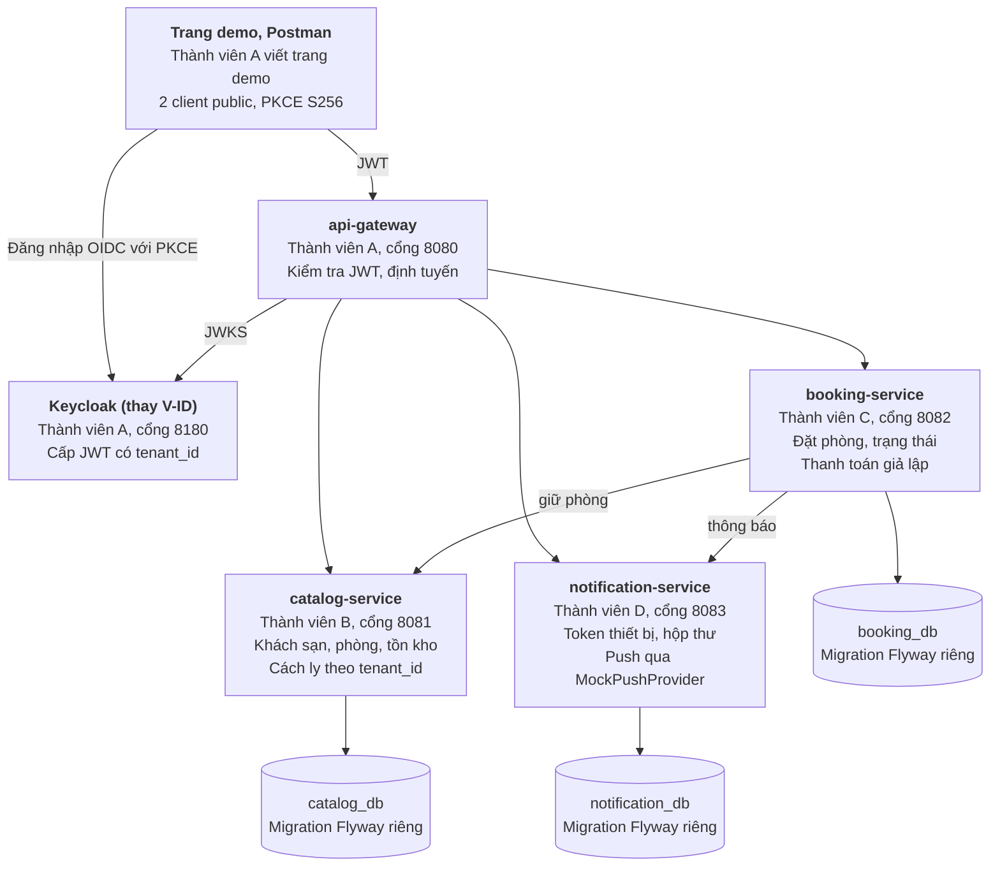
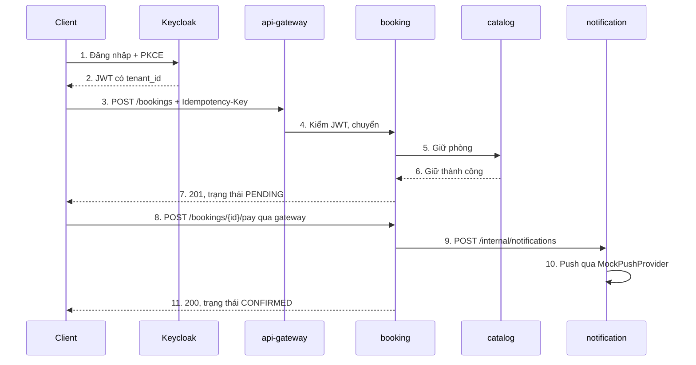

# Hotel Booking Demo: Phân công nhóm 4 người trong 3 ngày

Cập nhật: 2026-11-02

## Tóm tắt

Nhóm xây 4 microservice, mỗi người phụ trách trọn một service. Sau 3 ngày, nhóm demo một luồng liền mạch: đăng nhập SSO bằng PKCE, đặt phòng theo tenant, rồi nhận push notification.

Cả 4 người đều mới với Spring Boot và dùng AI để code. Vì vậy, bằng chứng chính không phải lượng code, mà là mỗi người giải thích được code của mình và trả lời được câu hỏi về mọi stack.

- **Làm thật:** Spring Boot, Gradle, Flyway, REST API, unit test, OIDC với PKCE, cách ly dữ liệu theo tenant, nghiệp vụ đặt phòng.
- **Giả lập:** Keycloak thay V-ID, thanh toán, và việc gửi push (không có app mobile).
- **Chưa code:** mua vé. Nhóm chỉ tìm hiểu nghiệp vụ, và code nếu còn dư thời gian.
- **Không làm:** Kubernetes, Kafka, service discovery, giao diện đầy đủ.

Rủi ro lớn nhất là chính microservices, vì 3 ngày không dư chỗ cho lỗi tích hợp. Nhóm giảm rủi ro bằng cách chốt API contract trước trưa Ngày 1 và cắt phạm vi theo thứ tự đã định sẵn ở phần Kế hoạch.

## Kiến trúc

Demo gồm `api-gateway` và 3 service nghiệp vụ, mỗi service nghiệp vụ có database riêng trên cùng một PostgreSQL. Các service gọi nhau bằng REST và chuyển tiếp JWT của người dùng.

Các quyết định sau được chốt sẵn để nhóm không mất thời gian tranh luận:

| Chủ đề | Quyết định | Lý do |
| --- | --- | --- |
| Repo | Monorepo, Gradle multi-project | Một lệnh build cả nhóm, dùng chung `buildSrc` có sẵn |
| Multi-tenant | Chung schema, cột `tenant_id`, Hibernate `@TenantId` | Đơn giản nhất với người mới, vẫn chứng minh được cách ly |
| Nguồn tenant | Claim `tenant_id` trong JWT | Client không tự khai tenant được |
| Keycloak | Một realm, thuộc tính người dùng map thành claim | Cấu hình ít, xuất realm ra file để cả nhóm dùng chung |
| Gọi giữa service | REST đồng bộ bằng `RestClient` | Dễ debug. Message broker chỉ là phần thêm |
| Lỗi API | `ProblemDetail` của Spring | Mọi service trả lỗi cùng một định dạng |
| Sequence diagram | Mermaid, lưu trong `docs/` | Xem được trên GitHub, sửa được như code |

## Luồng demo

Cả nhóm làm ngược từ luồng này: mọi việc trong bảng phân công đều phục vụ một bước của nó. Sơ đồ dưới đây cũng là bản nháp để nhóm học đọc sequence diagram trong buổi kickoff.

Nét liền là yêu cầu, nét đứt là phản hồi. Lỗi ở bước 9 hoặc 10 không làm hỏng booking đã thanh toán.

Kịch bản trình diễn đi theo thứ tự sau:

1. Khởi động hệ thống, mở bảng `flyway_schema_history` để thấy migration đã chạy.
2. Mở trang 1, đăng nhập bằng người dùng tenant 1, chỉ ra `code_challenge` trên DevTools.
3. Mở trang 2, thấy không phải nhập lại mật khẩu.
4. Tìm phòng, đặt phòng, thanh toán, rồi xem thông báo trong log và hộp thư.
5. Gửi lại cùng `Idempotency-Key`, thấy không có booking mới.
6. Hai người tranh phòng cuối cùng, thấy một người nhận 201 và một người nhận 409.
7. Đăng nhập bằng người dùng tenant 2, thấy không đọc được dữ liệu của tenant 1.
8. Chạy toàn bộ unit test bằng Gradle.

## Phân công

Mỗi người chủ trì một mảng khó và tự làm Flyway, REST, unit test, sequence diagram trong phần của mình. Nhờ vậy, ai cũng thực hành các stack nền tảng và không ai phải chờ người khác viết hộ. Nên giao vai A cho người chủ động nhất, vì cả nhóm phụ thuộc vào phần khung của A.

| Stack | Chủ trì | Bằng chứng trong demo |
| --- | --- | --- |
| Java 21, Spring Boot, Gradle | A | Một lệnh Gradle build được toàn bộ multi-project |
| Flyway | B | Mỗi database có lịch sử migration riêng, tự chạy khi khởi động |
| REST API | C | Mã lỗi đúng chuẩn, gửi lại yêu cầu không tạo trùng booking |
| Unit test | C | Test chuyển trạng thái và các lỗi nghiệp vụ |
| IAM, SSO, PKCE | A | Đăng nhập một lần cho 2 trang, xem được `code_challenge` trên DevTools |
| Multi-tenant | B | Người dùng tenant 1 không đọc được dữ liệu tenant 2 |
| Push notification | D | Thiết bị giả lập nhận thông báo, token lỗi bị xóa |
| Nghiệp vụ du lịch, khách sạn | C | Hai người tranh phòng cuối cùng, chỉ một người thành công |
| Sequence diagram | D | Mỗi người vẽ một sơ đồ, D gom vào `docs/` và kiểm tra khớp với code |

### Thành viên A: IAM và nền tảng (`api-gateway`)

- [ ] Chuyển repo thành Gradle multi-project: bỏ `app`, `list`, `utilities`, tạo 4 service và `common-security`.
- [ ] Chốt phiên bản Spring Boot, Spring Cloud trong `gradle/libs.versions.toml`.
- [ ] Viết Docker Compose cho PostgreSQL và Keycloak.
- [ ] Xuất realm Keycloak: 2 tenant, role `CUSTOMER` và `HOTEL_ADMIN`, claim `tenant_id`, 2 client public bật PKCE S256.
- [ ] Viết `common-security`: xác thực JWT, đưa `tenant_id` vào `TenantContext`, chuyển tiếp JWT khi service gọi nhau.
- [ ] Dựng `api-gateway`: định tuyến, kiểm tra JWT, không mở đường `/internal/**`.
- [ ] Làm 2 trang HTML nhỏ ở 2 cổng để demo SSO và PKCE.
- [ ] Viết migration dữ liệu mẫu trong `catalog-service`, khớp `tenant_id` với Keycloak.
- [ ] Viết test: không có token trả 401, JWT thiếu `tenant_id` bị từ chối.
- [ ] Vẽ sequence diagram: đăng nhập Authorization Code với PKCE.

### Thành viên B: Dữ liệu và multi-tenant (`catalog-service`)

- [ ] Viết Flyway V1 cho `hotel`, `room_type`, `room_inventory` (tồn kho theo ngày), bảng nào cũng có `tenant_id`.
- [ ] Viết quy ước đặt tên migration cho cả nhóm.
- [ ] Làm API `GET /hotels` và `GET /hotels/{id}/availability?checkIn&checkOut`.
- [ ] Làm API `POST /hotels` chỉ cho `HOTEL_ADMIN`, role khác nhận 403.
- [ ] Làm API nội bộ `POST /internal/inventory/hold` và `POST /internal/inventory/release`.
- [ ] Cài multi-tenant bằng Hibernate `@TenantId`, lấy tenant từ `TenantContext`.
- [ ] Chống đặt quá số phòng bằng câu `UPDATE` có điều kiện `available >= n`. Nếu dùng SQL native, phải tự thêm `tenant_id`.
- [ ] Viết test: cách ly giữa 2 tenant, giữ phòng thất bại khi hết phòng.
- [ ] Vẽ sequence diagram: từ JWT đến câu truy vấn có `tenant_id`.

### Thành viên C: Nghiệp vụ đặt phòng (`booking-service`)

- [ ] Viết Flyway V1 cho `booking`, ràng buộc duy nhất trên `tenant_id` và `idempotency_key`.
- [ ] Làm API `POST /bookings` (header `Idempotency-Key`), `GET /bookings/{id}`, `POST /bookings/{id}/pay`, `POST /bookings/{id}/cancel`.
- [ ] Cài trạng thái: `PENDING` sang `CONFIRMED` hoặc `CANCELLED`, `CONFIRMED` sang `CANCELLED`. Chuyển sai trả 409.
- [ ] Tính tiền theo số đêm và lưu lại giá tại thời điểm đặt.
- [ ] Gọi `catalog-service` để giữ phòng, trả phòng khi hủy hoặc khi lưu booking thất bại.
- [ ] Gọi `notification-service` sau khi xác nhận. Gửi thông báo lỗi thì booking vẫn thành công.
- [ ] Viết test: chuyển trạng thái, không tạo trùng, lỗi giữ phòng (mock client gọi `catalog-service`).
- [ ] Viết ghi chú nghiệp vụ một trang: giữ chỗ, chính sách hủy, no-show, hoàn tiền, và mua vé khác đặt phòng ở đâu.
- [ ] Vẽ sequence diagram: luồng đặt phòng, gồm cả nhánh hết phòng.

### Thành viên D: Thông báo và kịch bản demo (`notification-service`)

- [ ] Viết Flyway V1 cho `device_token` và `notification`.
- [ ] Làm API `POST /devices`, `DELETE /devices/{token}`, `GET /notifications`, `POST /internal/notifications`.
- [ ] Tạo interface `PushProvider` và `MockPushProvider`. Chỉ làm FCM thật nếu còn dư thời gian.
- [ ] Cài trạng thái `PENDING`, `SENT`, `FAILED`: thử lại tối đa 3 lần, token lỗi thì xóa, không có token thì chỉ lưu vào hộp thư.
- [ ] Viết test: xóa token lỗi, thử lại, người dùng không có thiết bị.
- [ ] Tìm hiểu chuỗi thật: app lấy token từ FCM hoặc APNs, gửi cho backend, backend gọi FCM, FCM gửi xuống máy.
- [ ] Vẽ sequence diagram: luồng thật và phần nhóm đang giả lập.
- [ ] Viết `docs/demo.http` chạy toàn bộ kịch bản demo, và gom sequence diagram của cả nhóm.

## Kế hoạch 3 ngày

Ngày 1 dựng khung, Ngày 2 chạy được luồng chính, Ngày 3 không thêm tính năng mới. Nếu cuối ngày chưa đạt mốc, nhóm cắt phạm vi ngay thay vì làm thêm giờ để đuổi.

| | Ngày 1: Dựng khung | Ngày 2: Ghép nghiệp vụ | Ngày 3: Kiểm chứng |
| --- | --- | --- | --- |
| **Cả nhóm** | Kickoff 1 giờ, đọc luồng demo. Chốt API contract trước trưa | Họp nhanh đầu và cuối ngày. Đổi contract phải báo cả nhóm | Sáng: sửa lỗi, đóng băng code. Chiều: hỏi chéo, tập demo |
| **A (IAM)** | Khung Gradle, Docker Compose. Keycloak realm, 2 tenant. `common-security` | `api-gateway`, chuyển tiếp JWT. Trang demo SSO và PKCE | Test 401, thiếu `tenant_id`. Sơ đồ đăng nhập PKCE |
| **B (Tenant)** | Flyway V1, quy ước migration. API đọc khách sạn | `@TenantId`, tìm phòng trống. Giữ và trả phòng | Test cách ly tenant. Sơ đồ từ JWT đến truy vấn |
| **C (Booking)** | Flyway V1. API booking, stub catalog | Trạng thái, idempotency. Gọi catalog, notification | Test trạng thái, chống trùng. Sơ đồ đặt phòng |
| **D (Push)** | Flyway V1. API đăng ký thiết bị | `MockPushProvider`, hộp thư. Nhận yêu cầu từ booking | Test token lỗi, thử lại. Sơ đồ push, kịch bản demo |
| **Mốc cuối ngày** | **4 service khởi động được. Đăng nhập lấy được JWT** | **Đặt phòng chạy hết luồng qua gateway, đúng tenant** | **Demo chạy trọn kịch bản. Ai cũng trả lời được câu hỏi** |

Hai điểm phụ thuộc vào A cần theo dõi sát:

- **Khung Gradle, trước trưa Ngày 1:** trong lúc chờ, B, C, D tìm hiểu stack và cùng viết API contract.
- **`common-security`, cuối Ngày 1:** trong lúc chờ, B, C, D dùng một tenant cố định trong stub.

Khi trễ, nhóm cắt theo thứ tự sau:

1. Cơ chế thử lại khi gửi push, vẫn giữ trạng thái `SENT` và `FAILED`.
2. API hủy booking và trả phòng.
3. `POST /hotels`, thay bằng dữ liệu mẫu từ Flyway.
4. `api-gateway`, client gọi thẳng service và mỗi service vẫn tự kiểm tra JWT.

Không cắt PKCE, cách ly tenant, Flyway, unit test và sequence diagram, vì đó là các stack nhóm phải chứng minh. Nếu dư thời gian, nhóm làm thêm theo thứ tự: tự hết hạn giữ chỗ, mua vé, FCM thật, RabbitMQ.

## Dùng AI và chứng minh hiểu bài

AI được viết code, nhưng tác giả pull request phải giải thích được từng file đã gửi. Không giải thích được thì chưa merge.

- **Nêu phiên bản khi hỏi AI:** AI có thể sinh code cho Spring Boot cũ. Khi code lỗi, đối chiếu tài liệu chính thức của đúng phiên bản đã chốt.
- **Review chéo:** mỗi pull request có một người khác đọc và hỏi lại trước khi merge.
- **Không sửa migration đã merge:** muốn đổi thì thêm version mới.
- **Không sửa test cho qua:** test sai thì phải nêu được lý do nó sai.
- **Không commit bí mật:** mật khẩu thật và khóa FCM không được vào repo.

Chiều Ngày 3, cả nhóm hỏi chéo bằng bảng dưới đây. Người trả lời phải là người không chủ trì stack đó, và không hỏi AI.

| Stack | Câu hỏi kiểm tra |
| --- | --- |
| Spring Boot, Gradle | Bean được tạo và inject thế nào? `buildSrc` và `libs.versions.toml` giải quyết việc gì? |
| Flyway | Vì sao không sửa migration đã chạy? Sai checksum thì chuyện gì xảy ra? |
| REST API | Khi nào trả 201, 401, 403, 409? `Idempotency-Key` chống lỗi gì? |
| Unit test | Nên mock cái gì? Test này sẽ bắt được lỗi nào? |
| IAM, SSO | Xác thực khác phân quyền ở đâu? Vì sao trang thứ hai không hỏi lại mật khẩu? |
| PKCE | `code_verifier` và `code_challenge` chống kiểu tấn công nào? Vì sao client public cần PKCE? |
| Multi-tenant | Vì sao lấy tenant từ JWT, không lấy từ header do client gửi? SQL native gây rủi ro gì? |
| Push notification | Vì sao backend không gửi thẳng đến điện thoại? Token hết hạn thì xử lý thế nào? |
| Nghiệp vụ | Hai người tranh phòng cuối cùng thì sao? Mua vé khác đặt phòng ở điểm nào? |
| Sequence diagram | Mũi tên nét liền và nét đứt khác gì? Vẽ lại luồng đặt phòng mà không nhìn tài liệu. |

## Việc cần chốt ở buổi kickoff

- [ ] Gán 4 người vào vai A, B, C, D.
- [ ] Chốt phiên bản Spring Boot ổn định mới nhất từ start.spring.io. Repo đang dùng Java 21 và Gradle 9.8.2, nên giữ nguyên hai phiên bản này.
- [ ] Hỏi người giao việc: dùng Keycloak thay V-ID có được chấp nhận không, và V-ID có theo chuẩn OIDC không?
- [ ] Hỏi người giao việc: mua vé có bắt buộc phải code không?
- [ ] Kiểm tra máy mỗi người chạy được JDK 21 và Docker.
- [ ] Chốt quy tắc Git: mỗi việc một nhánh, merge vào `main` qua pull request.
